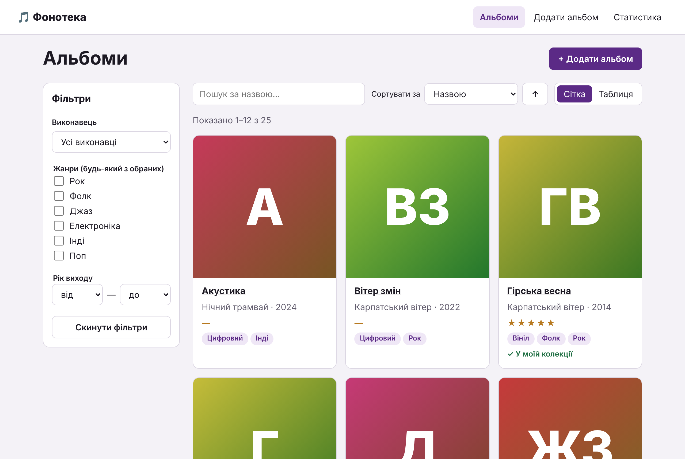
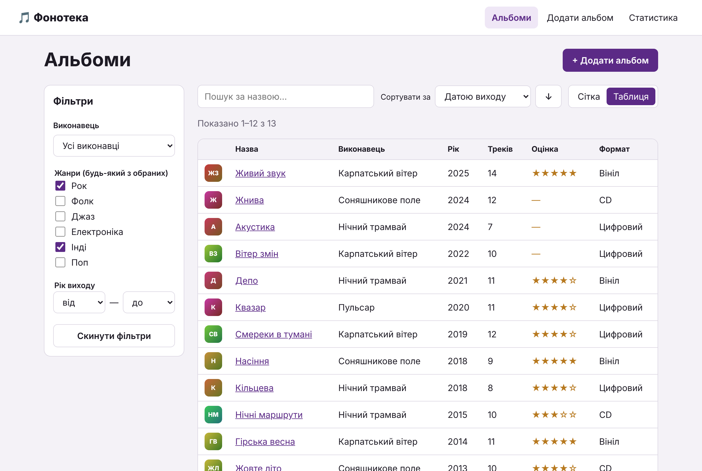
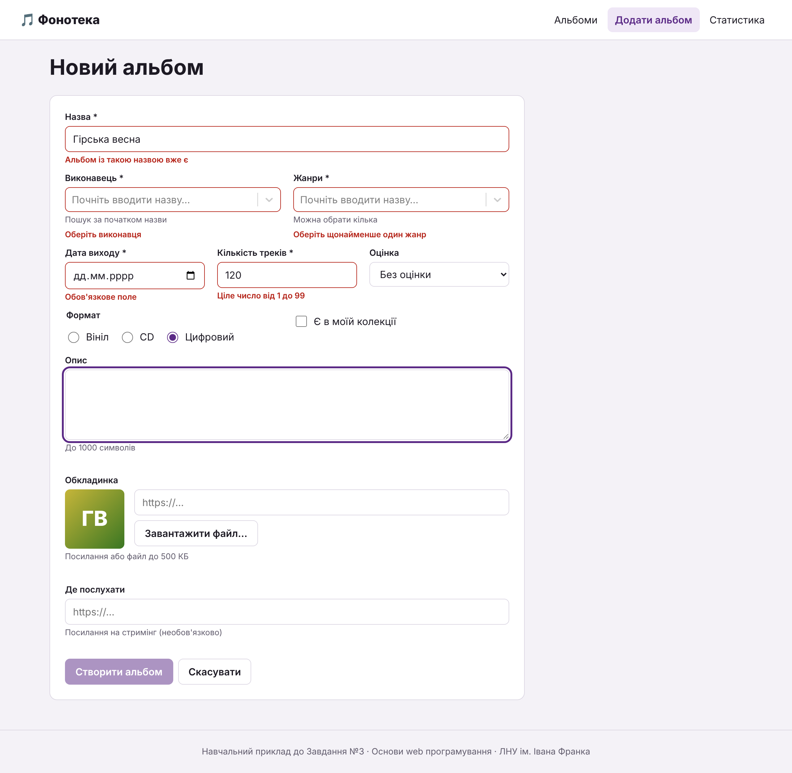
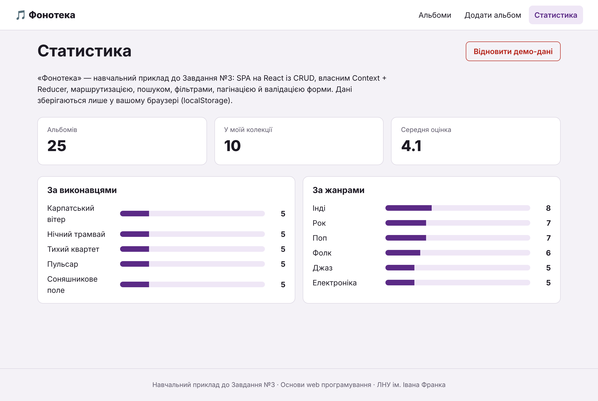
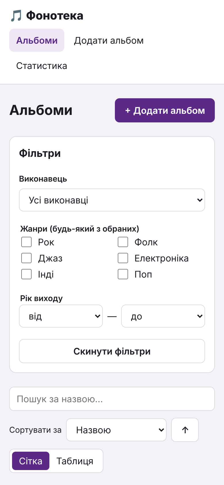

# Завдання №3 крок за кроком: SPA «Фонотека» на React

> **Курс:** Основи web програмування · ЛНУ ім. Івана Франка · ФПМІ
> **Завдання:** №3. SPA на React.js із CRUD та власним Context (30 балів)
> **Інструменти:** WebStorm 2026.2, Node.js 24 LTS, Vite 8, React 19, React Router 8, react-select 5
> **Обсяг:** близько 8–10 годин роботи, якщо виконувати всі кроки й експерименти

Цей посібник — повний робочий приклад Завдання №3. Крок за кроком ви
створите застосунок **«Фонотека»** — каталог музичних альбомів, який виконує
**всі** вимоги завдання: CRUD, власний Context + Reducer, маршрутизацію,
пошук, фільтри, сортування й пагінацію з параметрами в адресі, форму з
валідацією, роботу із зображенням і збереження в `localStorage`.

Посібник **самодостатній**: перед кожним кроком є теорія, потрібна саме для
нього, — що це, навіщо й **чому зроблено саме так, а не інакше**. Лекції
допоможуть глибше, але щоб виконати приклад і зрозуміти його, вони не
обов'язкові.

> ⚠️ **Тему «Музичні альбоми» для свого завдання брати не можна** — вона
> зайнята цим прикладом. Мета посібника — щоб ви зрозуміли кожне рішення і
> потім **так само** реалізували застосунок для власної предметної області.
> Як саме перенести приклад на свої сутності — у розділі 13.

---

## Як працювати з посібником

1. **Читайте теорію перед кодом.** Блоки «📚 Теорія» пояснюють поняття, які
   зустрінуться в коді кроку. Блоки «🤔 Чому так» — чому обрано саме таке
   рішення і які в нього альтернативи.
2. **Код кожного кроку — повний вміст файлу.** Його можна скопіювати цілком.
   Файли з позначкою «тимчасова версія» пізніше буде замінено повністю.
   Але не просто копіюйте: **читайте коментарі в коді** — вони теж частина
   пояснення.
3. **✅ Контрольна точка** після кроку — що ви маєте побачити в браузері.
   Бачите інше — не йдіть далі, спершу знайдіть розбіжність.
4. **🧪 Експерименти** — навмисні поломки, щоб побачити, навіщо потрібне те
   чи інше рішення. **Після кожного експерименту поверніть код як було**
   (`⌘Z` / `Ctrl+Z` або **Local History** у WebStorm).
5. **🤔 Перевір себе** — питання для самоперевірки. Спершу дайте відповідь
   самі, потім читайте відповідь у дужках. Схожі питання ставитимуть на
   захисті.
6. Тримайте відкритою **консоль браузера** (`⌥⌘I` / `F12` → **Console**):
   у ній з'являються помилки й попередження. Вимога завдання — щоб їх **не
   було**.

---

## Зміст

0. [Огляд: що й як ми будуємо](#0-огляд-що-й-як-ми-будуємо)
1. [Створення проєкту](#1-створення-проєкту)
2. [Прибираємо шаблон і глобальні стилі](#2-прибираємо-шаблон-і-глобальні-стилі)
3. [Дані та зв'язки між сутностями](#3-дані-та-звязки-між-сутностями)
4. [Редюсер: усі зміни даних в одному місці](#4-редюсер-усі-зміни-даних-в-одному-місці)
5. [Context: дані для всього застосунку](#5-context-дані-для-всього-застосунку)
6. [Маршрутизація й спільний макет](#6-маршрутизація-й-спільний-макет)
7. [Список альбомів: картки, таблиця, власний хук](#7-список-альбомів-картки-таблиця-власний-хук)
8. [Пошук, фільтри, сортування й пагінація в адресі](#8-пошук-фільтри-сортування-й-пагінація-в-адресі)
9. [Сторінка деталей і видалення](#9-сторінка-деталей-і-видалення)
10. [Форма створення й редагування з валідацією](#10-форма-створення-й-редагування-з-валідацією)
11. [Статистика й відновлення даних](#11-статистика-й-відновлення-даних)
12. [Фінальна перевірка](#12-фінальна-перевірка)
13. [Як зробити свій застосунок за цим прикладом](#13-як-зробити-свій-застосунок-за-цим-прикладом)
14. [Типові помилки](#14-типові-помилки)
15. [Питання для самоперевірки й захисту](#15-питання-для-самоперевірки-й-захисту)
16. [Корисні посилання](#16-корисні-посилання)

---

## 0. Огляд: що й як ми будуємо



| Таблиця з фільтрами | Сторінка альбому |
|---|---|
|  |  |

| Форма з помилками | Статистика | Телефон |
|---|---|---|
|  |  |  |

### 0.1. Предметна область

Завдання вимагає **одну головну сутність** і **дві довідникові**, пов'язані
з нею зв'язками «багато-до-одного» та «багато-до-багатьох».

| Роль | Сутність | Зв'язок | Як зберігається |
|---|---|---|---|
| Головна | **Альбом** | — | масив об'єктів, CRUD |
| Довідник 1 | **Виконавець** | **багато-до-одного**: в альбому рівно один виконавець, у виконавця — багато альбомів | поле `artistId` в альбомі |
| Довідник 2 | **Жанр** | **багато-до-багатьох**: в альбому кілька жанрів, один жанр — у багатьох альбомах | поле-масив `genreIds` в альбомі |

**Поля альбому** — щонайменше 10, різних типів, як вимагає завдання:

| Поле | Тип за вимогами завдання | Елемент форми |
|---|---|---|
| `title` | текстове коротке | `<input type="text">` |
| `description` | текстове довге (опис) | `<textarea>` |
| `trackCount` | числове | `<input type="number">` |
| `releaseDate` | дата | `<input type="date">` |
| `inCollection` | логічне | `<input type="checkbox">` |
| `coverUrl` | посилання на зображення | посилання або файл з диска |
| `artistId` | зв'язок «багато-до-одного» | select із пошуком (react-select) |
| `genreIds` | зв'язок «багато-до-багатьох» | select із пошуком, мультивибір |
| `format` | значення з фіксованого набору (enum) | група `radio` |
| `rating` | ще одне на вибір | звичайний `<select>` |
| `listenUrl` | ще одне на вибір (перевірка формату URL) | `<input type="url">` |

Плюс службові `id`, `createdAt`, `updatedAt`.

### 0.2. Маршрути

| Адреса | Сторінка | Що там |
|---|---|---|
| `/` | — | перенаправлення на `/albums` |
| `/albums` | `AlbumsPage` | список: сітка/таблиця, пошук, фільтри, сортування, сторінки |
| `/albums/new` | `AlbumFormPage` | створення |
| `/albums/:albumId` | `AlbumDetailsPage` | деталі, видалення |
| `/albums/:albumId/edit` | `AlbumFormPage` | редагування (та сама форма) |
| `/stats` | `StatsPage` | статистика й «Про застосунок» |
| будь-яка інша | `NotFoundPage` | 404 |

Приклад адреси зі станом списку:
`/albums?q=ніч&genres=g1&genres=g5&sort=rating&order=desc` — пошук «ніч»,
жанри «Рок» або «Інді», сортування за оцінкою за спаданням. Таке посилання можна надіслати, і отримувач побачить те саме.

### 0.3. Де живе стан — найважливіше архітектурне рішення

У застосунку три різні **види стану**, і в кожного своє місце:

```
┌──────────────────────────── DataProvider (useReducer + Context) ─────────────┐
│  ДАНІ: items (альбоми), artists, genres                                      │
│  змінюються діями ITEMS_LOADED, ITEM_CREATED, ITEM_UPDATED, ITEM_DELETED     │
│  зберігаються в localStorage                                                 │
└──────────────────────────────────────────────────────────────────────────────┘
┌──────────────────────────── Адреса сторінки (URL) ───────────────────────────┐
│  ПАРАМЕТРИ СПИСКУ: пошук, фільтри, сортування, сторінка, розмір сторінки     │
│  змінюються діями SEARCH_CHANGED, FILTER_CHANGED, SORT_CHANGED,              │
│  PAGE_CHANGED, PAGE_SIZE_CHANGED, FILTERS_RESET (через listQueryReducer)     │
└──────────────────────────────────────────────────────────────────────────────┘
┌──────────────────────────── Компоненти (useState) ───────────────────────────┐
│  ЛОКАЛЬНИЙ СТАН ІНТЕРФЕЙСУ: значення й помилки форми, відкрите модальне      │
│  вікно; вигляд «сітка/таблиця» (useLocalStorage)                             │
└──────────────────────────────────────────────────────────────────────────────┘
```

**Чому параметри списку не в `DataProvider`?** Завдання вимагає двох речей
одночасно: дій `SEARCH_CHANGED`, `PAGE_CHANGED` тощо **і** щоб пошук,
фільтри, сортування й сторінка були в адресі. Якщо тримати їх і в стані
провайдера, і в адресі, з'являються **дві копії** того самого, які треба
синхронізувати в обидва боки: користувач натиснув «Назад» — онови стан;
змінився стан — онови адресу. Це класичне джерело багів.

Тому в нас **одне джерело правди — адреса**. А редюсер `listQueryReducer`
описує, **як** параметри змінюються від кожної дії (наприклад, «новий пошук
повертає на першу сторінку»). Результат редюсера записується в адресу.
Тобто дії, творці дій і чистий редюсер є, як вимагає завдання, але копії
стану немає. Детально — у кроці 8.

### 0.4. Дерево компонентів

```
StrictMode
└── BrowserRouter
    └── DataProvider                    ← дані + dispatch
        └── App (Routes)
            └── Layout                  ← шапка, NavLink, <Outlet />, підвал
                ├── AlbumsPage          ← useListQuery, useDebounce, useLocalStorage
                │   ├── AlbumFilters
                │   ├── SearchBox · SortControl · ViewToggle
                │   ├── AlbumCard × N  або  AlbumTable
                │   │   └── CoverImage
                │   └── Pagination
                ├── AlbumDetailsPage
                │   ├── CoverImage
                │   └── ConfirmDialog
                ├── AlbumFormPage
                │   └── AlbumForm       ← useAlbumForm
                │       ├── Field × N
                │       ├── SearchSelect × 2   (react-select)
                │       ├── FormatRadioGroup
                │       ├── ImageField → CoverImage
                │       └── ConfirmDialog
                ├── StatsPage
                │   ├── StatsBars × 2
                │   └── ConfirmDialog
                └── NotFoundPage
```

### 0.5. Структура проєкту

```
music-catalog/
├── index.html
├── package.json
└── src/
    ├── main.jsx                    ← точка входу: провайдери
    ├── App.jsx                     ← маршрути
    ├── index.css                   ← глобальні стилі
    ├── data/seed.js                ← початкові дані
    ├── store/                      ← «мозок»: дії й редюсери (без React)
    │   ├── actionTypes.js
    │   ├── actions.js
    │   ├── dataReducer.js
    │   └── listQueryReducer.js
    ├── context/                    ← Context і провайдер
    ├── hooks/                      ← власні хуки
    ├── utils/                      ← чисті функції: фільтрація, валідація, формати
    ├── components/                 ← спільні компоненти (не знають про альбоми)
    ├── features/albums/            ← компоненти, що знають про альбоми
    ├── features/stats/
    └── pages/                      ← сторінки: по одній на маршрут
```

**Чому так:** кожна папка відповідає на одне питання. «Де змінюються
дані?» — `store/`. «Як перевіряється форма?» — `utils/albumValidation.js`.
«Що показує сторінка?» — `pages/`. Компоненти з `components/` можна
перенести в будь-який інший проєкт: вони нічого не знають про альбоми.

### 0.6. Вимоги завдання → де вони в прикладі

| Критерій (бали) | Де реалізовано | Крок |
|---|---|---|
| Список (сітка / таблиця), деталі `/albums/:id`, «не знайдено» (2) | `AlbumsPage`, `AlbumCard`, `AlbumTable`, `AlbumDetailsPage`, `NotFoundPage` | 7, 9 |
| Створення й редагування однією формою (2) | `AlbumForm`, `AlbumFormPage` | 10 |
| Видалення з підтвердженням у модальному вікні (1) | `ConfirmDialog`, `AlbumDetailsPage` | 9 |
| `DataContext`, `DataProvider`, чистий reducer (2) | `context/`, `store/dataReducer.js` | 4, 5 |
| Усі дії, типи в окремому файлі, action creators (2) | `store/actionTypes.js`, `store/actions.js` | 4, 8 |
| Хук `useData()` з помилкою поза провайдером (1) | `context/DataContext.js` | 5 |
| Пошук із debounce, без регістру, кнопка очищення (1) | `SearchBox`, `useDebounce`, `utils/albumQuery.js` | 8 |
| Фільтри за обома зв'язками й діапазоном (1) | `AlbumFilters` | 8 |
| Сортування за 3+ полями в обох напрямках (1) | `SortControl` (4 поля) | 8 |
| Пагінація: розмір, номери, «показано X–Y з Z» (1) | `Pagination`, `AlbumsPage` | 8 |
| Стан у URL, порожній стан зі скиданням (1) | `useListQuery`, `utils/listQuery.js` | 8 |
| Усі типи полів, select із пошуком (2) | `AlbumForm`, `SearchSelect` | 10 |
| Валідація 5+ полів власною реалізацією (2) | `utils/albumValidation.js` (8 полів) | 10 |
| UX помилок: blur/відправка, блокування кнопки, фокус, захист від втрати (1) | `useAlbumForm`, `AlbumForm`, `useUnsavedChangesWarning` | 10 |
| Маршрути, макет із `NavLink`, 404, програмна навігація (2) | `App`, `Layout`, `AlbumFormPage` | 6, 10 |
| Зображення: файл або посилання, перегляд, перевірка, заглушка (2) | `ImageField`, `CoverImage` | 7, 10 |
| Власні хуки, `useMemo`, коректні `useEffect` (2) | `useLocalStorage`, `useDebounce`, `useListQuery`, `useAlbumForm`, `useUnsavedChangesWarning` | 7, 8, 10 |
| Якість коду (1) | вся структура | — |
| Оригінальність теми й дизайну (3) | **ваша** тема і **ваш** дизайн | 13 |

---

## 1. Створення проєкту

**Орієнтовно 15 хвилин.**

### 📚 Теорія: SPA, Vite і npm

**SPA (Single Page Application)** — застосунок з **однієї** HTML-сторінки.
Браузер завантажує її один раз, а далі JavaScript сам перемальовує
інтерфейс і змінює адресу в рядку браузера без перезавантаження. Завдяки
цьому переходи миттєві, а стан (наприклад, дані у пам'яті) не губиться.

**React** — бібліотека для побудови інтерфейсу з **компонентів**: функцій,
що отримують дані (props) і повертають розмітку (JSX). Коли дані
змінюються, React сам вирішує, що саме оновити на сторінці.

**Vite** — інструмент збірки: запускає сервер розробки з миттєвим
оновленням (HMR) і збирає оптимізовану версію для публікації. Create React
App, про який можна прочитати в старих посібниках, офіційно застарів.

**npm** — менеджер пакетів Node.js. `package.json` — список залежностей і
скриптів проєкту; `node_modules/` — встановлені пакети (не редагуємо й не
додаємо в git).

### 1.1. Node.js

Потрібен Node.js **22.22 або новіший** (цього вимагає React Router 8).
Перевірте в терміналі:

```bash
node -v    # v24.x.x — рекомендовано
```

### 1.2. Новий проєкт у WebStorm

1. **File | New | Project…** → у лівій панелі **Vite**.
2. **Location** — `…/music-catalog`, **Template** — `react`, прапорець
   TypeScript **не ставте**.
3. **Create**. WebStorm сам виконає `npm install`.

Або в терміналі:

```bash
npm create vite@latest music-catalog -- --template react
cd music-catalog
npm install
```

### 1.3. Дві бібліотеки

Відкрийте термінал WebStorm (**View | Tool Windows | Terminal**,
`⌥F12` / `Alt+F12`):

```bash
npm install react-router react-select
```

- **`react-router`** — маршрутизація (версія 8). Старий пакет
  `react-router-dom` більше не потрібен: усе імпортуємо з `react-router`.
- **`react-select`** — select із пошуком. Це **єдина** стороння бібліотека
  інтерфейсу, яку дозволяє завдання. Менеджери стану (Redux, Zustand…),
  бібліотеки форм (React Hook Form, Formik) і UI-кіти (MUI, Ant Design…)
  **заборонені**: усе робимо самі.

### 1.4. Лінтер

Шаблон Vite уже містить **лінтер Oxlint** (файл `.oxlintrc.json`, команда
`npm run lint`) з правилами для React. Лінтер знаходить помилки ще до
запуску: порушення правил хуків, неповні залежності ефектів тощо.
Запускайте `npm run lint` після кожного кроку — він не має виводити
жодного зауваження.

### 1.5. Запуск

Run widget угорі вікна → **npm dev** → ▶ (або `npm run dev` у терміналі).
Відкрийте адресу з вікна **Run** — зазвичай `http://localhost:5173/`.

#### ✅ Контрольна точка

Стартова сторінка Vite з кнопкою **Count is 0**. У `package.json` серед
`dependencies` є `react`, `react-dom`, `react-router` і `react-select`.

---

## 2. Прибираємо шаблон і глобальні стилі

**Орієнтовно 15 хвилин.**

### 📚 Теорія: глобальні стилі й CSS Modules

Завдання дозволяє **CSS Modules** або звичайний CSS із BEM. Ми використовуємо
обидва підходи, кожен для свого:

- **`index.css`** — глобальні стилі: кольори в CSS-змінних, скидання стилів
  браузера й кілька спільних класів (`.button`, `.input`, `.page-header`),
  які потрібні багатьом компонентам.
- **`*.module.css`** поруч із компонентом — його власні стилі. Vite
  перетворює класи на унікальні імена (`.card` → `._card_x7f2a`), тож класи
  різних компонентів не конфліктують, навіть якщо називаються однаково.
  У JSX: `import styles from './AlbumCard.module.css'` і
  `className={styles.card}`.

**CSS-змінні** (`--color-accent`) задаються один раз у `:root` і
використовуються всюди: `color: var(--color-accent)`. Хочете змінити
кольорову гаму — змінюєте одне місце.

### 2.1. Видаліть зайве

`src/App.css`, папку `src/assets`, `public/icons.svg`.

### 2.2. `index.html`

📄 **`index.html`**

```html
<!doctype html>
<html lang="uk">
  <head>
    <meta charset="UTF-8" />
    <link rel="icon" type="image/svg+xml" href="/favicon.svg" />
    <meta name="viewport" content="width=device-width, initial-scale=1.0" />
    <title>Фонотека</title>
  </head>
  <body>
    <div id="root"></div>
    <script type="module" src="/src/main.jsx"></script>
  </body>
</html>
```

### 2.3. Глобальні стилі

Повністю замініть вміст `src/index.css`:

📄 **`src/index.css`**

```css
/* ==========================================================================
   Глобальні стилі: кольори (CSS-змінні), скидання, типографіка й спільні
   класи (.button, .input, .page-header…). Стилі компонентів — у *.module.css.
   ========================================================================== */

:root {
  --color-bg: #f4f2f7;
  --color-surface: #ffffff;
  --color-text: #1d1a24;
  --color-muted: #625d6e;
  --color-border: #dcd7e3;
  --color-accent: #5b2a86;
  --color-accent-hover: #47206a;
  --color-accent-soft: #efe7f6;
  --color-danger: #b42318;
  --color-danger-soft: #fdecea;
  --radius: 0.75rem; /* 12px */

  font-family: system-ui, sans-serif;
  line-height: 1.5;
  color: var(--color-text);
  background: var(--color-bg);
}

*,
*::before,
*::after {
  box-sizing: border-box;
}

body,
h1,
h2,
h3,
p,
ul,
dl,
dd,
figure,
fieldset {
  margin: 0;
}

ul {
  padding: 0;
  list-style: none;
}

fieldset {
  padding: 0;
  border: 0;
}

button,
input,
select,
textarea {
  font: inherit;
}

a {
  color: var(--color-accent);
}

:focus-visible {
  outline: 3px solid var(--color-accent);
  outline-offset: 2px;
}

/* --- Кнопки ----------------------------------------------------------------- */

.button {
  display: inline-flex;
  align-items: center;
  justify-content: center;
  gap: 0.375rem;
  min-height: 2.5rem; /* 40px */
  padding: 0.5rem 1rem;
  border: 1px solid transparent;
  border-radius: 0.5rem;
  background: var(--color-accent);
  color: #ffffff;
  font-weight: 600;
  text-decoration: none;
  cursor: pointer;
}

.button:hover {
  background: var(--color-accent-hover);
}

.button:disabled {
  opacity: 0.5;
  cursor: not-allowed;
}

.button--secondary {
  background: var(--color-surface);
  border-color: var(--color-border);
  color: var(--color-text);
}

.button--secondary:hover {
  background: var(--color-surface);
  border-color: var(--color-accent);
}

.button--danger {
  background: transparent;
  border-color: var(--color-danger);
  color: var(--color-danger);
}

.button--danger:hover {
  background: var(--color-danger-soft);
}

/* --- Поля введення ----------------------------------------------------------- */

.input {
  width: 100%;
  min-height: 2.5rem;
  padding: 0.5rem 0.75rem;
  border: 1px solid var(--color-border);
  border-radius: 0.5rem;
  background: var(--color-surface);
  color: inherit;
}

/* Поле з помилкою: стан беремо з атрибута, який чує й читач екрана */
.input[aria-invalid='true'] {
  border-color: var(--color-danger);
}

/* --- Розмітка сторінки -------------------------------------------------------- */

.page-header {
  display: flex;
  flex-wrap: wrap;
  align-items: center;
  justify-content: space-between;
  gap: 1rem;
  margin-bottom: 1.5rem;
}

.page-title {
  font-size: clamp(1.5rem, 1.2rem + 1.2vw, 2.25rem); /* 24px … 36px */
  line-height: 1.2;
}

.muted {
  color: var(--color-muted);
}

.actions {
  display: flex;
  flex-wrap: wrap;
  gap: 0.5rem;
}

/* Маленька «пігулка» — жанр, формат */
.chip {
  display: inline-block;
  padding: 0.125rem 0.625rem;
  border-radius: 999px;
  background: var(--color-accent-soft);
  color: var(--color-accent);
  font-size: 0.8125rem; /* 13px */
  font-weight: 600;
  text-decoration: none;
}

/* Текст лише для читачів екрана */
.visually-hidden {
  position: absolute;
  width: 1px;
  height: 1px;
  overflow: hidden;
  clip-path: inset(50%);
  white-space: nowrap;
}

/* Вертикальна «стопка» з проміжками */
.stack {
  display: grid;
  gap: 1rem;
  justify-items: start;
}
```

Зверніть увагу на `.input[aria-invalid='true']`: поле з помилкою
підсвічується за **ARIA-атрибутом**, який водночас повідомляє читачу
екрана, що поле недійсне. Один атрибут — і для доступності, і для стилю.

### 2.4. Тимчасовий `App.jsx`

📄 **`src/App.jsx`** — тимчасова версія

```jsx
function App() {
  return <h1>Фонотека</h1>;
}

export default App;
```

`src/main.jsx` поки не змінюйте.

#### ✅ Контрольна точка

Заголовок **Фонотека** на світло-бузковому тлі, вкладка браузера має назву
«Фонотека», у консолі — жодних помилок.

---

## 3. Дані та зв'язки між сутностями

**Орієнтовно 20 хвилин.**

### 📚 Теорія: як зберігати зв'язки

Як записати, що альбом «Гірська весна» належить гурту «Карпатський вітер»
і має жанри «Фолк» і «Рок»? Можна вкласти дані прямо в альбом:

```js
// ❌ Вкладені копії
{ title: 'Гірська весна', artist: { name: 'Карпатський вітер' }, genres: ['Фолк', 'Рок'] }
```

Але тоді назва гурту повторюється в кожному його альбомі. Перейменуєте
гурт — треба оновити всі копії, а пропущена копія означає розбіжність.

Тому довідники зберігаємо **окремо**, а в альбомі — лише **ідентифікатори**:

```js
// ✅ Посилання за id
{ title: 'Гірська весна', artistId: 'ar1', genreIds: ['g2', 'g1'] }
```

- **Багато-до-одного** — одне поле з одним `id` (`artistId`).
- **Багато-до-багатьох** — поле-масив `id` (`genreIds`).

Так само це робиться в реляційних базах даних (Завдання №4): зовнішній
ключ `artist_id` у таблиці альбомів і окрема таблиця зв'язків
`album_genres`. Модель даних, яку ви зараз спроєктуєте, без змін перейде
на сервер.

**Чому `id` — рядки** (`'a01'`, `'ar1'`)? Параметри адреси завжди рядки:
з `/albums/a01` ми отримаємо `'a01'`. Однаковий тип дозволяє порівнювати
`===` без перетворень. Нові альбоми отримають `id` від
`crypto.randomUUID()` — теж рядок.

**Чому дата — рядок `'2014-04-18'`?** Це формат ISO 8601: саме його
повертає й приймає `<input type="date">`, він однозначний для всіх мов,
переживає `JSON.stringify` (на відміну від об'єкта `Date`), а рядки цього
формату можна порівнювати й сортувати як звичайні рядки.

### 3.1. Структура папок

Створіть у `src/` папки (**New | Directory**): `components`, `context`,
`data`, `features/albums`, `features/stats`, `hooks`, `pages`, `store`, `utils`.

### 3.2. Початкові дані

Завдання вимагає seed щонайменше з **25** записів головної сутності й **5**
кожної довідникової.

📄 **`src/data/seed.js`**

```js
// Початкові дані («seed»). Потрапляють у стан лише під час першого запуску
// (або після «Відновити демо-дані»), далі все живе в localStorage.
// Виконавці й альбоми вигадані.

/** Довідник «багато-до-одного»: в альбому рівно один виконавець */
export const seedArtists = [
  { id: 'ar1', name: 'Карпатський вітер' },
  { id: 'ar2', name: 'Нічний трамвай' },
  { id: 'ar3', name: 'Тихий квартет' },
  { id: 'ar4', name: 'Пульсар' },
  { id: 'ar5', name: 'Соняшникове поле' },
];

/** Довідник «багато-до-багатьох»: в альбому кілька жанрів, жанр — у багатьох альбомів */
export const seedGenres = [
  { id: 'g1', name: 'Рок' },
  { id: 'g2', name: 'Фолк' },
  { id: 'g3', name: 'Джаз' },
  { id: 'g4', name: 'Електроніка' },
  { id: 'g5', name: 'Інді' },
  { id: 'g6', name: 'Поп' },
];

// Допоміжна функція, щоб не повторювати однакові поля в кожному записі
const album = (id, title, artistId, genreIds, releaseDate, trackCount, rating, format, inCollection, description) => ({
  id,
  title,
  description,
  artistId,
  genreIds,
  releaseDate,
  trackCount,
  rating,
  format,
  inCollection,
  coverUrl: '',
  listenUrl: '',
  createdAt: '2026-09-01T09:00:00.000Z',
});

export const seedAlbums = [
  album('a01', 'Гірська весна', 'ar1', ['g2', 'g1'], '2014-04-18', 11, 5, 'vinyl', true,
    'Дебютний альбом гурту: трембіта, електрогітари й пісні, записані наживо в Яремчі.'),
  album('a02', 'Полонина', 'ar1', ['g2'], '2016-09-02', 9, 4, 'cd', true,
    'Камерний акустичний альбом — лише голоси, скрипка й цимбали.'),
  album('a03', 'Смереки в тумані', 'ar1', ['g2', 'g1'], '2019-03-15', 12, 4, 'digital', false,
    'Найважчий за звучанням альбом гурту з довгими інструментальними частинами.'),
  album('a04', 'Вітер змін', 'ar1', ['g1'], '2022-11-11', 10, null, 'digital', false,
    'Рок-альбом про дорогу додому. Записаний у трьох містах за один місяць.'),
  album('a05', 'Остання зупинка', 'ar2', ['g1', 'g5'], '2012-06-01', 13, 5, 'vinyl', true,
    'Гаражний рок, записаний у підвалі колишнього трамвайного депо.'),
  album('a06', 'Нічні маршрути', 'ar2', ['g1'], '2015-10-23', 10, 3, 'cd', false,
    'Пісні про місто після опівночі: ліхтарі, порожні проспекти й останні рейси.'),
  album('a07', 'Кільцева', 'ar2', ['g5', 'g6'], '2018-02-14', 8, 4, 'digital', true,
    'Найпопулярніший альбом гурту з трьома радіосинглами.'),
  album('a08', 'Депо', 'ar2', ['g1', 'g5'], '2021-05-07', 11, 4, 'vinyl', false,
    'Повернення до сирого звуку перших записів.'),
  album('a09', 'Акустика', 'ar2', ['g5'], '2024-08-30', 7, null, 'digital', false,
    'Старі пісні гурту в акустичних аранжуваннях.'),
  album('a10', 'Тиша між нотами', 'ar3', ['g3'], '2010-01-20', 8, 5, 'cd', true,
    'Класичний джазовий квартет: фортепіано, контрабас, барабани й саксофон.'),
  album('a11', 'Осінній свінг', 'ar3', ['g3'], '2013-10-01', 9, 4, 'vinyl', true,
    'Власні композиції в стилі свінгу 1940-х.'),
  album('a12', 'Нічне кафе', 'ar3', ['g3', 'g6'], '2017-12-08', 10, 3, 'cd', false,
    'Джазові версії відомих поп-пісень.'),
  album('a13', 'Імпровізації', 'ar3', ['g3'], '2020-04-24', 6, 5, 'digital', false,
    'Шість довгих імпровізацій, записаних за один вечір без жодного дубля.'),
  album('a14', 'Сигнал', 'ar4', ['g4'], '2011-07-15', 12, 4, 'digital', false,
    'Мінімалістичне техно, натхненне звуками радіотелескопів.'),
  album('a15', 'Орбіта', 'ar4', ['g4', 'g6'], '2014-03-03', 10, 3, 'cd', false,
    'Найбільш танцювальний альбом проєкту.'),
  album('a16', 'Темна матерія', 'ar4', ['g4'], '2017-09-29', 9, 5, 'vinyl', true,
    'Повільна атмосферна електроніка для навушників.'),
  album('a17', 'Квазар', 'ar4', ['g4', 'g5'], '2020-11-20', 11, 4, 'digital', true,
    'Електроніка з живими гітарами й вокалом запрошених музикантів.'),
  album('a18', 'Гравітація', 'ar4', ['g4'], '2023-06-16', 8, null, 'digital', false,
    'Останній на сьогодні альбом проєкту — коротший і жорсткіший за попередні.'),
  album('a19', 'Жовте літо', 'ar5', ['g6', 'g5'], '2013-05-31', 10, 4, 'cd', true,
    'Легкий інді-поп про канікули, велосипеди й море.'),
  album('a20', 'Під небом', 'ar5', ['g6'], '2015-08-14', 11, 3, 'digital', false,
    'Альбом із найвідомішою піснею гурту «Небо над полем».'),
  album('a21', 'Насіння', 'ar5', ['g5', 'g2'], '2018-09-21', 9, 5, 'vinyl', true,
    'Інді-поп із фолковими мелодіями та сопілкою.'),
  album('a22', 'Серпень', 'ar5', ['g6'], '2021-08-24', 10, 4, 'digital', false,
    'Пісні, написані протягом одного серпня в селі під Полтавою.'),
  album('a23', 'Жнива', 'ar5', ['g5', 'g6'], '2024-10-04', 12, null, 'cd', false,
    'Найдовший альбом гурту, записаний із камерним оркестром.'),
  album('a24', 'Колискові', 'ar3', ['g3', 'g2'], '2022-02-18', 10, 4, 'cd', false,
    'Українські колискові в джазових аранжуваннях.'),
  album('a25', 'Живий звук', 'ar1', ['g2', 'g1'], '2025-07-11', 14, 5, 'vinyl', false,
    'Концертний запис ювілейного туру гурту.'),
];
```

Допоміжна функція `album(…)` лише скорочує запис: без неї кожен з 25
об'єктів займав би 15 рядків. У своєму проєкті можете писати об'єкти
повністю або згенерувати дані скриптом.

`coverUrl` у seed порожній: замість обкладинок покажемо заглушки (крок 7),
а власні зображення можна буде додати через форму (крок 10).

#### 🤔 Перевір себе

1. Як дізнатися ім'я виконавця альбому `a05`? *(Знайти альбом, узяти
   `artistId` (`'ar2'`), знайти виконавця з таким `id` у `seedArtists` —
   «Нічний трамвай».)*
2. Як знайти всі джазові альбоми? *(Відфільтрувати альбоми, у яких
   `genreIds` містить `'g3'`: `albums.filter(a => a.genreIds.includes('g3'))`.)*

---

## 4. Редюсер: усі зміни даних в одному місці

**Орієнтовно 40 хвилин.**

### 📚 Теорія: від `useState` до `useReducer`

З `useState` кожна зміна даних описується там, де вона відбувається:

```jsx
// Форма
setItems((prev) => [newAlbum, ...prev]);
// Сторінка деталей
setItems((prev) => prev.filter((a) => a.id !== id));
// Ще десь
setItems((prev) => prev.map((a) => (a.id === id ? { ...a, ...changes } : a)));
```

Коли таких місць десяток, важко відповісти на питання «як взагалі може
змінитися список?». **Редюсер** збирає відповідь в одному місці.

**Дія (action)** — звичайний об'єкт, що описує, **що сталося**:

```js
{ type: 'ITEM_DELETED', payload: 'a03' }
```

- `type` — рядок-назва події (обов'язково);
- `payload` — дані, потрібні для обробки (будь-що).

**Редюсер (reducer)** — функція `(поточний стан, дія) → новий стан`.
Компонент не змінює дані сам, а **надсилає дію** функцією `dispatch`:

```jsx
dispatch({ type: 'ITEM_DELETED', payload: 'a03' });
```

React викликає редюсер із поточним станом і цією дією, отримує новий стан і
перемальовує компоненти, які від нього залежать.

```
компонент ──dispatch(дія)──► редюсер(стан, дія) ──новий стан──► React перемальовує
```

**Редюсер обов'язково чистий:**

1. **Не змінює** вхідний стан, а повертає **новий** об'єкт. React порівнює
   старий і новий стан за посиланням (`Object.is`). Якщо змінити масив на
   місці (`push`, `splice`, присвоєння полю) і повернути той самий об'єкт,
   React вирішить, що нічого не змінилося, і **не оновить** інтерфейс.
2. **Не має побічних ефектів**: жодних запитів, `localStorage`,
   `console.log`.
3. **Детермінований**: однакові `(стан, дія)` → однаковий результат.
   Тому всередині не можна викликати `Date.now()`, `Math.random()`,
   `crypto.randomUUID()`.

У режимі розробки `<StrictMode>` навмисно викликає редюсер **двічі**, щоб
ви помітили нечистий редюсер: чистому це не шкодить, а «брудний»
поводитиметься дивно.

**Незмінні оновлення** — чотири прийоми, якими пишеться будь-який редюсер:

| Що зробити | Як |
|---|---|
| Додати елемент | `[newItem, ...items]` |
| Змінити елемент | `items.map((it) => (it.id === id ? { ...it, ...changes } : it))` |
| Видалити елемент | `items.filter((it) => it.id !== id)` |
| Змінити поле об'єкта | `{ ...state, items: newItems }` |

**Константи типів дій.** Якщо писати типи рядками в кожному компоненті,
описка `'ITEM_DELTED'` мовчки нічого не зробить: редюсер не знайде такої
гілки й поверне стан без змін. Описку в імені константи помітять
інструменти: WebStorm підкреслить невідому властивість `T.ITEM_DELTED`, а
іменований імпорт `import { ITEM_DELTED } from …` браузер узагалі не
завантажить (`does not provide an export named …`). Плюс автодоповнення.

**Творці дій (action creators)** — функції, що створюють дії:
`itemDeleted('a03')` замість `{ type: ITEM_DELETED, payload: 'a03' }`.
Вони роблять виклики коротшими, а форму кожної дії описують в одному
місці. І саме у творці дії генеруються `id` і дати — бо редюсер мусить
бути чистим.

### 4.1. Типи дій

📄 **`src/store/actionTypes.js`**

```js
// Типи дій — в одному місці. Описку в імені константи підкреслить редактор,
// описка в рядку 'ITEM_UPDTED' мовчки нічого б не зробила.

// --- Дані (dataReducer, живуть у DataProvider) ---------------------------------
export const ITEMS_LOADED = 'ITEMS_LOADED';
export const ITEM_CREATED = 'ITEM_CREATED';
export const ITEM_UPDATED = 'ITEM_UPDATED';
export const ITEM_DELETED = 'ITEM_DELETED';

// --- Параметри списку (listQueryReducer, живуть в адресі сторінки) ----------------
export const SEARCH_CHANGED = 'SEARCH_CHANGED';
export const FILTER_CHANGED = 'FILTER_CHANGED';
export const SORT_CHANGED = 'SORT_CHANGED';
export const PAGE_CHANGED = 'PAGE_CHANGED';
export const PAGE_SIZE_CHANGED = 'PAGE_SIZE_CHANGED';
export const FILTERS_RESET = 'FILTERS_RESET';
```

### 4.2. Творці дій

📄 **`src/store/actions.js`**

```js
import * as T from './actionTypes.js';

// Творці дій (action creators): єдине місце, яке знає, як виглядає кожна дія.
// У компоненті: dispatch(itemDeleted(id)) замість dispatch({ type: 'ITEM_DELETED', payload: id }).

// --- Дані ----------------------------------------------------------------------
export const itemsLoaded = (items) => ({ type: T.ITEMS_LOADED, payload: items });

// id і дати генеруються ТУТ, а не в редюсері: редюсер має бути чистою функцією
export const itemCreated = (data) => {
  const now = new Date().toISOString();
  return {
    type: T.ITEM_CREATED,
    payload: { ...data, id: crypto.randomUUID(), createdAt: now, updatedAt: now },
  };
};

export const itemUpdated = (id, changes) => ({
  type: T.ITEM_UPDATED,
  payload: { id, changes: { ...changes, updatedAt: new Date().toISOString() } },
});

export const itemDeleted = (id) => ({ type: T.ITEM_DELETED, payload: id });

// --- Параметри списку ------------------------------------------------------------
export const searchChanged = (search) => ({ type: T.SEARCH_CHANGED, payload: search });
export const filterChanged = (name, value) => ({ type: T.FILTER_CHANGED, payload: { name, value } });
export const sortChanged = (field, order) => ({ type: T.SORT_CHANGED, payload: { field, order } });
export const pageChanged = (page) => ({ type: T.PAGE_CHANGED, payload: page });
export const pageSizeChanged = (pageSize) => ({ type: T.PAGE_SIZE_CHANGED, payload: pageSize });
export const filtersReset = () => ({ type: T.FILTERS_RESET });
```

Творці дій для параметрів списку (`searchChanged`, `pageChanged`…) теж тут —
усі дії застосунку в одному файлі. Використаємо їх у кроці 8.

### 4.3. Редюсер даних

📄 **`src/store/dataReducer.js`**

```js
import * as T from './actionTypes.js';

/**
 * Стан даних застосунку:
 *  • items   — альбоми (головна сутність);
 *  • artists — виконавці (довідник «багато-до-одного»);
 *  • genres  — жанри (довідник «багато-до-багатьох»).
 */
export function dataReducer(state, action) {
  switch (action.type) {
    case T.ITEMS_LOADED:
      return { ...state, items: action.payload };

    case T.ITEM_CREATED:
      return { ...state, items: [action.payload, ...state.items] };

    case T.ITEM_UPDATED: {
      const { id, changes } = action.payload;
      return {
        ...state,
        items: state.items.map((item) => (item.id === id ? { ...item, ...changes } : item)),
      };
    }

    case T.ITEM_DELETED:
      return { ...state, items: state.items.filter((item) => item.id !== action.payload) };

    default:
      return state;
  }
}
```

#### 🤔 Чому так

- **Один редюсер на всі дані**, а не окремий `useState` на кожну дію.
  Відповідь на питання «як може змінитися список альбомів?» — рівно чотири
  гілки `switch`.
- **`default: return state`** — невідома дія нічого не змінює. Це важливо:
  без `default` редюсер поверне `undefined`, і застосунок упаде.
- **Новий альбом — на початок списку**, щоб його було видно одразу.
- **`ITEMS_LOADED` замінює весь список.** Зараз ним відновлюємо демо-дані
  (крок 11), а в Завданні №4 — покладемо в стан дані, отримані від сервера.

### 4.4. Перевіряємо редюсер без React

Редюсер — звичайна функція. Його можна викликати вручну й подивитися на
результат, не запускаючи жодного компонента.

📄 **`src/App.jsx`** — тимчасова версія

```jsx
import { dataReducer } from './store/dataReducer.js';
import { itemCreated, itemDeleted, itemUpdated } from './store/actions.js';
import { seedAlbums, seedArtists, seedGenres } from './data/seed.js';

// Тимчасова версія. Редюсер — звичайна функція: викликаємо його вручну, без React.
let state = { items: seedAlbums, artists: seedArtists, genres: seedGenres };
const before = state;

const created = itemCreated({ ...seedAlbums[0], title: 'Тестовий альбом' });
state = dataReducer(state, created);
state = dataReducer(state, itemUpdated('a02', { rating: 1 }));
state = dataReducer(state, itemDeleted('a03'));

function App() {
  return (
    <main style={{ padding: '1rem' }}>
      <h1>Перевірка редюсера</h1>
      <p>Було альбомів: {before.items.length}, стало: {state.items.length}</p>
      <p>Перший альбом: {state.items[0].title} (id: {state.items[0].id})</p>
      <p>Оцінка «Полонини»: було {before.items[1].rating}, стало {state.items.find((a) => a.id === 'a02').rating}</p>
      <p>Чи є ще a03: {state.items.some((a) => a.id === 'a03') ? 'так' : 'ні'}</p>
    </main>
  );
}

export default App;
```

#### 🤔 Перевір себе

**До того як відкрити браузер**, передбачте всі чотири рядки результату.

*(Було 25, стало 25: один альбом додали, один видалили. Перший — «Тестовий
альбом» з довгим випадковим `id`. Оцінка «Полонини»: було 4, стало 1.
`a03` більше немає.)*

#### ✅ Контрольна точка

Чотири рядки на сторінці збігаються з вашим передбаченням. Перезавантажте
сторінку — `id` тестового альбому щоразу інший: його генерує
`crypto.randomUUID()` у творці дії.

#### 🧪 Експеримент: мутація

Тимчасово замініть гілку `ITEM_CREATED` у `dataReducer.js` на «простішу»:

```js
    case T.ITEM_CREATED:
      state.items.unshift(action.payload); // ❌ змінюємо масив на місці
      return state;
```

Рядок «Було альбомів» тепер показує **26**, а не 25: `before.items` і
`state.items` — **той самий** масив (`seedAlbums`), і `unshift` зіпсував
«минуле», а заодно й самі початкові дані. У React-компоненті така мутація
ще й не оновила б інтерфейс: стан — той самий об'єкт, отже, «нічого не
змінилося». Ось чому редюсер не має права змінювати вхідні дані.
**Поверніть оригінальний код** і перезавантажте сторінку.

---

## 5. Context: дані для всього застосунку

**Орієнтовно 40 хвилин.**

### 📚 Теорія: Context

Дані потрібні багатьом компонентам на різній глибині: списку, сторінці
деталей, формі (для перевірки унікальності назви), статистиці. Передавати
їх через props від `App` вниз крізь компоненти, яким вони не потрібні, —
це **prop drilling**: кожен проміжний компонент змушений приймати й
передавати чужі props.

**Context** — «канал», яким значення з верхнього компонента доступне будь-
якому нащадкові напряму:

```jsx
// 1. Створюємо канал
const DataContext = createContext(null);

// 2. Провайдер кладе значення в канал для всіх нащадків
<DataContext value={{ items, dispatch }}>
  <App />
</DataContext>

// 3. Будь-який нащадок бере значення
const { items } = useContext(DataContext);
```

- `<DataContext value={…}>` — запис React 19. У старіших версіях писали
  `<DataContext.Provider value={…}>` — побачите його в старих прикладах.
- Коли `value` змінюється, React перемальовує **всі** компоненти, що читають
  цей контекст. Тому `value` загортаємо в `useMemo` — щоб новий об'єкт
  створювався лише тоді, коли справді змінилися дані.
- `createContext(null)`: `null` — значення, яке отримає компонент, якщо над
  ним **немає** провайдера.

**Context + Reducer** — стандартна пара: `useReducer` тримає стан і дає
`dispatch`, Context роздає їх усім. Це і є «власний менеджер стану», який
вимагає завдання замість Redux.

### 📚 Теорія: власний хук доступу

```js
export function useData() {
  const context = useContext(DataContext);
  if (context === null) throw new Error('useData() має викликатися всередині <DataProvider>.');
  return context;
}
```

**Власний хук** — звичайна функція, ім'я якої починається з `use` і яка
викликає інші хуки. Тут він дає три переваги: компоненти не імпортують сам
контекст; якщо провайдера забули, ви отримаєте зрозуміле повідомлення
замість `Cannot read properties of null`; реалізацію можна змінити, не
чіпаючи компонентів. Цей хук прямо вимагає завдання.

### 📚 Теорія: `useEffect` і збереження в `localStorage`

Дані мають переживати перезавантаження, тобто синхронізуватися з
**`localStorage`** — сховищем браузера «ключ → рядок» (~5 МБ на сайт).

**Читаємо один раз** — під час створення стану. Третій аргумент
`useReducer` — функція ініціалізації, яку React викликає лише під час
**першого** рендеру:

```js
useReducer(dataReducer, null, loadInitialState);   // ✅ loadInitialState() — один раз
useReducer(dataReducer, loadInitialState());        // ❌ читає сховище на КОЖНОМУ рендері
```

**Записуємо після кожної зміни** — в ефекті. **`useEffect`** — хук для
синхронізації компонента із **зовнішньою системою** (сховище, `document`,
таймери, підписки на події, мережа). Функція ефекту виконується **після**
того, як React оновив сторінку:

```js
useEffect(() => {
  localStorage.setItem(KEY, JSON.stringify(items));   // що зробити
}, [items]);                                          // коли: щойно змінився items
```

**Масив залежностей** визначає, коли ефект виконується знову:

| Запис | Коли виконується |
|---|---|
| `useEffect(fn)` | після **кожного** рендеру |
| `useEffect(fn, [])` | один раз після появи компонента |
| `useEffect(fn, [a, b])` | після появи й щоразу, коли змінилося `a` або `b` |

> 💡 У режимі розробки `<StrictMode>` навмисно викликає ініціалізатори
> (`loadInitialState`, функцію в `useState(() => …)`) **двічі**, а ефект із
> `[]` проганяє як «запуск → очищення → запуск». Так React перевіряє, що
> код готовий до повторного виклику. У зібраній версії цього немає. Якщо
> `console.log` друкується двічі — це не помилка.

Правило: у залежностях має бути **все** з компонента, що ефект
використовує (props, стан, функції). Лінтер (`npm run lint`) перевіряє це
правилом `exhaustive-deps`. Завдання вимагає «правильних залежностей у
`useEffect`» — не вимикайте це попередження, а виправляйте код.

**Чого НЕ робити в ефекті:** обчислювати дані з інших даних (це робиться
просто під час рендеру або в `useMemo`) і реагувати на дії користувача
(це роблять обробники подій). Ефект — лише для зовнішніх систем.

### 5.1. Контекст і хук `useData`

📄 **`src/context/DataContext.js`**

```js
import { createContext, useContext } from 'react';

// null за замовчуванням: так useData() відрізнить «немає провайдера»
export const DataContext = createContext(null);

/**
 * Доступ до даних застосунку: { items, artists, genres, dispatch }.
 * Кидає зрозумілу помилку, якщо компонент опинився поза <DataProvider>.
 */
export function useData() {
  const context = useContext(DataContext);
  if (context === null) {
    throw new Error('useData() має викликатися всередині <DataProvider>.');
  }
  return context;
}
```

**Чому окремий `.js`-файл, а не разом із провайдером?** Vite оновлює
компоненти «на льоту» (Fast Refresh) лише у файлах, що експортують
**тільки компоненти**. Тому контекст і хук — в одному файлі, а компонент-
провайдер — в іншому. Лінтер нагадує про це правилом `only-export-components`.

### 5.2. Провайдер

📄 **`src/context/DataProvider.jsx`**

```jsx
import { useEffect, useMemo, useReducer } from 'react';
import { DataContext } from './DataContext.js';
import { dataReducer } from '../store/dataReducer.js';
import { seedAlbums, seedArtists, seedGenres } from '../data/seed.js';

// Версія в ключі: якщо колись зміниться структура альбому — :v2,
// і старі збережені дані не зламають нову версію застосунку
const STORAGE_KEY = 'music-catalog:albums:v1';

// Початковий стан. Викликається ОДИН раз — як третій аргумент useReducer.
function loadInitialState() {
  let items = seedAlbums;
  try {
    const raw = localStorage.getItem(STORAGE_KEY);
    if (raw !== null) items = JSON.parse(raw);
  } catch {
    // зіпсовані дані — починаємо з seed
  }
  return { items, artists: seedArtists, genres: seedGenres };
}

export function DataProvider({ children }) {
  const [state, dispatch] = useReducer(dataReducer, null, loadInitialState);

  // Синхронізація з localStorage — зовнішньою системою. Справжня робота для ефекту.
  useEffect(() => {
    try {
      localStorage.setItem(STORAGE_KEY, JSON.stringify(state.items));
    } catch (error) {
      // Найчастіше — перевищено квоту (~5 МБ) через великі зображення
      console.warn('Не вдалося зберегти альбоми:', error);
    }
  }, [state.items]);

  // Новий об'єкт value — лише коли змінився стан (dispatch стабільний)
  const value = useMemo(() => ({ ...state, dispatch }), [state]);

  return <DataContext value={value}>{children}</DataContext>;
}
```

#### 🤔 Чому так

- **`:v1` у ключі сховища.** Якщо колись зміниться структура альбому,
  змініть ключ на `:v2` — старі дані користувачів не зламають нову версію.
- **Зберігаємо лише `items`.** Довідники в нашому застосунку не
  змінюються, тож завжди беремо їх із seed.
- **`try/catch` навколо `localStorage`.** Сховище може бути заблоковане
  (приватний режим) або переповнене (великі зображення). Застосунок не має
  падати через це.
- **`useMemo` для `value`.** Без нього `{ ...state, dispatch }` був би
  новим об'єктом на кожному рендері провайдера, і всі споживачі контексту
  перемальовувалися б щоразу. `dispatch` від React стабільний — він та сама
  функція завжди, тому в залежностях лише `state`.

### 5.3. Підключаємо провайдер

📄 **`src/main.jsx`**

```jsx
import { StrictMode } from 'react';
import { createRoot } from 'react-dom/client';
import { BrowserRouter } from 'react-router';
import { DataProvider } from './context/DataProvider.jsx';
import App from './App.jsx';
import './index.css';

createRoot(document.getElementById('root')).render(
  <StrictMode>
    <BrowserRouter>
      <DataProvider>
        <App />
      </DataProvider>
    </BrowserRouter>
  </StrictMode>,
);
```

`BrowserRouter` знадобиться в наступному кроці — додаємо його одразу.
Порядок має значення: усе, що користується маршрутами або даними, мусить
бути **всередині** відповідного провайдера.

📄 **`src/App.jsx`** — тимчасова версія

```jsx
import { useData } from './context/DataContext.js';
import { itemDeleted } from './store/actions.js';

// Тимчасова версія: перевіряємо DataProvider, useData() і збереження в localStorage
function App() {
  const { items, artists, genres, dispatch } = useData();

  return (
    <main style={{ padding: '1rem' }}>
      <h1>Перевірка контексту</h1>
      <p>
        Альбомів: {items.length}, виконавців: {artists.length}, жанрів: {genres.length}
      </p>
      <ul>
        {items.slice(0, 5).map((album) => (
          <li key={album.id}>
            {album.title}{' '}
            <button type="button" onClick={() => dispatch(itemDeleted(album.id))}>
              Видалити
            </button>
          </li>
        ))}
      </ul>
    </main>
  );
}

export default App;
```

#### ✅ Контрольна точка

- «Альбомів: 25, виконавців: 5, жанрів: 6» і п'ять назв.
- Видаліть два альбоми кнопкою «Видалити» — лічильник показує 23.
- **Перезавантажте сторінку** — усе одно 23: дані збереглися.
- DevTools → **Application** → **Local Storage** → `http://localhost:5173`:
  є ключ `music-catalog:albums:v1` з масивом альбомів.
- Видаліть цей ключ (правою кнопкою → **Delete**) і перезавантажте
  сторінку — знову 25. Так скидаються дані під час розробки.

#### 🧪 Експеримент: забули провайдер

У `main.jsx` закоментуйте обгортку провайдера:

```jsx
      {/* <DataProvider> */}
        <App />
      {/* </DataProvider> */}
```

Сторінка порожня, у консолі — наше повідомлення
`useData() має викликатися всередині <DataProvider>.` Саме для цього
хук перевіряє `null`. **Поверніть провайдер.**

#### 🧪 Експеримент: неправильні залежності

У `DataProvider.jsx` замініть `[state.items]` у `useEffect` на `[]`.

1. Виконайте `npm run lint` — лінтер попередить:
   `React Hook useEffect has a missing dependency: 'state.items'`.
2. Видаліть пару альбомів і перезавантажте сторінку — видалені альбоми
   **повернулися**: ефект виконався лише один раз, після появи компонента,
   і зберіг початковий список, а пізніші зміни вже не записував.

**Поверніть `[state.items]`.**

---

## 6. Маршрутизація й спільний макет

**Орієнтовно 40 хвилин.**

### 📚 Теорія: як працює маршрутизація в SPA

У звичайному сайті кожна адреса — окремий запит до сервера й окрема
HTML-сторінка. У SPA сторінка одна, а **React Router** стежить за адресою
в рядку браузера (через History API) і вирішує, який компонент показати.

```jsx
<BrowserRouter>                 {/* стежить за адресою */}
  <Routes>                      {/* обирає ОДИН маршрут, що найкраще збігся */}
    <Route path="/" element={<Layout />}>      {/* батьківський маршрут */}
      <Route path="albums" element={<AlbumsPage />} />
      <Route path="albums/:albumId" element={<AlbumDetailsPage />} />
      <Route path="*" element={<NotFoundPage />} />
    </Route>
  </Routes>
</BrowserRouter>
```

- **Вкладені маршрути.** Дочірні `Route` відображаються **всередині**
  батьківського компонента — там, де він поставив **`<Outlet />`**. Так
  шапка, меню й підвал (у `Layout`) лишаються на місці, а змінюється лише
  вміст сторінки.
- **Параметр шляху** `:albumId` — змінна частина адреси. Один маршрут
  обслуговує `/albums/a01`, `/albums/a17` і будь-який інший `id`. Значення
  дає хук `useParams()`: `const { albumId } = useParams()` — **завжди
  рядок**.
- **`index`** — маршрут для адреси самого батька (`/`).
- **`path="*"`** — усе, що не збіглося з іншими маршрутами: сторінка 404.
- **Найточніший збіг.** `albums/new` і `albums/:albumId` не конфліктують:
  React Router обирає найконкретніший маршрут, тож `/albums/new` — це
  форма, а не альбом з `id = "new"`. Порядок маршрутів у коді не важливий.

**Посилання.** `<Link to="/albums">` змінює адресу **без перезавантаження**.
Звичайне `<a href="/albums">` перезавантажило б сторінку повністю, і
незбережений стан (наприклад, заповнена форма) зник би. `<a href>`
лишаємо лише для зовнішніх сайтів.

**`NavLink`** — `Link` для меню: знає, чи збігається його адреса з
поточною, передає у функцію `className` об'єкт `{ isActive }` і сам ставить
активному пункту `aria-current="page"`. За замовчуванням `NavLink` активний
і на вкладених адресах: `/albums` — на `/albums/a01` і `/albums/new`.
Проп **`end`** вимагає точного збігу.

**`<Navigate to="/albums" replace />`** — перенаправлення: компонент, що
одразу змінює адресу. `replace` замінює поточний запис в історії, а не
додає новий, — щоб «Назад» не повертав на `/`, звідки знову перекине на
`/albums`.

### 6.1. Макет

📄 **`src/components/Layout.jsx`**

```jsx
import { Link, NavLink, Outlet } from 'react-router';
import styles from './Layout.module.css';

const navLinkClass = ({ isActive }) =>
  isActive ? `${styles.navLink} ${styles.active}` : styles.navLink;

function Layout() {
  return (
    <div className={styles.layout}>
      <header className={styles.header}>
        <Link to="/albums" className={styles.logo}>
          🎵 Фонотека
        </Link>

        <nav aria-label="Основна навігація">
          <ul className={styles.navList}>
            <li>
              {/* end: «Альбоми» активні лише на /albums, а не на /albums/new чи /albums/a01 */}
              <NavLink to="/albums" end className={navLinkClass}>
                Альбоми
              </NavLink>
            </li>
            <li>
              <NavLink to="/albums/new" className={navLinkClass}>
                Додати альбом
              </NavLink>
            </li>
            <li>
              <NavLink to="/stats" className={navLinkClass}>
                Статистика
              </NavLink>
            </li>
          </ul>
        </nav>
      </header>

      <main className={styles.main}>
        <Outlet />
      </main>

      <footer className={styles.footer}>
        Навчальний приклад до Завдання №3 · Основи web програмування · ЛНУ ім. Івана Франка
      </footer>
    </div>
  );
}

export default Layout;
```

📄 **`src/components/Layout.module.css`**

```css
/* Підвал завжди внизу, навіть на короткій сторінці */
.layout {
  display: grid;
  grid-template-rows: auto 1fr auto;
  grid-template-columns: minmax(0, 1fr);
  min-height: 100dvh;
}

.header {
  display: flex;
  flex-wrap: wrap;
  align-items: center;
  justify-content: space-between;
  gap: 0.5rem 1rem;
  padding: 0.75rem 1rem;
  background: var(--color-surface);
  border-bottom: 1px solid var(--color-border);
}

.logo {
  color: var(--color-text);
  font-size: 1.25rem; /* 20px */
  font-weight: 800;
  text-decoration: none;
}

.navList {
  display: flex;
  flex-wrap: wrap;
  gap: 0.25rem;
}

.navLink {
  display: block;
  padding: 0.5rem 0.75rem;
  border-radius: 0.5rem;
  color: var(--color-text);
  text-decoration: none;
}

.navLink:hover {
  background: var(--color-bg);
}

.active {
  background: var(--color-accent-soft);
  color: var(--color-accent);
  font-weight: 600;
}

.main {
  width: 100%;
  max-width: 72rem; /* 1152px */
  margin-inline: auto;
  padding: 1.5rem 1rem 3rem;
}

.footer {
  padding: 1.5rem 1rem;
  border-top: 1px solid var(--color-border);
  color: var(--color-muted);
  font-size: 0.875rem;
  text-align: center;
}

@media (min-width: 48rem) {
  .header {
    padding-inline: 2rem;
  }
}
```

**Чому `end` у «Альбоми»:** без нього пункт «Альбоми» підсвічувався б і на
`/albums/new` — одночасно з «Додати альбом». А от для `to="/"` React Router
завжди вимагає точного збігу і без `end`.

`grid-template-rows: auto 1fr auto` — шапка й підвал за висотою вмісту,
середина займає решту: підвал завжди внизу, навіть на короткій сторінці.

### 6.2. Сторінка 404

📄 **`src/pages/NotFoundPage.jsx`**

```jsx
import { Link } from 'react-router';

/**
 * @param {Object} props
 * @param {string} [props.message]
 */
function NotFoundPage({ message = 'Такої сторінки не існує.' }) {
  return (
    <div className="stack">
      <h1 className="page-title">404</h1>
      <p>{message}</p>
      <Link to="/albums" className="button">
        До списку альбомів
      </Link>
    </div>
  );
}

export default NotFoundPage;
```

Prop `message` дозволяє показати точніше повідомлення: сторінка деталей
покаже «Такого альбому немає» для неіснуючого `id` (вимога завдання).

### 6.3. Заглушки сторінок

Повні версії напишемо далі. Зараз заглушки потрібні, щоб запрацювали всі
маршрути.

📄 **`src/pages/AlbumsPage.jsx`** — тимчасова версія

```jsx
import { Link } from 'react-router';
import { useData } from '../context/DataContext.js';

// Тимчасова заглушка — справжній список напишемо на кроках 7–8
function AlbumsPage() {
  const { items } = useData();

  return (
    <>
      <h1 className="page-title">Альбоми</h1>
      <ul>
        {items.map((album) => (
          <li key={album.id}>
            <Link to={`/albums/${album.id}`}>{album.title}</Link>
          </li>
        ))}
      </ul>
    </>
  );
}

export default AlbumsPage;
```

📄 **`src/pages/AlbumDetailsPage.jsx`** — тимчасова версія

```jsx
import { useParams } from 'react-router';

// Тимчасова заглушка — справжню сторінку напишемо на кроці 9
function AlbumDetailsPage() {
  const { albumId } = useParams();

  return <h1 className="page-title">Альбом: {albumId}</h1>;
}

export default AlbumDetailsPage;
```

📄 **`src/pages/AlbumFormPage.jsx`** — тимчасова версія

```jsx
import { useParams } from 'react-router';

// Тимчасова заглушка — справжню форму напишемо на кроці 10
function AlbumFormPage() {
  const { albumId } = useParams();

  return <h1 className="page-title">{albumId ? `Редагування: ${albumId}` : 'Новий альбом'}</h1>;
}

export default AlbumFormPage;
```

📄 **`src/pages/StatsPage.jsx`** — тимчасова версія

```jsx
// Тимчасова заглушка — справжню сторінку напишемо на кроці 11
function StatsPage() {
  return <h1 className="page-title">Статистика</h1>;
}

export default StatsPage;
```

### 6.4. Маршрути

📄 **`src/App.jsx`**

```jsx
import { Navigate, Route, Routes } from 'react-router';
import Layout from './components/Layout.jsx';
import AlbumsPage from './pages/AlbumsPage.jsx';
import AlbumDetailsPage from './pages/AlbumDetailsPage.jsx';
import AlbumFormPage from './pages/AlbumFormPage.jsx';
import StatsPage from './pages/StatsPage.jsx';
import NotFoundPage from './pages/NotFoundPage.jsx';

function App() {
  return (
    <Routes>
      <Route path="/" element={<Layout />}>
        {/* Головна сторінка = список альбомів */}
        <Route index element={<Navigate to="/albums" replace />} />
        <Route path="albums" element={<AlbumsPage />} />
        <Route path="albums/new" element={<AlbumFormPage />} />
        <Route path="albums/:albumId" element={<AlbumDetailsPage />} />
        <Route path="albums/:albumId/edit" element={<AlbumFormPage />} />
        <Route path="stats" element={<StatsPage />} />
        <Route path="*" element={<NotFoundPage />} />
      </Route>
    </Routes>
  );
}

export default App;
```

Це вже остаточна версія: п'ять маршрутів сторінок (список, створення,
деталі, редагування, статистика), перенаправлення з `/` і 404 — як вимагає
завдання («щонайменше 5 маршрутів… а також сторінка 404»). Одна сторінка
`AlbumFormPage` обслуговує два маршрути — створення й редагування.

#### ✅ Контрольна точка

- `http://localhost:5173/` одразу перекидає на `/albums`. Натисніть
  «Назад» — ви не повертаєтеся на `/` (бо `replace`).
- Шапка з трьома пунктами меню; активний підсвічений. На `/albums/new`
  підсвічений лише «Додати альбом».
- Клацніть назву альбому — «Альбом: a01». Сторінка **не перезавантажилася**
  (у вкладці **Network** немає нового запиту документа).
- `/albums/a01/edit` — «Редагування: a01»; `/qwerty` — сторінка 404 зі
  шапкою.
- Кнопки браузера «Назад» / «Вперед» працюють.

#### 🧪 Експеримент: `<a href>` замість `Link`

У `NotFoundPage.jsx` тимчасово замініть `Link` на
`<a href="/albums" className="button">До списку альбомів</a>`. Відкрийте
`/qwerty` і клацніть кнопку з відкритою вкладкою **Network**: з'явився
новий запит документа, усі скрипти завантажилися заново — сторінка
повністю перезавантажилася. **Поверніть `Link`.**

#### 🤔 Перевір себе

1. Що станеться, якщо в `Layout` прибрати `<Outlet />`? *(Шапка й підвал
   є, а сторінок не видно: дочірнім маршрутам ніде відобразитися.)*
2. Чому `useParams()` повертає `'a01'`, а не об'єкт альбому?
   *(Маршрутизатор знає лише адресу. Знайти альбом за `id` — справа
   сторінки, яка має доступ до даних.)*

---

## 7. Список альбомів: картки, таблиця, власний хук

**Орієнтовно 60 хвилин.**

### 📚 Теорія: списки й ключі

Список у JSX — це масив елементів, отриманий через `map`:

```jsx
<ul>
  {items.map((album) => (
    <li key={album.id}>{album.title}</li>
  ))}
</ul>
```

**`key`** допомагає React зрозуміти, який елемент списку який, коли список
змінюється (додали, видалили, пересортували). Ключ має бути **стабільним і
унікальним** серед сусідів — зазвичай `id` із даних.

**Індекс масиву як ключ — заборонено вимогами завдання**, і не випадково:
після сортування чи видалення той самий індекс отримує інший елемент, і
React може «приклеїти» стан одного рядка до іншого (наприклад, відкрите
меню чи введений текст). `Math.random()` теж не підходить: новий ключ на
кожному рендері змушує React створювати елемент заново.

### 📚 Теорія: похідні дані й `useMemo`

Картці потрібне **ім'я** виконавця, а в альбомі лише `artistId`. Шукати
виконавця в масиві для кожної картки (`artists.find(…)`) — зайва робота.
Краще один раз побудувати **словник** `Map` «id → ім'я»:

```js
const artistNames = useMemo(() => new Map(artists.map((a) => [a.id, a.name])), [artists]);
artistNames.get('ar1'); // 'Карпатський вітер'
```

Це **похідні дані**: їх можна обчислити з наявного стану, тож вони **не
зберігаються** в стані окремо (інакше їх довелося б синхронізувати).
**`useMemo(функція, залежності)`** запам'ятовує результат і перераховує
його лише тоді, коли змінилися залежності. Завдання прямо вимагає
обчислювати похідні дані через `useMemo`, а не зберігати їх у стані.

### 📚 Теорія: власний хук `useLocalStorage`

Вимога: перемикач «сітка / таблиця» зберігається між сеансами. Потрібен
стан, що живе в `localStorage`. Логіку «прочитати один раз, записувати
після змін» ми вже писали в провайдері — винесемо її в **власний хук**, щоб
використовувати як звичайний `useState`:

```js
const [view, setView] = useLocalStorage('music-catalog:view', 'grid');
```

Власний хук — спосіб перевикористати **логіку зі станом і ефектами**
(не розмітку). Кожен виклик хука має **власний** стан: два компоненти з
`useLocalStorage` з різними ключами не заважають один одному. Правила
хуків діють і всередині: викликати інші хуки лише на верхньому рівні, не в
умовах і циклах.

**Ліниве початкове значення:** `useState(() => читатиСховище())` — функцію
React викличе лише під час першого рендеру. `useState(читатиСховище())` читав би й розбирав
JSON на кожному рендері, а результат одразу викидав би.

### 📚 Теорія: заглушка для зображення без ефекту

Вимога: заглушка, якщо зображення відсутнє **або не завантажилося**.
Подія `onError` у `` спрацьовує, коли браузер не зміг завантажити
файл. Запам'ятовуємо в стані, **яке саме** посилання не завантажилося:

```js
const [failedSrc, setFailedSrc] = useState(null);
const showPlaceholder = !src || failedSrc === src;   // похідне значення
```

Якщо `src` зміниться (користувач ввів інше посилання), умова
`failedSrc === src` стане хибною, і нове зображення отримає шанс. Без
жодного ефекту «коли змінився src — скинь помилку».

### 7.1. Допоміжні функції форматування

📄 **`src/utils/format.js`**

```js
export const FORMATS = [
  { value: 'vinyl', label: 'Вініл' },
  { value: 'cd', label: 'CD' },
  { value: 'digital', label: 'Цифровий' },
];

export const formatLabel = (value) => FORMATS.find((format) => format.value === value)?.label ?? value;

const dateFormatter = new Intl.DateTimeFormat('uk-UA', { dateStyle: 'long' });

/** '2014-04-18' → «18 квітня 2014 р.» */
export function formatDate(isoDate) {
  const [year, month, day] = isoDate.split('-').map(Number);
  // new Date(рік, місяць, день) — локальна дата без зсуву часового поясу
  return dateFormatter.format(new Date(year, month - 1, day));
}

/** 4 → «★★★★☆»; null → «—» */
export function formatRating(rating) {
  return rating ? '★'.repeat(rating) + '☆'.repeat(5 - rating) : '—';
}
```

**Чому `new Date(year, month - 1, day)`, а не `new Date('2014-04-18')`?**
Рядок `'2014-04-18'` JavaScript розуміє як **північ за UTC**. У часовому
поясі з від'ємним зсувом (наприклад, у США) це ще 17 квітня, і дата
«з'їде» на день. Конструктор із числами створює дату за місцевим часом.

### 7.2. Обкладинка із заглушкою

📄 **`src/components/CoverImage.jsx`**

```jsx
import { useState } from 'react';
import styles from './CoverImage.module.css';

// Стабільний відтінок кольору для назви: та сама назва — той самий колір заглушки
function hueFromText(text) {
  let sum = 0;
  for (const char of text) sum += char.codePointAt(0);
  return sum % 360;
}

const initials = (text) =>
  text
    .split(/\s+/)
    .filter(Boolean)
    .slice(0, 2)
    .map((word) => word[0].toUpperCase())
    .join('');

/**
 * Обкладинка альбому із заглушкою, якщо зображення немає або воно не завантажилося.
 * @param {Object} props
 * @param {string} props.src — URL або data URL; порожній рядок — зображення немає
 * @param {string} props.title — назва альбому (для alt і заглушки)
 */
function CoverImage({ src, title }) {
  // Запам'ятовуємо, ЯКЕ саме посилання не завантажилося:
  // нове src автоматично отримує новий шанс — без жодного ефекту
  const [failedSrc, setFailedSrc] = useState(null);

  if (!src || failedSrc === src) {
    return (
      <div
        className={styles.placeholder}
        style={{ '--hue': hueFromText(title) }}
        role="img"
        aria-label={`Альбом «${title}» без обкладинки`}
      >
        <span aria-hidden="true">{initials(title) || '♪'}</span>
      </div>
    );
  }

  return (
     setFailedSrc(src)}
    />
  );
}

export default CoverImage;
```

📄 **`src/components/CoverImage.module.css`**

```css
.image,
.placeholder {
  display: block;
  width: 100%;
  aspect-ratio: 1; /* завжди квадрат, як справжня обкладинка */
  border-radius: 0.5rem;
}

.image {
  object-fit: cover;
  background: var(--color-bg);
}

/* --hue задається в JSX для кожної назви окремо */
.placeholder {
  display: grid;
  place-items: center;
  background: linear-gradient(
    135deg,
    hsl(var(--hue) 55% 50%),
    hsl(calc(var(--hue) + 50) 55% 30%)
  );
  color: #ffffff;
  font-weight: 800;
  container-type: inline-size; /* розмір літер — від ширини самої заглушки */
}

.placeholder span {
  font-size: 35cqi; /* 35 % ширини: однаково гарно і в картці, і в рядку таблиці */
}
```

`style={{ '--hue': … }}` передає в CSS змінну: кожна назва отримує свій
колір градієнта. `aspect-ratio: 1` тримає квадратну форму, а `object-fit:
cover` обрізає зображення будь-яких пропорцій до квадрата без спотворення.

### 7.3. Картка й таблиця

📄 **`src/features/albums/AlbumCard.jsx`**

```jsx
import { Link } from 'react-router';
import CoverImage from '../../components/CoverImage.jsx';
import { formatLabel, formatRating } from '../../utils/format.js';
import styles from './AlbumCard.module.css';

/**
 * @param {Object} props
 * @param {object} props.album
 * @param {string} props.artistName
 * @param {{ id: string, name: string }[]} props.genres
 */
function AlbumCard({ album, artistName, genres }) {
  return (
    <article className={styles.card}>
      <CoverImage src={album.coverUrl} title={album.title} />

      <div className={styles.body}>
        <h2 className={styles.title}>
          <Link to={`/albums/${album.id}`}>{album.title}</Link>
        </h2>
        <p className="muted">
          {artistName} · {album.releaseDate.slice(0, 4)}
        </p>
        <p className={styles.rating} aria-label={`Оцінка: ${album.rating ?? 'немає'}`}>
          {formatRating(album.rating)}
        </p>
        <ul className={styles.tags}>
          <li className="chip">{formatLabel(album.format)}</li>
          {genres.map((genre) => (
            <li key={genre.id} className={`chip ${styles.genre}`}>
              {genre.name}
            </li>
          ))}
        </ul>
        {album.inCollection && <p className={styles.owned}>✓ У моїй колекції</p>}
      </div>
    </article>
  );
}

export default AlbumCard;
```

📄 **`src/features/albums/AlbumCard.module.css`**

```css
.card {
  display: grid;
  grid-template-rows: auto 1fr;
  overflow: hidden;
  border: 1px solid var(--color-border);
  border-radius: var(--radius);
  background: var(--color-surface);
}

.card > :first-child {
  border-radius: 0; /* обкладинка без заокруглення всередині картки */
}

.body {
  display: grid;
  gap: 0.375rem;
  align-content: start;
  padding: 0.875rem 1rem 1rem;
}

.title {
  font-size: 1.0625rem; /* 17px */
  line-height: 1.3;
}

.title a {
  color: inherit;
}

.rating {
  color: #b7791f;
  letter-spacing: 0.1em;
}

.tags {
  display: flex;
  flex-wrap: wrap;
  gap: 0.25rem;
}

.genre {
  background: var(--color-bg);
  color: var(--color-muted);
}

.owned {
  color: #1f6f43;
  font-size: 0.875rem;
  font-weight: 600;
}
```

📄 **`src/features/albums/AlbumTable.jsx`**

```jsx
import { Link } from 'react-router';
import CoverImage from '../../components/CoverImage.jsx';
import { formatLabel, formatRating } from '../../utils/format.js';
import styles from './AlbumTable.module.css';

/**
 * Той самий список, що й сітка карток, але таблицею.
 * @param {Object} props
 * @param {object[]} props.albums
 * @param {Map<string, string>} props.artistNames — id виконавця → ім'я
 */
function AlbumTable({ albums, artistNames }) {
  return (
    // Обгортка з прокруткою: на вузькому екрані таблиця прокручується, а не ламає сторінку
    <div className={styles.wrapper}>
      <table className={styles.table}>
        <thead>
          <tr>
            <th scope="col">
              <span className="visually-hidden">Обкладинка</span>
            </th>
            <th scope="col">Назва</th>
            <th scope="col">Виконавець</th>
            <th scope="col">Рік</th>
            <th scope="col">Треків</th>
            <th scope="col">Оцінка</th>
            <th scope="col">Формат</th>
          </tr>
        </thead>
        <tbody>
          {albums.map((album) => (
            <tr key={album.id}>
              <td className={styles.cover}>
                <CoverImage src={album.coverUrl} title={album.title} />
              </td>
              <td>
                <Link to={`/albums/${album.id}`}>{album.title}</Link>
              </td>
              <td>{artistNames.get(album.artistId)}</td>
              <td>{album.releaseDate.slice(0, 4)}</td>
              <td>{album.trackCount}</td>
              <td className={styles.rating}>{formatRating(album.rating)}</td>
              <td>{formatLabel(album.format)}</td>
            </tr>
          ))}
        </tbody>
      </table>
    </div>
  );
}

export default AlbumTable;
```

📄 **`src/features/albums/AlbumTable.module.css`**

```css
.wrapper {
  overflow-x: auto;
  border: 1px solid var(--color-border);
  border-radius: var(--radius);
  background: var(--color-surface);
}

.table {
  width: 100%;
  border-collapse: collapse;
  white-space: nowrap;
}

.table th,
.table td {
  padding: 0.5rem 0.75rem;
  border-bottom: 1px solid var(--color-border);
  text-align: left;
  vertical-align: middle;
}

.table th {
  background: var(--color-bg);
  font-size: 0.875rem;
}

.table tbody tr:last-child td {
  border-bottom: 0;
}

.cover {
  width: 3.5rem; /* 56px */
}

.rating {
  color: #b7791f;
}
```

Картка й таблиця отримують **готові** дані через props (`artistName`,
`genres`, `artistNames`) і нічого не знають про контекст чи адресу. Такі
компоненти найпростіше читати й перевикористовувати.

`<th scope="col">` пояснює читачу екрана, що це заголовок стовпця; клас
`visually-hidden` ховає текст «Обкладинка» з екрана, але лишає його для
читача екрана.

### 7.4. Перемикач і хук

📄 **`src/features/albums/ViewToggle.jsx`**

```jsx
import styles from './ViewToggle.module.css';

const VIEWS = [
  { value: 'grid', label: 'Сітка' },
  { value: 'table', label: 'Таблиця' },
];

/**
 * Перемикач «сітка / таблиця».
 * @param {Object} props
 * @param {'grid' | 'table'} props.value
 * @param {(value: 'grid' | 'table') => void} props.onChange
 */
function ViewToggle({ value, onChange }) {
  return (
    <div className={styles.toggle} role="group" aria-label="Вигляд списку">
      {VIEWS.map((view) => (
        <button
          key={view.value}
          type="button"
          className={styles.option}
          aria-pressed={value === view.value}
          onClick={() => onChange(view.value)}
        >
          {view.label}
        </button>
      ))}
    </div>
  );
}

export default ViewToggle;
```

📄 **`src/features/albums/ViewToggle.module.css`**

```css
.toggle {
  display: flex;
  padding: 0.25rem;
  border: 1px solid var(--color-border);
  border-radius: 0.5rem;
  background: var(--color-surface);
}

.option {
  padding: 0.25rem 0.75rem;
  border: 0;
  border-radius: 0.375rem;
  background: transparent;
  color: var(--color-text);
  cursor: pointer;
}

.option[aria-pressed='true'] {
  background: var(--color-accent);
  color: #ffffff;
}
```

`aria-pressed` перетворює кнопку на перемикач («натиснуто / не натиснуто»)
для читача екрана, а CSS підсвічує натиснуту кнопку за тим самим
атрибутом.

📄 **`src/hooks/useLocalStorage.js`**

```js
import { useEffect, useState } from 'react';

/**
 * Як useState, але значення переживає перезавантаження сторінки.
 * @template T
 * @param {string} key — ключ у localStorage (не змінюйте його під час роботи компонента)
 * @param {T} initialValue — значення, якщо в сховищі нічого немає
 * @returns {[T, (value: T | ((prev: T) => T)) => void]}
 */
export function useLocalStorage(key, initialValue) {
  // Ліниве початкове значення: сховище читаємо один раз, а не на кожному рендері
  const [value, setValue] = useState(() => {
    try {
      const raw = localStorage.getItem(key);
      return raw === null ? initialValue : JSON.parse(raw);
    } catch {
      return initialValue; // зіпсований JSON або заблоковане сховище
    }
  });

  useEffect(() => {
    try {
      localStorage.setItem(key, JSON.stringify(value));
    } catch (error) {
      console.warn(`Не вдалося зберегти «${key}»:`, error);
    }
  }, [key, value]);

  return [value, setValue];
}
```

### 7.5. Сторінка списку (перша версія)

📄 **`src/pages/AlbumsPage.module.css`**

```css
/* Телефон: фільтри над списком. Ширший екран: фільтри ліворуч */
.layout {
  display: grid;
  gap: 1.5rem;
}

.results {
  display: grid;
  gap: 1rem;
  align-content: start;
  min-width: 0; /* дозволяє таблиці прокручуватися всередині колонки */
}

.toolbar {
  display: flex;
  flex-wrap: wrap;
  align-items: center;
  gap: 0.75rem;
}

/* Стільки колонок, скільки вміщається по 200px */
.grid {
  display: grid;
  grid-template-columns: repeat(auto-fill, minmax(min(100%, 12.5rem), 1fr));
  gap: 1rem;
}

.grid > li {
  display: grid; /* картки в одному ряду однакової висоти */
}

.empty {
  display: grid;
  gap: 1rem;
  justify-items: center;
  padding: 2rem 1rem;
  border: 1px dashed var(--color-border);
  border-radius: var(--radius);
  text-align: center;
}

.footer {
  display: flex;
  flex-wrap: wrap;
  align-items: center;
  justify-content: space-between;
  gap: 1rem;
}

.pageSize {
  display: flex;
  align-items: center;
  gap: 0.5rem;
  font-size: 0.875rem;
}

.pageSize select {
  width: auto;
}

@media (min-width: 60rem) {
  .layout {
    grid-template-columns: 16rem 1fr;
    align-items: start;
  }
}
```

📄 **`src/pages/AlbumsPage.jsx`** — тимчасова версія

```jsx
import { useMemo } from 'react';
import { Link } from 'react-router';
import AlbumCard from '../features/albums/AlbumCard.jsx';
import AlbumTable from '../features/albums/AlbumTable.jsx';
import ViewToggle from '../features/albums/ViewToggle.jsx';
import { useData } from '../context/DataContext.js';
import { useLocalStorage } from '../hooks/useLocalStorage.js';
import styles from './AlbumsPage.module.css';

// Тимчасова версія: усі альбоми без пошуку, фільтрів і сторінок (їх додамо на кроці 8)
function AlbumsPage() {
  const { items, artists, genres } = useData();
  const [view, setView] = useLocalStorage('music-catalog:view', 'grid');

  // Словники «id → запис»: щоб не шукати виконавця в масиві для кожної картки
  const artistNames = useMemo(() => new Map(artists.map((a) => [a.id, a.name])), [artists]);
  const genreById = useMemo(() => new Map(genres.map((g) => [g.id, g])), [genres]);

  return (
    <>
      <div className="page-header">
        <h1 className="page-title">Альбоми</h1>
        <Link to="/albums/new" className="button">
          + Додати альбом
        </Link>
      </div>

      <section className={styles.results} aria-label="Результати">
        <div className={styles.toolbar}>
          <ViewToggle value={view} onChange={setView} />
        </div>

        {view === 'grid' ? (
          <ul className={styles.grid}>
            {items.map((album) => (
              <li key={album.id}>
                <AlbumCard
                  album={album}
                  artistName={artistNames.get(album.artistId)}
                  genres={album.genreIds.map((id) => genreById.get(id)).filter(Boolean)}
                />
              </li>
            ))}
          </ul>
        ) : (
          <AlbumTable albums={items} artistNames={artistNames} />
        )}
      </section>
    </>
  );
}

export default AlbumsPage;
```

**Сітка без медіазапитів:** `repeat(auto-fill, minmax(min(100%, 12.5rem), 1fr))`
означає «стільки колонок, скільки вміститься по 200 px, решту місця
поділити порівну». На телефоні — одна колонка, на широкому екрані — п'ять.

#### ✅ Контрольна точка

- 25 карток із кольоровими заглушками, назвами, виконавцем, роком,
  оцінкою (зірочки або «—»), форматом і жанрами.
- **Таблиця** → ті самі альбоми таблицею. **Перезавантажте сторінку** —
  таблиця лишилася (`localStorage`, ключ `music-catalog:view`).
- Назва альбому — посилання на `/albums/…` (поки заглушка).
- На ширині телефону — одна колонка карток; таблиця прокручується
  горизонтально всередині рамки, а сторінка — ні.

#### 🧪 Експеримент: список без ключів

У `AlbumsPage.jsx` тимчасово приберіть `key={album.id}` з `<li>`. У консолі
з'явиться попередження React
`Each child in a list should have a unique "key" prop.` Вимога завдання —
чиста консоль, тож ключі обов'язкові. **Поверніть `key={album.id}`.**
Детальніше про те, чому ключ — не індекс, — у кроці 8.

#### 🤔 Перевір себе

1. Чому `artistNames` — не стан? *(Його можна обчислити з `artists`.
   Окремий стан довелося б оновлювати разом з `artists`.)*
2. Що повертає `useLocalStorage`, і чим він відрізняється від `useState`?
   *(Ту саму пару `[значення, функція-оновлення]`, але значення читається
   з `localStorage` під час першого рендеру й записується туди після кожної
   зміни.)*

---

## 8. Пошук, фільтри, сортування й пагінація в адресі

**Орієнтовно 2 години.** Найважливіший крок.

### 📚 Теорія: стан в адресі

Вимога: «поточні пошук, фільтри, сортування й сторінка відображаються в
query-параметрах URL — сторінку зі станом можна скопіювати й відкрити
повторно». Query-параметри — частина адреси після `?`:

```
/albums?q=ніч&artist=ar2&genres=g1&genres=g5&sort=rating&order=desc&page=2
        └─┬─┘ └───┬───┘ └────────┬────────┘ └───┬─────┘ └───┬────┘ └──┬──┘
       пошук  виконавець   два жанри        сортування  напрямок  сторінка
```

Хук React Router **`useSearchParams()`** повертає пару, схожу на
`useState`:

```js
const [searchParams, setSearchParams] = useSearchParams();
searchParams.get('q');            // 'ніч' або null
searchParams.getAll('genres');    // ['g1', 'g5']
setSearchParams({ q: 'рок' });    // адреса стає /albums?q=рок, сторінка перемальовується
```

**Чому в адресі, а не в `useState`?** Стан у `useState` зникає при
перезавантаженні, його не можна надіслати посиланням, і кнопка «Назад» його
не знає. Адреса вміє все це «безкоштовно».

**Одне джерело правди.** Якщо параметри списку живуть в адресі, ніде більше
їх зберігати **не можна**: дві копії неминуче розійдуться (користувач
натиснув «Назад» — адреса змінилася, а копія в стані ні). Тому всі
компоненти **читають** параметри з адреси й **пишуть** їх в адресу.

**Але ж завдання вимагає дій і редюсера!** Так, і ми їх маємо. Редюсер —
просто чиста функція `(параметри, дія) → нові параметри`. Він не знає, де
живуть параметри. `useReducer` тримає результат у пам'яті React — а ми
запишемо його в адресу:

```
дія pageChanged(2)
   │
   ▼
listQueryReducer(параметри з адреси, дія) ──► нові параметри ──► toSearchParams ──► адреса
                                                                                     │
компоненти ◄── parseListQuery(адреса) ◄──────────────────────────────────────────────┘
```

Переваги редюсера тут ті самі, що й для даних: усі правила зміни параметрів
в одному місці. Наприклад, «новий пошук, фільтр, сортування чи розмір
сторінки повертають на першу сторінку» описано **один раз** у редюсері, а
не в кожному обробнику.

**`replace` чи новий запис в історії?** Кожен виклик `setSearchParams`
за замовчуванням додає запис в історію браузера. Для пошуку це погано:
слово «рок» створило б три записи, і кнопка «Назад» повертала б по одній
літері. Тому пошук оновлює адресу з `{ replace: true }`, а фільтри,
сортування й сторінки додають новий запис в історію — щоб «Назад»
повертав попередній стан.

**Адресу може змінити будь-хто.** Користувач може вписати `?page=abc` чи
`?sort=hacker`. Тому розбір адреси (`parseListQuery`) перевіряє кожне
значення й підставляє значення за замовчуванням, а зворотне перетворення
(`toSearchParams`) не пише в адресу значень за замовчуванням: `/albums`
замість `/albums?q=&sort=title&order=asc&page=1&size=12`.

### 📚 Теорія: debounce

Вимога: «пошук із затримкою (debounce 300 мс)». **Debounce** — виконати дію
лише тоді, коли подія **перестала** повторюватися певний час. Користувач
набирає «нічні» — список на екрані не повинен «стрибати» п'ять разів, на
кожну літеру; достатньо оновити його один раз через 300 мс після останньої.
(У Завданні №4 це вбереже від п'яти запитів до сервера.)

Хук `useDebounce(value, 300)` повертає значення із запізненням: кожна зміна
`value` запускає таймер, а **функція очищення ефекту** скасовує попередній
таймер. Тож нове значення «доходить» лише коли `value` не змінювалося
300 мс:

```
літери:     н   і   ч   н   і              (пауза 300 мс)
таймери:    ✕   ✕   ✕   ✕   ✓──────────────► debounced = 'нічні'
```

**Функція очищення** (те, що повертає ефект) викликається перед наступним
запуском ефекту і коли компонент зникає. Вона прибирає все, що ефект
«завів»: таймери, слухачі подій, підписки. Без очищення старі таймери
спрацьовували б і перезаписували значення.

У нас адреса оновлюється **одразу** на кожну літеру (поле введення
показує саме її, і посилання завжди актуальне), а **список** показує
результат пошуку за значенням із затримкою.

### 📚 Теорія: фільтрація, сортування й пагінація — чисті функції

Що показати на екрані — функція від двох речей: **списку** і **параметрів**.
Таку логіку зручно писати окремими чистими функціями без React (файл
`utils/albumQuery.js`):

```
items ──► filterAndSortAlbums(items, query) ──► visibleAlbums ──► paginate(…) ──► pageItems
```

- **Пошук без урахування регістру:** обидва рядки до нижнього регістру
  (`toLocaleLowerCase('uk')`) і `includes`.
- **Сортування — копії**, а не масиву зі стану: `toSorted` повертає новий
  масив (на відміну від `sort`, що змінює масив на місці). Рядки
  порівнюємо через `localeCompare(…, 'uk')` — правильний український
  алфавіт: «Ґ» після «Г», «Є» після «Е», «І» після «И».
- **Пагінація** — `slice` поточної сторінки плюс числа для підпису
  «показано X–Y з Z».

У компоненті результат загортаємо в `useMemo`: перераховується лише тоді,
коли змінилися дані чи параметри.

### 8.1. Редюсер параметрів списку

📄 **`src/store/listQueryReducer.js`**

```js
import * as T from './actionTypes.js';

// Значення за замовчуванням для параметрів списку.
// Їх немає в адресі: /albums означає саме цей стан.
export const DEFAULT_QUERY = {
  search: '',
  artistId: '', // фільтр «багато-до-одного»
  genreIds: [], // фільтр «багато-до-багатьох» (мультивибір)
  yearFrom: '', // числовий діапазон
  yearTo: '',
  sortField: 'title',
  sortOrder: 'asc',
  page: 1,
  pageSize: 12,
};

/**
 * Чистий редюсер параметрів списку: (поточні параметри, дія) → нові параметри.
 * Він не знає, де параметри зберігаються, — ми тримаємо їх в адресі (див. useListQuery).
 */
export function listQueryReducer(query, action) {
  switch (action.type) {
    case T.SEARCH_CHANGED:
      // Новий пошук — завжди з першої сторінки. Правило записане ОДИН раз.
      return { ...query, search: action.payload, page: 1 };

    case T.FILTER_CHANGED:
      return { ...query, [action.payload.name]: action.payload.value, page: 1 };

    case T.SORT_CHANGED:
      return { ...query, sortField: action.payload.field, sortOrder: action.payload.order, page: 1 };

    case T.PAGE_CHANGED:
      return { ...query, page: Math.max(1, action.payload) };

    case T.PAGE_SIZE_CHANGED:
      return { ...query, pageSize: action.payload, page: 1 };

    case T.FILTERS_RESET:
      // Скидаємо пошук і фільтри, але залишаємо сортування й розмір сторінки
      return {
        ...DEFAULT_QUERY,
        sortField: query.sortField,
        sortOrder: query.sortOrder,
        pageSize: query.pageSize,
      };

    default:
      return query;
  }
}
```

**`FILTERS_RESET`** скидає пошук і фільтри, але залишає сортування й
розмір сторінки — це налаштування перегляду, а не «фільтри». Таке рішення
легко змінити саме тому, що воно записане в одному місці.

### 8.2. Адреса ↔ параметри

📄 **`src/utils/listQuery.js`**

```js
import { DEFAULT_QUERY } from '../store/listQueryReducer.js';

export const SORT_FIELDS = [
  { value: 'title', label: 'Назвою' },
  { value: 'releaseDate', label: 'Датою виходу' },
  { value: 'rating', label: 'Оцінкою' },
  { value: 'trackCount', label: 'Кількістю треків' },
];

export const PAGE_SIZES = [6, 12, 24];

// Назви параметрів в адресі: короткі й зрозумілі людині
const PARAM_NAMES = {
  search: 'q',
  artistId: 'artist',
  genreIds: 'genres',
  yearFrom: 'from',
  yearTo: 'to',
  sortField: 'sort',
  sortOrder: 'order',
  page: 'page',
  pageSize: 'size',
};

/**
 * Адреса → об'єкт параметрів. Адресу може змінити будь-хто (і вписати ?page=abc),
 * тому кожне значення перевіряємо й за потреби беремо значення за замовчуванням.
 * @param {URLSearchParams} searchParams
 */
export function parseListQuery(searchParams) {
  const sortField = searchParams.get('sort');
  const page = Number(searchParams.get('page'));
  const pageSize = Number(searchParams.get('size'));

  return {
    search: searchParams.get('q') ?? '',
    artistId: searchParams.get('artist') ?? '',
    genreIds: searchParams.getAll('genres'), // ?genres=g1&genres=g5 → ['g1', 'g5']
    yearFrom: searchParams.get('from') ?? '',
    yearTo: searchParams.get('to') ?? '',
    sortField: SORT_FIELDS.some((field) => field.value === sortField)
      ? sortField
      : DEFAULT_QUERY.sortField,
    sortOrder: searchParams.get('order') === 'desc' ? 'desc' : 'asc',
    page: Number.isInteger(page) && page > 0 ? page : DEFAULT_QUERY.page,
    pageSize: PAGE_SIZES.includes(pageSize) ? pageSize : DEFAULT_QUERY.pageSize,
  };
}

/**
 * Об'єкт параметрів → адреса. Значення за замовчуванням не пишемо:
 * /albums?sort=rating замість /albums?q=&sort=rating&order=asc&page=1&size=12.
 */
export function toSearchParams(query) {
  const params = new URLSearchParams();

  for (const [key, name] of Object.entries(PARAM_NAMES)) {
    const value = query[key];
    const isDefault = Array.isArray(value) ? value.length === 0 : value === DEFAULT_QUERY[key];
    if (isDefault) continue;

    if (Array.isArray(value)) {
      value.forEach((item) => params.append(name, item)); // кілька однакових параметрів
    } else {
      params.set(name, String(value));
    }
  }

  return params;
}
```

Кілька жанрів записуємо повторенням параметра: `?genres=g1&genres=g5`.
`searchParams.getAll('genres')` повертає масив, а `params.append` додає ще
одне значення з тим самим ім'ям.

### 8.3. Хук `useListQuery`

📄 **`src/hooks/useListQuery.js`**

```js
import { useMemo } from 'react';
import { useSearchParams } from 'react-router';
import { SEARCH_CHANGED } from '../store/actionTypes.js';
import { listQueryReducer } from '../store/listQueryReducer.js';
import { parseListQuery, toSearchParams } from '../utils/listQuery.js';

/**
 * Параметри списку (пошук, фільтри, сортування, сторінка), що живуть в адресі.
 * Працює як useReducer, тільки «сховище» стану — не пам'ять React, а URL:
 *
 *   const [query, dispatchQuery] = useListQuery();
 *   dispatchQuery(pageChanged(2));   // → /albums?page=2
 */
export function useListQuery() {
  const [searchParams, setSearchParams] = useSearchParams();

  // Адреса → об'єкт. Перераховуємо лише тоді, коли змінилася адреса.
  const query = useMemo(() => parseListQuery(searchParams), [searchParams]);

  // Дія → редюсер → нові параметри → адреса.
  // Одна подія — одна дія: два виклики поспіль в одному обробнику обидва
  // почнуть із тієї самої адреси, і перший результат загубиться.
  const dispatchQuery = (action) => {
    const nextQuery = listQueryReducer(query, action);
    setSearchParams(toSearchParams(nextQuery), {
      // Кожна літера пошуку НЕ стає окремим записом в історії браузера
      replace: action.type === SEARCH_CHANGED,
    });
  };

  return [query, dispatchQuery];
}
```

- Хук **виглядає як `useReducer`**: повертає `[query, dispatchQuery]`.
  Компонентам байдуже, що стан живе в адресі.
- **Одна подія — одна дія.** На відміну від `dispatch` з `useReducer`,
  React Router не ставить оновлення адреси в чергу: два виклики
  `dispatchQuery` поспіль в одному обробнику обидва почнуть з тієї самої
  адреси, і перший результат загубиться. Якщо одна подія має змінити кілька
  параметрів, опишіть це **однією** дією (як `SORT_CHANGED` змінює і поле, і
  напрямок).

### 8.4. Хук `useDebounce`

📄 **`src/hooks/useDebounce.js`**

```js
import { useEffect, useState } from 'react';

/**
 * Повертає value, але із затримкою: нове значення «доходить» лише тоді,
 * коли value не змінювалося delay мілісекунд.
 * @template T
 * @param {T} value
 * @param {number} [delay=300]
 * @returns {T}
 */
export function useDebounce(value, delay = 300) {
  const [debounced, setDebounced] = useState(value);

  useEffect(() => {
    const timer = setTimeout(() => setDebounced(value), delay);
    // Значення змінилося раніше, ніж минув delay, — старий таймер скасовуємо
    return () => clearTimeout(timer);
  }, [value, delay]);

  return debounced;
}
```

### 8.5. Фільтрація, сортування, пагінація

📄 **`src/utils/albumQuery.js`**

```js
// Чисті функції «список + параметри → те, що показати». Без React:
// їх легко прочитати, протестувати й перевикористати (наприклад, на сервері в Завданні №4).

const normalize = (text) => text.trim().toLocaleLowerCase('uk');

const getYear = (album) => Number(album.releaseDate.slice(0, 4));

// Порівняння двох значень; порожні значення (оцінки ще немає) — завжди в кінці
function compareValues(a, b, order) {
  if (a === b) return 0;
  if (a === null || a === '') return 1;
  if (b === null || b === '') return -1;

  const result = typeof a === 'string' ? a.localeCompare(b, 'uk') : a - b;
  return order === 'asc' ? result : -result;
}

/**
 * Фільтрує й сортує альбоми. Нічого не змінює: повертає новий масив.
 * @param {object[]} albums
 * @param {typeof import('../store/listQueryReducer.js').DEFAULT_QUERY} query
 */
export function filterAndSortAlbums(albums, query) {
  const search = normalize(query.search);
  const yearFrom = query.yearFrom === '' ? -Infinity : Number(query.yearFrom);
  const yearTo = query.yearTo === '' ? Infinity : Number(query.yearTo);

  return albums
    .filter((album) => {
      if (search && !normalize(album.title).includes(search)) return false;
      if (query.artistId && album.artistId !== query.artistId) return false;
      // Мультивибір: альбом має хоча б один з обраних жанрів
      if (query.genreIds.length > 0 && !query.genreIds.some((id) => album.genreIds.includes(id))) {
        return false;
      }
      const year = getYear(album);
      return year >= yearFrom && year <= yearTo;
    })
    .toSorted(
      (a, b) =>
        compareValues(a[query.sortField], b[query.sortField], query.sortOrder) ||
        a.title.localeCompare(b.title, 'uk'), // за рівних значень — за назвою
    );
}

/**
 * Вирізає поточну сторінку. Якщо сторінка за межами (?page=99), показує останню.
 */
export function paginate(items, page, pageSize) {
  const total = items.length;
  const totalPages = Math.max(1, Math.ceil(total / pageSize));
  const currentPage = Math.min(page, totalPages);
  const start = (currentPage - 1) * pageSize;

  return {
    pageItems: items.slice(start, start + pageSize),
    currentPage,
    totalPages,
    from: total === 0 ? 0 : start + 1,
    to: Math.min(start + pageSize, total),
    total,
  };
}

/** Роки, які є в даних, — для фільтра «від / до» */
export function getYears(albums) {
  return [...new Set(albums.map(getYear))].toSorted((a, b) => a - b);
}
```

- **Фільтр за жанрами — «хоча б один з обраних»** (`some`). Альтернатива —
  «усі обрані» (`every`). Обидва варіанти законні; головне — назвати
  поведінку в інтерфейсі («Жанри (будь-який з обраних)»).
- **Порожні оцінки — завжди в кінці**, незалежно від напрямку
  сортування: альбоми без оцінки цікаві найменше.
- **За рівних значень — за назвою.** Без цього альбоми з однаковою
  оцінкою мінялися б місцями непередбачувано.
- **`?page=99`** показує останню сторінку, а не порожній екран.

### 8.6. Поле пошуку

📄 **`src/features/albums/SearchBox.jsx`**

```jsx
import { useRef } from 'react';
import styles from './SearchBox.module.css';

/**
 * Поле пошуку з кнопкою очищення.
 * @param {Object} props
 * @param {string} props.value
 * @param {(value: string) => void} props.onChange
 */
function SearchBox({ value, onChange }) {
  const inputRef = useRef(null);

  const handleClear = () => {
    onChange('');
    inputRef.current.focus(); // після очищення користувач одразу може друкувати знову
  };

  return (
    <div className={styles.search}>
      <label htmlFor="album-search" className="visually-hidden">
        Пошук за назвою
      </label>
      <input
        ref={inputRef}
        id="album-search"
        type="search"
        className={`input ${styles.input}`}
        placeholder="Пошук за назвою…"
        value={value}
        onChange={(event) => onChange(event.target.value)}
        autoComplete="off"
      />
      {value && (
        <button type="button" className={styles.clear} onClick={handleClear} aria-label="Очистити пошук">
          ✕
        </button>
      )}
    </div>
  );
}

export default SearchBox;
```

📄 **`src/features/albums/SearchBox.module.css`**

```css
.search {
  position: relative;
  flex: 1 1 16rem; /* росте, але не вужче 256px */
}

.input {
  padding-right: 2.5rem; /* місце для кнопки очищення */
}

/* Ховаємо вбудований «хрестик» Chrome/Safari — у нас свій */
.input::-webkit-search-cancel-button {
  display: none;
}

.clear {
  position: absolute;
  top: 50%;
  right: 0.25rem;
  width: 2rem;
  height: 2rem;
  border: 0;
  border-radius: 50%;
  background: transparent;
  color: var(--color-muted);
  cursor: pointer;
  transform: translateY(-50%);
}

.clear:hover {
  background: var(--color-bg);
}
```

**Кероване поле:** `value={value}` + `onChange`. React — єдине джерело
значення поля: поле показує те, що в адресі, а кожна літера оновлює
адресу. **`useRef`** дає доступ до DOM-елемента поля, щоб після очищення
повернути в нього фокус (`inputRef.current.focus()`).

### 8.7. Сортування

📄 **`src/features/albums/SortControl.jsx`**

```jsx
import { SORT_FIELDS } from '../../utils/listQuery.js';
import styles from './SortControl.module.css';

/**
 * @param {Object} props
 * @param {string} props.field
 * @param {'asc' | 'desc'} props.order
 * @param {(field: string, order: 'asc' | 'desc') => void} props.onChange
 */
function SortControl({ field, order, onChange }) {
  const isAsc = order === 'asc';

  return (
    <div className={styles.sort}>
      <label htmlFor="album-sort" className={styles.label}>
        Сортувати за
      </label>
      <select
        id="album-sort"
        className="input"
        value={field}
        onChange={(event) => onChange(event.target.value, order)}
      >
        {SORT_FIELDS.map((option) => (
          <option key={option.value} value={option.value}>
            {option.label}
          </option>
        ))}
      </select>
      <button
        type="button"
        className="button button--secondary"
        onClick={() => onChange(field, isAsc ? 'desc' : 'asc')}
        aria-label={isAsc ? 'За зростанням. Змінити на спадання' : 'За спаданням. Змінити на зростання'}
      >
        {isAsc ? '↑' : '↓'}
      </button>
    </div>
  );
}

export default SortControl;
```

📄 **`src/features/albums/SortControl.module.css`**

```css
.sort {
  display: flex;
  align-items: center;
  gap: 0.5rem;
}

.label {
  font-size: 0.875rem;
  white-space: nowrap;
}

.sort select {
  width: auto;
}
```

### 8.8. Фільтри

📄 **`src/features/albums/AlbumFilters.jsx`**

```jsx
import styles from './AlbumFilters.module.css';

/**
 * Панель фільтрів. Сама нічого не зберігає: показує значення з query
 * і повідомляє батька про зміни через onChange(назва фільтра, значення).
 *
 * @param {Object} props
 * @param {{ artistId: string, genreIds: string[], yearFrom: string, yearTo: string }} props.query
 * @param {{ id: string, name: string }[]} props.artists
 * @param {{ id: string, name: string }[]} props.genres
 * @param {number[]} props.years
 * @param {(name: string, value: string | string[]) => void} props.onChange
 * @param {() => void} props.onReset
 */
function AlbumFilters({ query, artists, genres, years, onChange, onReset }) {
  // Мультивибір: додаємо жанр, якщо його не було, і прибираємо, якщо був
  const toggleGenre = (genreId) => {
    const next = query.genreIds.includes(genreId)
      ? query.genreIds.filter((id) => id !== genreId)
      : [...query.genreIds, genreId];
    onChange('genreIds', next);
  };

  return (
    <section className={styles.filters} aria-labelledby="filters-title">
      <h2 id="filters-title" className={styles.title}>
        Фільтри
      </h2>

      {/* «Багато-до-одного»: один виконавець */}
      <div className={styles.group}>
        <label htmlFor="filter-artist" className={styles.label}>
          Виконавець
        </label>
        <select
          id="filter-artist"
          className="input"
          value={query.artistId}
          onChange={(event) => onChange('artistId', event.target.value)}
        >
          <option value="">Усі виконавці</option>
          {artists.map((artist) => (
            <option key={artist.id} value={artist.id}>
              {artist.name}
            </option>
          ))}
        </select>
      </div>

      {/* «Багато-до-багатьох»: кілька жанрів одночасно */}
      <fieldset className={styles.group}>
        <legend className={styles.label}>Жанри (будь-який з обраних)</legend>
        <ul className={styles.checkboxes}>
          {genres.map((genre) => (
            <li key={genre.id}>
              <label className={styles.checkbox}>
                <input
                  type="checkbox"
                  checked={query.genreIds.includes(genre.id)}
                  onChange={() => toggleGenre(genre.id)}
                />
                {genre.name}
              </label>
            </li>
          ))}
        </ul>
      </fieldset>

      {/* Числовий діапазон: рік виходу від … до */}
      <fieldset className={styles.group}>
        <legend className={styles.label}>Рік виходу</legend>
        <div className={styles.range}>
          <select
            className="input"
            aria-label="Рік від"
            value={query.yearFrom}
            onChange={(event) => onChange('yearFrom', event.target.value)}
          >
            <option value="">від</option>
            {years.map((year) => (
              <option key={year} value={year}>
                {year}
              </option>
            ))}
          </select>
          <span aria-hidden="true">—</span>
          <select
            className="input"
            aria-label="Рік до"
            value={query.yearTo}
            onChange={(event) => onChange('yearTo', event.target.value)}
          >
            <option value="">до</option>
            {years.map((year) => (
              <option key={year} value={year}>
                {year}
              </option>
            ))}
          </select>
        </div>
      </fieldset>

      <button type="button" className="button button--secondary" onClick={onReset}>
        Скинути фільтри
      </button>
    </section>
  );
}

export default AlbumFilters;
```

📄 **`src/features/albums/AlbumFilters.module.css`**

```css
.filters {
  display: grid;
  gap: 1.25rem;
  align-content: start;
  padding: 1rem;
  border: 1px solid var(--color-border);
  border-radius: var(--radius);
  background: var(--color-surface);
}

.title {
  font-size: 1.125rem;
}

.group {
  display: grid;
  gap: 0.375rem;
}

.label {
  font-size: 0.875rem;
  font-weight: 600;
}

.checkboxes {
  display: grid;
  grid-template-columns: repeat(auto-fill, minmax(8rem, 1fr));
  gap: 0.25rem 0.75rem;
}

.checkbox {
  display: flex;
  align-items: center;
  gap: 0.5rem;
  cursor: pointer;
}

.checkbox input {
  width: 1.125rem;
  height: 1.125rem;
  accent-color: var(--color-accent);
}

.range {
  display: flex;
  align-items: center;
  gap: 0.5rem;
}
```

Три вимоги завдання до фільтрів — три блоки: **за сутністю «багато-до-
одного»** (виконавець, звичайний `select`), **за сутністю «багато-до-
багатьох»** (жанри, мультивибір чекбоксами) і **за діапазоном** (рік від /
до). `fieldset` + `legend` об'єднують групу полів під одним підписом.

**Компонент без власного стану — навмисно:** він нічого не зберігає, а лише показує
значення з `query` і повідомляє батька про зміни через
`onChange(назва, значення)`. Тому фільтри завжди збігаються з адресою.

### 8.9. Пагінація

📄 **`src/components/Pagination.jsx`**

```jsx
import styles from './Pagination.module.css';

/**
 * Номери сторінок із пропусками: [1, 'gap-1', 4, 5, 6, 'gap-6', 20] → 1 … 4 5 6 … 20.
 * Завжди показуємо першу, останню й сусідні з поточною.
 * Пропуск — рядок 'gap-N' (N — сторінка перед ним): він же стане ключем у списку.
 */
function buildPageList(current, total) {
  const pages = [];
  for (let page = 1; page <= total; page++) {
    const isEdge = page === 1 || page === total;
    const isNear = Math.abs(page - current) <= 1;
    if (isEdge || isNear) {
      pages.push(page);
    } else if (typeof pages.at(-1) === 'number') {
      pages.push(`gap-${pages.at(-1)}`);
    }
  }
  return pages;
}

/**
 * @param {Object} props
 * @param {number} props.currentPage
 * @param {number} props.totalPages
 * @param {(page: number) => void} props.onChange
 */
function Pagination({ currentPage, totalPages, onChange }) {
  if (totalPages <= 1) return null;

  return (
    <nav className={styles.pagination} aria-label="Сторінки">
      <button
        type="button"
        className={styles.step}
        onClick={() => onChange(currentPage - 1)}
        disabled={currentPage === 1}
      >
        ← Попередня
      </button>

      <ul className={styles.pages}>
        {buildPageList(currentPage, totalPages).map((page) =>
          typeof page === 'string' ? (
            <li key={page} className={styles.gap} aria-hidden="true">
              …
            </li>
          ) : (
            <li key={page}>
              <button
                type="button"
                className={styles.page}
                onClick={() => onChange(page)}
                aria-current={page === currentPage ? 'page' : undefined}
                aria-label={`Сторінка ${page}`}
              >
                {page}
              </button>
            </li>
          ),
        )}
      </ul>

      <button
        type="button"
        className={styles.step}
        onClick={() => onChange(currentPage + 1)}
        disabled={currentPage === totalPages}
      >
        Наступна →
      </button>
    </nav>
  );
}

export default Pagination;
```

📄 **`src/components/Pagination.module.css`**

```css
.pagination {
  display: flex;
  flex-wrap: wrap;
  align-items: center;
  justify-content: center;
  gap: 0.5rem;
}

.pages {
  display: flex;
  flex-wrap: wrap;
  gap: 0.25rem;
}

.step,
.page {
  min-width: 2.5rem;
  min-height: 2.5rem;
  padding: 0.25rem 0.75rem;
  border: 1px solid var(--color-border);
  border-radius: 0.5rem;
  background: var(--color-surface);
  color: var(--color-text);
  cursor: pointer;
}

.step:disabled {
  opacity: 0.4;
  cursor: not-allowed;
}

.page[aria-current='page'] {
  border-color: var(--color-accent);
  background: var(--color-accent);
  color: #ffffff;
  font-weight: 700;
}

.gap {
  align-self: center;
  padding-inline: 0.25rem;
  color: var(--color-muted);
}
```

Пропуски «…» — теж елементи списку, і їм теж потрібен ключ. Номера в них
немає, а індекс брати не можна, тож ключ складаємо з номера сторінки перед
пропуском (`'gap-2'`): він унікальний і стабільний.

### 8.10. Сторінка списку (остаточна версія)

📄 **`src/pages/AlbumsPage.jsx`**

```jsx
import { useMemo } from 'react';
import { Link } from 'react-router';
import AlbumCard from '../features/albums/AlbumCard.jsx';
import AlbumFilters from '../features/albums/AlbumFilters.jsx';
import AlbumTable from '../features/albums/AlbumTable.jsx';
import SearchBox from '../features/albums/SearchBox.jsx';
import SortControl from '../features/albums/SortControl.jsx';
import ViewToggle from '../features/albums/ViewToggle.jsx';
import Pagination from '../components/Pagination.jsx';
import { useData } from '../context/DataContext.js';
import { useDebounce } from '../hooks/useDebounce.js';
import { useListQuery } from '../hooks/useListQuery.js';
import { useLocalStorage } from '../hooks/useLocalStorage.js';
import {
  filterChanged,
  filtersReset,
  pageChanged,
  pageSizeChanged,
  searchChanged,
  sortChanged,
} from '../store/actions.js';
import { filterAndSortAlbums, getYears, paginate } from '../utils/albumQuery.js';
import { PAGE_SIZES } from '../utils/listQuery.js';
import styles from './AlbumsPage.module.css';

function AlbumsPage() {
  const { items, artists, genres } = useData();
  const [query, dispatchQuery] = useListQuery();
  const [view, setView] = useLocalStorage('music-catalog:view', 'grid');

  // Адреса оновлюється на кожну літеру, а список — через 300 мс після останньої
  const debouncedSearch = useDebounce(query.search, 300);

  // --- Похідні дані: обчислюємо, а не зберігаємо в стані ---------------------
  const artistNames = useMemo(() => new Map(artists.map((a) => [a.id, a.name])), [artists]);
  const genreById = useMemo(() => new Map(genres.map((g) => [g.id, g])), [genres]);
  const years = useMemo(() => getYears(items), [items]);

  const visibleAlbums = useMemo(
    () => filterAndSortAlbums(items, { ...query, search: debouncedSearch }),
    [items, query, debouncedSearch],
  );
  const { pageItems, currentPage, totalPages, from, to, total } = paginate(
    visibleAlbums,
    query.page,
    query.pageSize,
  );

  const resetFilters = () => dispatchQuery(filtersReset());

  return (
    <>
      <div className="page-header">
        <h1 className="page-title">Альбоми</h1>
        <Link to="/albums/new" className="button">
          + Додати альбом
        </Link>
      </div>

      <div className={styles.layout}>
        <AlbumFilters
          query={query}
          artists={artists}
          genres={genres}
          years={years}
          onChange={(name, value) => dispatchQuery(filterChanged(name, value))}
          onReset={resetFilters}
        />

        <section className={styles.results} aria-label="Результати">
          <div className={styles.toolbar}>
            <SearchBox value={query.search} onChange={(text) => dispatchQuery(searchChanged(text))} />
            <SortControl
              field={query.sortField}
              order={query.sortOrder}
              onChange={(field, order) => dispatchQuery(sortChanged(field, order))}
            />
            <ViewToggle value={view} onChange={setView} />
          </div>

          <p className="muted" aria-live="polite">
            {total > 0 ? `Показано ${from}–${to} з ${total}` : 'Нічого не знайдено'}
          </p>

          {total === 0 && (
            <div className={styles.empty}>
              <p>Жоден альбом не відповідає пошуку й фільтрам.</p>
              <button type="button" className="button" onClick={resetFilters}>
                Скинути фільтри
              </button>
            </div>
          )}

          {total > 0 && view === 'grid' && (
            <ul className={styles.grid}>
              {pageItems.map((album) => (
                <li key={album.id}>
                  <AlbumCard
                    album={album}
                    artistName={artistNames.get(album.artistId)}
                    genres={album.genreIds.map((id) => genreById.get(id)).filter(Boolean)}
                  />
                </li>
              ))}
            </ul>
          )}

          {total > 0 && view === 'table' && <AlbumTable albums={pageItems} artistNames={artistNames} />}

          <div className={styles.footer}>
            <label className={styles.pageSize}>
              На сторінці:
              <select
                className="input"
                value={query.pageSize}
                onChange={(event) => dispatchQuery(pageSizeChanged(Number(event.target.value)))}
              >
                {PAGE_SIZES.map((size) => (
                  <option key={size} value={size}>
                    {size}
                  </option>
                ))}
              </select>
            </label>
            <Pagination
              currentPage={currentPage}
              totalPages={totalPages}
              onChange={(page) => dispatchQuery(pageChanged(page))}
            />
          </div>
        </section>
      </div>
    </>
  );
}

export default AlbumsPage;
```

Подивіться, як мало логіки лишилося в самій сторінці: вона бере дані
(`useData`) і параметри (`useListQuery`), обчислює похідні дані
(`useMemo`) і перетворює події дочірніх компонентів на дії
(`dispatchQuery(filterChanged(…))`). Усе інше — у хуках, редюсері й чистих
функціях.

#### ✅ Контрольна точка

- «Показано 1–12 з 25», 12 карток, унизу — сторінки **1 2 3** і
  «Наступна →».
- Наберіть у пошуку `ніч`: адреса одразу `/albums?q=ніч`, а список
  змінюється приблизно через 0,3 с — дві картки. Регістр не важливий:
  `НІЧ` дає те саме. **✕** очищає пошук і повертає курсор у поле.
- **Виконавець** «Пульсар» → 5 альбомів, `?artist=ar4`. Додайте жанр
  «Джаз» → «Нічого не знайдено» й кнопка **Скинути фільтри**; додайте ще
  «Електроніка» → знову 5 (будь-який з обраних жанрів). Натисніть **Скинути
  фільтри**.
- **Рік** від 2020 до 2022 → 6 альбомів. Натисніть «Назад» у браузері —
  повернувся попередній фільтр (лише «від 2020»).
- **Сортувати за** «Оцінкою» й кнопка напрямку ↓ → першими йдуть альбоми з
  п'ятьма зірками, альбоми без оцінки — в кінці.
- **На сторінці: 6** → «Показано 1–6 з 25», сторінки `1 2 … 5`.
- Скопіюйте адресу з кількома параметрами й відкрийте в новій вкладці —
  той самий стан.
- Відкрийте `/albums?page=99&size=abc` — остання (третя) сторінка з одним
  альбомом: некоректний розмір замінено на 12, завеликий номер — на
  останню сторінку. Жодних помилок.

#### 🧪 Експеримент: історія без `replace`

У `useListQuery.js` замініть `{ replace: action.type === SEARCH_CHANGED }`
на `{}`. Наберіть у пошуку «рок» і натисніть «Назад» кілька разів —
адреса відступає по одній літері. **Поверніть код.**

#### 🧪 Експеримент: довга затримка

У `AlbumsPage.jsx` тимчасово замініть `useDebounce(query.search, 300)` на
`useDebounce(query.search, 3000)`. Наберіть літеру — список зміниться лише
через 3 секунди після останнього натискання. Поверніть 300.

#### 💡 Чому ключ — не індекс

Уявіть, що ключ — `index`. Після зміни сортування на позиції 0 тепер інший
альбом, але ключ той самий (`0`), тож React **перевикористовує** той самий
екземпляр картки й лише змінює їй props. Поки в картці немає власного
стану, різниці не видно. Але якби в картці був стан (розгорнутий опис,
введений текст, позначка «обрано»), він лишився б на позиції 0 і
«переїхав» до чужого альбому. З `key={album.id}` стан завжди належить
своєму альбому.

#### 🤔 Перевір себе

1. Чому новий пошук повертає на першу сторінку? *(На 3-й сторінці
   результатів пошуку може не бути взагалі. Правило записане в редюсері
   один раз — забути його в якомусь обробнику неможливо.)*
2. Що буде, якщо зберігати параметри і в `useState`, і в адресі?
   *(Дві копії стану. Натискання «Назад» змінить адресу, але не стан — і
   екран покаже не те, що в адресі. Їх довелося б синхронізувати ефектами
   в обидва боки.)*
3. Чому `useDebounce` — власний хук, а не просто `setTimeout` в обробнику?
   *(Хук сам скасовує попередній таймер функцією очищення, у тому числі
   коли компонент зникає. Логіку можна перевикористати для будь-якого
   значення.)*

---

## 9. Сторінка деталей і видалення

**Орієнтовно 45 хвилин.**

### 📚 Теорія: сторінка за параметром

```js
const { albumId } = useParams();                       // 'a05' з адреси /albums/a05
const album = items.find((item) => item.id === albumId);
if (!album) return <NotFoundPage message="Такого альбому немає." />;
```

Маршрут `albums/:albumId` збігається з **будь-яким** `id`, тож перевірити,
чи такий альбом існує, може лише сама сторінка. Для неіснуючого `id`
показуємо «не знайдено» (вимога завдання).

**Правило хуків.** Хуки (`useState`, `useNavigate`, `useData`…) мають
викликатися **на кожному рендері в тому самому порядку**: React розрізняє їх
лише за порядком виклику. Тому всі хуки — **до** умовного `return`. Якщо
поставити `useState` після `if (!album) return …`, то для неіснуючого
альбому хуків буде менше, ніж для існуючого, і React зламається. Лінтер
перевіряє це правилом `rules-of-hooks`.

### 📚 Теорія: модальне вікно на `<dialog>`

Вимога: видалення з підтвердженням у **модальному вікні**. Браузер має
готовий елемент `<dialog>`. Метод `showModal()` відкриває його модально:
затемнює фон (`::backdrop`), тримає фокус клавіатури всередині вікна й
закриває його клавішею `Escape` (з подією `close`). Не треба писати жодного
коду для цих речей — і це доступно для читачів екрана.

Проблема: React керує даними (`open = true/false`), а `<dialog>`
відкривається **методом DOM**. Містком між ними є:

- **`useRef`** — посилання на DOM-елемент: `dialogRef.current` — це сам
  `<dialog>`;
- **`useEffect`** — синхронізація: змінився prop `open` → викликаємо
  `showModal()` або `close()`.

**`useId()`** генерує унікальний `id` (наприклад, `_r_3_`; формат залежить
від версії React, тож не покладайтеся на нього) для зв'язку
`aria-labelledby` вікна з його заголовком. Жорстко прописаний
`id="dialog-title"` зламався б, якби на сторінці було два вікна.

### 📚 Теорія: програмна навігація

Після видалення треба перейти до списку. Перехід не за кліком на
посилання, а з коду — хук **`useNavigate()`**:

```js
const navigate = useNavigate();
navigate('/albums', { replace: true });
```

**`replace: true`** замінює поточний запис в історії. Без нього кнопка
«Назад» повернула б на сторінку щойно видаленого альбому, тобто на 404.
Навігація — у **обробнику події** («натиснули Видалити → видалити й
перейти»), а не в ефекті: це реакція на дію користувача, а не синхронізація
із зовнішньою системою.

### 9.1. Модальне вікно підтвердження

📄 **`src/components/ConfirmDialog.jsx`**

```jsx
import { useEffect, useId, useRef } from 'react';
import styles from './ConfirmDialog.module.css';

/**
 * Модальне вікно підтвердження на нативному <dialog>.
 * showModal() дає затемнення фону, утримання фокуса всередині й закриття клавішею Escape.
 *
 * @param {Object} props
 * @param {boolean} props.open
 * @param {string} props.title
 * @param {string} props.message
 * @param {string} [props.confirmLabel='Підтвердити']
 * @param {string} [props.cancelLabel='Скасувати']
 * @param {() => void} props.onConfirm
 * @param {() => void} props.onCancel
 */
function ConfirmDialog({
  open,
  title,
  message,
  confirmLabel = 'Підтвердити',
  cancelLabel = 'Скасувати',
  onConfirm,
  onCancel,
}) {
  const dialogRef = useRef(null);
  const titleId = useId();

  // React знає лише prop open, а <dialog> відкривається методами DOM — синхронізуємо
  useEffect(() => {
    const dialog = dialogRef.current;
    if (open && !dialog.open) dialog.showModal();
    if (!open && dialog.open) dialog.close();
  }, [open]);

  return (
    <dialog ref={dialogRef} className={styles.dialog} aria-labelledby={titleId} onClose={onCancel}>
      <h2 id={titleId} className={styles.title}>
        {title}
      </h2>
      <p>{message}</p>
      <div className={`actions ${styles.actions}`}>
        <button type="button" className="button button--secondary" onClick={onCancel}>
          {cancelLabel}
        </button>
        <button type="button" className="button button--danger" onClick={onConfirm}>
          {confirmLabel}
        </button>
      </div>
    </dialog>
  );
}

export default ConfirmDialog;
```

📄 **`src/components/ConfirmDialog.module.css`**

```css
.dialog {
  max-width: min(28rem, calc(100% - 2rem));
  padding: 1.5rem;
  border: 1px solid var(--color-border);
  border-radius: var(--radius);
  background: var(--color-surface);
  color: var(--color-text);
}

.dialog::backdrop {
  background: rgb(0 0 0 / 0.5);
}

.title {
  margin-bottom: 0.5rem;
  font-size: 1.25rem;
}

.actions {
  justify-content: flex-end;
  margin-top: 1.5rem;
}
```

`onClose={onCancel}`: подія `close` настає і при `Escape`, тож закриття
клавішею теж повідомляє батька, і його стан `open` стає `false`.

### 9.2. Сторінка деталей

📄 **`src/pages/AlbumDetailsPage.jsx`**

```jsx
import { useState } from 'react';
import { Link, useNavigate, useParams } from 'react-router';
import ConfirmDialog from '../components/ConfirmDialog.jsx';
import CoverImage from '../components/CoverImage.jsx';
import NotFoundPage from './NotFoundPage.jsx';
import { useData } from '../context/DataContext.js';
import { itemDeleted } from '../store/actions.js';
import { formatDate, formatLabel, formatRating } from '../utils/format.js';
import styles from './AlbumDetailsPage.module.css';

function AlbumDetailsPage() {
  const { albumId } = useParams(); // параметр шляху — завжди рядок
  const { items, artists, genres, dispatch } = useData();
  const navigate = useNavigate();
  const [isDeleteDialogOpen, setIsDeleteDialogOpen] = useState(false);

  const album = items.find((item) => item.id === albumId);
  if (!album) {
    return <NotFoundPage message="Такого альбому немає. Можливо, його видалили." />;
  }

  const artist = artists.find((item) => item.id === album.artistId);
  const albumGenres = genres.filter((genre) => album.genreIds.includes(genre.id));

  const handleDelete = () => {
    dispatch(itemDeleted(album.id));
    // replace: сторінки видаленого альбому не має лишитися в історії «Назад»
    navigate('/albums', { replace: true });
  };

  return (
    <article>
      <Link to="/albums">← До списку</Link>

      <div className={styles.details}>
        <div className={styles.cover}>
          <CoverImage src={album.coverUrl} title={album.title} />
        </div>

        <div className={styles.info}>
          <h1 className="page-title">{album.title}</h1>
          <p className={styles.artist}>
            {/* Посилання на список, уже відфільтрований за виконавцем */}
            <Link to={`/albums?artist=${artist.id}`}>{artist.name}</Link>
          </p>

          <ul className={styles.tags} aria-label="Жанри">
            {albumGenres.map((genre) => (
              <li key={genre.id}>
                <Link to={`/albums?genres=${genre.id}`} className="chip">
                  {genre.name}
                </Link>
              </li>
            ))}
          </ul>

          <dl className={styles.facts}>
            <div>
              <dt>Дата виходу</dt>
              <dd>{formatDate(album.releaseDate)}</dd>
            </div>
            <div>
              <dt>Треків</dt>
              <dd>{album.trackCount}</dd>
            </div>
            <div>
              <dt>Оцінка</dt>
              <dd className={styles.rating}>{formatRating(album.rating)}</dd>
            </div>
            <div>
              <dt>Формат</dt>
              <dd>{formatLabel(album.format)}</dd>
            </div>
            <div>
              <dt>У колекції</dt>
              <dd>{album.inCollection ? 'Так' : 'Ні'}</dd>
            </div>
          </dl>

          {album.description && <p>{album.description}</p>}
          {album.listenUrl && (
            <p>
              <a href={album.listenUrl} target="_blank" rel="noreferrer">
                Слухати онлайн ↗
              </a>
            </p>
          )}

          <div className="actions">
            <Link to={`/albums/${album.id}/edit`} className="button button--secondary">
              Редагувати
            </Link>
            <button type="button" className="button button--danger" onClick={() => setIsDeleteDialogOpen(true)}>
              Видалити
            </button>
          </div>
        </div>
      </div>

      <ConfirmDialog
        open={isDeleteDialogOpen}
        title="Видалити альбом?"
        message={`«${album.title}» буде видалено назавжди.`}
        confirmLabel="Видалити"
        onConfirm={handleDelete}
        onCancel={() => setIsDeleteDialogOpen(false)}
      />
    </article>
  );
}

export default AlbumDetailsPage;
```

📄 **`src/pages/AlbumDetailsPage.module.css`**

```css
.details {
  display: grid;
  gap: 1.5rem;
  margin-top: 1rem;
  padding: 1.5rem;
  border: 1px solid var(--color-border);
  border-radius: var(--radius);
  background: var(--color-surface);
}

.cover {
  max-width: 20rem; /* 320px */
}

.info {
  display: grid;
  gap: 1rem;
  align-content: start;
}

.artist {
  font-size: 1.125rem;
}

.tags {
  display: flex;
  flex-wrap: wrap;
  gap: 0.375rem;
}

.facts {
  display: grid;
  grid-template-columns: repeat(auto-fill, minmax(9rem, 1fr));
  gap: 0.75rem 1rem;
}

.facts dt {
  color: var(--color-muted);
  font-size: 0.875rem;
}

.facts dd {
  font-weight: 600;
}

.rating {
  color: #b7791f;
}

@media (min-width: 48rem) {
  .details {
    grid-template-columns: 18rem 1fr;
  }
}
```

- **Пов'язані сутності** (вимога: «усі поля та пов'язані сутності»):
  виконавця знаходимо за `artistId`, жанри — фільтром за `genreIds`.
- **Посилання з параметрами** `/albums?artist=ar2` і `/albums?genres=g3`
  відкривають список, уже відфільтрований за цим виконавцем чи жанром. Це
  працює «безкоштовно», бо стан списку живе в адресі.
- **`<dl>`** (список визначень: `<dt>` — назва, `<dd>` — значення) —
  семантичний елемент саме для пар «властивість — значення».
- **`target="_blank" rel="noreferrer"`** для зовнішнього посилання:
  відкривається в новій вкладці, а нова сторінка не отримує доступу до
  нашої через `window.opener`.

#### ✅ Контрольна точка

- Клацніть альбом у списку — обкладинка, назва, виконавець, жанри, дата
  українською («1 червня 2012 р.»), треки, оцінка, формат, «У колекції»,
  опис.
- Клацніть виконавця — список лише його альбомів (`?artist=…`); жанр —
  альбоми цього жанру.
- `/albums/zzz` — 404 «Такого альбому немає».
- **Видалити** → модальне вікно, фон затемнений, `Tab` не виходить за межі
  вікна. `Escape` або **Скасувати** закриває вікно.
- **Видалити** у вікні → список без цього альбому («з 24»). Натисніть
  «Назад» у браузері — ви **не** потрапляєте на сторінку видаленого альбому.

#### 🧪 Експеримент: без `replace`

У `handleDelete` приберіть `{ replace: true }`. Видаліть альбом і натисніть
«Назад»: тепер ви на сторінці 404. **Поверніть `replace: true`.** (Щоб
повернути видалені альбоми, скиньте ключ у **Local Storage** — або
дочекайтеся кнопки «Відновити демо-дані» в кроці 11.)

#### 🧪 Експеримент: хук після `return`

Перенесіть рядок `const [isDeleteDialogOpen, setIsDeleteDialogOpen] = useState(false);`
нижче блоку `if (!album) { … }` і виконайте `npm run lint`:

```
error … React Hook "useState" is called conditionally.
```

**Поверніть рядок на місце.**

---

## 10. Форма створення й редагування з валідацією

**Орієнтовно 3 години.** Найбільший блок вимог (5 балів за форму плюс
зображення).

### 📚 Теорія: керовані поля

**Кероване поле** (controlled input) — поле, значення якого береться зі
стану React, а кожна зміна оновлює стан:

```jsx
<input name="title" value={values.title} onChange={handleChange} />
```

Стан — **єдине джерело правди**: ми в будь-який момент знаємо значення
всіх полів, можемо їх перевірити, порівняти з початковими, скинути.

**Один обробник для всіх полів.** Атрибут `name` поля збігається з ключем
у `values`, тож одна функція обслуговує всі поля:

```js
const handleChange = (event) => {
  const { name, type, value, checked } = event.target;
  setValues((prev) => ({ ...prev, [name]: type === 'checkbox' ? checked : value }));
};
```

| Елемент | Значення в стані | Атрибут |
|---|---|---|
| `<input type="text">`, `<textarea>` | рядок | `value` |
| `<input type="number">` | **рядок** (`'12'`) | `value` |
| `<input type="date">` | рядок `'2026-03-15'` | `value` |
| `<select>` | рядок `value` обраного `<option>` | `value` |
| `<input type="checkbox">` | `true / false` | `checked` |
| група `<input type="radio">` (однаковий `name`) | рядок `value` обраної кнопки | `checked={values.format === 'cd'}` |

Важливо: **поля введення завжди працюють із рядками**, навіть числові. Тому
у формі `trackCount: '12'`, а в даних альбому — `12`. Перетворення «альбом ↔
значення форми» винесемо в окремі функції (`toFormValues` /
`fromFormValues`).

### 📚 Теорія: одна форма для створення й редагування

Вимога: «редагування тією самою формою… форма — один переюзаний
компонент». Форма отримує **початкові значення** через props і віддає
**готові дані** через колбек — і нічого не знає про маршрути й редюсер:

```jsx
<AlbumForm onSubmit={create} submitLabel="Створити альбом" />                    // порожня
<AlbumForm initialValues={toFormValues(album)} onSubmit={update} submitLabel="Зберегти" />
```

Куди зберегти й куди перейти після збереження — вирішує сторінка
(`AlbumFormPage`): `dispatch(itemCreated(…))` чи
`dispatch(itemUpdated(…))`, а потім `navigate` на сторінку деталей
(вимога: «після створення/редагування — програмна навігація на сторінку
деталей»).

**`key` для скидання стану.** `useState(initialValues)` читає початкове
значення лише при **першому** рендері. Якщо з редагування альбому
перейти на `/albums/new`, React бачить той самий компонент на тому самому
місці й зберігає його стан — форма «нового» альбому показала б старі дані.
`<AlbumForm key={albumId ?? 'new'} …>`: інший `key` — для React це інший
компонент, тож старий зникає, а новий створюється з чистим станом.

### 📚 Теорія: валідація як дані

Правила перевірки описуємо не умовами всередині компонента, а **даними**:

```js
const required = (message = "Обов'язкове поле") => (value) => (value.trim() === '' ? message : null);
const maxLength = (max) => (value) => (value.length > max ? `Не більше ${max} символів` : null);

const schema = {
  title: [required("Обов'язкове поле"), maxLength(100)],
  trackCount: [required(), integerInRange(1, 99)],
};
```

- **Правило** — функція «значення → текст помилки або `null`».
- **Фабрика правила** (`maxLength(100)`) — функція, що створює правило з
  параметрами.
- **Схема** — «поле → список правил». Перевіряємо по черзі до першої
  помилки.

Переваги: правила короткі, перевикористовуються, тестуються без React.
Додати перевірку — один елемент масиву. Завдання вимагає щонайменше 5
полів і перелічує види перевірок — у нас усі:

| Вид перевірки (за завданням) | Де |
|---|---|
| обов'язковість | `title`, `artistId`, `genreIds`, `releaseDate`, `trackCount` |
| мінімальна / максимальна довжина | `title` (2–100), `description` (до 1000) |
| числовий діапазон | `trackCount` (ціле 1–99), `releaseDate` (1900 — сьогодні) |
| формат (URL або e-mail) | `listenUrl`, `coverUrl` |
| унікальність назви серед наявних записів | `title` |

### 📚 Теорія: коли показувати помилки

Вимога: «помилка з'являється після `blur` або спроби відправки (а не з
першого символу)». Логіка проста — помилка з'являється **пізно**, а зникає
**рано**:

| Подія | Що робимо |
|---|---|
| Користувач друкує в полі без помилки | нічого: він ще не закінчив |
| Поле втратило фокус (`blur`) | перевіряємо це поле |
| Друкує в полі, що **вже** має помилку | перевіряємо на кожну зміну — помилка оновлюється або зникає, щойно стало правильно |
| Натиснув «Створити» | перевіряємо **всі** поля, фокус — на перше помилкове |

Повідомлення кажуть **що не так і як виправити**: не «Помилка», а «Ціле
число від 1 до 99».

**Місце під помилку зарезервоване** (`min-height` у `Field`): поява
повідомлення не зсуває форму, тож кнопка не «тікає» з-під курсора в момент
кліку.

### 📚 Теорія: блокування кнопки й фокус

Завдання вимагає дві речі одночасно: «кнопка збереження **блокується**,
поки форма невалідна» і «**при спробі відправити** невалідну форму фокус
переводиться на перше помилкове поле». Якщо кнопку заблокувати з самого
початку, спроби відправити не буде ніколи, і друга вимога втратить сенс.
До того ж неактивна кнопка без пояснень — погана практика: користувач не
розуміє, чого від нього хочуть.

Тому наше правило: **кнопка заблокована, поки на екрані є помилки.**

1. Порожня форма: помилок на екрані немає — кнопка активна.
2. Натиснули «Створити» → перевіряємо всі поля, показуємо всі помилки,
   фокус — на перше помилкове поле. Тепер помилки на екрані — кнопка
   заблокована.
3. Користувач виправляє поля, помилки зникають одна за одною — щойно зникла
   остання, кнопка знову активна.

Так виконано обидві вимоги, і користувач завжди бачить, чому кнопка
неактивна.

**Як знайти перше помилкове поле.** Порядок полів у схемі збігається з
порядком у формі, тож перший ключ об'єкта помилок — перше помилкове поле
на екрані. Щоб сфокусувати його, потрібен `id`. Генеруємо передбачувані
`id` з одного префікса `useId()`: `${prefix}-title`, `${prefix}-artistId`…
і викликаємо `document.getElementById(…).focus()`. Для react-select цей
`id` отримує його поле пошуку (`inputId`).

### 📚 Теорія: захист від втрати даних

Вимога: «спроба закрити форму з незбереженими змінами викликає
підтвердження». **«Брудна» форма** — коли значення відрізняються від
початкових. Це похідне значення, обчислюємо під час рендеру:

```js
const isDirty = JSON.stringify(values) !== JSON.stringify(initialValues);
```

Тут видно, навіщо значення форми — рядки: якби в `initialValues` було
число `12`, то після «змінив і повернув як було» поле дало б рядок `'12'`,
і форма вважалася б зміненою, хоча нічого не змінено.

Два способи «закрити» форму:

1. **Кнопка «Скасувати»** — якщо форма брудна, показуємо `ConfirmDialog`.
2. **Закриття вкладки чи перезавантаження** — подія браузера
   `beforeunload`. Якщо викликати в обробнику `event.preventDefault()`,
   браузер сам запитає «Залишити сайт?». Слухач додаємо в ефекті, лише коли
   форма брудна, і прибираємо функцією очищення.

> 💡 Перехід за посиланням у шапці цей код не зупинить. У React Router для
> цього є хук `useBlocker`, але він працює лише з маршрутизатором
> `createBrowserRouter` (Data-режим), а не з `<BrowserRouter>`. Для
> завдання достатньо двох способів вище.

### 📚 Теорія: select із пошуком (react-select)

Вимога: «select із пошуком за початком назви (сторонньою бібліотекою)».
`react-select` працює з об'єктами `{ value, label }`:

```jsx
<Select
  inputId="artist"                         // id поля пошуку — для <label htmlFor> і фокусу
  options={[{ value: 'ar1', label: 'Карпатський вітер' }, …]}
  value={{ value: 'ar1', label: 'Карпатський вітер' }}   // обраний ОБ'ЄКТ, не id
  onChange={(option) => …}                 // отримує обраний об'єкт (або масив при isMulti)
  filterOption={(option, input) => option.label.toLowerCase().startsWith(input.toLowerCase())}
/>
```

За замовчуванням react-select шукає **входження** в будь-якому місці назви.
Вимога — **за початком**, тому передаємо власну `filterOption` зі
`startsWith`. Щоб решта форми працювала з простими `id`, загорнемо
react-select у компонент `SearchSelect`, який отримує й повертає `id`.

### 📚 Теорія: зображення з диска

Вимога: завантаження файлу з диска (`<input type="file">` + `FileReader` →
data URL) **або** посилання, з попереднім переглядом і перевіркою типу й
розміру.

- `<input type="file" accept="image/*">` — вибір файлу; `accept` лише
  фільтрує діалог, тому тип усе одно перевіряємо в коді: `file.type`
  (наприклад, `'image/png'`) має починатися з `'image/'`.
- `file.size` — розмір у байтах. Обмеження обов'язкове: усе
  `localStorage` — близько 5 МБ на сайт.
- **`FileReader.readAsDataURL(file)`** читає файл і повертає рядок
  `'data:image/png;base64,iVBORw0…'` — **data URL**. Його можна покласти в
  `src` зображення й зберегти в `localStorage`, як звичайне посилання. Base64
  збільшує обсяг приблизно на третину, тому ліміт 500 КБ.
- `FileReader` працює через події, тож загортаємо його в `Promise`, щоб
  писати `await readFileAsDataUrl(file)`.

### 10.1. Правила й схема валідації

📄 **`src/utils/albumValidation.js`**

```js
import { formatDate } from './format.js';

// --- Правила ----------------------------------------------------------------------
// Кожне правило — функція «значення → текст помилки або null».
// Правила не знають ні про React, ні про форму: їх легко читати, поєднувати й тестувати.

const isEmpty = (value) => (Array.isArray(value) ? value.length === 0 : String(value).trim() === '');

export const required = (message = "Обов'язкове поле") => (value) =>
  isEmpty(value) ? message : null;

export const minLength = (min) => (value) =>
  value.trim().length < min ? `Не менше ${min} символів` : null;

export const maxLength = (max) => (value) =>
  value.length > max ? `Не більше ${max} символів (зараз ${value.length})` : null;

export const integerInRange = (min, max) => (value) => {
  if (value === '') return null; // порожнє перевіряє required
  const number = Number(value);
  return Number.isInteger(number) && number >= min && number <= max
    ? null
    : `Ціле число від ${min} до ${max}`;
};

// Дати у форматі 'РРРР-ММ-ДД' можна порівнювати як рядки
export const dateInRange = (min, max) => (value) => {
  if (value === '') return null;
  return value < min || value > max ? `Дата від ${formatDate(min)} до ${formatDate(max)}` : null;
};

export const httpUrl = () => (value) => {
  if (value.trim() === '') return null; // поле необов'язкове
  try {
    const { protocol } = new URL(value);
    return protocol === 'http:' || protocol === 'https:'
      ? null
      : 'Посилання має починатися з http:// або https://';
  } catch {
    return 'Введіть коректне посилання, наприклад https://example.com';
  }
};

// Обкладинка: порожньо, завантажений файл (data URL) або http(s)-посилання
export const imageSource = () => (value) =>
  value.startsWith('data:image/') ? null : httpUrl()(value);

export const uniqueTitle = (items, currentId) => (value) => {
  const title = value.trim().toLocaleLowerCase('uk');
  const exists = items.some(
    (item) => item.id !== currentId && item.title.trim().toLocaleLowerCase('uk') === title,
  );
  return exists ? 'Альбом із такою назвою вже є' : null;
};

// --- Схема -----------------------------------------------------------------------
// Поле → список правил. Порядок полів = порядок у формі: так «перше помилкове поле»
// у схемі збігається з першим помилковим полем на екрані.

/** Сьогоднішня дата 'РРРР-ММ-ДД' за місцевим часом */
function todayIso() {
  const now = new Date();
  const month = String(now.getMonth() + 1).padStart(2, '0');
  const day = String(now.getDate()).padStart(2, '0');
  return `${now.getFullYear()}-${month}-${day}`;
}

/**
 * @param {{ id: string, title: string }[]} items — для перевірки унікальності назви
 * @param {string} [currentId] — id альбому, який редагуємо
 */
export function buildAlbumSchema(items, currentId) {
  return {
    title: [required(), minLength(2), maxLength(100), uniqueTitle(items, currentId)],
    artistId: [required('Оберіть виконавця')],
    genreIds: [required('Оберіть щонайменше один жанр')],
    releaseDate: [required(), dateInRange('1900-01-01', todayIso())],
    trackCount: [required(), integerInRange(1, 99)],
    description: [maxLength(1000)],
    coverUrl: [imageSource()],
    listenUrl: [httpUrl()],
  };
}

/** Перша помилка поля або null */
export function validateField(schema, name, value) {
  for (const rule of schema[name] ?? []) {
    const error = rule(value);
    if (error) return error;
  }
  return null;
}

/** Об'єкт лише з помилковими полями: { title: '…', trackCount: '…' } */
export function validateAll(schema, values) {
  const errors = {};
  for (const name of Object.keys(schema)) {
    const error = validateField(schema, name, values[name]);
    if (error) errors[name] = error;
  }
  return errors;
}
```

- **`new URL(value)`** кидає виняток для некоректного посилання — це
  найнадійніша перевірка формату без регулярних виразів. Додатково
  дозволяємо лише `http:` і `https:` (а не, скажімо, `javascript:`).
- **`todayIso()`** будує дату за місцевим часом: `toISOString()` дає дату
  за UTC, і після опівночі в Україні вона ще «вчорашня».
- **Схема — функція**, а не константа: правило унікальності потребує
  поточного списку альбомів і `id` альбому, що редагується (його назва не
  має конфліктувати сама з собою).

### 10.2. Альбом ↔ значення форми

📄 **`src/features/albums/albumFormValues.js`**

```js
// Перетворення «альбом ↔ значення форми».
// Поля <input> завжди працюють із РЯДКАМИ, а в даних — числа й null.

export const EMPTY_VALUES = {
  title: '',
  artistId: '',
  genreIds: [],
  releaseDate: '',
  trackCount: '',
  rating: '',
  format: 'digital',
  inCollection: false,
  description: '',
  coverUrl: '',
  listenUrl: '',
};

/** Альбом → значення форми (числа стають рядками) */
export function toFormValues(album) {
  return {
    title: album.title,
    artistId: album.artistId,
    genreIds: album.genreIds,
    releaseDate: album.releaseDate,
    trackCount: String(album.trackCount),
    rating: album.rating === null ? '' : String(album.rating),
    format: album.format,
    inCollection: album.inCollection,
    description: album.description,
    coverUrl: album.coverUrl,
    listenUrl: album.listenUrl,
  };
}

/** Значення форми → дані альбому (рядки стають числами, зайві пробіли зникають) */
export function fromFormValues(values) {
  return {
    ...values,
    title: values.title.trim(),
    description: values.description.trim(),
    listenUrl: values.listenUrl.trim(),
    trackCount: Number(values.trackCount),
    rating: values.rating === '' ? null : Number(values.rating),
  };
}
```

### 10.3. Читання файлу

📄 **`src/utils/readFileAsDataUrl.js`**

```js
/**
 * Читає файл і повертає його вміст як data URL ('data:image/png;base64,…').
 * FileReader працює через події — загортаємо його в проміс.
 * @param {File} file
 * @returns {Promise<string>}
 */
export function readFileAsDataUrl(file) {
  return new Promise((resolve, reject) => {
    const reader = new FileReader();
    reader.addEventListener('load', () => resolve(reader.result));
    reader.addEventListener('error', () => reject(reader.error));
    reader.readAsDataURL(file);
  });
}
```

### 10.4. Хуки форми

📄 **`src/hooks/useUnsavedChangesWarning.js`**

```js
import { useEffect } from 'react';

/**
 * Попередження браузера при закритті вкладки або перезавантаженні,
 * якщо у формі є незбережені зміни.
 * @param {boolean} isDirty
 */
export function useUnsavedChangesWarning(isDirty) {
  useEffect(() => {
    if (!isDirty) return; // змін немає — слухач не потрібен

    const handleBeforeUnload = (event) => event.preventDefault();
    window.addEventListener('beforeunload', handleBeforeUnload);

    return () => window.removeEventListener('beforeunload', handleBeforeUnload);
  }, [isDirty]);
}
```

📄 **`src/hooks/useAlbumForm.js`**

```js
import { useMemo, useState } from 'react';
import { useData } from '../context/DataContext.js';
import { useUnsavedChangesWarning } from './useUnsavedChangesWarning.js';
import { buildAlbumSchema, validateAll, validateField } from '../utils/albumValidation.js';

/**
 * Уся логіка форми альбому: значення, помилки, валідація, «брудність».
 * Розмітка — в AlbumForm.jsx. Так обидва файли короткі й читаються окремо.
 *
 * @param {Object} options
 * @param {object} options.initialValues
 * @param {string} [options.currentId] — id альбому під час редагування
 * @param {(values: object) => void} options.onValid — форма валідна, можна зберігати
 * @param {(firstInvalidField: string) => void} options.onInvalid — куди перевести фокус
 */
export function useAlbumForm({ initialValues, currentId, onValid, onInvalid }) {
  const { items } = useData();
  const [values, setValues] = useState(initialValues);
  const [errors, setErrors] = useState({});

  // Схема залежить від списку альбомів (унікальність назви) — не перебудовуємо без потреби
  const schema = useMemo(() => buildAlbumSchema(items, currentId), [items, currentId]);

  // Похідні значення — обчислюємо під час рендеру
  const isDirty = JSON.stringify(values) !== JSON.stringify(initialValues);
  const hasErrors = Object.values(errors).some(Boolean);

  useUnsavedChangesWarning(isDirty);

  const setFieldError = (name, error) => setErrors((prev) => ({ ...prev, [name]: error }));

  // Нове значення будь-якого поля (і звичайного, і react-select, і зображення)
  const setFieldValue = (name, value) => {
    setValues((prev) => ({ ...prev, [name]: value }));
    // Поле вже з помилкою — перевіряємо на кожну зміну, щоб помилка зникла, щойно стане правильно
    if (errors[name]) setFieldError(name, validateField(schema, name, value));
  };

  // Помилка з'являється, коли користувач покинув поле
  const validateOnBlur = (name) => setFieldError(name, validateField(schema, name, values[name]));

  // Обробники для звичайних полів: беруть name з атрибута name
  const handleChange = (event) => {
    const { name, type, value, checked } = event.target;
    setFieldValue(name, type === 'checkbox' ? checked : value);
  };
  const handleBlur = (event) => validateOnBlur(event.target.name);

  const handleSubmit = (event) => {
    event.preventDefault(); // без цього браузер перезавантажить сторінку

    const nextErrors = validateAll(schema, values);
    setErrors(nextErrors);

    const firstInvalid = Object.keys(nextErrors)[0];
    if (firstInvalid) onInvalid(firstInvalid);
    else onValid(values);
  };

  return {
    values,
    errors,
    isDirty,
    hasErrors,
    setFieldValue,
    setFieldError,
    validateOnBlur,
    handleChange,
    handleBlur,
    handleSubmit,
  };
}
```

**Чому логіка форми — окремий хук?** Завдання вимагає розбивати компоненти,
довші за ~150 рядків. Форма з 11 полями — це багато розмітки, і якби там же
була вся логіка, вийшло б 250+ рядків. Розподіл природний: **хук знає
«що»** (значення, помилки, коли перевіряти), **компонент знає «як
виглядає»** (поля, підписи, кнопки).

`setFieldValue(name, value)` — для полів, у яких немає `event.target.name`:
react-select і зображення повідомляють лише нове значення.

### 10.5. Обгортка поля

📄 **`src/components/Field.jsx`**

```jsx
import styles from './Field.module.css';

/**
 * Обгортка поля форми: підпис, підказка, помилка й aria-зв'язки між ними.
 * Сам елемент введення малює батько — через функцію в children (render prop),
 * тож Field підходить для <input>, <textarea>, <select> і react-select.
 *
 * @param {Object} props
 * @param {string} props.id — id елемента введення (з ним зв'язується <label>)
 * @param {string} props.label
 * @param {string} [props.hint]
 * @param {string | null} [props.error]
 * @param {(fieldProps: {id: string, 'aria-invalid'?: boolean, 'aria-describedby'?: string}) => React.ReactNode} props.children
 */
function Field({ id, label, hint, error, children }) {
  const hintId = `${id}-hint`;
  const errorId = `${id}-error`;
  const describedBy = [hint && hintId, error && errorId].filter(Boolean).join(' ');

  return (
    <div className={styles.field}>
      <label htmlFor={id} className={styles.label}>
        {label}
      </label>

      {children({
        id,
        'aria-invalid': error ? true : undefined,
        'aria-describedby': describedBy || undefined,
      })}

      {hint && (
        <p id={hintId} className={styles.hint}>
          {hint}
        </p>
      )}
      {/* Елемент є завжди і має висоту рядка: поява помилки не зсуває форму */}
      <p id={errorId} className={styles.error} role="alert">
        {error}
      </p>
    </div>
  );
}

export default Field;
```

📄 **`src/components/Field.module.css`**

```css
.field {
  display: grid;
  gap: 0.25rem;
  align-content: start;
}

.label {
  font-size: 0.875rem; /* 14px */
  font-weight: 600;
}

.hint {
  color: var(--color-muted);
  font-size: 0.8125rem; /* 13px */
}

/* min-height резервує місце під один рядок повідомлення */
.error {
  min-height: 1.25rem; /* 20px */
  color: var(--color-danger);
  font-size: 0.8125rem;
  font-weight: 600;
}
```

**Доступність форми** — в одному місці:

- `<label htmlFor={id}>` зв'язує підпис із полем: клік по підпису
  фокусує поле, читач екрана оголошує підпис;
- `aria-invalid` — «поле недійсне» (і червона рамка через CSS);
- `aria-describedby` — підказка й помилка зачитуються разом із полем
  (react-select цей атрибут не приймає, тож для нього повідомлення про
  помилку оголошує лише `role="alert"`);
- `role="alert"` — нове повідомлення про помилку оголошується одразу.

**Render prop:** елемент введення малює батько, а `Field` передає йому
готові атрибути через функцію в `children`:
`{(fieldProps) => <input {...fieldProps} … />}`. Тому один `Field`
підходить для `<input>`, `<textarea>`, `<select>` і react-select.

### 10.6. Select із пошуком

📄 **`src/components/SearchSelect.jsx`**

```jsx
import Select from 'react-select';

// Пошук за ПОЧАТКОМ назви: «Ка» знайде «Карпатський вітер», але не «Тихий квартет»
const filterByStart = (option, input) =>
  option.label.toLocaleLowerCase('uk').startsWith(input.trim().toLocaleLowerCase('uk'));

// Стилі react-select задаються функціями: (стандартні стилі, стан) → нові стилі
const getStyles = (invalid) => ({
  control: (base, state) => ({
    ...base,
    minHeight: '2.5rem',
    borderRadius: '0.5rem',
    borderColor: invalid
      ? 'var(--color-danger)'
      : state.isFocused
        ? 'var(--color-accent)'
        : 'var(--color-border)',
    boxShadow: state.isFocused ? '0 0 0 1px var(--color-accent)' : 'none',
  }),
  multiValue: (base) => ({ ...base, backgroundColor: 'var(--color-accent-soft)' }),
});

/**
 * Select із пошуком (бібліотека react-select) з простішим інтерфейсом:
 * отримує й повертає id, а не об'єкти { value, label }.
 *
 * @param {Object} props
 * @param {string} props.id — id поля введення (для <label htmlFor>)
 * @param {{ value: string, label: string }[]} props.options
 * @param {string | string[]} props.value — id або масив id (для isMulti)
 * @param {(value: string | string[]) => void} props.onChange
 * @param {() => void} [props.onBlur]
 * @param {boolean} [props.isMulti=false]
 * @param {boolean} [props.invalid=false]
 * @param {string} [props.placeholder]
 */
function SearchSelect({
  id,
  options,
  value,
  onChange,
  onBlur,
  isMulti = false,
  invalid = false,
  placeholder = 'Почніть вводити назву…',
}) {
  const selected = isMulti
    ? options.filter((option) => value.includes(option.value))
    : (options.find((option) => option.value === value) ?? null);

  const handleChange = (option) => {
    if (isMulti) onChange(option.map((item) => item.value));
    else onChange(option?.value ?? '');
  };

  return (
    <Select
      inputId={id}
      options={options}
      value={selected}
      onChange={handleChange}
      onBlur={onBlur}
      isMulti={isMulti}
      isClearable
      filterOption={filterByStart}
      placeholder={placeholder}
      noOptionsMessage={() => 'Нічого не знайдено'}
      aria-invalid={invalid}
      styles={getStyles(invalid)}
    />
  );
}

export default SearchSelect;
```

### 10.7. Група radio і поле зображення

📄 **`src/features/albums/AlbumForm.module.css`**

```css
.form {
  display: grid;
  gap: 0.5rem 1.25rem;
  max-width: 48rem; /* 768px */
  padding: 1.5rem;
  border: 1px solid var(--color-border);
  border-radius: var(--radius);
  background: var(--color-surface);
}

/* Кілька коротких полів в один ряд, якщо вміщаються */
.row {
  display: grid;
  grid-template-columns: repeat(auto-fit, minmax(min(100%, 13rem), 1fr));
  gap: 0.5rem 1.25rem;
  align-items: start;
}

.radioGroup {
  display: flex;
  flex-wrap: wrap;
  gap: 0.25rem 1rem;
}

.legend {
  width: 100%;
  margin-bottom: 0.25rem;
  font-size: 0.875rem;
  font-weight: 600;
}

.choice {
  display: flex;
  align-items: center;
  gap: 0.5rem;
  min-height: 2.5rem;
  cursor: pointer;
}

.choice input {
  width: 1.125rem;
  height: 1.125rem;
  accent-color: var(--color-accent);
}
```

📄 **`src/features/albums/FormatRadioGroup.jsx`**

```jsx
import { FORMATS } from '../../utils/format.js';
import styles from './AlbumForm.module.css';

/**
 * Група radio-кнопок «Формат». Значення з фіксованого набору (enum).
 * @param {Object} props
 * @param {string} props.value
 * @param {(event: React.ChangeEvent<HTMLInputElement>) => void} props.onChange
 */
function FormatRadioGroup({ value, onChange }) {
  return (
    <fieldset className={styles.radioGroup}>
      <legend className={styles.legend}>Формат</legend>
      {FORMATS.map((format) => (
        <label key={format.value} className={styles.choice}>
          {/* Однаковий name об'єднує кнопки в групу: обрати можна лише одну */}
          <input
            type="radio"
            name="format"
            value={format.value}
            checked={value === format.value}
            onChange={onChange}
          />
          {format.label}
        </label>
      ))}
    </fieldset>
  );
}

export default FormatRadioGroup;
```

📄 **`src/features/albums/ImageField.jsx`**

```jsx
import { useId } from 'react';
import CoverImage from '../../components/CoverImage.jsx';
import { readFileAsDataUrl } from '../../utils/readFileAsDataUrl.js';
import styles from './ImageField.module.css';

// data URL займає в localStorage на третину більше за файл, а все сховище — ~5 МБ
const MAX_FILE_SIZE = 500 * 1024; // 500 КБ

/**
 * Обкладинка: посилання АБО файл з диска, з попереднім переглядом.
 * Підпис, підказку й помилку малює Field; сюди приходять id та aria-атрибути.
 *
 * @param {Object} props
 * @param {string} props.id — id поля посилання
 * @param {string} props.value — '', http(s)-посилання або data URL
 * @param {string} props.title — назва альбому (для заглушки)
 * @param {(value: string) => void} props.onChange
 * @param {() => void} props.onBlur
 * @param {(message: string) => void} props.onError — помилка вибору файлу
 */
function ImageField({ id, value, title, onChange, onBlur, onError, ...ariaProps }) {
  const fileInputId = useId();
  const isFile = value.startsWith('data:');
  const hasError = Boolean(ariaProps['aria-invalid']); // Field передає aria-invalid, коли є помилка

  const handleFileChange = async (event) => {
    const file = event.target.files[0];
    event.target.value = ''; // щоб той самий файл можна було обрати ще раз
    if (!file) return;

    if (!file.type.startsWith('image/')) {
      onError('Оберіть файл зображення (JPG, PNG, WebP…)');
      return;
    }
    if (file.size > MAX_FILE_SIZE) {
      onError(`Файл завеликий: ${Math.round(file.size / 1024)} КБ. Максимум — 500 КБ.`);
      return;
    }

    try {
      onChange(await readFileAsDataUrl(file));
    } catch {
      onError('Не вдалося прочитати файл');
    }
  };

  return (
    <div className={styles.imageField}>
      <div className={styles.preview}>
        <CoverImage src={value} title={title || 'Новий альбом'} />
      </div>

      <div className={styles.controls}>
        <input
          {...ariaProps}
          id={id}
          name="coverUrl"
          type="url"
          className="input"
          placeholder={isFile ? 'Завантажено файл з диска' : 'https://…'}
          // Довжелезний data URL у полі не показуємо
          value={isFile ? '' : value}
          onChange={(event) => onChange(event.target.value)}
          onBlur={onBlur}
        />

        <div className="actions">
          <label htmlFor={fileInputId} className="button button--secondary">
            Завантажити файл…
          </label>
          <input
            id={fileInputId}
            type="file"
            accept="image/*"
            className="visually-hidden"
            onChange={handleFileChange}
          />
          {/* «Прибрати» очищає поле — а разом із ним і помилку (наприклад, «Файл завеликий») */}
          {(value || hasError) && (
            <button type="button" className="button button--secondary" onClick={() => onChange('')}>
              Прибрати
            </button>
          )}
        </div>
      </div>
    </div>
  );
}

export default ImageField;
```

📄 **`src/features/albums/ImageField.module.css`**

```css
.imageField {
  display: grid;
  grid-template-columns: 6rem 1fr; /* 96px під попередній перегляд */
  gap: 1rem;
  align-items: start;
}

.controls {
  display: grid;
  gap: 0.5rem;
}

/* Прихований input[type=file] отримує фокус з клавіатури — підсвічуємо його кнопку-підпис */
.controls label:has(+ input[type='file']:focus-visible) {
  outline: 3px solid var(--color-accent);
  outline-offset: 2px;
}
```

- **«Прибрати»** очищає поле, а разом із ним і помилку: `setFieldValue`
  перевіряє поле з помилкою наново, а порожнє поле — правильне.
- **Прихований `input[type=file]` і `label` як кнопка.** Стандартне поле
  вибору файлу погано стилізується. Ховаємо його класом `visually-hidden`
  (він лишається доступним з клавіатури), а клік по `<label htmlFor>`
  відкриває діалог вибору файлу.
- **`event.target.value = ''`** — інакше повторний вибір **того самого**
  файлу не викличе `onChange`.
- **Попередній перегляд** — той самий `CoverImage`: data URL чи посилання,
  а якщо зображення не завантажилося — заглушка.

### 10.8. Форма

📄 **`src/features/albums/AlbumForm.jsx`**

```jsx
import { useId, useState } from 'react';
import ConfirmDialog from '../../components/ConfirmDialog.jsx';
import Field from '../../components/Field.jsx';
import SearchSelect from '../../components/SearchSelect.jsx';
import FormatRadioGroup from './FormatRadioGroup.jsx';
import ImageField from './ImageField.jsx';
import { EMPTY_VALUES, fromFormValues } from './albumFormValues.js';
import { useData } from '../../context/DataContext.js';
import { useAlbumForm } from '../../hooks/useAlbumForm.js';
import styles from './AlbumForm.module.css';

/**
 * Одна форма і для створення, і для редагування.
 * Нічого не знає про маршрути й редюсер: віддає готові дані через onSubmit.
 *
 * @param {Object} props
 * @param {object} [props.initialValues] — значення форми (рядки), див. albumFormValues.js
 * @param {string} [props.currentId]
 * @param {string} props.submitLabel
 * @param {(album: object) => void} props.onSubmit
 * @param {() => void} props.onCancel
 */
function AlbumForm({ initialValues = EMPTY_VALUES, currentId, submitLabel, onSubmit, onCancel }) {
  const { artists, genres } = useData();
  const [isLeaveDialogOpen, setIsLeaveDialogOpen] = useState(false);

  // Передбачувані id полів: за ними шукаємо перше помилкове поле
  const idPrefix = useId();
  const fieldId = (name) => `${idPrefix}-${name}`;

  const form = useAlbumForm({
    initialValues,
    currentId,
    onValid: (values) => onSubmit(fromFormValues(values)),
    onInvalid: (name) => document.getElementById(fieldId(name))?.focus(),
  });
  const { values, errors, handleChange, handleBlur, setFieldValue, validateOnBlur } = form;

  const artistOptions = artists.map((artist) => ({ value: artist.id, label: artist.name }));
  const genreOptions = genres.map((genre) => ({ value: genre.id, label: genre.name }));

  // Спільні props для звичайних полів: name, value, обробники
  const bind = (name) => ({ name, value: values[name], onChange: handleChange, onBlur: handleBlur });

  const handleCancel = () => (form.isDirty ? setIsLeaveDialogOpen(true) : onCancel());

  return (
    <form className={styles.form} onSubmit={form.handleSubmit} noValidate>
      <Field id={fieldId('title')} label="Назва *" error={errors.title}>
        {(fieldProps) => <input {...fieldProps} {...bind('title')} className="input" autoComplete="off" />}
      </Field>

      <div className={styles.row}>
        <Field id={fieldId('artistId')} label="Виконавець *" hint="Пошук за початком назви" error={errors.artistId}>
          {(fieldProps) => (
            <SearchSelect
              id={fieldProps.id}
              options={artistOptions}
              value={values.artistId}
              onChange={(value) => setFieldValue('artistId', value)}
              onBlur={() => validateOnBlur('artistId')}
              invalid={Boolean(errors.artistId)}
            />
          )}
        </Field>
        <Field id={fieldId('genreIds')} label="Жанри *" hint="Можна обрати кілька" error={errors.genreIds}>
          {(fieldProps) => (
            <SearchSelect
              id={fieldProps.id}
              options={genreOptions}
              value={values.genreIds}
              onChange={(value) => setFieldValue('genreIds', value)}
              onBlur={() => validateOnBlur('genreIds')}
              invalid={Boolean(errors.genreIds)}
              isMulti
            />
          )}
        </Field>
      </div>

      <div className={styles.row}>
        <Field id={fieldId('releaseDate')} label="Дата виходу *" error={errors.releaseDate}>
          {(fieldProps) => <input {...fieldProps} {...bind('releaseDate')} type="date" className="input" />}
        </Field>
        <Field id={fieldId('trackCount')} label="Кількість треків *" error={errors.trackCount}>
          {(fieldProps) => (
            <input {...fieldProps} {...bind('trackCount')} type="number" inputMode="numeric" className="input" />
          )}
        </Field>
        <Field id={fieldId('rating')} label="Оцінка">
          {(fieldProps) => (
            <select {...fieldProps} {...bind('rating')} className="input">
              <option value="">Без оцінки</option>
              {[5, 4, 3, 2, 1].map((stars) => (
                <option key={stars} value={stars}>
                  {'★'.repeat(stars)} ({stars})
                </option>
              ))}
            </select>
          )}
        </Field>
      </div>

      <div className={styles.row}>
        <FormatRadioGroup value={values.format} onChange={handleChange} />
        <label className={styles.choice}>
          <input type="checkbox" name="inCollection" checked={values.inCollection} onChange={handleChange} />
          Є в моїй колекції
        </label>
      </div>

      <Field id={fieldId('description')} label="Опис" hint="До 1000 символів" error={errors.description}>
        {(fieldProps) => <textarea {...fieldProps} {...bind('description')} rows={4} className="input" />}
      </Field>

      <Field id={fieldId('coverUrl')} label="Обкладинка" hint="Посилання або файл до 500 КБ" error={errors.coverUrl}>
        {(fieldProps) => (
          <ImageField
            {...fieldProps}
            value={values.coverUrl}
            title={values.title}
            onChange={(value) => setFieldValue('coverUrl', value)}
            onBlur={handleBlur}
            onError={(message) => form.setFieldError('coverUrl', message)}
          />
        )}
      </Field>

      <Field id={fieldId('listenUrl')} label="Де послухати" hint="Посилання на стримінг (необов'язково)" error={errors.listenUrl}>
        {(fieldProps) => <input {...fieldProps} {...bind('listenUrl')} type="url" className="input" placeholder="https://…" />}
      </Field>

      <div className="actions">
        {/* Заблокована, поки на екрані є помилки: спершу їх треба виправити */}
        <button type="submit" className="button" disabled={form.hasErrors}>
          {submitLabel}
        </button>
        <button type="button" className="button button--secondary" onClick={handleCancel}>
          Скасувати
        </button>
      </div>

      <ConfirmDialog
        open={isLeaveDialogOpen}
        title="Незбережені зміни"
        message="Ви змінили форму, але не зберегли зміни. Вийти без збереження?"
        confirmLabel="Вийти без збереження"
        cancelLabel="Продовжити редагування"
        onConfirm={onCancel}
        onCancel={() => setIsLeaveDialogOpen(false)}
      />
    </form>
  );
}

export default AlbumForm;
```

- **`noValidate`** вимикає вбудовані підказки браузера (вимога —
  «власна реалізація валідації»).
- **`bind(name)`** скорочує однакові props звичайних полів: `name`,
  `value`, `onChange`, `onBlur`.
- **Кнопка `type="submit"`** відправляє форму й клавішею `Enter`; кнопка
  «Скасувати» — `type="button"`, інакше вона теж відправляла б форму
  (кнопка в `<form>` без `type` — це `submit`).

### 10.9. Сторінка форми

📄 **`src/pages/AlbumFormPage.jsx`**

```jsx
import { useNavigate, useParams } from 'react-router';
import AlbumForm from '../features/albums/AlbumForm.jsx';
import { toFormValues } from '../features/albums/albumFormValues.js';
import NotFoundPage from './NotFoundPage.jsx';
import { useData } from '../context/DataContext.js';
import { itemCreated, itemUpdated } from '../store/actions.js';

// Одна сторінка для двох маршрутів: /albums/new і /albums/:albumId/edit
function AlbumFormPage() {
  const { albumId } = useParams();
  const isEdit = albumId !== undefined;
  const { items, dispatch } = useData();
  const navigate = useNavigate();

  const album = isEdit ? items.find((item) => item.id === albumId) : null;
  if (isEdit && !album) {
    return <NotFoundPage message="Альбом для редагування не знайдено." />;
  }

  const handleSubmit = (data) => {
    if (isEdit) {
      dispatch(itemUpdated(album.id, data));
      navigate(`/albums/${album.id}`, { replace: true });
    } else {
      // Творець дії сам згенерує id — беремо його з дії, щоб перейти на сторінку альбому
      const action = itemCreated(data);
      dispatch(action);
      navigate(`/albums/${action.payload.id}`, { replace: true });
    }
  };

  // Скасування: назад до альбому або до списку
  const handleCancel = () => navigate(isEdit ? `/albums/${album.id}` : '/albums');

  return (
    <>
      <div className="page-header">
        <h1 className="page-title">{isEdit ? `Редагування: ${album.title}` : 'Новий альбом'}</h1>
      </div>

      {/* key: перехід «редагування» → «новий» створює форму заново з чистим станом */}
      <AlbumForm
        key={albumId ?? 'new'}
        initialValues={album ? toFormValues(album) : undefined}
        currentId={albumId}
        submitLabel={isEdit ? 'Зберегти зміни' : 'Створити альбом'}
        onSubmit={handleSubmit}
        onCancel={handleCancel}
      />
    </>
  );
}

export default AlbumFormPage;
```

- **`id` нового альбому** генерує творець дії, тож беремо його з самої
  дії (`action.payload.id`), щоб перейти на сторінку створеного альбому.
- **`replace: true`** після збереження: «Назад» зі сторінки альбому не
  повертає до вже відправленої форми.

#### ✅ Контрольна точка


**Створення:**

- **Додати альбом** → порожня форма, кнопка **Створити альбом** активна.
- Натисніть її → під п'ятьма полями помилки, курсор у полі «Назва»,
  кнопка заблокована.
- Введіть «Гірська весна» й перейдіть у наступне поле → «Альбом із такою
  назвою вже є». Змініть назву — помилка зникає одразу під час набору.
- **Виконавець:** наберіть «Ти» — лише «Тихий квартет» (пошук за
  початком назви, тож «Карпатський вітер» не з'являється). Оберіть
  `Enter`-ом.
- **Жанри:** оберіть два.
- **Дата** в майбутньому → помилка з діапазоном дат.
- **Кількість треків** 150 → «Ціле число від 1 до 99».
- **Де послухати** `ftp://x` → «Посилання має починатися з http:// або
  https://».
- **Завантажити файл…** — оберіть фото, більше за 500 КБ → «Файл
  завеликий», кнопка **Прибрати** знімає помилку. Оберіть маленьке
  зображення → попередній перегляд, а в полі посилання — підказка
  «Завантажено файл з диска». (Перевірку типу файлу можна побачити,
  тимчасово прибравши `accept="image/*"` і обравши текстовий файл: діалог
  із `accept` просто не дасть його обрати.)
- Виправте всі помилки → кнопка активна. **Створити альбом** → сторінка
  нового альбому з вашим зображенням.

**Редагування:**

- **Редагувати** → форма заповнена, виконавець і жанри обрані. Збережіть
  без змін — помилки унікальності назви немає.
- Змініть назву й натисніть **Скасувати** → вікно «Незбережені зміни».
  **Продовжити редагування** закриває вікно, зміни на місці.
- Змініть поле й натисніть `⌘R` / `F5` → браузер запитає, чи залишити
  сайт.
- Не зберігаючи, клацніть у меню **Додати альбом** → форма порожня
  (спрацював `key`).
- Усе працює з клавіатури: `Tab` по полях, стрілки в групі radio, `Space`
  на чекбоксі, `Enter` відправляє форму.

#### 🧪 Експеримент: форма без `key`

У `AlbumFormPage.jsx` приберіть `key={albumId ?? 'new'}`. Відкрийте
редагування будь-якого альбому й клацніть у меню **Додати альбом** — форма
«нового» альбому показує дані попереднього. **Поверніть `key`.**

#### 🧪 Експеримент: пошук не за початком

У `SearchSelect.jsx` приберіть `filterOption={filterByStart}`. Тепер «ар»
знайде «Карпатський вітер», «Тихий квартет» і «Пульсар» — стандартний
пошук react-select за входженням. Вимога завдання — за початком. **Поверніть
`filterOption`.**

#### 🧪 Експеримент: числа у формі

У `albumFormValues.js` у функції `toFormValues` замініть
`trackCount: String(album.trackCount)` на `trackCount: album.trackCount`.
Відкрийте редагування альбому, змініть кількість треків (наприклад, 11 →
12) і поверніть попереднє значення, потім натисніть **Скасувати** —
з'являється вікно «Незбережені зміни», хоча нічого не змінено: в
`initialValues` лежить число `11`, а поле повернуло рядок `'11'`.
**Поверніть `String(…)`.**

#### 🤔 Перевір себе

1. Чому форма не викликає `dispatch` сама? *(Тоді вона знала б про
   редюсер і маршрути й не була б перевикористовуваною. Форма віддає дані,
   сторінка вирішує, що з ними робити.)*
2. Чим відрізняються `handleChange` і `setFieldValue`? *(Перший — для
   звичайних полів: бере `name` і значення з події. Другий — для полів без
   події з `name` (react-select, зображення): ім'я передаємо самі.)*
3. Чому кнопка не заблокована з самого початку? *(Інакше користувач не
   зміг би «спробувати відправити» й побачити, що не так; див. теорію
   вище.)*

---

## 11. Статистика й відновлення даних

**Орієнтовно 30 хвилин.**

### 📚 Теорія

Сторінка статистики — п'ятий маршрут («Про застосунок / статистика» за
вимогами) і хороший приклад **похідних даних**: усі числа обчислюються з
`items` в одному `useMemo`, нічого не зберігається окремо. Тут же
використовується дія **`ITEMS_LOADED`**: кнопка «Відновити демо-дані»
замінює весь список альбомів початковими даними.

### 11.1. Смужки

📄 **`src/features/stats/StatsBars.jsx`**

```jsx
import styles from './StatsBars.module.css';

/**
 * Горизонтальні смужки «назва — частка — кількість».
 * @param {Object} props
 * @param {string} props.title
 * @param {{ id: string, name: string, count: number }[]} props.rows
 * @param {number} props.total — 100 % ширини смужки
 */
function StatsBars({ title, rows, total }) {
  return (
    <section className={styles.card}>
      <h2 className={styles.title}>{title}</h2>
      <ul className={styles.bars}>
        {rows.map((row) => (
          <li key={row.id}>
            <span>{row.name}</span>
            {/* Ширину смужки задає CSS-змінна --share (від 0 до 1) */}
            <span className={styles.bar} style={{ '--share': total ? row.count / total : 0 }} />
            <span className={styles.count}>{row.count}</span>
          </li>
        ))}
      </ul>
    </section>
  );
}

export default StatsBars;
```

📄 **`src/features/stats/StatsBars.module.css`**

```css
.card {
  padding: 1rem 1.25rem;
  border: 1px solid var(--color-border);
  border-radius: var(--radius);
  background: var(--color-surface);
}

.title {
  margin-bottom: 0.75rem;
  font-size: 1.125rem;
}

.bars {
  display: grid;
  gap: 0.5rem;
}

.bars li {
  display: grid;
  grid-template-columns: minmax(6rem, 9rem) 1fr 2rem;
  gap: 0.75rem;
  align-items: center;
}

.bar {
  height: 0.75rem;
  border-radius: 999px;
  background: linear-gradient(
    to right,
    var(--color-accent) calc(var(--share) * 100%),
    var(--color-accent-soft) 0
  );
}

.count {
  font-weight: 700;
  text-align: right;
}
```

Ширина смужки задається однією CSS-змінною `--share` (частка від 0 до 1),
а градієнт із жорсткою межею малює «заповнену» й «порожню» частини.
Жодної бібліотеки графіків.

### 11.2. Сторінка

📄 **`src/pages/StatsPage.module.css`**

```css
.about {
  max-width: 48rem;
  margin-bottom: 1.5rem;
}

.card {
  padding: 1rem 1.25rem;
  border: 1px solid var(--color-border);
  border-radius: var(--radius);
  background: var(--color-surface);
}

.totals {
  display: grid;
  grid-template-columns: repeat(auto-fit, minmax(10rem, 1fr));
  gap: 1rem;
  margin-bottom: 1.5rem;
}

.totals dt {
  color: var(--color-muted);
  font-size: 0.875rem;
}

.totals dd {
  font-size: 2rem;
  font-weight: 800;
}

.columns {
  display: grid;
  grid-template-columns: repeat(auto-fit, minmax(min(100%, 20rem), 1fr));
  gap: 1rem;
}
```

📄 **`src/pages/StatsPage.jsx`**

```jsx
import { useMemo, useState } from 'react';
import ConfirmDialog from '../components/ConfirmDialog.jsx';
import StatsBars from '../features/stats/StatsBars.jsx';
import { useData } from '../context/DataContext.js';
import { seedAlbums } from '../data/seed.js';
import { itemsLoaded } from '../store/actions.js';
import styles from './StatsPage.module.css';

// Скільки альбомів припадає на кожен запис довідника
function countBy(albums, list, getIds) {
  return list
    .map((entry) => ({
      ...entry,
      count: albums.filter((album) => getIds(album).includes(entry.id)).length,
    }))
    .toSorted((a, b) => b.count - a.count);
}

function StatsPage() {
  const { items, artists, genres, dispatch } = useData();
  const [isResetOpen, setIsResetOpen] = useState(false);

  // Уся статистика — похідні дані від items
  const stats = useMemo(() => {
    const rated = items.filter((album) => album.rating !== null);
    return {
      total: items.length,
      inCollection: items.filter((album) => album.inCollection).length,
      averageRating: rated.length
        ? (rated.reduce((sum, album) => sum + album.rating, 0) / rated.length).toFixed(1)
        : '—',
      byArtist: countBy(items, artists, (album) => [album.artistId]),
      byGenre: countBy(items, genres, (album) => album.genreIds),
    };
  }, [items, artists, genres]);

  const handleReset = () => {
    dispatch(itemsLoaded(seedAlbums));
    setIsResetOpen(false);
  };

  return (
    <>
      <div className="page-header">
        <h1 className="page-title">Статистика</h1>
        <button type="button" className="button button--danger" onClick={() => setIsResetOpen(true)}>
          Відновити демо-дані
        </button>
      </div>

      <p className={styles.about}>
        «Фонотека» — навчальний приклад до Завдання №3: SPA на React із CRUD, власним Context +
        Reducer, маршрутизацією, пошуком, фільтрами, пагінацією й валідацією форми. Дані
        зберігаються лише у вашому браузері (localStorage).
      </p>

      <dl className={styles.totals}>
        <div className={styles.card}>
          <dt>Альбомів</dt>
          <dd>{stats.total}</dd>
        </div>
        <div className={styles.card}>
          <dt>У моїй колекції</dt>
          <dd>{stats.inCollection}</dd>
        </div>
        <div className={styles.card}>
          <dt>Середня оцінка</dt>
          <dd>{stats.averageRating}</dd>
        </div>
      </dl>

      <div className={styles.columns}>
        <StatsBars title="За виконавцями" rows={stats.byArtist} total={stats.total} />
        <StatsBars title="За жанрами" rows={stats.byGenre} total={stats.total} />
      </div>

      <ConfirmDialog
        open={isResetOpen}
        title="Відновити демо-дані?"
        message="Усі ваші зміни буде втрачено: список повернеться до 25 початкових альбомів."
        confirmLabel="Відновити"
        onConfirm={handleReset}
        onCancel={() => setIsResetOpen(false)}
      />
    </>
  );
}

export default StatsPage;
```

#### ✅ Контрольна точка

- **Статистика**: кількість альбомів, скільки в колекції, середня оцінка,
  розподіл за виконавцями й жанрами.
- Видаліть альбом або змініть оцінку — числа на сторінці статистики
  змінилися.
- **Відновити демо-дані** → підтвердження → знову 25 початкових альбомів
  (ваші нові альбоми зникли).

---

## 12. Фінальна перевірка

**Орієнтовно 20 хвилин.**

### 12.1. Лінтер і збірка

```bash
npm run lint
npm run build
npm run preview
```

- `lint` (Oxlint із правилами React) не має вивести **жодного** зауваження.
  Він перевіряє зокрема правила хуків (`rules-of-hooks`), залежності
  ефектів (`exhaustive-deps`) і правило «один файл — лише компоненти»
  (`only-export-components`).
- `build` збирає оптимізовану версію в `dist/`, `preview` відкриває її на
  `http://localhost:4173/`. Пройдіться застосунком у цій версії: у консолі
  не має бути жодного повідомлення.

### 12.2. Фінальна структура

```
music-catalog/
├── index.html
├── package.json
├── vite.config.js
├── .oxlintrc.json
├── public/
│   └── favicon.svg
└── src/
    ├── main.jsx
    ├── App.jsx
    ├── index.css
    ├── components/
    │   ├── ConfirmDialog.jsx · ConfirmDialog.module.css
    │   ├── CoverImage.jsx · CoverImage.module.css
    │   ├── Field.jsx · Field.module.css
    │   ├── Layout.jsx · Layout.module.css
    │   ├── Pagination.jsx · Pagination.module.css
    │   └── SearchSelect.jsx
    ├── context/
    │   ├── DataContext.js
    │   └── DataProvider.jsx
    ├── data/
    │   └── seed.js
    ├── features/
    │   ├── albums/
    │   │   ├── AlbumCard.jsx · AlbumCard.module.css
    │   │   ├── AlbumFilters.jsx · AlbumFilters.module.css
    │   │   ├── AlbumForm.jsx · AlbumForm.module.css
    │   │   ├── AlbumTable.jsx · AlbumTable.module.css
    │   │   ├── FormatRadioGroup.jsx
    │   │   ├── ImageField.jsx · ImageField.module.css
    │   │   ├── SearchBox.jsx · SearchBox.module.css
    │   │   ├── SortControl.jsx · SortControl.module.css
    │   │   ├── ViewToggle.jsx · ViewToggle.module.css
    │   │   └── albumFormValues.js
    │   └── stats/
    │       └── StatsBars.jsx · StatsBars.module.css
    ├── hooks/
    │   ├── useAlbumForm.js
    │   ├── useDebounce.js
    │   ├── useListQuery.js
    │   ├── useLocalStorage.js
    │   └── useUnsavedChangesWarning.js
    ├── pages/
    │   ├── AlbumDetailsPage.jsx · AlbumDetailsPage.module.css
    │   ├── AlbumFormPage.jsx
    │   ├── AlbumsPage.jsx · AlbumsPage.module.css
    │   ├── NotFoundPage.jsx
    │   └── StatsPage.jsx · StatsPage.module.css
    ├── store/
    │   ├── actionTypes.js
    │   ├── actions.js
    │   ├── dataReducer.js
    │   └── listQueryReducer.js
    └── utils/
        ├── albumQuery.js
        ├── albumValidation.js
        ├── format.js
        ├── listQuery.js
        └── readFileAsDataUrl.js
```

### 12.3. Чек-лист за критеріями оцінювання

**CRUD (5)**

- [ ] Список карток і таблиця; перемикач зберігається після перезавантаження.
- [ ] Сторінка деталей `/albums/:id` з усіма полями й пов'язаними сутностями.
- [ ] Неіснуючий `id` — сторінка «не знайдено».
- [ ] Створення й редагування — **один** компонент форми.
- [ ] Видалення лише після підтвердження в модальному вікні.

**Context + Reducer (5)**

- [ ] `DataContext` і `DataProvider`; стан змінюється **лише** через `dispatch`.
- [ ] Редюсер чистий: жодних мутацій, `Date`, `random`, `localStorage`.
- [ ] Дії `ITEMS_LOADED`, `ITEM_CREATED`, `ITEM_UPDATED`, `ITEM_DELETED`,
  `SEARCH_CHANGED`, `PAGE_CHANGED`, `SORT_CHANGED`, `FILTER_CHANGED`; типи —
  в окремому файлі; для кожної — творець дії.
- [ ] `useData()` кидає зрозумілу помилку поза провайдером.

**Пошук, фільтри, сортування, пагінація (5)**

- [ ] Пошук із затримкою 300 мс, без урахування регістру, з кнопкою очищення.
- [ ] Фільтри за «багато-до-одного», «багато-до-багатьох» (мультивибір) і
  діапазоном.
- [ ] Сортування за 3+ полями в обох напрямках.
- [ ] Розмір сторінки 6/12/24, номери сторінок, «попередня/наступна»,
  «показано X–Y з Z».
- [ ] Усе це — в адресі; адресу можна скопіювати й відкрити в новій вкладці.
- [ ] Порожній стан із кнопкою скидання фільтрів.

**Форма (5)**

- [ ] Текстові поля, `textarea`, число, дата, чекбокс, група radio,
  звичайний `select`, select із пошуком за початком назви.
- [ ] Валідація 5+ полів без бібліотек: обов'язковість, довжина, діапазон,
  формат, унікальність.
- [ ] Помилки — після `blur` або відправки, поле підсвічене.
- [ ] Кнопка заблокована, поки є помилки; при відправці — фокус на першому
  помилковому полі.
- [ ] Підтвердження при скасуванні зміненої форми й при закритті вкладки.

**Решта (10)**

- [ ] 5+ маршрутів і 404; `Layout` із `NavLink`; після збереження —
  перехід на сторінку деталей.
- [ ] Зображення: файл або посилання, попередній перегляд, перевірка типу й
  розміру, заглушка.
- [ ] Щонайменше два власні хуки, крім `useData`; похідні дані — у `useMemo`;
  повні залежності в `useEffect`.
- [ ] Один компонент — один файл, кожен до ~150 рядків; `key` — не індекс;
  у консолі чисто.
- [ ] **Власна** тема й **власний** дизайн (не «Фонотека»!).

---

## 13. Як зробити свій застосунок за цим прикладом

Найкращий спосіб — **не копіювати «Фонотеку» й перейменовувати**, а пройти
ті самі кроки для своїх сутностей, звіряючись із прикладом. Тоді на захисті
ви зможете пояснити кожен рядок.

### 13.1. Спроєктуйте дані (на папері)

1. **Головна сутність** і щонайменше 10 полів за таблицею з розділу 0.1:
   коротке текстове, довге текстове, число, дата, логічне, зображення,
   зв'язок «багато-до-одного», зв'язок «багато-до-багатьох», enum і ще одне.
2. **Довідник «багато-до-одного»** — поле `…Id` у головній сутності.
3. **Довідник «багато-до-багатьох»** — поле-масив `…Ids`.
4. Для кожного поля — **елемент форми** і **правила валідації**. Хоча б одне
   поле з перевіркою формату (URL або e-mail) і назва з перевіркою
   унікальності.
5. **Три поля для сортування** й **діапазон** для фільтра (число або дата).

Приклад для теми «Настільні ігри» (тема із завдання, лише для ілюстрації):

| «Фонотека» | Ваш застосунок |
|---|---|
| Альбом | Гра |
| Виконавець (`artistId`) | Видавець (`publisherId`) |
| Жанри (`genreIds`) | Механіки (`mechanicIds`) |
| `trackCount` (1–99) | `playersMax` (1–20) |
| `releaseDate` | `releaseDate` |
| `format` (вініл / CD / цифровий) | `complexity` (легка / середня / складна) |
| `rating` | `rating` |
| `inCollection` | `owned` |
| `listenUrl` | `rulesUrl` |

### 13.2. Що змінюється, а що — ні

| Файл | Що робити |
|---|---|
| `store/actionTypes.js`, `store/actions.js`, `store/dataReducer.js` | **майже без змін**: ці файли не знають про альбоми |
| `store/listQueryReducer.js` | змінити назви фільтрів у `DEFAULT_QUERY` |
| `context/*` | без змін (лише ключ сховища) |
| `hooks/useDebounce.js`, `useLocalStorage.js`, `useListQuery.js`, `useUnsavedChangesWarning.js` | без змін |
| `components/*` | без змін — вони не знають про альбоми |
| `data/seed.js` | **ваші** 25 + 5 + 5 записів |
| `utils/listQuery.js` | ваші поля сортування й назви параметрів |
| `utils/albumQuery.js` | ваші поля фільтрів і пошуку |
| `utils/albumValidation.js` | ваша схема (правила-функції лишаються) |
| `features/albums/*`, `pages/*` | **ваші** поля, підписи й розмітка |
| `index.css`, `*.module.css` | **ваш** дизайн — за оригінальність дизайну 3 бали |

### 13.3. Порядок роботи

Ідіть тими самими кроками й після кожного перевіряйте результат:

1. Проєкт, глобальні стилі **у своїх кольорах** (крок 1–2).
2. Seed із вашими даними (крок 3).
3. Редюсер — перевірте вручну, як у кроці 4.4.
4. Провайдер і `useData` — перевірте збереження (крок 5).
5. Маршрути із заглушками (крок 6).
6. Список (крок 7) → параметри в адресі (крок 8).
7. Деталі й видалення (крок 9).
8. Форма — спершу 2–3 поля з валідацією, потім решта (крок 10).
9. Статистика або «Про застосунок» (крок 11).
10. Чек-лист (крок 12).

### 13.4. Типові пастки при перенесенні

- Перейменували поле в seed, але не в `toFormValues`/`fromFormValues` —
  форма редагування порожня або зберігає `undefined`.
- Додали поле в форму, але не в `EMPTY_VALUES` — React попереджає
  `A component is changing an uncontrolled input to be controlled`.
- Числове поле без перетворення в `fromFormValues` — у даних з'являються
  рядки, і сортування за цим полем працює «за алфавітом»: `'10' < '9'`.
- Змінили структуру даних, а в `localStorage` лежать старі — змініть
  версію ключа (`:v2`) або видаліть ключ у DevTools.
- Порядок полів у схемі валідації не збігається з порядком у формі —
  фокус потрапляє не на перше видиме помилкове поле.

---

## 14. Типові помилки

| Симптом | Причина | Як виправити |
|---|---|---|
| `useData() має викликатися всередині <DataProvider>` | Компонент поза провайдером | Перевірте `main.jsx` |
| `useLocation() may be used only in the context of a <Router> component` (або інший хук маршрутизатора) | Немає `BrowserRouter` вище | Обгорніть застосунок у `main.jsx` |
| `Failed to resolve import "react-router-dom"` | Приклад для старої версії | Імпортуйте з `react-router` |
| Шапка є, сторінок немає | У `Layout` немає `<Outlet />` | Додайте |
| Клік по пункту меню перезавантажує сторінку | `<a href>` замість `Link` / `NavLink` | `Link` / `NavLink` |
| Після дії інтерфейс не оновлюється | Мутація в редюсері, повернуто той самий об'єкт | `map` / `filter` / spread |
| Після невідомої дії все падає | Немає `default: return state` | Додайте |
| `Each child in a list should have a unique "key" prop` | Немає `key` у `map` | `key={item.id}` |
| `A component is changing an uncontrolled input to be controlled` | Значення поля стало `undefined` | Усі поля — в `EMPTY_VALUES`; `value` ніколи не `undefined` |
| Сторінка перезавантажується після «Зберегти» | Немає `event.preventDefault()` | Першим рядком `handleSubmit` |
| «Скасувати» відправляє форму | `<button>` без `type` у формі | `type="button"` |
| Форма «нового» запису показує старі дані | Немає `key` на формі | `key={id ?? 'new'}` |
| Форма вважається зміненою, хоча значення повернули як було | Числа в `initialValues`, а поля дають рядки | `toFormValues` перетворює числа на рядки |
| Кожна літера пошуку — окремий запис в історії | `setSearchParams` без `replace` | `replace: true` для пошуку |
| `?page=abc` ламає список | Немає перевірки при розборі адреси | `parseListQuery` зі значеннями за замовчуванням |
| Сортування чисел «за алфавітом» (`'10' < '9'`) | Числа збережено рядками | `Number(…)` у `fromFormValues` |
| Попередження лінтера `missing dependency` | Неповний масив залежностей | Додайте залежність, а не вимикайте правило |
| `QuotaExceededError` у консолі | Великі зображення в `localStorage` | Обмеження розміру файлу |
| react-select шукає не за початком назви | Немає власного `filterOption` | `startsWith` у `filterOption` |
| `console.log` виводиться двічі | `StrictMode` у режимі розробки | Так і має бути |

---

## 15. Питання для самоперевірки й захисту

1. Що таке редюсер і які три вимоги до нього? *(Функція `(стан, дія) →
   новий стан`; не мутує стан, не має побічних ефектів, детермінована.)*
2. Чому `id` нового запису генерується у творці дії, а не в редюсері?
   *(`crypto.randomUUID()` щоразу дає інший результат — редюсер став би
   недетермінованим, а `StrictMode` викликає його двічі.)*
3. Навіщо константи типів дій і творці дій? *(Описка в константі — помилка
   імпорту, а в рядку — тихий баг; форма кожної дії описана в одному
   місці.)*
4. Що буде, якщо `useData()` викликати поза `DataProvider`? *(Помилка з
   поясненням: `useContext` поверне `null`, і хук це перевіряє.)*
5. Чому `value` провайдера загорнуте в `useMemo`? *(Інакше новий об'єкт на
   кожному рендері перемальовував би всіх споживачів контексту.)*
6. Чому параметри списку зберігаються в адресі, а не в `DataProvider`?
   *(Одне джерело правди: адреса вже вміє «Назад», посилання й
   перезавантаження; копія в стані потребувала б синхронізації.)*
7. Як працює `useDebounce`? *(Кожна зміна значення запускає таймер,
   функція очищення ефекту скасовує попередній; значення оновлюється, коли
   300 мс не було змін.)*
8. Чим `replace: true` відрізняється від звичайної навігації? *(Замінює
   поточний запис в історії замість додавання нового.)*
9. Чому ключ у списку — `id`, а не індекс? *(Індекс змінюється при
   сортуванні й видаленні, і React приписав би стан одного елемента
   іншому.)*
10. Коли потрібен `useEffect`, а коли — ні? *(Потрібен для синхронізації із
    зовнішніми системами: `localStorage`, `<dialog>`, таймери, події
    `window`. Не потрібен для обчислення похідних даних і реакції на дії
    користувача.)*
11. Що таке похідні дані? Наведіть три приклади з проєкту. *(Дані, що
    обчислюються з наявних: відфільтрований список, `isDirty`,
    статистика.)*
12. Як працює одна форма для створення й редагування? *(Отримує
    `initialValues` і віддає дані через `onSubmit`; що з ними робити,
    вирішує сторінка.)*
13. Чому значення форми — рядки? *(Поля введення працюють із рядками;
    перетворення — у `toFormValues` / `fromFormValues`.)*
14. Коли показується помилка поля й коли зникає? *(З'являється після
    `blur` або спроби відправки, зникає під час набору, щойно значення
    стало правильним.)*
15. Як знаходиться перше помилкове поле? *(Порядок полів у схемі = порядок
    у формі; перший ключ об'єкта помилок; передбачуваний `id` з префікса
    `useId()`.)*
16. Чому правило хуків забороняє викликати їх після умовного `return`?
    *(React розрізняє хуки за порядком виклику; кількість хуків має бути
    однаковою на кожному рендері.)*
17. Як завантажене зображення потрапляє в `localStorage`? *(`FileReader`
    перетворює файл на data URL — рядок, який зберігається як звичайне
    поле.)*
18. Навіщо `key` на `AlbumForm`? *(Щоб при переході між записами форма
    створювалася заново з новим початковим станом.)*

---

## 16. Корисні посилання

**React**

- [react.dev — Learn React](https://react.dev/learn), особливо розділи
  [Managing State](https://react.dev/learn/managing-state),
  [Scaling Up with Reducer and Context](https://react.dev/learn/scaling-up-with-reducer-and-context),
  [Reusing Logic with Custom Hooks](https://react.dev/learn/reusing-logic-with-custom-hooks).
- [You Might Not Need an Effect](https://react.dev/learn/you-might-not-need-an-effect) —
  коли ефект не потрібен.
- [Preserving and Resetting State](https://react.dev/learn/preserving-and-resetting-state) —
  чому працює `key` на формі.
- Довідка: [useReducer](https://react.dev/reference/react/useReducer),
  [useContext](https://react.dev/reference/react/useContext),
  [useMemo](https://react.dev/reference/react/useMemo),
  [useId](https://react.dev/reference/react/useId).

**Бібліотеки й інструменти**

- [React Router — документація](https://reactrouter.com/) (розділ
  **Declarative Mode**).
- [react-select](https://react-select.com/) — властивості `filterOption`,
  `isMulti`, `styles`.
- [Vite — Getting Started](https://vite.dev/guide/).
- [React Developer Tools](https://react.dev/learn/react-developer-tools).

**Вебплатформа (MDN)**

- [`<dialog>`](https://developer.mozilla.org/en-US/docs/Web/HTML/Element/dialog),
  [ARIA APG: Modal Dialog](https://www.w3.org/WAI/ARIA/apg/patterns/dialog-modal/).
- [`URLSearchParams`](https://developer.mozilla.org/en-US/docs/Web/API/URLSearchParams),
  [`FileReader`](https://developer.mozilla.org/en-US/docs/Web/API/FileReader),
  [`localStorage`](https://developer.mozilla.org/en-US/docs/Web/API/Window/localStorage),
  [`beforeunload`](https://developer.mozilla.org/en-US/docs/Web/API/Window/beforeunload_event).

**Курс**

- Лекції [6](../lectures/06-react-components-props-state.md),
  [7](../lectures/07-react-hooks-effects.md),
  [8](../lectures/08-react-context-reducer.md) і
  [9](../lectures/09-react-routing-forms.md) — те саме детальніше.
- Менші приклади на ці теми: [«Кінотека»](../lessons/10.21/01-react-vite-film-library.md),
  [«Міні-крамниця»](../lessons/10.28/01-react-vite-mini-shop.md).
