# HTTP і HTTPS під капотом: протоколи, рукостискання TLS, методи, коди стану й REST

> **Курс:** Основи web програмування · ЛНУ ім. Івана Франка · ФПМІ
> **Додатковий матеріал** до лекцій [5. Асинхронний JavaScript і мережа](../lectures/05-async-javascript-network.md),
> [12. Express.js](../lectures/12-express-middleware-architecture.md),
> [13. REST API та PostgreSQL](../lectures/13-rest-api-postgresql.md) і
> [14. Автентифікація та безпека](../lectures/14-auth-security.md)
> **Актуально станом на:** листопад 2026 року (усі статистичні дані — з датою й джерелом)

Цей матеріал відповідає на питання, які зазвичай лишаються «за кадром»:
що саме летить мережею, коли браузер відкриває сторінку; чому HTTP/2 швидший
за HTTP/1.1, а HTTP/3 узагалі відмовився від TCP; що відбувається за ті
кількадесят мілісекунд, поки встановлюється захищене з'єднання; чому `PUT`
можна повторювати, а `POST` — ні; який код стану повертати в кожній
ситуації; що таке REST насправді і де на «драбині Річардсона» стоїть ваш API.

**Як читати.** Розділи 1–4 — «як влаштовано» (протоколи), 5–7 — «як
користуватися» (методи, коди стану, заголовки), 8–9 — «як проєктувати»
(REST і модель зрілості). Кожен розділ закінчується блоком **🧪 Спробуйте
самі** — команди, які можна виконати у вашому терміналі за хвилину.

| Позначка | Що означає |
|---|---|
| 🔑 | головна думка розділу |
| ⚠️ | типова помилка або пастка |
| 💡 | корисна порада з практики |
| 📜 | посилання на специфікацію (RFC) |
| 🧪 | спробуйте самі |

---

## Зміст

1. [Що відбувається, коли ви вводите адресу в браузері](#1-що-відбувається-коли-ви-вводите-адресу-в-браузері)
2. [HTTP під капотом: повідомлення, з'єднання, стан](#2-http-під-капотом-повідомлення-зєднання-стан)
3. [HTTP/1.1, HTTP/2 і HTTP/3: еволюція протоколу](#3-http11-http2-і-http3-еволюція-протоколу)
4. [HTTPS і TLS: як влаштоване захищене з'єднання](#4-https-і-tls-як-влаштоване-захищене-зєднання)
5. [HTTP-методи та їхні властивості](#5-http-методи-та-їхні-властивості)
6. [Коди стану HTTP: повний довідник і кращі практики](#6-коди-стану-http-повний-довідник-і-кращі-практики)
7. [Заголовки, що варто знати: кешування, CORS, cookies, безпека](#7-заголовки-що-варто-знати-кешування-cors-cookies-безпека)
8. [REST: принципи та кращі практики](#8-rest-принципи-та-кращі-практики)
9. [Модель зрілості Річардсона](#9-модель-зрілості-річардсона)
10. [Інструменти: як дивитися на HTTP своїми очима](#10-інструменти-як-дивитися-на-http-своїми-очима)
11. [Питання для самоперевірки](#11-питання-для-самоперевірки)
12. [Глосарій](#12-глосарій)
13. [Джерела й специфікації](#13-джерела-й-специфікації)

---

## 1. Що відбувається, коли ви вводите адресу в браузері

### 1.1. Анатомія URL

```
  https://api.example.com:443/v1/albums/42?sort=title&order=asc#reviews
  └─┬─┘   └──────┬──────┘└┬┘└─────┬─────┘└─────────┬──────────┘└──┬──┘
 схема        хост       порт    шлях          рядок запиту     фрагмент
(scheme)     (host)     (port)  (path)          (query)        (fragment)
             └────────┬─────────┘
                 authority
```

| Частина | Що це | Чи йде на сервер |
|---|---|---|
| **Схема** | протокол: `http` (порт 80 за замовчуванням) або `https` (443) | визначає, як з'єднуватися |
| **Хост** | доменне ім'я або IP-адреса | так — у заголовку `Host` (HTTP/1.1) або псевдозаголовку `:authority` (HTTP/2, 3) |
| **Порт** | можна не писати, якщо стандартний | так, разом із хостом |
| **Шлях** | ідентифікує ресурс на сервері | так |
| **Query** | параметри: фільтри, сортування, пагінація | так |
| **Фрагмент** | позиція всередині документа | **ні** — браузер ніколи не надсилає `#…` на сервер |

⚠️ Фрагмент (`#reviews`) не потрапляє в запит. Саме тому старі односторінкові
застосунки використовували «hash-маршрутизацію» (`/#/albums`): сервер завжди
бачив `/` і віддавав той самий `index.html`.

### 1.2. Від натискання Enter до першого пікселя

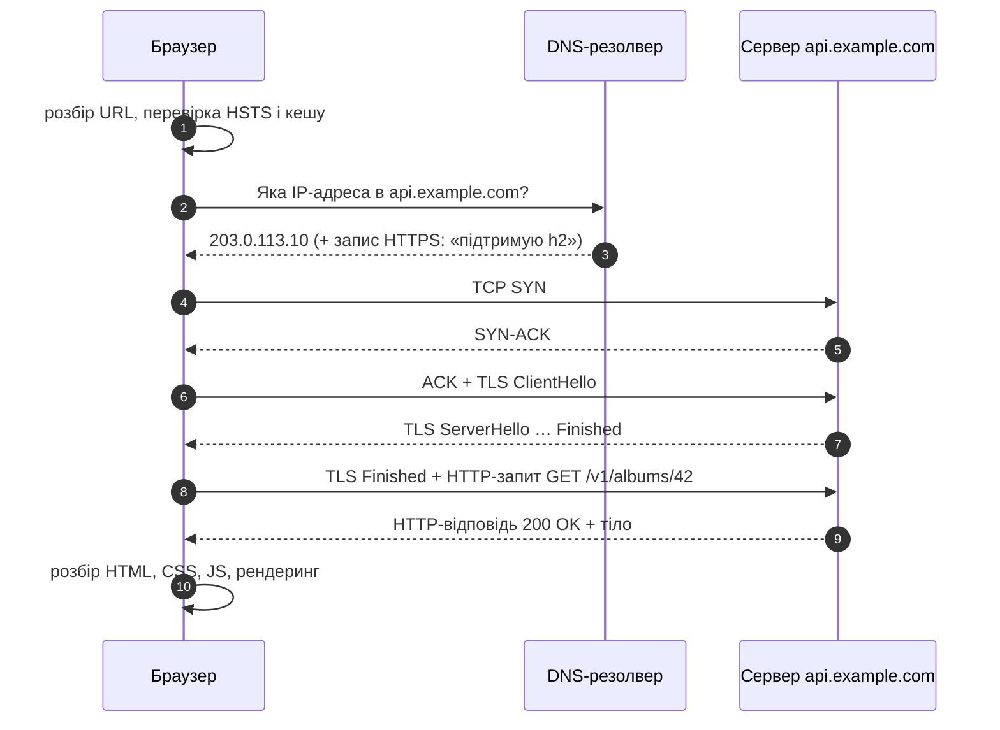

1. **Розбір URL і локальні перевірки.** Чи є домен у списку HSTS (тоді `http`
   автоматично стає `https`), чи є відповідь у кеші браузера.
2. **DNS.** Ім'я → IP-адреса. Сучасний запис DNS типу `HTTPS`
   (📜 RFC 9460) може одразу повідомити, що сервер підтримує HTTP/3, — і
   браузер пропустить спробу через TCP.
3. **Транспорт.** TCP-рукостискання (1 обхід мережею — *RTT, round-trip
   time*) або QUIC для HTTP/3.
4. **TLS-рукостискання.** Домовленість про ключі шифрування й перевірка
   сертифіката (розділ 4).
5. **HTTP-запит і відповідь.**
6. **Рендеринг** — і нові запити за CSS, JS, зображеннями, шрифтами. Типова
   сторінка робить десятки запитів, тому кожен зекономлений RTT множиться.

🔑 **Затримка (latency) важить більше за пропускну здатність.** Для
типової вебсторінки обходи мережею, а не мегабіти, визначають швидкість.
Більшість нововведень HTTP/2, HTTP/3 і TLS 1.3 — про те, щоб зробити менше
обходів.

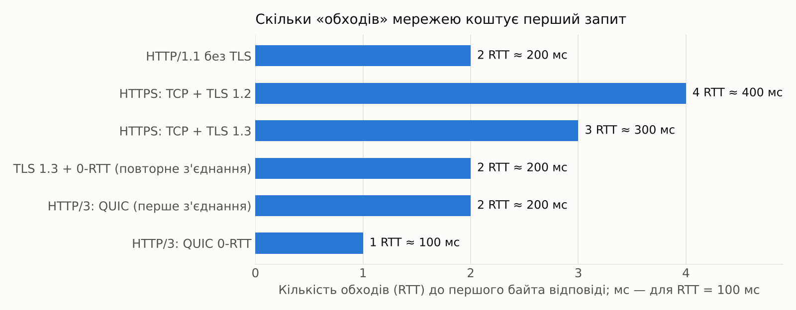

*RTT між Києвом і сервером у Франкфурті — близько 30–40 мс, а до США — 100–150 мс.
Для мобільних мереж додайте ще десятки мілісекунд.*

---

## 2. HTTP під капотом: повідомлення, з'єднання, стан

### 2.1. Модель «запит — відповідь»

**HTTP (HyperText Transfer Protocol)** — прикладний протокол, у якому
**клієнт** надсилає **запит**, а **сервер** повертає **відповідь**. Сервер
ніколи не починає розмову першим (виняток — механізми на кшталт WebSocket і
Server-Sent Events, що працюють *поверх* уже встановленого з'єднання).

📜 Семантика HTTP (методи, коди стану, заголовки) спільна для всіх версій і
описана в **RFC 9110**; кешування — у **RFC 9111**; формат повідомлень
HTTP/1.1 — у **RFC 9112**. Версії 2 і 3 змінюють лише **спосіб передачі**,
а не зміст: `GET /albums` і `404 Not Found` означають одне й те саме в
HTTP/1.1, HTTP/2 і HTTP/3.

### 2.2. Як виглядає повідомлення HTTP/1.1

HTTP/1.1 — **текстовий** протокол. Ось справжній запит, байт у байт (`␍␊` —
символи кінця рядка CR LF):

```http
POST /api/v1/albums HTTP/1.1␍␊
Host: api.example.com␍␊
User-Agent: curl/8.10.1␍␊
Accept: application/json␍␊
Content-Type: application/json␍␊
Content-Length: 73␍␊
␍␊
{"title":"Перший сніг","artistId":3,"releaseDate":"2026-01-15"}
```

```http
HTTP/1.1 201 Created␍␊
Date: Tue, 03 Nov 2026 10:15:30 GMT␍␊
Content-Type: application/json; charset=utf-8␍␊
Location: /api/v1/albums/9f1c…␍␊
␍␊
{"id":"9f1c…","title":"Перший сніг", …}
```

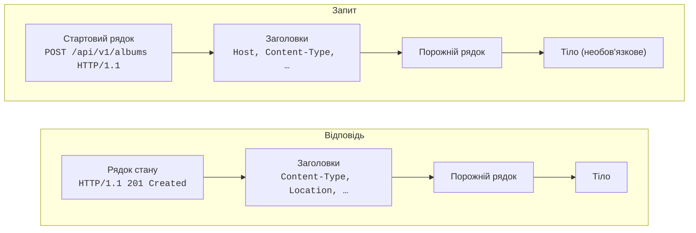

| Частина | Деталі |
|---|---|
| **Стартовий рядок** запиту | метод, **ціль** (шлях + query), версія протоколу |
| **Рядок стану** відповіді | версія, **код стану** (3 цифри), **фраза** (`Created`) — фраза лише для людей, програми дивляться на код |
| **Заголовки** | `Назва: значення`; назви **нечутливі до регістру** (`content-type` = `Content-Type`) |
| **Порожній рядок** | межа між заголовками й тілом |
| **Тіло** | будь-які байти; його довжину задає `Content-Length` або `Transfer-Encoding: chunked` |

⚠️ **`Content-Length` рахує байти, а не символи.** `"Перший сніг"` — це
11 символів, але 21 байт в UTF-8 (кожна кирилична літера — 2 байти).

**Як сервер дізнається, де закінчилося тіло.**

- `Content-Length: 73` — рівно 73 байти (у прикладі вище: 63 символи, з них 10 кириличних по 2 байти).
- `Transfer-Encoding: chunked` — тіло йде шматками, перед кожним — його
  довжина в шістнадцятковому вигляді, кінець — шматок нульової довжини. Так
  сервер може почати відповідь, ще не знаючи її повного розміру (потокова
  генерація, великі звіти).

```http
HTTP/1.1 200 OK␍␊
Transfer-Encoding: chunked␍␊
␍␊
1A␍␊
{"data":[{"id":1},{"id":2}␍␊
2␍␊
]}␍␊
0␍␊
␍␊
```

⚠️ **Request smuggling.** Якщо проксі й сервер по-різному розуміють межі
повідомлення (одночасно `Content-Length` і `Transfer-Encoding`), зловмисник
може «протягти» другий запит усередині першого. Тому RFC 9112 вимагає
відхиляти такі неоднозначні запити, а HTTP/2 і HTTP/3 узагалі не мають
`chunked` — межі кадрів задає сам протокол.

### 2.3. З'єднання: від «одне на запит» до keep-alive

| Версія | Поведінка з'єднання |
|---|---|
| HTTP/1.0 (1996) | нове TCP-з'єднання **на кожен запит** (якщо не домовилися про `Connection: keep-alive`) |
| HTTP/1.1 (1997) | **постійні з'єднання** за замовчуванням: кілька запитів **послідовно** в одному з'єднанні; закрити — `Connection: close` |
| HTTP/1.1 pipelining | можна надіслати кілька запитів, не чекаючи відповідей, але відповіді йдуть **суворо в порядку запитів**; браузери так і не ввімкнули це за замовчуванням |
| HTTP/2 (2015) | **одне** з'єднання, багато **паралельних потоків** |
| HTTP/3 (2022) | одне QUIC-з'єднання поверх UDP, незалежні потоки |

💡 Через послідовність HTTP/1.1 браузери відкривають **до 6 з'єднань на
домен**. Звідси старі «оптимізації» епохи HTTP/1.1 — склеювання файлів
(bundling), спрайти, розподіл ресурсів по піддоменах (domain sharding). З
HTTP/2 частина з них стала непотрібною або навіть шкідливою.

### 2.4. HTTP не має стану (stateless)

Кожен запит **самодостатній**: сервер не зобов'язаний пам'ятати попередні
запити цього клієнта. Усе, що потрібно для обробки, має бути в самому
запиті: адреса, метод, заголовки, тіло.

«Пам'ять» додають поверх HTTP:

| Механізм | Як працює |
|---|---|
| **Cookies** | сервер ставить `Set-Cookie`, браузер автоматично повертає `Cookie` у наступних запитах до того самого сайту |
| **Токени** | клієнт сам додає `Authorization: Bearer <токен>` у кожен запит |
| **Сесії на сервері** | у cookie лише ідентифікатор, стан — у базі чи Redis |

🔑 Безстановість — це сила, а не обмеження: будь-який із десяти серверів за
балансувальником може обробити будь-який запит. Саме тому вона є одним з
обмежень REST (розділ 8).

### 🧪 Спробуйте самі

```bash
# -v показує запит (>) і відповідь (<) з усіма заголовками
curl -v https://example.com/ -o /dev/null

# «сирий» HTTP/1.1 руками — без бібліотек, через TCP
printf 'GET / HTTP/1.1\r\nHost: example.com\r\nConnection: close\r\n\r\n' | nc example.com 80
```

---

## 3. HTTP/1.1, HTTP/2 і HTTP/3: еволюція протоколу

### 3.1. Коротка історія

| Рік | Версія | Специфікація | Головне |
|---|---|---|---|
| 1991 | HTTP/0.9 | — | лише `GET`, лише HTML, без заголовків |
| 1996 | HTTP/1.0 | RFC 1945 | заголовки, коди стану, `POST`, `Content-Type` |
| 1997 → 1999 | HTTP/1.1 | RFC 2068 → RFC 2616 | постійні з'єднання, обов'язковий `Host`, `chunked`, кешування |
| 2014 | HTTP/1.1 | RFC 7230–7235 | переписана, точніша специфікація |
| 2015 | HTTP/2 | RFC 7540 (виріс із SPDY від Google) | бінарні кадри, мультиплексування, стискання заголовків |
| 2021 | QUIC | RFC 9000 | новий транспорт поверх UDP із вбудованим TLS 1.3 |
| 2022 | HTTP/1.1, 2, 3 | RFC 9110–9114 | спільна семантика (9110) + окремі «дротові» формати; **HTTP/3** — RFC 9114 |

🔑 З 2022 року HTTP — це **одна семантика й три способи її передачі**.

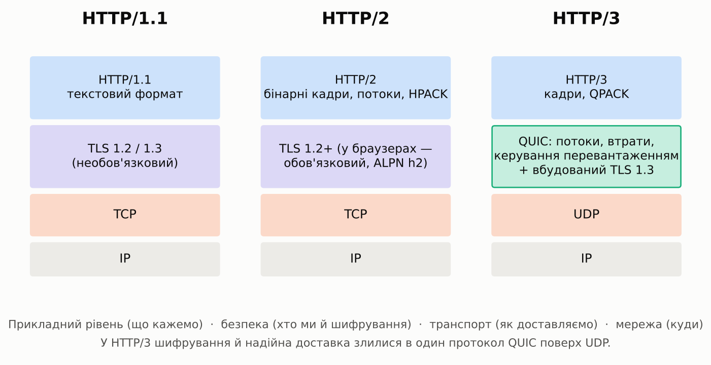

### 3.2. HTTP/1.1: простий і зрозумілий, але послідовний

**Сильні сторони:** текстовий (читається людиною), простий у реалізації,
працює всюди, підтримується кожним інструментом.

**Проблеми:**

1. **Блокування на початку черги (head-of-line blocking) на рівні HTTP.** В
   одному з'єднанні наступна відповідь чекає, доки повністю прийде
   попередня. Великий файл «затуляє» дрібні.
2. **Багато з'єднань.** 6 TCP-з'єднань на домен = 6 рукостискань TCP і TLS.
3. **Надлишкові заголовки.** Кожен запит знову надсилає `User-Agent`,
   `Accept`, `Cookie` — часто сотні байтів чи кілька кілобайтів тексту, які
   майже не змінюються.

### 3.3. HTTP/2: бінарні кадри й мультиплексування

📜 RFC 9113 (2022, замінив RFC 7540), стискання заголовків — RFC 7541 (HPACK).

**Бінарні кадри (frames).** Повідомлення розбивається на кадри з
9-байтовим заголовком: довжина, тип, прапорці, **ідентифікатор потоку**.

```
+-----------------------------------------------+
|                 Length (24 біти)              |
+---------------+---------------+---------------+
|   Type (8)    |   Flags (8)   |
+-+-------------+---------------+-------------------------------+
|R|                 Stream Identifier (31 біт)                  |
+=+=============================================================+
|                   Frame Payload (0…)                          |
+---------------------------------------------------------------+
```

| Тип кадру | Призначення |
|---|---|
| `HEADERS` | заголовки запиту або відповіді (стиснені HPACK) |
| `DATA` | тіло |
| `SETTINGS` | параметри з'єднання (максимум потоків, розмір вікна…) |
| `WINDOW_UPDATE` | керування потоком: «можу прийняти ще N байтів» |
| `RST_STREAM` | скасувати один потік, не чіпаючи інших |
| `PING`, `GOAWAY` | перевірка, чи з'єднання живе; коректне закриття з'єднання |
| `PUSH_PROMISE` | server push (див. нижче — фактично мертвий) |
| `PRIORITY`, `CONTINUATION` | застаріла схема пріоритетів; продовження великих заголовків |

**Потоки (streams) і мультиплексування.** Кожна пара «запит — відповідь» —
окремий потік зі своїм номером (клієнтські — непарні: 1, 3, 5…). Кадри
різних потоків **перемішуються** в одному TCP-з'єднанні, тому велика
відповідь більше не блокує малі — на рівні HTTP.

**Псевдозаголовки.** Стартовий рядок зник; його замінили службові поля з
двокрапкою: `:method`, `:scheme`, `:authority`, `:path` у запиті й
`:status` у відповіді. Назви звичайних заголовків — **лише малими літерами**.

**HPACK.** Заголовки стискаються:

- **статична таблиця** — 61 найчастіший заголовок (`:method: GET` — це
  один байт-індекс);
- **динамічна таблиця** — заголовки, які вже надсилали в цьому з'єднанні
  (повторний `user-agent` займає 1–2 байти замість сотні);
- **код Гаффмана** для рядків.

⚠️ Загальні алгоритми стискання (gzip) для заголовків небезпечні: атака
**CRIME** (2012) відновлювала cookie за зміною розміру стисненого запиту.
HPACK спроєктовано так, щоб цього уникнути.

**Керування потоком (flow control)** — кожен потік і з'єднання загалом
мають «вікно»: відправник не надішле більше байтів, ніж отримувач дозволив
кадром `WINDOW_UPDATE`.

**Пріоритети.** Складне «дерево залежностей» з RFC 7540 майже ніхто не
реалізував правильно, тож RFC 9113 його застарив. На заміну прийшли
**Extensible Priorities** (📜 RFC 9218): простий заголовок
`Priority: u=1, i` (терміновість 0–7 і чи можна віддавати частинами).

**Server push — помер.** Сервер міг надіслати ресурс, якого клієнт ще не
просив (`PUSH_PROMISE`). На практиці push часто надсилав те, що вже було в
кеші браузера. Chrome вимкнув його у версії 106 (2022), Firefox — у 132
(2024). Замість push використовують **`103 Early Hints`** і
`<link rel="preload">` — підказки, рішення приймає браузер.

**Як браузер домовляється про HTTP/2.** Під час TLS-рукостискання —
розширенням **ALPN** (*Application-Layer Protocol Negotiation*): клієнт
пропонує `h2, http/1.1`, сервер обирає. Браузери підтримують HTTP/2 **лише
поверх TLS**; варіант без шифрування (`h2c`) використовується хіба що між
внутрішніми сервісами.

⚠️ **Проблема, яку HTTP/2 не вирішив.** Блокування на початку черги
перемістилося з HTTP на рівень **TCP**: TCP гарантує доставку байтів **у
порядку відправлення**. Якщо загубився один пакет потоку A, ядро ОС не віддасть
застосунку вже отримані пакети потоків B і C, доки не прийде повторна
передача. На мобільних мережах із втратами HTTP/2 буває навіть повільнішим
за кілька з'єднань HTTP/1.1.

⚠️ **HTTP/2 Rapid Reset (CVE-2023-44487).** У 2023 році зловмисники
відкривали потік і одразу скасовували його (`RST_STREAM`) — мільйони разів
на секунду в одному з'єднанні. Це дало рекордні DDoS-атаки (сотні мільйонів
запитів на секунду). Урок: мультиплексування — це ще й нові вектори атак.

### 3.4. HTTP/3: HTTP поверх QUIC

📜 HTTP/3 — RFC 9114, QUIC — RFC 9000 (транспорт) і RFC 9001 (TLS у QUIC),
стискання заголовків — RFC 9204 (QPACK).

**Чому UDP.** Змінити TCP неможливо: він «зашитий» в ядра ОС і в мільйони
маршрутизаторів та файрволів, які відкидають усе незнайоме. UDP проходить
скрізь, а надійність, порядок і керування перевантаженням QUIC реалізує сам
— у **просторі користувача** (у браузері й на сервері), тож його можна
оновлювати так само часто, як браузер.

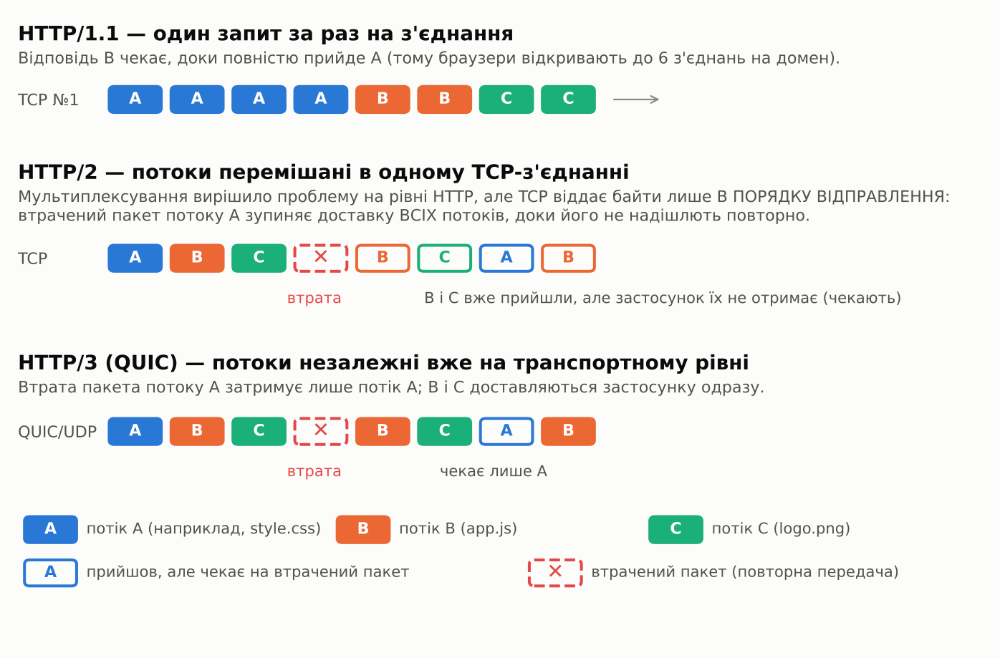

**Що дає QUIC:**

| Можливість | Як це працює | Користь |
|---|---|---|
| **Незалежні потоки** | порядок гарантується в межах потоку, а не всього з'єднання | втрата пакета затримує лише свій потік |
| **Вбудований TLS 1.3** | транспортне й криптографічне рукостискання — одне й те саме | 1 RTT до запиту замість 2–3 |
| **0-RTT** | при повторному з'єднанні дані йдуть у першому ж пакеті | запит без жодного очікування |
| **Міграція з'єднання** | з'єднання ідентифікує **Connection ID**, а не пара IP:порт | перехід із Wi-Fi на мобільну мережу без розриву |
| **Шифрування майже всього** | шифруються навіть службові поля транспорту | проміжні вузли не можуть «ламати» протокол своїми припущеннями |

**QPACK** — варіант HPACK для QUIC. HPACK покладався на строгий порядок
кадрів, а в QUIC потоки незалежні, тому оновлення таблиці заголовків
передаються окремими потоками.

**Як браузер дізнається, що сервер уміє HTTP/3.** Перший візит зазвичай іде
через HTTP/2, а сервер повідомляє заголовком:

```http
Alt-Svc: h3=":443"; ma=86400
```

(«HTTP/3 доступний на UDP-порту 443, пам'ятай це добу»). Наступні запити
йдуть уже через HTTP/3. DNS-запис типу `HTTPS` дозволяє дізнатися про це ще
до першого з'єднання. Якщо UDP заблоковано (корпоративні мережі), браузер
тихо повертається до HTTP/2.

### 3.5. Порівняльна таблиця

| | HTTP/1.1 | HTTP/2 | HTTP/3 |
|---|---|---|---|
| Специфікація | RFC 9112 | RFC 9113 | RFC 9114 |
| Формат | текст | бінарні кадри | бінарні кадри |
| Транспорт | TCP | TCP | QUIC поверх UDP |
| TLS | необов'язковий | у браузерах обов'язковий (TLS 1.2+) | обов'язковий, вбудований (TLS 1.3) |
| Паралельні запити | ні (до 6 з'єднань на домен) | так, потоки в одному з'єднанні | так, незалежні потоки |
| Блокування на початку черги | на рівні HTTP і TCP | на рівні TCP | немає між потоками |
| Стискання заголовків | немає | HPACK | QPACK |
| Рукостискання до першого запиту | TCP + TLS: 2–3 RTT | TCP + TLS: 2–3 RTT | 1 RTT, повторно — 0 RTT |
| Зміна мережі (Wi-Fi → LTE) | розрив | розрив | з'єднання живе (Connection ID) |
| Server push | — | був, вимкнений браузерами | у специфікації є, у браузерах не підтримується |

### 3.6. Хто чим користується (2026)

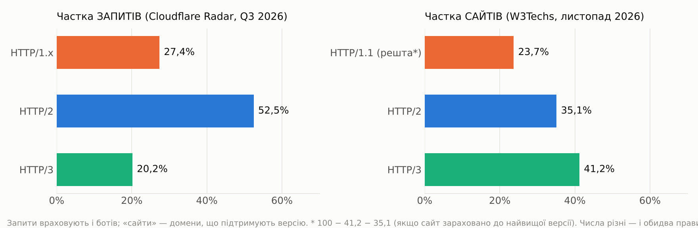

| Показник | HTTP/1.x | HTTP/2 | HTTP/3 | Джерело |
|---|---|---|---|---|
| Частка **запитів** до Cloudflare, Q3 2026 | 27,4% | 52,5% | 20,2% | Cloudflare Radar |
| Частка **сайтів**, листопад 2026 | ≈23,7%* | 35,1% | 41,2% | W3Techs |

🔑 Числа не суперечать одне одному: W3Techs рахує сайти, що **підтримують**
версію, а Cloudflare — реальні **запити**, серед яких багато ботів,
скриптів і API-клієнтів, що досі говорять HTTP/1.1 (за оцінкою Cloudflare,
боти — близько 35% запитів у Q3 2026).

\* Обчислено як 100 − 41,2 − 35,1, тобто в припущенні, що W3Techs зараховує
кожен сайт до найвищої версії, яку той підтримує. HTTP/1.1 нікуди не зникне: він простий, і
саме ним зазвичай спілкуються сервіси всередині дата-центру.

💡 **Для вашого Express-застосунку.** Node.js `http` говорить HTTP/1.1. У
продакшені перед ним стоїть проксі (nginx, Caddy, Cloudflare, балансувальник
хмари), який приймає від браузерів HTTP/2 і HTTP/3 та «перекладає» їх у
HTTP/1.1 до вашого сервера. Окремо вмикати HTTP/2 в Node.js майже ніколи не
потрібно.

### 🧪 Спробуйте самі

```bash
curl -sI --http1.1 https://www.cloudflare.com/ | head -1      # HTTP/1.1 200 OK
curl -sI --http2   https://www.cloudflare.com/ | head -1      # HTTP/2 200
curl -sI https://www.cloudflare.com/ | grep -i alt-svc        # чи пропонує сервер h3
curl -sI --http3   https://www.cloudflare.com/ | head -1      # HTTP/3 200 (якщо curl зібрано з HTTP/3)
```

У Chrome: **DevTools → Network** → правий клік по заголовку таблиці →
увімкніть колонку **Protocol** (`http/1.1`, `h2`, `h3`).

---

## 4. HTTPS і TLS: як влаштоване захищене з'єднання

**HTTPS** — це не окремий протокол, а **той самий HTTP усередині TLS**
(*Transport Layer Security*). TLS лежить між HTTP і TCP (або вбудований у
QUIC) і дає три гарантії:

| Гарантія | Від чого захищає | Чим забезпечується |
|---|---|---|
| **Конфіденційність** | хтось у тій самій Wi-Fi-мережі читає паролі й cookie | симетричне шифрування (AES-GCM, ChaCha20-Poly1305) |
| **Цілісність** | провайдер чи «точка доступу в кав'ярні» вставляє рекламу або шкідливий скрипт | автентифіковане шифрування (AEAD): змінений байт → повідомлення відкидається |
| **Автентичність** | вас перенаправили на підробний `bank.com` | сертифікат сервера, підписаний центром сертифікації (CA) |

🔑 Без HTTPS **будь-хто на шляху** пакета (Wi-Fi, провайдер, проксі) бачить і
може змінити все: адресу сторінки, cookie, тіло форми з паролем. Тому сьогодні
HTTPS — норма: за даними Cloudflare Radar, **98,9% запитів від людей** у
Q3 2026 ішли через HTTPS.

### 4.1. SSL чи TLS? Історія назв

| Версія | Рік | Статус |
|---|---|---|
| SSL 2.0 | 1995 (Netscape) | заборонений (RFC 6176) |
| SSL 3.0 | 1996 | заборонений (RFC 7568, атака POODLE) |
| TLS 1.0 | 1999 | застарілий (RFC 8996, 2021) |
| TLS 1.1 | 2006 | застарілий (RFC 8996, 2021) |
| **TLS 1.2** | 2008 (RFC 5246) | досі широко використовується |
| **TLS 1.3** | 2018 (RFC 8446; оновлена редакція — RFC 9846, 2026) | сучасний стандарт; ≈66% людського трафіку Cloudflare (липень 2026) |

💡 Слова «SSL-сертифікат» і «SSL handshake» — історична звичка. Протоколу SSL
ніхто не використовує вже понад 10 років; насправді це **TLS-сертифікат** і
**TLS-рукостискання**. Далі в тексті — саме так.

### 4.2. Два види шифрування й навіщо обидва

| | Асиметричне (з відкритим ключем) | Симетричне |
|---|---|---|
| Ключі | пара: **відкритий** (усім) і **закритий** (лише власнику) | один спільний секретний ключ |
| Приклади | ECDHE (обмін ключами), RSA, ECDSA, Ed25519 (підписи) | AES-128/256-GCM, ChaCha20-Poly1305 |
| Швидкість | повільне | дуже швидке (AES прискорюється інструкціями процесора) |
| Роль у TLS | **домовитися** про спільний ключ і **довести**, хто ти | **шифрувати** всі дані після рукостискання |

🔑 **Рукостискання TLS** = асиметрична криптографія, щоб безпечно отримати
спільний симетричний ключ через відкриту мережу. Далі все шифрується
симетрично.

**Обмін ключами Діффі — Геллмана на еліптичних кривих (ECDHE)** — серце
рукостискання. Інтуїція на «фарбах»:

1. Клієнт і сервер беруть однакову загальновідому «базову фарбу».
2. Кожен змішує її зі своєю **таємною** фарбою й надсилає суміш іншому
   (суміші бачать усі).
3. Кожен додає до чужої суміші **свою** таємну фарбу. Обидва отримують
   **однаковий** колір, а сторонній спостерігач, маючи лише суміші, не може
   його відтворити.

Літера **E** (*ephemeral*) означає, що таємні значення генеруються **заново
для кожного з'єднання** й одразу забуваються. Це дає **пряму секретність**
(*forward secrecy*): навіть якщо через роки викрадуть закритий ключ сервера,
записаний сьогодні трафік розшифрувати не вдасться.

### 4.3. Сертифікати й ланцюжок довіри

Сертифікат X.509 — це документ «відкритий ключ **належить** домену
`example.com`», **підписаний** центром сертифікації (CA).

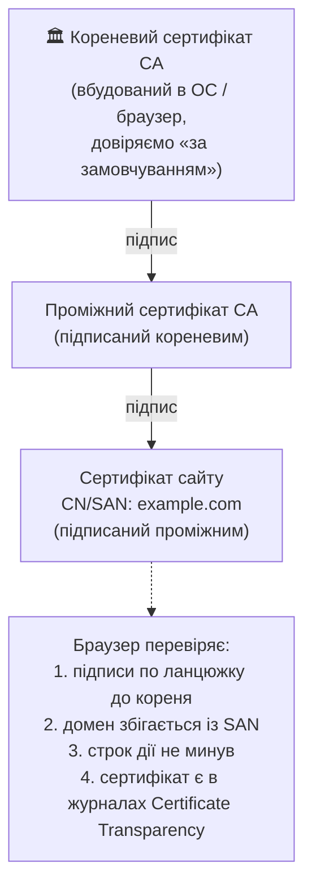

| Поняття | Пояснення |
|---|---|
| **CA (центр сертифікації)** | організація, якій довіряють браузери й ОС: Let's Encrypt, DigiCert, Sectigo, Google Trust Services… |
| **Кореневе сховище** | список кореневих сертифікатів у браузері чи ОС |
| **Проміжний сертифікат** | кореневим ключем підписують рідко (він зберігається офлайн); щоденна видача йде через проміжні |
| **SAN** (*Subject Alternative Name*) | список доменів, для яких дійсний сертифікат (`example.com`, `*.example.com`) |
| **DV / OV / EV** | рівень перевірки власника: лише домен / організація / розширена; для шифрування різниці немає |
| **Certificate Transparency (CT)** | кожен публічний сертифікат записується в публічні журнали; власник домену бачить, якщо хтось випустив сертифікат на його ім'я |
| **ACME** (📜 RFC 8555) | протокол автоматичного отримання сертифікатів; так працює Let's Encrypt (безкоштовно) |
| **Відкликання** | OCSP і CRL; Let's Encrypt вимкнув OCSP у серпні 2025 через приватність (CA бачив, хто який сайт відкриває) і перейшов на CRL |

**Строк дії сертифікатів стрімко скорочується** — щоб автоматизація стала
обов'язковою, а скомпрометований ключ швидше «згорав»:

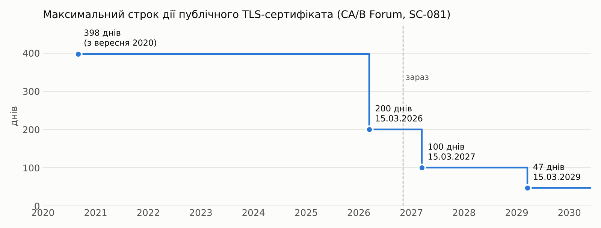

⚠️ З 2029 року сертифікат на 47 днів руками не оновиш — лише автоматично
(ACME: Certbot, Caddy, хмарні балансувальники). Let's Encrypt, що й так видає
90-денні сертифікати, має власний графік: 64 дні з лютого 2027, 45 днів — з
лютого 2028.

### 4.4. Рукостискання TLS 1.2 (2 RTT)

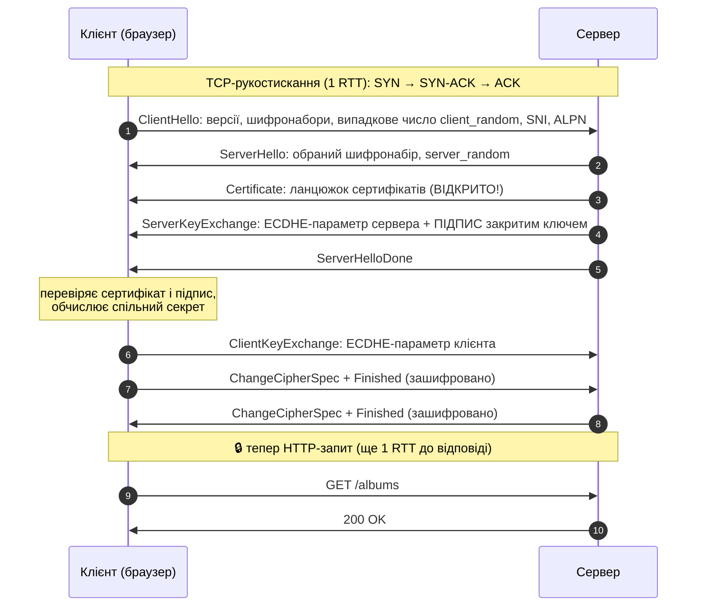

1. **ClientHello.** Клієнт повідомляє найвищу підтримувану версію TLS, список **шифронаборів**
   (cipher suites), надсилає випадкове число, **SNI** (*Server Name
   Indication* — ім'я сайту, бо на одній IP-адресі живуть тисячі сайтів) і
   **ALPN** (`h2`, `http/1.1`).
2. **ServerHello, Certificate, ServerKeyExchange, ServerHelloDone.** Сервер
   обирає параметри, надсилає ланцюжок сертифікатів і свою частину ECDHE,
   **підписану** закритим ключем сертифіката. Підпис доводить: «я — власник
   цього сертифіката, і ці параметри — мої».
3. **ClientKeyExchange.** Клієнт перевіряє ланцюжок і підпис, надсилає свою
   частину ECDHE. Обидві сторони обчислюють **pre-master secret** → разом із
   двома випадковими числами → **master secret** → симетричні ключі.
4. **Finished.** Кожна сторона надсилає зашифрований MAC (хеш із ключем,
   отриманим із master secret) усього рукостискання. Якщо хтось підмінив хоч байт (наприклад, «викреслив» сильні
   шифри зі списку, щоб змусити використати слабкий), хеші не зійдуться.

**Шифронабір TLS 1.2** описує все одразу:

```
TLS_ECDHE_RSA_WITH_AES_128_GCM_SHA256
    └─┬─┘ └┬┘      └────┬────┘ └─┬──┘
 обмін ключами  підпис  шифрування   хеш для PRF
```

⚠️ TLS 1.2 дозволяв і небезпечні варіанти: обмін ключами RSA без forward
secrecy, шифри в режимі CBC (атаки Lucky13, POODLE-подібні), RC4, SHA-1.
Правильно налаштований TLS 1.2 сьогодні — це **лише ECDHE + AEAD**.

### 4.5. Рукостискання TLS 1.3 (1 RTT)

📜 RFC 8446 (2018); нова редакція — RFC 9846 (2026).

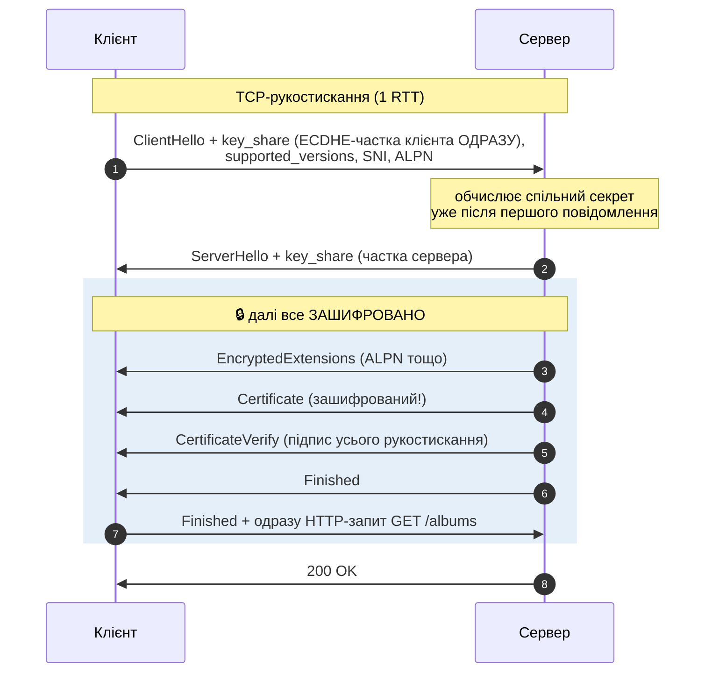

**Головна ідея.** Клієнт **вгадує**, яку групу ECDHE обере сервер
(практично завжди X25519 або гібрид X25519MLKEM768), і надсилає свою частку
ключа **в першому ж повідомленні**. Серверу вже нема про що питати — один
обхід менше.

| | TLS 1.2 | TLS 1.3 |
|---|---|---|
| Обходів до першого запиту (поверх TCP) | 2 | **1** (повторно — **0** з 0-RTT) |
| Обмін ключами | RSA, DHE, ECDHE | повне рукостискання — **лише (EC)DHE** → forward secrecy (винятки: відновлення сесії в режимі «лише PSK» і 0-RTT-дані) |
| Шифри | десятки, зокрема CBC, RC4 | **5** шифронаборів, лише AEAD |
| Сертифікат сервера | передається **відкрито** | **зашифрований** |
| Ключі | PRF на основі master secret | **HKDF**, окремі ключі для кожної фази |
| Повторне узгодження, стискання | були (і були вразливості) | **видалені** |

Усі 5 шифронаборів TLS 1.3 (обмін ключами й підпис обираються окремо, тому
назви коротші):

```
TLS_AES_128_GCM_SHA256          ← найпоширеніший
TLS_AES_256_GCM_SHA384
TLS_CHACHA20_POLY1305_SHA256    ← швидкий на телефонах без апаратного AES
TLS_AES_128_CCM_SHA256
TLS_AES_128_CCM_8_SHA256
```

### 4.6. Відновлення сесії й 0-RTT

Після першого рукостискання сервер надсилає **квиток сесії** (*session
ticket*, PSK — *pre-shared key*). Наступного разу клієнт пред'являє його й
може надіслати **дані відразу в першому повідомленні** (*early data*, 0-RTT).

⚠️ **0-RTT-дані можна повторити (replay).** Зловмисник, що записав такий
пакет, може надіслати його серверу ще раз. Тому:

- у 0-RTT дозволяють лише **безпечні й ідемпотентні** запити (`GET`), а не
  «переказати 1000 грн»;
- сервер, який отримав ризиковий запит у 0-RTT, відповідає
  **`425 Too Early`** (📜 RFC 8470) — клієнт повторить його після
  повного рукостискання.

### 4.7. SNI, ALPN і ECH: що видно сторонньому спостерігачу

| Що | Видно провайдеру? |
|---|---|
| IP-адреса сервера | так |
| Ім'я сайту в **SNI** | **так** — ClientHello йде відкрито |
| Сертифікат | TLS 1.2 — так; TLS 1.3 — ні |
| Шлях, query, заголовки, cookie, тіло | **ні** — усе зашифровано |
| Розмір і час обміну | так (метадані) |

**ECH (Encrypted Client Hello)** — 📜 RFC 9849 (березень 2026) — шифрує
«внутрішній» ClientHello з реальним іменем сайту ключем, опублікованим у
DNS-записі `HTTPS`. Назовні видно лише загальне ім'я провайдера (наприклад,
CDN). Для повної приватності потрібен ще й зашифрований DNS (DoH/DoT).

### 4.8. Постквантова криптографія вже тут

Квантовий комп'ютер достатнього розміру зможе зламати ECDHE і RSA. Його ще
немає, але є загроза **«збирай зараз — розшифруєш потім»** (*harvest now,
decrypt later*): трафік можна записати сьогодні й розшифрувати через 10 років.

Тому TLS 1.3 уже використовує **гібридний обмін ключами X25519MLKEM768**:
класичний X25519 + постквантовий **ML-KEM-768** (стандарт NIST FIPS 203).
Зламати треба **обидва**.

| Хто | Статус (2026) |
|---|---|
| Chrome, Edge | за замовчуванням з версії 131 (листопад 2024) |
| Firefox | десктоп — з 132, Android — з 145 |
| Safari / ОС Apple | з iOS, iPadOS і macOS 26 |
| Трафік людей до Cloudflare | **понад 65%** уже постквантово захищені (квітень 2026) |

💡 Вам як розробнику майже нічого не треба робити: гібридний обмін ключами
вмикається в бібліотеках (OpenSSL 3.5+, BoringSSL, Go) і на CDN. Наступний
крок — **постквантові підписи** в сертифікатах; Cloudflare планує повний
постквантовий захист до 2029 року.

### 4.9. HTTPS у вашому застосунку

1. **Отримайте сертифікат автоматично**: Let's Encrypt (Certbot, Caddy),
   хмарний балансувальник або Cloudflare.
2. **TLS зазвичай завершується (terminates) на проксі** — Express отримує
   звичайний HTTP. Тоді в Express потрібен `app.set('trust proxy', 1)`, щоб
   `req.protocol` і `req.ip` бралися із заголовків `X-Forwarded-Proto` /
   `X-Forwarded-For` (лекція 12, §9).
3. **Перенаправляйте HTTP → HTTPS** кодом `301`/`308` і вмикайте **HSTS**:

   ```http
   Strict-Transport-Security: max-age=63072000; includeSubDomains; preload
   ```

   Браузер запам'ятає: «цей домен — лише HTTPS» і протягом `max-age` не
   звертатиметься по `http://` (захист від атаки *SSL stripping*). Домени
   зі списку `preload` вбудовані в браузери одразу.
   `helmet()` ставить HSTS автоматично (за замовчуванням — на рік, без `preload`).
4. **Без змішаного вмісту (mixed content):** сторінка HTTPS не повинна
   вантажити скрипти чи стилі через `http://` — браузер їх заблокує.
5. **Cookie з `Secure`** — передаються лише через HTTPS.

### 🧪 Спробуйте самі

```bash
# Подивитися рукостискання, ланцюжок сертифікатів і обрані параметри
openssl s_client -connect example.com:443 -servername example.com -tls1_3 </dev/null

# Коротко: версія TLS, шифр, сертифікат
curl -svo /dev/null https://example.com/ 2>&1 | grep -E 'SSL connection|ALPN|subject:|expire'
```

У браузері: клік по значку замка (або «налаштувань сайту») ліворуч від
адреси → **Connection is secure → Certificate is valid**. У DevTools вкладка
**Security** (у нових версіях Chrome — **Privacy and security**) показує версію TLS, групу обміну ключами (наприклад,
`X25519MLKEM768`) і шифр.

💡 **Як побачити зашифрований трафік у Wireshark.** Запустіть браузер зі
змінною середовища `SSLKEYLOGFILE=/шлях/keys.log` — він записуватиме
сесійні ключі. Вкажіть цей файл у Wireshark (**Preferences → Protocols →
TLS**), і HTTPS-трафік стане читабельним. Лише для навчання на власному
комп'ютері!

---

## 5. HTTP-методи та їхні властивості

### 5.1. Три властивості, які треба знати напам'ять

| Властивість | Визначення (📜 RFC 9110, §9.2) | Практичний наслідок |
|---|---|---|
| **Безпечний** (*safe*) | клієнт **не просить змінювати** стан сервера — лише читання | браузер, пошуковий робот, передвибірка (prefetch) можуть викликати його будь-коли; логування, лічильники переглядів не рахуються «зміною» |
| **Ідемпотентний** (*idempotent*) | **N однакових** запитів мають той самий **задуманий ефект на сервері**, що й один | після мережевої помилки клієнт (і проксі) може **безпечно повторити** запит |
| **Кешований** (*cacheable*) | відповідь можна зберегти й повторно використати без звернення до сервера | браузер, CDN, проксі можуть віддати збережену копію (з урахуванням `Cache-Control`) |

🔑 **Усі безпечні методи ідемпотентні, але не навпаки.** `DELETE` нічого не
«читає», але видалити те саме двічі — той самий результат: ресурсу немає.

⚠️ **Ідемпотентність — про стан сервера, а не про відповідь.** Перший
`DELETE /albums/42` поверне `204`, другий — `404`. Коди різні, а стан
однаковий («альбому 42 немає») — метод ідемпотентний.

### 5.2. Усі методи в одній таблиці

| Метод | Безпечний | Ідемпотентний | Кешований | Тіло запиту | Типове призначення |
|---|:-:|:-:|:-:|---|---|
| `GET` | ✅ | ✅ | ✅ | не має сенсу (⚠️ не використовуйте) | отримати представлення ресурсу |
| `HEAD` | ✅ | ✅ | ✅ | ні | як `GET`, але **без тіла** відповіді: розмір, тип, `ETag` |
| `OPTIONS` | ✅ | ✅ | ❌ | рідко | які методи дозволені; **CORS preflight** |
| `TRACE` | ✅ | ✅ | ❌ | ні | «луна» запиту для діагностики; **вимикають** на продакшені |
| `QUERY` 🆕 | ✅ | ✅ | ✅ | **так** — опис запиту | складний пошук із тілом (📜 RFC 10008, червень 2026) |
| `PUT` | ❌ | ✅ | ❌ | так | **створити або повністю замінити** ресурс за відомою адресою |
| `DELETE` | ❌ | ✅ | ❌ | не має сенсу | видалити ресурс |
| `POST` | ❌ | ❌ | ⚠️ формально так, на практиці ні¹ | так | створити підлеглий ресурс, виконати дію, обробити дані |
| `PATCH` | ❌ | ❌² | ⚠️ формально так, на практиці ні¹ | так — **опис змін** | часткова зміна (📜 RFC 5789) |
| `CONNECT` | ❌ | ❌ | ❌ | — | тунель через проксі (так HTTPS проходить через корпоративний проксі) |

¹ RFC дозволяє кешувати відповідь на `POST`/`PATCH` лише з явною свіжістю й
`Content-Location`, що збігається з адресою запиту. Браузери й CDN цього
практично не роблять.
² `PATCH` **може** бути ідемпотентним (наприклад, `{"rating": 5}`), але не
зобов'язаний (`{"op": "increment", "path": "/plays"}`), тому клієнт не має
права вважати його таким.

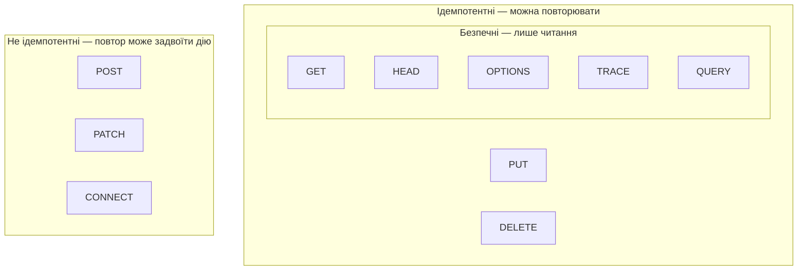

### 5.3. Методи детально

**`GET`** — «дай мені представлення ресурсу».

- Параметри — лише в URL (`?search=…&limit=20`). Тіло в `GET` формально
  можна надіслати, але його семантика не визначена: проксі й бібліотеки
  можуть його відкинути. Для складних пошуків із тілом є `QUERY`.
- ⚠️ **Ніколи не змінюйте стан у `GET`.** Посилання
  `<a href="/albums/42/delete">` видалить альбом, щойно браузеру, антивірусу
  чи пошуковому роботу заманеться «попередньо завантажити» сторінку.
- Довжина URL: специфікація ліміту не задає, але сервери й проксі мають свої
  (часто 8 КБ); завеликий URL → `414 URI Too Long`.

**`HEAD`** — як `GET`, але без тіла. Застосування: перевірити, чи існує
файл і який його розмір, перш ніж завантажувати; перевірити `ETag`.
Express обробляє `HEAD` автоматично для кожного маршруту `GET`.

**`POST`** — «обробіть ці дані згідно з семантикою ресурсу». Найширший
метод: створення в колекції (`POST /albums` → `201` + `Location`), дії
(`POST /orders/42/cancel`), завантаження форм, RPC.

⚠️ Подвійне натискання «Оплатити» = два `POST` = два платежі. Захист —
**ключ ідемпотентності**:

```http
POST /api/v1/payments
Idempotency-Key: 8e03978e-40d5-43e8-bc93-6894a57f9324
```

Сервер запам'ятовує ключ і результат: повторний запит із тим самим ключем
отримує збережену відповідь, а не новий платіж. Так працюють Stripe,
PayPal та інші платіжні API; заголовок стандартизується IETF (чернетка
*draft-ietf-httpapi-idempotency-key-header*).

**`PUT`** — «покладіть **ось це** за **цією** адресою». Клієнт знає
адресу ресурсу й надсилає **повне** представлення. Якщо ресурсу не було —
`201 Created`, якщо був — `200 OK` або `204 No Content`.

**`PATCH`** — «застосуйте **ці зміни**». Формати опису змін:

| Формат | `Content-Type` | Приклад |
|---|---|---|
| JSON Merge Patch (📜 RFC 7396) | `application/merge-patch+json` | `{"rating": 5, "description": null}` — `null` означає «видалити поле» |
| JSON Patch (📜 RFC 6902) | `application/json-patch+json` | `[{"op":"replace","path":"/rating","value":5}]` |

На практиці багато API приймають «частковий об'єкт» у `application/json` —
по суті merge patch.

**`PUT` проти `PATCH` проти `POST`:**

| Сценарій | Метод | Чому |
|---|---|---|
| Створити альбом, `id` генерує сервер | `POST /albums` | адресу нового ресурсу визначає сервер |
| Створити або замінити налаштування з відомим ключем | `PUT /users/7/settings` | клієнт знає адресу, повтор безпечний |
| Замінити альбом повністю | `PUT /albums/42` | не передане поле стає порожнім |
| Змінити лише оцінку | `PATCH /albums/42` | передаємо лише зміни |
| Опублікувати альбом (дія) | `POST /albums/42/publish` | дія з побічними ефектами, не CRUD |

**`DELETE`** — видалити. Після успіху: `204 No Content` (або `200` з тілом,
`202 Accepted`, якщо видалення асинхронне). Повторний `DELETE` — `404`
(або `204`: обидва варіанти ідемпотентні; важливо — однаково для всього API).

**`OPTIONS`** — які можливості в ресурсу. Відповідь містить заголовок
`Allow: GET, HEAD, PUT, DELETE`. Головне практичне застосування —
**preflight-запит CORS** (розділ 7.4).

**`TRACE`** — сервер повертає отриманий запит як є. ⚠️ Атака
*Cross-Site Tracing* використовувала його, щоб прочитати cookie з
`HttpOnly`, тому `TRACE` вимикають; браузери не дозволяють надсилати його з
JavaScript.

**`CONNECT`** — `CONNECT api.example.com:443 HTTP/1.1` просить проксі
відкрити TCP-тунель; далі всередині тунелю йде TLS. Звичайний вебсервер
його не реалізує.

**`QUERY`** 🆕 — новий метод (📜 RFC 10008, червень 2026): **безпечний,
ідемпотентний, кешований**, як `GET`, але **з тілом**, як `POST`.

```http
QUERY /api/v1/albums
Content-Type: application/json
Accept: application/json

{ "genres": [3, 5], "yearFrom": 2015, "fields": ["title", "artist"], "sort": "-rating" }
```

Раніше складні пошуки робили через `POST /albums/search` — і втрачали
кешування й безпечний повтор. ⚠️ Підтримка в бібліотеках, проксі й CDN лише
з'являється (2026), тому для навчальних API поки що вистачає `GET` з query.

**Методи WebDAV** (📜 RFC 4918): `PROPFIND`, `PROPPATCH`, `MKCOL`, `COPY`,
`MOVE`, `LOCK`, `UNLOCK` — для роботи з файлами як із мережевим диском.
Звідси й коди `207`, `423`, `424`, `507`.

### 5.4. Кращі практики

1. **Метод — це дієслово, URI — іменник:** `DELETE /albums/42`, а не
   `POST /deleteAlbum?id=42`.
2. **Безпечні методи — справді без змін.** Жодного `GET /logout` чи
   `GET /albums/42/delete`.
3. **Непідтримуваний метод на наявному ресурсі** → `405 Method Not Allowed` +
   заголовок `Allow`. Невідомий серверу метод узагалі → `501 Not Implemented`.
4. **Для `POST`, що створює щось цінне** (замовлення, платежі) —
   `Idempotency-Key`.
5. **Не покладайтеся на тіло `GET` і `DELETE`.**
6. **`PATCH` з явним форматом** (`merge-patch+json`) — і чітка документація
   того, як трактується `null`.

### 🧪 Спробуйте самі

```bash
curl -i -X OPTIONS https://api.github.com/ | grep -i -E '^(allow|access-control)'
curl -I https://www.ietf.org/                    # HEAD: лише заголовки
curl -i -X DELETE https://www.ietf.org/          # 405 + Allow — або 403, залежно від сервера
```

---

## 6. Коди стану HTTP: повний довідник і кращі практики

### 6.1. П'ять класів

| Клас | Значення | Хто «винен» | Що робить клієнт |
|---|---|---|---|
| **1xx** Informational | проміжна відповідь, запит обробляється | — | чекає остаточної відповіді |
| **2xx** Success | запит успішно прийнято й оброблено | — | використовує результат |
| **3xx** Redirection | потрібна додаткова дія (інша адреса, кеш) | — | іде за `Location` або бере кеш |
| **4xx** Client Error | помилка в запиті | **клієнт** | **не повторює** без змін (крім 408, 425, 429) |
| **5xx** Server Error | сервер не зміг виконати коректний запит | **сервер** | може повторити пізніше (особливо 502, 503, 504) |

🔑 **Перша цифра — найважливіша.** Клієнт, який не знає коду `422`, має
поводитися з ним як із `400`, а з невідомим `5xx` — як із `500`. Тому
вигадувати власні коди (`499`, `520`) у публічному API не можна: клієнти їх
не зрозуміють.

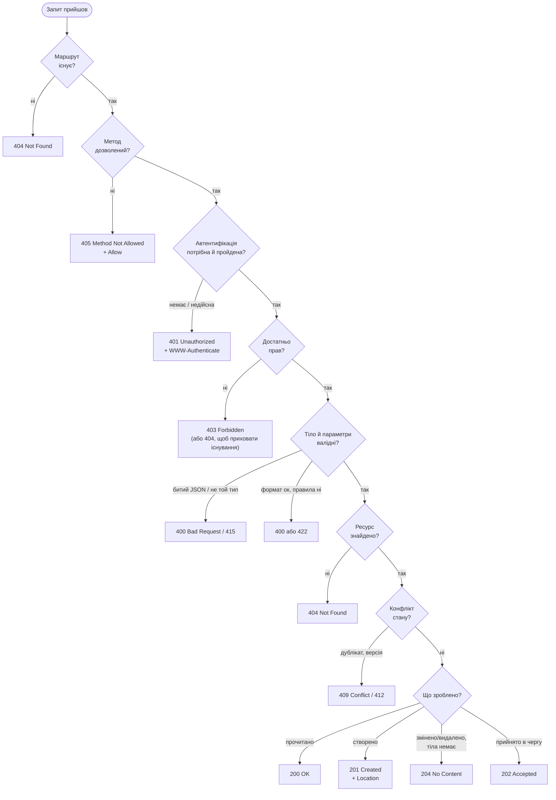

### 6.2. 1xx — інформаційні

| Код | Назва | Коли й навіщо | Практика |
|---|---|---|---|
| **100** | Continue | клієнт надіслав `Expect: 100-continue` і чекає дозволу, перш ніж відправляти велике тіло; сервер відповідає `100` («надсилай») або одразу помилкою (`401`, `413`) | Node.js має подію `'checkContinue'`; корисно для великих завантажень |
| **101** | Switching Protocols | перехід на інший протокол за запитом `Upgrade` — найчастіше **WebSocket** | відповідь видає бібліотека (`ws`, Socket.IO) |
| **102** | Processing | WebDAV: «ще обробляю», щоб клієнт не закрив з'єднання | застарілий; не використовуйте |
| **103** | Early Hints | **до** основної відповіді сервер підказує ресурси для передзавантаження: `Link: </app.css>; rel=preload` (📜 RFC 8297) | заміна server push; підтримують Chrome, Edge, Firefox (Safari — частково), CDN Cloudflare і Fastly; у Node.js — `res.writeEarlyHints()` |
| **104** | Upload Resumption Supported | **тимчасова** реєстрація IANA для стандарту відновлюваних завантажень (чернетка IETF) | поки експериментальний |

### 6.3. 2xx — успіх

| Код | Назва | Коли використовувати | Кращі практики й пастки |
|---|---|---|---|
| **200** | OK | успішний `GET`; `PUT`/`PATCH`/`POST`, якщо повертаєте тіло з результатом | ⚠️ ніколи не повертайте `200` з `{"error": "…"}` у тілі — клієнти, кеші й моніторинг вважатимуть це успіхом |
| **201** | Created | створено **новий ресурс** (`POST` у колекцію, `PUT` за новою адресою) | **завжди** додавайте `Location: /api/v1/albums/<id>`; тіло — створений ресурс |
| **202** | Accepted | запит прийнято, але виконання **асинхронне** (черга, довга обробка: генерація звіту, конвертація відео) | поверніть адресу для перевірки статусу: `Location: /jobs/123`; клієнт опитує її або чекає webhook |
| **203** | Non-Authoritative Information | проксі **змінив** відповідь оригінального сервера | у власних API не використовується |
| **204** | No Content | успіх, **тіла немає**: `DELETE`, `PUT`/`PATCH` без повернення ресурсу | тіло **заборонене** — `res.status(204).end()`, не `.json(…)`; браузерна форма не перезавантажує сторінку |
| **205** | Reset Content | «очистіть форму» | на практиці не використовується |
| **206** | Partial Content | відповідь на запит із `Range: bytes=0-1023` — частина файлу | для відео, аудіо, докачування; `express.static` підтримує автоматично; заголовки `Content-Range`, `Accept-Ranges: bytes` |
| **207** | Multi-Status | WebDAV: кілька окремих статусів у тілі | деякі API використовують для пакетних операцій; краще — `200` з масивом результатів |
| **208** | Already Reported | WebDAV: елемент уже перелічений | рідкісний |
| **226** | IM Used | дельта-кодування (📜 RFC 3229) | майже не зустрічається |

### 6.4. 3xx — перенаправлення

| Код | Назва | Метод при переході | Кешується за замовчуванням | Коли використовувати |
|---|---|---|---|---|
| **300** | Multiple Choices | — | так | кілька варіантів ресурсу; майже не використовується |
| **301** | Moved Permanently | ⚠️ браузери змінюють `POST` → `GET` | **так** | ресурс переїхав назавжди (старий домен, `http` → `https` для `GET`) |
| **302** | Found | ⚠️ браузери змінюють `POST` → `GET` | ні | тимчасовий редирект (історично найпоширеніший) |
| **303** | See Other | **завжди** `GET` | ні | після обробки форми: «результат дивись тут» — патерн **Post/Redirect/Get** |
| **304** | Not Modified | — | — | відповідь на умовний запит (`If-None-Match`, `If-Modified-Since`): «ваша копія актуальна» — **без тіла** |
| **305** | Use Proxy | — | — | застарілий через безпеку |
| **306** | (Unused) | — | — | зарезервований |
| **307** | Temporary Redirect | **зберігається** | ні | тимчасовий редирект `POST`/`PUT` (обслуговування, балансування) |
| **308** | Permanent Redirect | **зберігається** | **так** | постійний переїзд API: `POST /v1/x` лишиться `POST` (📜 RFC 7538 → RFC 9110) |

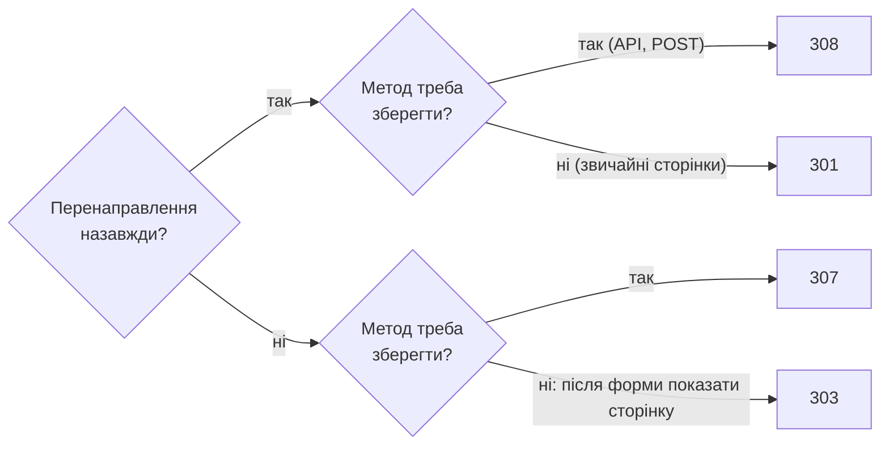

⚠️ **`301` і `308` браузер кешує надовго** — інколи до очищення кешу. Помилковий
постійний редирект «прилипає» до користувачів, тож тестуйте з `302`/`307`,
а на постійний переходьте, коли впевнені.

💡 Express: `res.redirect(308, '/api/v2/albums')`. За замовчуванням
`res.redirect(url)` дає `302`.

### 6.5. 4xx — помилки клієнта

| Код | Назва | Коли використовувати | Кращі практики й пастки |
|---|---|---|---|
| **400** | Bad Request | запит **неможливо зрозуміти**: битий JSON, невалідні параметри, порушені правила валідації | поверніть **список помилок за полями** (розділ 8.6); не залишайте клієнта гадати |
| **401** | Unauthorized | **не автентифікований**: немає токена, токен недійсний або прострочений | ⚠️ назва історично невдала — насправді «unauthenticated»; специфікація вимагає заголовок `WWW-Authenticate` з хоча б однією схемою (для токенів — `Bearer`) |
| **402** | Payment Required | зарезервований «на майбутнє»; дехто використовує для «закінчилася підписка» | без стандартної семантики — краще `403` з поясненням |
| **403** | Forbidden | автентифікований, але **немає прав**; або доступ заборонено незалежно від автентифікації | повторна автентифікація не допоможе; для чужих приватних ресурсів можна повертати `404`, щоб не розкривати їхнє існування |
| **404** | Not Found | ресурсу за цією адресою немає | однаково для неіснуючих маршрутів і неіснуючих `id`; не для порожніх колекцій (там `200` і `[]`) |
| **405** | Method Not Allowed | ресурс є, але метод не підтримується | **обов'язково** заголовок `Allow: GET, POST` |
| **406** | Not Acceptable | сервер не може віддати жоден формат з `Accept` клієнта | багато API просто віддають JSON, ігноруючи `Accept` — це теж допустимо |
| **407** | Proxy Authentication Required | як `401`, але для проксі | — |
| **408** | Request Timeout | клієнт надто довго надсилав запит | сервер закриває з'єднання; клієнт може повторити |
| **409** | Conflict | конфлікт із **поточним станом**: дублікат унікального значення, видалення виконавця з альбомами, конфлікт версій | поясніть, що саме конфліктує, щоб людина могла виправити |
| **410** | Gone | ресурс **був** і видалений **назавжди** | корисно для застарілих ендпоїнтів API; кешується за замовчуванням |
| **411** | Length Required | немає `Content-Length` там, де він потрібен | генерує сервер/проксі |
| **412** | Precondition Failed | не виконалася умова `If-Match` / `If-Unmodified-Since` | основа **оптимістичного блокування**: «хтось змінив ресурс після того, як ви його прочитали» (розділ 8.7) |
| **413** | Content Too Large | тіло завелике | `express.json({ limit })` повертає саме його |
| **414** | URI Too Long | надто довгий URL | ознака того, що даним місце в тілі (`POST`/`QUERY`) |
| **415** | Unsupported Media Type | формат тіла не підтримується (надіслали XML, а API приймає JSON) | перевіряйте `Content-Type` для `POST`/`PUT`/`PATCH` |
| **416** | Range Not Satisfiable | запитаний діапазон байтів поза файлом | генерує `express.static` |
| **417** | Expectation Failed | сервер не виконає `Expect` | рідкісний |
| **418** | (Unused) | жартівливий «I'm a teapot» (RFC 2324, 1 квітня 1998); IANA **зарезервувала** код, щоб його ніхто не зайняв | ⚠️ не використовуйте у справжніх API |
| **421** | Misdirected Request | запит прийшов на сервер, який не обслуговує цей домен (повторне використання з'єднання HTTP/2 для іншого хоста) | генерують проксі й CDN |
| **422** | Unprocessable Content | синтаксис коректний, але **семантично** не можна обробити: валідний JSON, але дата закінчення раніша за дату початку | ✅ популярний вибір для **помилок валідації**; у RFC 9110 став загальним (раніше — лише WebDAV). Головне — **один підхід на весь API**: або завжди `400`, або `400` для битого синтаксису й `422` для правил |
| **423** | Locked | WebDAV: ресурс заблокований | — |
| **424** | Failed Dependency | WebDAV: дія не вдалася, бо не вдалася інша | — |
| **425** | Too Early | сервер не обробляє запит, надісланий у **TLS 0-RTT** (ризик повтору) | 📜 RFC 8470; клієнт повторить після повного рукостискання |
| **426** | Upgrade Required | сервер обробить запит лише через інший протокол, указаний у заголовку `Upgrade` (наприклад, `Upgrade: HTTP/3.0`) | рідкісний |
| **428** | Precondition Required | сервер **вимагає** умовний запит (`If-Match`), щоб уникнути «втрачених оновлень» | разом із `412` — повний захист від одночасного редагування |
| **429** | Too Many Requests | перевищено ліміт частоти | бажано `Retry-After: 60` (секунди або дата); `express-rate-limit` ставить і заголовки `RateLimit-*` |
| **431** | Request Header Fields Too Large | завеликі заголовки (часто — роздуті cookies) | у Node.js ліміт заголовків — 16 КБ за замовчуванням |
| **451** | Unavailable For Legal Reasons | недоступний з юридичних причин (рішення суду, санкції) | номер — алюзія на «451 градус за Фаренгейтом» Бредбері; бажано вказати, хто вимагає блокування: `Link: <…>; rel="blocked-by"` |

### 6.6. 5xx — помилки сервера

| Код | Назва | Коли | Кращі практики |
|---|---|---|---|
| **500** | Internal Server Error | **неочікувана** помилка: баг, необроблений виняток | клієнту — загальне повідомлення, **без стеку й SQL**; у логах — усе з ідентифікатором запиту |
| **501** | Not Implemented | сервер не підтримує метод **узагалі** | не плутайте з `405` (метод не підтримує конкретний ресурс) |
| **502** | Bad Gateway | проксі отримав **некоректну відповідь** від сервера за ним (застосунок упав, обірвав з'єднання) | у продакшені зазвичай означає «Node.js-процес не відповідає» |
| **503** | Service Unavailable | **тимчасово** недоступний: обслуговування, перевантаження, база впала | додавайте `Retry-After`; так відповідає `/health`, коли залежності недоступні |
| **504** | Gateway Timeout | проксі **не дочекався** відповіді від сервера | шукайте повільні запити до бази чи зовнішніх API |
| **505** | HTTP Version Not Supported | версія HTTP не підтримується | рідкісний |
| **506** | Variant Also Negotiates | помилка конфігурації узгодження вмісту | рідкісний |
| **507** | Insufficient Storage | WebDAV: немає місця | — |
| **508** | Loop Detected | WebDAV: нескінченний цикл | — |
| **510** | Not Extended | **застарілий** (експеримент RFC 2774 переведено в Historic) | не використовуйте |
| **511** | Network Authentication Required | «авторизуйтеся в мережі» — сторінка входу Wi-Fi в готелі чи аеропорту | генерують captive portals, а не застосунки |

### 6.7. Неофіційні коди, які ви побачите в логах

Їх **немає** в реєстрі IANA, але вони трапляються щодня:

| Код | Хто | Значення |
|---|---|---|
| 444 | nginx | закрити з'єднання без відповіді (відсікання ботів) |
| 499 | nginx | клієнт сам закрив з'єднання, не дочекавшись відповіді |
| 520–527 | Cloudflare | проблеми між Cloudflare і вашим сервером: 521 — сервер не приймає з'єднань, 522 — тайм-аут з'єднання, 525/526 — помилка TLS до сервера |

### 6.8. Пари, які найчастіше плутають

| Пара | Різниця |
|---|---|
| **401 vs 403** | `401` — «я не знаю, хто ви» (увійдіть); `403` — «я знаю, хто ви, і вам не можна» |
| **400 vs 422** | `400` — не можу прочитати (битий JSON); `422` — прочитав, але дані порушують правила. Обидва допустимі для валідації — оберіть одне правило |
| **404 vs 410** | `404` — немає (можливо, ніколи не було або з'явиться); `410` — було й видалено назавжди |
| **409 vs 412** | `409` — конфлікт стану, виявлений сервером; `412` — не справдилася умова, яку **клієнт** сам задав у `If-Match` |
| **405 vs 501** | `405` — цей ресурс не підтримує метод; `501` — сервер узагалі не знає такого методу |
| **500 vs 502 vs 503 vs 504** | `500` — помилка у вашому коді; `502` — проксі отримав сміття або обрив від вашого коду; `503` — свідомо «не зараз»; `504` — проксі не дочекався |
| **301 vs 308, 302 vs 307** | `307`/`308` гарантують збереження методу й тіла |
| **200 vs 204** | `204` — коли тіла справді немає; інакше `200` |

### 6.9. Як це реалізувати в Express

```js
// 201 + Location
res.status(201).location(`/api/v1/albums/${album.id}`).json(album);

// 204 — без тіла
res.status(204).end();

// 405 + Allow — для ресурсу, що підтримує лише GET і POST
router.all('/', (req, res, next) => {
  res.set('Allow', 'GET, HEAD, POST');
  next(new AppError(`Метод ${req.method} не підтримується`, 405));
});

// 401 з WWW-Authenticate
res.set('WWW-Authenticate', 'Bearer realm="api"').status(401).json({ /* … */ });

// 429 з Retry-After
res.set('Retry-After', '60').status(429).json({ /* … */ });

// 304 — Express робить сам: res.json() додає ETag, а req.fresh перевіряє If-None-Match
```

🔑 **Кращі практики для кодів стану:**

1. **Код — для машини, тіло — для людини.** Код каже, *що сталося*
   (клієнт обирає гілку логіки), тіло — *чому й що робити*.
2. **Найконкретніший стандартний код**, який точно описує ситуацію; якщо
   сумніваєтеся — загальний код класу (`400`, `500`).
3. **Єдиний формат тіла помилки** для всього API — бажано
   **Problem Details** (📜 RFC 9457, розділ 8.6).
4. **Не розкривайте внутрішнє**: стек, SQL, шляхи до файлів — лише в логах.
5. **Заголовки-супутники.** Обов'язкові: `Allow` (405), `WWW-Authenticate`
   (401), `Location` (3xx-редиректи). Дуже бажані: `Location` (201),
   `Retry-After` (429, 503).
6. **Документуйте коди** кожного ендпоїнта (OpenAPI, лекція 15).

---

## 7. Заголовки, що варто знати: кешування, CORS, cookies, безпека

### 7.1. Найважливіші заголовки одним поглядом

| Заголовок | Напрямок | Для чого |
|---|---|---|
| `Host` | запит | який сайт на цій IP-адресі (обов'язковий у HTTP/1.1) |
| `Accept`, `Accept-Language`, `Accept-Encoding` | запит | які формати, мови, стискання розуміє клієнт |
| `Content-Type` | обидва | формат тіла: `application/json; charset=utf-8` |
| `Content-Length` | обидва | довжина тіла в байтах |
| `Authorization` | запит | облікові дані: `Bearer <токен>`, `Basic …` |
| `Cookie` / `Set-Cookie` | запит / відповідь | стан між запитами |
| `Cache-Control`, `ETag`, `Last-Modified` | відповідь | правила кешування й версія ресурсу |
| `If-None-Match`, `If-Modified-Since`, `If-Match` | запит | умовні запити |
| `Location` | відповідь | адреса створеного ресурсу або редиректу |
| `Origin`, `Access-Control-*` | обидва | CORS |
| `User-Agent`, `Referer` | запит | хто клієнт і звідки прийшов (так, `Referer` — з помилкою в специфікації ще з 1996 року) |
| `X-Request-Id` | обидва | наскрізний ідентифікатор для логів |

### 7.2. Кешування

📜 RFC 9111. Найшвидший запит — той, якого не було.

| Директива `Cache-Control` | Значення |
|---|---|
| `max-age=3600` | відповідь «свіжа» 1 годину — використовувати без звернення до сервера |
| `s-maxage=…` | те саме, але лише для спільних кешів (CDN) |
| `no-cache` | зберігати **можна**, але перед кожним використанням **перевірити** на сервері |
| `no-store` | **не зберігати взагалі** (банківські дані, особисті сторінки) |
| `private` | лише кеш браузера, не CDN (персональні дані) |
| `public` | можна кешувати всюди |
| `immutable` | не зміниться ніколи — навіть не перевіряти (файли з хешем у назві: `app.3f9a1c.js`) |
| `stale-while-revalidate=60` | можна віддати застарілу копію, поки у фоні оновлюється нова |

⚠️ **`no-cache` ≠ «не кешувати».** «Не кешувати» — це `no-store`.

**Умовні запити й `304 Not Modified`:**

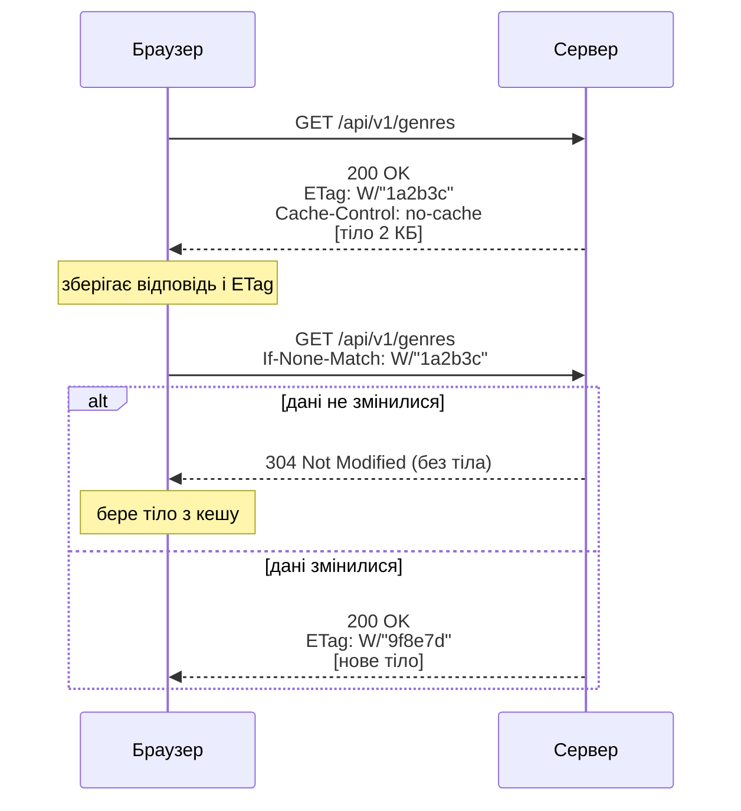

💡 Express додає **слабкий `ETag`** (`W/"…"`) до відповідей `res.json()` і
`res.send()` і сам відповідає `304`, якщо `If-None-Match` збігся. Але сервер
усе одно **виконує запит до бази й формує відповідь** — економиться лише
трафік. Щоб економити й роботу сервера, потрібен кеш на CDN або в застосунку.

**Типова стратегія для SPA:**

| Ресурс | `Cache-Control` |
|---|---|
| `index.html` | `no-cache` (завжди перевіряти — він посилається на нові версії файлів) |
| `assets/app.3f9a1c.js`, `assets/style.8d2e.css` | `public, max-age=31536000, immutable` (хеш у назві змінюється з кожною збіркою) |
| `GET /api/…` публічні довідники | `public, max-age=60` або `no-cache` + `ETag` |
| `GET /api/me`, кошик, профіль | `private, no-cache` або `no-store` |

### 7.3. Узгодження вмісту й стискання

Клієнт каже, що він уміє, сервер обирає й повідомляє:

```http
GET /api/v1/albums HTTP/1.1
Accept: application/json
Accept-Language: uk, en;q=0.8
Accept-Encoding: zstd, br, gzip
```

```http
HTTP/1.1 200 OK
Content-Type: application/json; charset=utf-8
Content-Language: uk
Content-Encoding: br
Vary: Accept-Encoding, Accept-Language
```

| Алгоритм | `Content-Encoding` | Коментар |
|---|---|---|
| gzip | `gzip` | підтримується всюди |
| Brotli | `br` | на 15–25% краще за gzip на тексті; усі сучасні браузери |
| Zstandard | `zstd` | швидке стискання й розпакування; Chrome 123+, Firefox 126+, Safari 26.3+ |

⚠️ **`Vary`** обов'язковий: він каже кешам, що відповідь залежить від
вказаних заголовків запиту. Без `Vary: Accept-Encoding` CDN може віддати
стиснену brotli-версію клієнту, який brotli не розуміє.

💡 Стискати варто текст (HTML, CSS, JS, JSON, SVG). JPEG, PNG, WebP, MP4,
ZIP уже стиснені — повторне стискання лише марнує процесор.

### 7.4. CORS: чому браузер блокує запит до вашого API

**Same-Origin Policy.** JavaScript на сторінці `https://shop.example.com` не
може **читати** відповіді з іншого *походження* (origin = схема + хост +
порт). `http://localhost:5173` (Vite) і `http://localhost:3000` (Express) —
**різні** походження, бо різні порти.

**CORS** (*Cross-Origin Resource Sharing*) — спосіб, у який **сервер**
дозволяє браузеру послабити це правило.

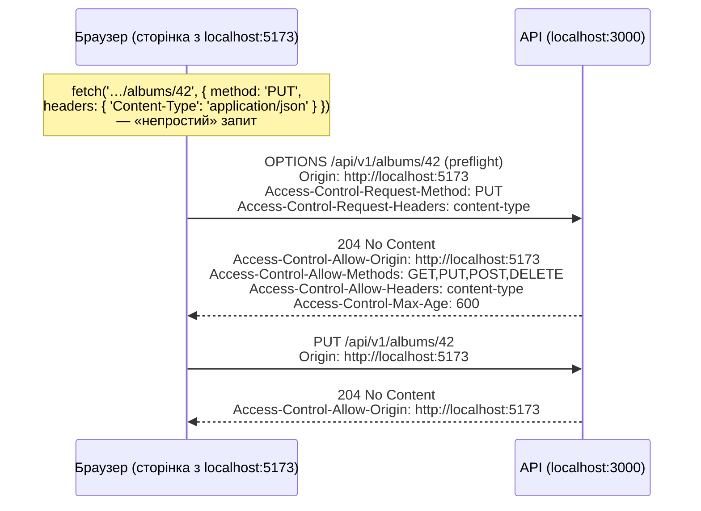

| Поняття | Пояснення |
|---|---|
| **Простий запит** | `GET`/`HEAD`/`POST` з «безпечними» заголовками й `Content-Type` лише `text/plain`, `multipart/form-data` або `application/x-www-form-urlencoded` — preflight не потрібен |
| **Preflight** | `OPTIONS`-запит **перед** «непростим» (`PUT`, `DELETE`, `Content-Type: application/json`, `Authorization`) |
| `Access-Control-Max-Age` | скільки секунд браузер пам'ятає дозвіл preflight |
| `credentials` | щоб надсилати cookies: на клієнті `credentials: 'include'`, на сервері `Access-Control-Allow-Credentials: true` і **конкретний** origin (не `*`) |

⚠️ **CORS захищає користувачів браузера, а не ваш сервер.** `curl`, Postman
і бекенд-сервіси CORS ігнорують. Захист API — це автентифікація й
авторизація, а не CORS.

⚠️ Помилка CORS у консолі не означає, що запит не дійшов до сервера:
«простий» `POST` **виконається**, браузер лише не дасть JavaScript прочитати
відповідь.

### 7.5. Cookies

```http
Set-Cookie: session=abc123; Path=/; Max-Age=86400; HttpOnly; Secure; SameSite=Lax
```

| Атрибут | Ефект |
|---|---|
| `HttpOnly` | недоступна з JavaScript (`document.cookie`) — захист від крадіжки через XSS |
| `Secure` | надсилається лише через HTTPS |
| `SameSite=Lax` | не надсилається в міжсайтових `POST` і фонових запитах, але надсилається при переході за посиланням; у Chrome і Edge — значення за замовчуванням, якщо `SameSite` не вказано (Firefox і Safari так не роблять, тож задавайте атрибут явно) |
| `SameSite=Strict` | не надсилається з **жодних** міжсайтових запитів |
| `SameSite=None` | надсилається й у міжсайтових запитах (обов'язково з `Secure`), якщо браузер не блокує сторонні cookies (Safari й Firefox блокують за замовчуванням) — для вбудованих віджетів |
| `Max-Age` / `Expires` | без них — **сесійна** cookie (зникає після закриття браузера) |
| `Domain`, `Path` | для яких адрес надсилати |
| `Partitioned` | окреме «відро» cookie для кожного сайту верхнього рівня (CHIPS) — для сторонніх віджетів |

🔑 **Сесійна cookie з токеном** = `HttpOnly; Secure; SameSite=Lax` (або
`Strict`) — мінімум. Детальніше — у лекції 14.

### 7.6. Заголовки безпеки

| Заголовок | Що робить |
|---|---|
| `Strict-Transport-Security` | лише HTTPS для домену (HSTS) |
| `Content-Security-Policy` | звідки дозволено завантажувати скрипти, стилі, зображення — головний захист від XSS |
| `X-Content-Type-Options: nosniff` | браузер не «вгадує» тип файлу всупереч `Content-Type` |
| `Referrer-Policy: strict-origin-when-cross-origin` | що потрапляє в `Referer` на інших сайтах |
| `Permissions-Policy` | які API браузера доступні (камера, геолокація) |
| `Cross-Origin-Opener-Policy`, `Cross-Origin-Resource-Policy` | ізоляція від сторінок інших походжень |
| `X-Frame-Options` | заборона вбудовувати сторінку у `<iframe>` (захист від clickjacking); витісняється `Content-Security-Policy: frame-ancestors 'self'`, але для старих браузерів ставлять обидва |

💡 `helmet()` в Express ставить розумні значення для більшості з них
одним рядком.

### 🧪 Спробуйте самі

```bash
curl -sI https://developer.mozilla.org/ | grep -i -E 'cache-control|etag|strict-transport|content-security|vary'
curl -s -o /dev/null -w '%{size_download} байтів без стискання\n' https://developer.mozilla.org/
curl -s -o /dev/null -w '%{size_download} байтів з br/gzip\n' -H 'Accept-Encoding: br, gzip' https://developer.mozilla.org/
```

---

## 8. REST: принципи та кращі практики

### 8.1. Що таке REST

**REST** (*Representational State Transfer*) — **архітектурний стиль**,
який описав Рой Філдінг (Roy Fielding, один з авторів HTTP/1.1) у
дисертації 2000 року. Це не протокол і не стандарт: це набір **обмежень**, і
система, що їх виконує, отримує їхні властивості — масштабованість,
простоту, незалежну еволюцію клієнта й сервера.

| Обмеження | Суть | Що дає |
|---|---|---|
| **Клієнт — сервер** | інтерфейс окремо, дані й логіка окремо | фронтенд і бекенд розвиваються незалежно |
| **Без стану** (*stateless*) | кожен запит містить усе потрібне; сесії клієнта на сервері немає | горизонтальне масштабування: будь-який сервер обробить будь-який запит |
| **Кешованість** | відповіді позначають себе як кешовані чи ні | менше запитів, швидше для користувача |
| **Багаторівнева система** | клієнт не знає, говорить він із сервером чи з проксі, CDN, балансувальником | можна додавати проміжні рівні |
| **Уніфікований інтерфейс** | однакові правила для всіх ресурсів (див. нижче) | клієнт, що вміє HTTP, уміє працювати з будь-яким ресурсом |
| **Код на вимогу** (необов'язкове) | сервер може надіслати виконуваний код (JavaScript) | розширення клієнта без його оновлення |

**Уніфікований інтерфейс** складається з чотирьох частин:

1. **Ідентифікація ресурсів** — кожен ресурс має URI (`/albums/42`).
2. **Маніпуляція через представлення** — клієнт отримує й надсилає
   **представлення** (JSON, XML, HTML) ресурсу, а не сам ресурс.
3. **Самоописові повідомлення** — метод, коди стану, `Content-Type`,
   `Cache-Control` пояснюють, як обробляти повідомлення.
4. **Гіпермедіа як рушій стану застосунку** (*HATEOAS*) — відповідь містить
   **посилання** на можливі наступні дії (розділ 9.4).

🔑 **Ресурс ≠ таблиця в базі.** Ресурс — будь-яке поняття, що має сенс для
клієнта: альбом, «статистика продажів за жовтень», «пошук», «кошик
поточного користувача».

### 8.2. URI: іменники, множина, ієрархія

```
✅ Добре                                ❌ Погано
GET    /api/v1/albums                   GET  /api/getAllAlbums
GET    /api/v1/albums/42                GET  /api/album?id=42
POST   /api/v1/albums                   POST /api/createAlbum
PATCH  /api/v1/albums/42                POST /api/albums/42/update
DELETE /api/v1/albums/42                GET  /api/albums/42/delete
GET    /api/v1/artists/3/albums         GET  /api/getAlbumsByArtist?artist=3
GET    /api/v1/albums?genre=jazz        GET  /api/albums/genre/jazz
POST   /api/v1/orders/17/cancel         ← прагматичний виняток: дія, а не CRUD
```

| Правило | Приклад |
|---|---|
| іменники у **множині** для колекцій | `/albums`, `/albums/42` |
| **нижній регістр, дефіси** | `/music-labels`, не `/musicLabels` |
| ієрархія — лише для справжньої належності, **не глибше 2 рівнів** | `/artists/3/albums` ✅, `/labels/1/artists/3/albums/42/tracks/7` ❌ |
| фільтри, сортування, пагінація — у **query** | `?genre=jazz&sort=-releaseDate&limit=20` |
| без розширень і завершального `/` | `/albums`, не `/albums.json/` |
| версія — у шляху (найпростіше) | `/api/v1/…` |

### 8.3. Методи й коди стану для CRUD

| Операція | Запит | Успіх | Типові помилки |
|---|---|---|---|
| Список | `GET /albums?limit=20&offset=40` | `200` + `{ data, total, limit, offset }` | `400` |
| Один | `GET /albums/42` | `200` | `404` |
| Створити | `POST /albums` | `201` + `Location` + тіло | `400`/`422`, `409` |
| Замінити | `PUT /albums/42` | `200` з тілом або `204` | `400`, `404`, `409`, `412` |
| Змінити частково | `PATCH /albums/42` | `200` з тілом або `204` | `400`, `404`, `409`, `412` |
| Видалити | `DELETE /albums/42` | `204` | `404`, `409` |
| Будь-який, без прав | — | — | `401`, `403` |

### 8.4. Колекції: пагінація, фільтри, сортування, поля

```http
GET /api/v1/albums?genre=3&yearFrom=2015&sort=-rating,title&limit=20&offset=40&fields=id,title,rating
```

```json
{
  "data": [ { "id": "…", "title": "…", "rating": 5 } ],
  "total": 137,
  "limit": 20,
  "offset": 40,
  "links": {
    "self": "/api/v1/albums?limit=20&offset=40",
    "next": "/api/v1/albums?limit=20&offset=60",
    "prev": "/api/v1/albums?limit=20&offset=20"
  }
}
```

| Підхід | Переваги | Недоліки |
|---|---|---|
| **Зсув** (`limit` + `offset`) | простий, можна перейти на довільну сторінку | повільний на великих зсувах; дублікати й пропуски, якщо дані змінюються між запитами |
| **Курсор** (`limit` + `after=<непрозорий токен>`) | швидкий і стабільний для стрічок | не можна «стрибнути на сторінку 7» |

🔑 Колекція — **завжди об'єкт**, а не «голий» масив: у масив неможливо
додати `total` чи посилання, не зламавши клієнтів. І **завжди обмежуйте
`limit`** зверху (наприклад, 100).

### 8.5. Версіонування

| Спосіб | Приклад | Коментар |
|---|---|---|
| У шляху | `/api/v1/albums` | найпростіший і найпоширеніший |
| Заголовок | `Accept: application/vnd.fonoteka.v2+json` | «чистіші» URI, складніше тестувати й кешувати |
| Параметр | `?version=2` | легко забути; рідко |
| За датою | `Stripe-Version: 2026-09-30` | гнучко, але складно в підтримці |

Нова версія — лише для **несумісних** змін: видалення чи перейменування поля,
зміна типу або семантики. Додавання нового необов'язкового поля сумісне.
Застарілі версії оголошуйте заздалегідь заголовками `Deprecation` і
`Sunset` (📜 RFC 9745 і RFC 8594).

### 8.6. Помилки: Problem Details (RFC 9457)

📜 RFC 9457 (2023) задає стандартний формат помилки з типом
`application/problem+json`:

```http
HTTP/1.1 422 Unprocessable Content
Content-Type: application/problem+json
```

```json
{
  "type": "https://api.fonoteka.example/problems/validation",
  "title": "Дані альбому не пройшли перевірку",
  "status": 422,
  "detail": "2 поля містять помилки",
  "instance": "/api/v1/albums",
  "errors": [
    { "pointer": "/releaseDate", "detail": "Дата у форматі РРРР-ММ-ДД" },
    { "pointer": "/trackCount", "detail": "Кількість треків — від 1 до 999" }
  ]
}
```

| Поле | Значення |
|---|---|
| `type` | URI, що ідентифікує **тип** проблеми (бажано — сторінка документації); за замовчуванням `about:blank` |
| `title` | коротка назва типу (однакова для всіх випадків цього типу) |
| `status` | дублює код стану (корисно, якщо тіло переслали окремо) |
| `detail` | пояснення **саме цього** випадку |
| `instance` | URI конкретного випадку |
| розширення | будь-які додаткові поля (`errors`, `traceId`) |

💡 Формат `{ status, message, errors, path, timestamp }` з лекції 13 — та
сама ідея. Важливо не те, який формат, а щоб він був **єдиним** для всього
API.

### 8.7. Одночасне редагування: `ETag` + `If-Match`

Двоє адміністраторів відкрили альбом 42. Перший зберіг зміни, другий — через
хвилину, затерши їх («втрачене оновлення»). Захист — **оптимістичне
блокування**:

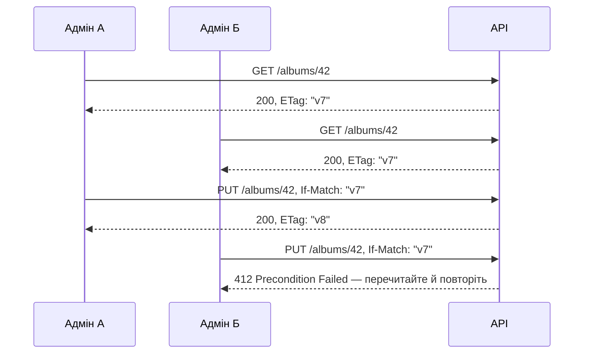

Якщо `PUT` надіслали **без** `If-Match`, а API його вимагає, — `428
Precondition Required`.

### 8.8. Чекліст кращих практик REST API

**Дизайн**

- [ ] Ресурси — іменники в множині, ієрархія не глибше 2 рівнів
- [ ] Методи відповідають семантиці (безпечні — без змін, `PUT`/`DELETE` — ідемпотентні)
- [ ] Найточніші коди стану + супутні заголовки (`Location`, `Allow`, `Retry-After`)
- [ ] JSON у `camelCase`, дати в ISO 8601 UTC (`2026-11-03T10:15:30Z`), гроші — цілими копійками або рядком
- [ ] Колекції — об'єкт із метаданими; `limit` обмежено зверху

**Надійність**

- [ ] `Idempotency-Key` для критичних `POST`
- [ ] `ETag` + `If-Match` для одночасного редагування
- [ ] Обмеження частоти (`429` + `Retry-After`)
- [ ] Тайм-аути й `503` при недоступних залежностях

**Безпека**

- [ ] Лише HTTPS, HSTS
- [ ] Автентифікація (`401`) окремо від авторизації (`403`)
- [ ] Валідація всіх вхідних даних; відхилення невідомих полів (mass assignment)
- [ ] Жодних секретів, стеку чи SQL у відповідях
- [ ] CORS — конкретні походження, а не `*` з `credentials`

**Зручність**

- [ ] Документація OpenAPI (лекція 15)
- [ ] Єдиний формат помилок (Problem Details)
- [ ] Версіонування й оголошення про застарілі версії
- [ ] `X-Request-Id` у відповіді для пошуку в логах

### 8.9. REST — не єдиний варіант

| Підхід | Коли доречний |
|---|---|
| **REST** | публічні API, CRUD, кешування, широка сумісність |
| **GraphQL** | багато різних клієнтів, кожному потрібні свої поля; один ендпоїнт `POST /graphql` |
| **gRPC** | швидкий зв'язок між сервісами всередині системи (HTTP/2, Protocol Buffers) |
| **WebSocket / SSE** | події в реальному часі: чати, сповіщення, біржові котирування |
| **JSON-RPC** | «виклик функції на сервері» без претензій на ресурси |

---

## 9. Модель зрілості Річардсона

Леонард Річардсон (Leonard Richardson) запропонував її в доповіді на QCon
2008, а популярною її зробила стаття Мартіна Фаулера (Martin Fowler) 2010
року «Richardson Maturity Model: steps toward the glory of REST». Модель —
це **драбина з чотирьох сходинок**, на кожній з яких API використовує
більше можливостей вебу.

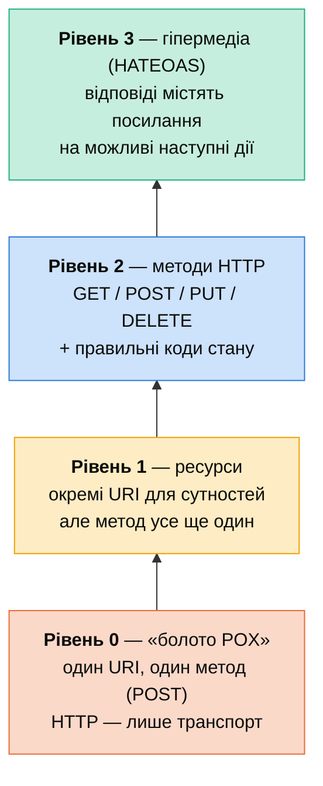

Розгляньмо ту саму задачу — «знайти альбоми виконавця й поставити оцінку
альбому» — на кожному рівні. Предметна область — «Фонотека» з прикладів курсу.

### 9.1. Рівень 0: «болото POX» (Plain Old XML/JSON)

Один ендпоїнт, усе через `POST`, дія — у тілі. HTTP — лише «труба».

```http
POST /api
{ "action": "findAlbums", "artistId": 3 }

POST /api
{ "action": "rateAlbum", "albumId": "a42", "rating": 5 }
```

```http
HTTP/1.1 200 OK
{ "success": false, "error": "ALBUM_NOT_FOUND" }
```

Так працюють XML-RPC і JSON-RPC (SOAP теж має один URI й лише `POST`, хоча помилки повертає з кодом `500`). ⚠️ `200 OK` на помилку: кеші,
моніторинг і проксі вважають усе успіхом; кешування неможливе; повторювати
запити небезпечно — невідомо, що вони роблять.

### 9.2. Рівень 1: ресурси

З'являються окремі URI, але метод усе ще один.

```http
POST /api/artists/3
{ "action": "listAlbums" }

POST /api/albums/a42
{ "action": "rate", "rating": 5 }
```

**Що покращилося:** складність розбита на ресурси — «розділяй і володарюй».
**Що ні:** методи й коди стану досі не використовуються.

### 9.3. Рівень 2: методи HTTP і коди стану

```http
GET /api/v1/artists/3/albums          → 200 OK
PATCH /api/v1/albums/a42              → 204 No Content
{ "rating": 5 }
GET /api/v1/albums/zzz                → 404 Not Found
```

**Що покращилося:**

- `GET` — безпечний і кешований: CDN і браузер можуть кешувати;
- `PUT`/`DELETE` — ідемпотентні: можна повторювати після збою;
- коди стану зрозумілі будь-якому HTTP-клієнту, моніторингу, проксі.

🔑 **Більшість «REST API» у світі — це рівень 2**, і для більшості задач
цього достатньо. API з лекцій 12–13 курсу — саме рівень 2.

### 9.4. Рівень 3: гіпермедіа (HATEOAS)

Відповідь містить **посилання на те, що можна зробити далі**. Клієнт не
«склеює» URL сам, а переходить за посиланнями — як людина на сайті.

```json
{
  "id": "a42",
  "title": "Гірська весна",
  "rating": 4,
  "inCollection": false,
  "_links": {
    "self":     { "href": "/api/v1/albums/a42" },
    "artist":   { "href": "/api/v1/artists/1" },
    "rate":     { "href": "/api/v1/albums/a42", "method": "PATCH" },
    "add-to-collection": { "href": "/api/v1/me/collection", "method": "POST" },
    "delete":   { "href": "/api/v1/albums/a42", "method": "DELETE" }
  }
}
```

Приклад у стилі **HAL** (`application/hal+json`). Інші формати гіпермедіа:
JSON:API, Siren, JSON-LD/Hydra, Collection+JSON.

**Що дає:**

- сервер може змінити URL, не ламаючи клієнтів;
- посилання показують **дозволені** дії: немає посилання `delete` → у
  користувача немає прав або альбом не можна видалити (кнопка не
  показується);
- API «самодокументується» — його можна досліджувати переходами.

**Чому рівень 3 рідкісний:** клієнти (особливо мобільні застосунки й SPA)
зазвичай усе одно «знають» структуру API наперед; формати гіпермедіа
конкурують між собою; документація OpenAPI вирішує частину тих самих задач.
Найвідоміші приклади часткової гіпермедіа — **посилання пагінації** (`next`,
`prev`) і заголовок `Link` у GitHub API.

### 9.5. Підсумкова таблиця

| Рівень | Ресурси (URI) | Методи HTTP | Коди стану | Гіпермедіа | Приклади |
|---|:-:|:-:|:-:|:-:|---|
| 0 | один | лише `POST` | `200` для всього | ❌ | XML-RPC, JSON-RPC, SOAP |
| 1 | ✅ | лише `POST` | `200` для всього | ❌ | ранні «REST-подібні» API |
| 2 | ✅ | ✅ | ✅ | ❌ | більшість публічних API, API курсу |
| 3 | ✅ | ✅ | ✅ | ✅ | GitHub API (частково), PayPal API, Spring HATEOAS |

⚠️ **Застереження Філдінга.** Сам автор REST у дописі 2008 року «REST APIs
must be hypertext-driven» наголошував: API без гіпермедіа — **не REST** у
строгому сенсі. Модель Річардсона корисна як інструмент навчання й аналізу,
а не як «сертифікат REST». Фаулер теж зазначав, що рівень 3 — не обов'язкова
мета, а один із кроків.

### 🧪 Спробуйте самі

```bash
# GitHub API — гіпермедіа в тілі (поля *_url) і в заголовку Link (пагінація)
curl -s https://api.github.com/repos/nodejs/node | grep -E '"(issues|pulls|releases)_url"'
curl -sI "https://api.github.com/repos/nodejs/node/issues?per_page=5" | grep -i '^link:'
```

---

## 10. Інструменти: як дивитися на HTTP своїми очима

| Інструмент | Для чого | Підказка |
|---|---|---|
| **DevTools → Network** (Chrome, Firefox) | усі запити сторінки: метод, статус, протокол, розмір, час | колонка **Protocol**; вкладка **Timing** показує DNS, з'єднання, TLS, очікування (TTFB), завантаження |
| **DevTools → Security** (Privacy and security) | версія TLS, шифр, сертифікат | |
| **`curl -v` / `curl -I`** | один запит із повними заголовками | `--http1.1`, `--http2`, `--http3`, `-w '%{time_starttransfer}'` |
| **HTTP Client у WebStorm** (`.http`-файли) | збережені запити поруч із кодом | змінні, перевірки відповіді (лекція 12) |
| **Postman, Bruno, Insomnia** | ручне тестування API, колекції запитів | |
| **`openssl s_client`** | деталі TLS і ланцюжок сертифікатів | |
| **Wireshark** | пакети TCP, UDP, QUIC, рукостискання | ключі TLS — через `SSLKEYLOGFILE` |
| **SSL Labs Server Test** (ssllabs.com) | оцінка налаштувань TLS вашого домену | оцінка A/A+ — мета |
| **securityheaders.com** | перевірка заголовків безпеки | |
| **`chrome://net-export`** | повний журнал мережевої активності браузера | для складних випадків |

**Що означають фази в DevTools → Timing:**

```
Queueing / Stalled   ← черга в браузері (ліміт 6 з'єднань у HTTP/1.1!)
DNS Lookup           ← ім'я → IP
Initial connection   ← TCP-рукостискання (і QUIC для h3)
SSL                  ← TLS-рукостискання
Request sent         ← відправка запиту
Waiting (TTFB)       ← сервер думає: база, бізнес-логіка  ← найчастіше «винуватець»
Content Download     ← завантаження тіла
```

```bash
# Накопичений час від початку запиту до кожної фази (TLS = appconnect − connect)
curl -so /dev/null https://example.com/ -w 'DNS %{time_namelookup}s | TCP %{time_connect}s | TLS %{time_appconnect}s | TTFB %{time_starttransfer}s | всього %{time_total}s\n'
```

---

## 11. Питання для самоперевірки

<details>
<summary>1. Чому фрагмент <code>#reviews</code> не потрапляє в логи сервера?</summary>

Браузер не надсилає фрагмент у запиті — він використовується лише на клієнті
для переходу до місця в документі (або SPA-маршрутизації).
</details>

<details>
<summary>2. HTTP/2 вирішив проблему блокування на початку черги. Чому тоді знадобився HTTP/3?</summary>

HTTP/2 вирішив її на рівні HTTP (мультиплексування), але не на рівні TCP:
TCP доставляє байти суворо в порядку відправлення, тому втрата одного пакета зупиняє всі
потоки. QUIC забезпечує порядок у межах кожного потоку окремо.
</details>

<details>
<summary>3. Скільки обходів мережею потрібно до першого байта відповіді для HTTPS з TLS 1.2, TLS 1.3 і HTTP/3?</summary>

TLS 1.2: 1 (TCP) + 2 (TLS) + 1 (запит) = 4 RTT. TLS 1.3: 1 + 1 + 1 = 3 RTT.
HTTP/3 (QUIC): 1 (спільне рукостискання) + 1 (запит) = 2 RTT, із 0-RTT — 1.
</details>

<details>
<summary>4. Що таке forward secrecy і як її забезпечує TLS 1.3?</summary>

Навіть після крадіжки закритого ключа сервера не можна розшифрувати раніше
записаний трафік. У повному рукостисканні TLS 1.3 дозволяє лише ефемерний обмін ключами
(EC)DHE: сеансові ключі генеруються для кожного з'єднання й не виводяться з
ключа сертифіката. (Винятки — відновлення в режимі «лише PSK» і 0-RTT-дані.)
</details>

<details>
<summary>5. Чому 0-RTT-дані не можна використовувати для оплати?</summary>

Їх можна перехопити й надіслати повторно (replay) — сервер не відрізнить
повтор від оригіналу. Для неідемпотентних запитів сервер має відповісти
<code>425 Too Early</code>.
</details>

<details>
<summary>6. <code>DELETE</code> повернув 204, а повторний — 404. Метод не ідемпотентний?</summary>

Ідемпотентний: ідемпотентність стосується стану сервера (альбому немає після
обох запитів), а не кодів відповіді.
</details>

<details>
<summary>7. Чим <code>PUT</code> відрізняється від <code>PATCH</code>, а <code>PATCH</code> — від <code>QUERY</code>?</summary>

<code>PUT</code> замінює ресурс повністю й ідемпотентний; <code>PATCH</code>
змінює частину й у загальному випадку не ідемпотентний. <code>QUERY</code>
нічого не змінює: це безпечний і кешований запит із тілом, що описує пошук.
</details>

<details>
<summary>8. Користувач увійшов, але відкриває чужу приватну колекцію. 401, 403 чи 404?</summary>

Не <code>401</code> — користувач автентифікований. <code>403</code> — якщо
не страшно розкрити, що колекція існує; <code>404</code> — якщо сам факт
існування приватний.
</details>

<details>
<summary>9. Після успішного POST форми сервер перенаправляє на сторінку результату. Який код і чому?</summary>

<code>303 See Other</code>: браузер гарантовано виконає <code>GET</code>, і
оновлення сторінки (F5) не надішле форму вдруге (патерн Post/Redirect/Get).
</details>

<details>
<summary>10. API переїхав з <code>/v1/orders</code> на <code>/v2/orders</code> назавжди. Клієнти надсилають туди POST. 301 чи 308?</summary>

<code>308</code>: він зберігає метод і тіло. Після <code>301</code> багато
клієнтів перетворять <code>POST</code> на <code>GET</code> і втратять тіло.
</details>

<details>
<summary>11. Чому CORS не захищає API від зловмисника?</summary>

CORS виконує браузер, щоб захистити користувача від чужих сайтів. Скрипт на
сервері, <code>curl</code> чи Postman CORS не перевіряють — від них захищають
автентифікація й авторизація.
</details>

<details>
<summary>12. На якому рівні моделі Річардсона API, де всі помилки повертаються як <code>200 OK</code> з полем <code>success: false</code>?</summary>

Щонайбільше на рівні 1: рівень 2 вимагає правильного використання і методів, і
кодів стану.
</details>

<details>
<summary>13. Чим <code>Cache-Control: no-cache</code> відрізняється від <code>no-store</code>?</summary>

<code>no-cache</code> дозволяє зберігати, але вимагає перевірити актуальність
на сервері (умовний запит → <code>304</code>); <code>no-store</code> забороняє
зберігати взагалі.
</details>

<details>
<summary>14. Що побачить провайдер, коли ви відкриваєте <code>https://example.com/albums?search=jazz</code>?</summary>

IP-адресу й ім'я сайту (у SNI, якщо немає ECH), обсяг і час трафіку. Шлях
<code>/albums</code>, параметр <code>search=jazz</code>, заголовки й cookie
зашифровані.
</details>

---

## 12. Глосарій

| Термін | Пояснення |
|---|---|
| **AEAD** | шифрування з автентифікацією (AES-GCM, ChaCha20-Poly1305): шифрує й гарантує цілісність одночасно |
| **ALPN** | розширення TLS для вибору прикладного протоколу (`h2`, `http/1.1`) під час рукостискання |
| **CA** | центр сертифікації, що підписує сертифікати |
| **CORS** | механізм, яким сервер дозволяє браузеру міжпохідні запити |
| **ECDHE** | ефемерний обмін ключами Діффі — Геллмана на еліптичних кривих |
| **ECH** | шифрування ClientHello, зокрема імені сайту (RFC 9849) |
| **ETag** | ідентифікатор версії представлення ресурсу |
| **HATEOAS** | гіпермедіа як рушій стану застосунку: дії задаються посиланнями у відповідях |
| **HOL blocking** | блокування на початку черги: затримка першого елемента затримує всі наступні |
| **HPACK / QPACK** | стискання заголовків у HTTP/2 / HTTP/3 |
| **HSTS** | політика «лише HTTPS» для домену |
| **Ідемпотентність** | повтор запиту не змінює результату на сервері |
| **ML-KEM** | постквантовий механізм інкапсуляції ключів (NIST FIPS 203) |
| **Мультиплексування** | кілька незалежних потоків в одному з'єднанні |
| **Origin (походження)** | схема + хост + порт |
| **Preflight** | попередній `OPTIONS`-запит CORS |
| **QUIC** | транспортний протокол поверх UDP із вбудованим TLS 1.3 (RFC 9000) |
| **RTT** | час обходу: пакет до сервера й відповідь назад |
| **SNI** | ім'я сайту в ClientHello, щоб сервер обрав потрібний сертифікат |
| **Шифронабір (cipher suite)** | комбінація алгоритмів шифрування, обміну ключами й хешування |
| **TTFB** | час до першого байта відповіді |
| **0-RTT** | надсилання даних у першому ж пакеті при повторному з'єднанні |

---

## 13. Джерела й специфікації

**Специфікації IETF (rfc-editor.org)**

- RFC 9110 — HTTP Semantics · RFC 9111 — HTTP Caching · RFC 9112 — HTTP/1.1 ·
  RFC 9113 — HTTP/2 · RFC 9114 — HTTP/3 · RFC 9000 — QUIC · RFC 9204 — QPACK ·
  RFC 7541 — HPACK · RFC 9218 — Extensible Priorities
- RFC 8446 і RFC 9846 — TLS 1.3 · RFC 8996 — застарілі TLS 1.0 і 1.1 ·
  RFC 9849 — Encrypted Client Hello · RFC 9460 — DNS-записи SVCB і HTTPS ·
  RFC 8555 — ACME · RFC 6797 — HSTS · RFC 8470 — 0-RTT і `425 Too Early`
- RFC 5789 — `PATCH` · RFC 10008 — `QUERY` · RFC 7396 — JSON Merge Patch ·
  RFC 6902 — JSON Patch · RFC 9457 — Problem Details · RFC 8297 —
  `103 Early Hints` · RFC 9745 — `Deprecation` · RFC 8594 — `Sunset`
- [Реєстр кодів стану HTTP (IANA)](https://www.iana.org/assignments/http-status-codes/) ·
  [реєстр методів HTTP (IANA)](https://www.iana.org/assignments/http-methods/)

**Статистика (з датами в тексті)**

- [Cloudflare Radar](https://radar.cloudflare.com/adoption-and-usage) — версії HTTP, HTTPS, TLS 1.3, постквантове шифрування
- [W3Techs: HTTP/3](https://w3techs.com/technologies/details/ce-http3) ·
  [W3Techs: HTTP/2](https://w3techs.com/technologies/details/ce-http2)
- [Cloudflare: план повного постквантового захисту до 2029 року](https://blog.cloudflare.com/post-quantum-roadmap/) ·
  [підтримка PQC у браузерах](https://developers.cloudflare.com/ssl/post-quantum-cryptography/pqc-support/)
- [Apple: quantum-secure encryption in TLS](https://support.apple.com/en-us/122756)
- [Графік скорочення строку дії сертифікатів (SC-081)](https://support.dnsimple.com/articles/announcement-ssl-certificate-validity-changes/)
- [Let's Encrypt: Ending OCSP Support in 2025](https://letsencrypt.org/2024/12/05/ending-ocsp/)
- [Chrome: Removing HTTP/2 Server Push](https://developer.chrome.com/blog/removing-push)

**Посібники й статті**

- [MDN: HTTP](https://developer.mozilla.org/en-US/docs/Web/HTTP) — найкращий довідник
- Ilya Grigorik. [High Performance Browser Networking](https://hpbn.co/) — класика про TCP, TLS, HTTP/2
- [HTTP/3 explained](https://http3-explained.haxx.se/en/) — Daniel Stenberg (автор curl)
- [The Illustrated TLS 1.3 Connection](https://tls13.xargs.org/) — кожен байт рукостискання з поясненнями
- Roy Fielding. [Architectural Styles and the Design of Network-based Software Architectures](https://ics.uci.edu/~fielding/pubs/dissertation/top.htm) (2000), розділ 5 — REST
- Roy Fielding. [REST APIs must be hypertext-driven](https://roy.gbiv.com/untangled/2008/rest-apis-must-be-hypertext-driven) (2008)
- Martin Fowler. [Richardson Maturity Model](https://martinfowler.com/articles/richardsonMaturityModel.html) (2010)
- [Microsoft REST API Guidelines](https://github.com/microsoft/api-guidelines) · [Zalando RESTful API Guidelines](https://opensource.zalando.com/restful-api-guidelines/)
