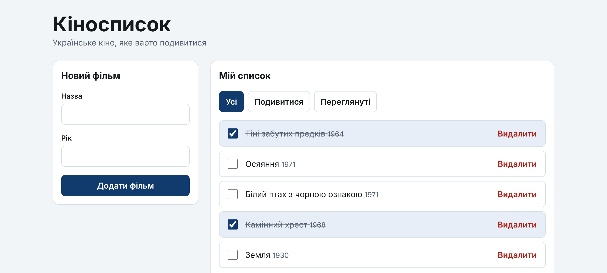
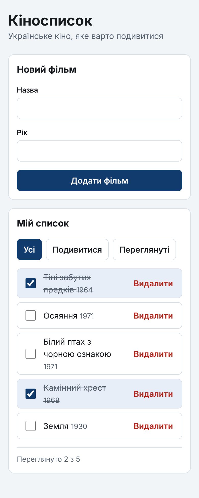

# Перша аплікація на React: «Кіносписок»

> **Курс:** Основи web програмування · ЛНУ ім. Івана Франка · ФПМІ
> **Заняття:** 13 жовтня 2026 р.
> **Теорія:** [Лекція 6. React: компонентна модель, props, state](../../lectures/06-react-components-props-state.md)
> **Інструменти:** WebStorm 2026.2, Node.js 24 LTS, Vite 8, React 19
> **Тривалість:** близько 2 академічних годин

Покрокова інструкція: від порожньої папки до робочої аплікації, у якій можна
додавати фільми до списку, позначати переглянуті, видаляти їх і фільтрувати
список. Аплікація навмисно маленька — сім компонентів, кожен на кілька десятків
рядків, — щоб усе можна було прочитати й зрозуміти. Але кожен її фрагмент показує конкретний
принцип із лекції 6, і в таблиці нижче видно, який саме і де.

Код кожного кроку — повний вміст файлу: його можна скопіювати цілком.
Після кожного кроку є **контрольна точка** — що саме ви маєте побачити
в браузері. Якщо бачите інше, не йдіть далі: знайдіть розбіжність.

---

## Зміст

0. [Що ми побудуємо](#0-що-ми-побудуємо)
1. [Підготовка середовища](#1-підготовка-середовища)
2. [Створення проєкту у WebStorm](#2-створення-проєкту-у-webstorm)
3. [Що згенерував Vite](#3-що-згенерував-vite)
4. [Прибираємо шаблон](#4-прибираємо-шаблон)
5. [Структура папок і дані](#5-структура-папок-і-дані)
6. [Перевикористовувані компоненти: Button і Panel](#6-перевикористовувані-компоненти-button-і-panel)
7. [Список фільмів: статична версія](#7-список-фільмів-статична-версія)
8. [Додаємо стан: позначити й видалити](#8-додаємо-стан-позначити-й-видалити)
9. [Форма додавання фільму](#9-форма-додавання-фільму)
10. [Фільтр і похідні дані](#10-фільтр-і-похідні-дані)
11. [Розкладка mobile first](#11-розкладка-mobile-first)
12. [Фінальна перевірка](#12-фінальна-перевірка)
13. [Типові помилки](#13-типові-помилки)
14. [Завдання для самостійної роботи](#14-завдання-для-самостійної-роботи)
15. [Корисні посилання](#15-корисні-посилання)

---

## 0. Що ми побудуємо



**Що вміє аплікація:**

- показує список фільмів із роком виходу;
- позначає фільм переглянутим (і знімає позначку);
- видаляє фільм;
- додає новий фільм через форму з перевіркою полів;
- фільтрує список: усі / подивитися / переглянуті;
- показує, скільки фільмів переглянуто;
- на телефоні — один стовпчик, на ширшому екрані — форма ліворуч, список праворуч.

**Чого в ній немає — навмисно.** Збереження між перезавантаженнями
(`localStorage`, `useEffect`) — це лекція 7. Context і `useReducer` — лекція 8.
Маршрутизація — лекція 9. Сервер — лекція 10. Після перезавантаження сторінки
список повертається до початкового: так і має бути.

### 0.1. Дерево компонентів

```
App                         ← стан: films, filter
├── Panel «Новий фільм»
│   └── FilmForm            ← стан: поля форми, помилка
│       └── Button
└── Panel «Мій список»
    ├── FilmFilters
    │   └── Button × 3
    └── FilmList
        └── FilmItem × N
            └── Button
```

### 0.2. Як рухаються дані

```
                    App  (films, filter)
          ┌──────────┼──────────────┐
  onAdd ↑ │   value ↓│ ↑ onChange    │ ↓ films
          │          │               │ ↑ onToggle, onDelete
      FilmForm   FilmFilters      FilmList
                                      │ ↓ film
                                      │ ↑ onToggle, onDelete
                                   FilmItem
```

**Дані течуть униз** через props, **події піднімаються вгору** через
колбеки. Жоден дочірній компонент не змінює список фільмів сам — він лише
повідомляє `App`, що сталося. Це і є односпрямований потік даних (лекція 6, §13).

### 0.3. Які принципи лекції де показані

| Принцип (розділ лекції 6) | Де в аплікації |
|---|---|
| Компонент — функція, ім'я з великої літери, один компонент — один файл (§5, §15) | усі файли `*.jsx` |
| Композиція й `children` (§5.1, §6.2) | `Panel` обгортає і форму, і список |
| Значення props за замовчуванням (§6) | `Button`: `variant = 'primary'`, `type = 'button'` |
| JSX як значення prop (§6.1) | `footer={<p>…</p>}` у `App` |
| Прохідний spread `...rest` (§6.4) | `Button` |
| Документування props у JSDoc (§6.5) | кожен компонент |
| Умовний рендеринг: раннє повернення, `&&`, тернарний оператор (§7) | `FilmList`, `FilmForm`, `FilmItem` |
| Пастка `length && …` (§4.3) | `footer` у `App` |
| Списки й стабільні ключі (§8) | `FilmList`, `FilmFilters` |
| `useState` (§9) | `App`, `FilmForm` |
| Мінімум стану, похідні дані обчислюються (§9.5) | `visibleFilms`, `watchedCount` у `App` |
| Стан живе там, де він потрібен (§9.6) | `FilmForm` тримає лише свої поля |
| Функціональне оновлення (§9.2) | усі виклики `setFilms(prev => …)` |
| Оновлення без мутацій (§10) | `[newFilm, ...prev]`, `map`, `filter`, `{ ...film }` |
| Обробка подій, функція замість виклику (§11) | `onClick={() => onDelete(film.id)}`, `preventDefault()` |
| Керовані поля форми, один обробник (§12) | `FilmForm` |
| Підняття стану, іменування `onX` / `handleX` (§13) | `App` → `FilmList` → `FilmItem` |
| CSS Modules, умовні класи (§14) | кожен `*.module.css`, `styles.watched` |
| Поділ на `components/` і `features/` (§15) | структура `src/` |
| `StrictMode` (§3) | `main.jsx` |

---

## 1. Підготовка середовища

**Орієнтовно 5 хвилин** (якщо все вже встановлено).

### 1.1. Node.js

Vite 8 потребує Node.js **22.12 або новішої** (формально підтримується
ще 20.19, але гілка 20 вже не отримує оновлень). Рекомендуємо актуальну
LTS-версію — **Node.js 24**.

Перевірте в терміналі:

```bash
node -v    # v24.x.x — добре; v22.12+ — теж підійде
npm -v
```

Якщо Node.js немає або версія старша — встановіть LTS з
[nodejs.org](https://nodejs.org/). Після встановлення **перезапустіть
WebStorm**, інакше він не побачить нову версію.

### 1.2. WebStorm

Підійде WebStorm 2026.1 або новіший. Для некомерційного (зокрема
навчального) використання WebStorm безкоштовний; студенти також можуть
отримати освітню ліцензію JetBrains.

### 1.3. React Developer Tools

Встановіть у браузер розширення **React Developer Tools** (є для Chrome,
Firefox і Edge). Воно додає в інструменти розробника дві вкладки —
**Components** і **Profiler**. На вкладці Components видно дерево
компонентів, їхні props і стан. Ми будемо дивитися туди на кількох кроках.

---

## 2. Створення проєкту у WebStorm

**Орієнтовно 10 хвилин.**

### 2.1. Через майстер нового проєкту

1. На стартовому екрані WebStorm натисніть **New Project** (або в меню
   **File | New | Project…**).
2. У лівій панелі оберіть **Vite**.
3. У правій панелі:
   - **Location** — шлях до нової папки, наприклад
     `…/lessons/10.14/movie-watchlist`. Остання частина шляху стане назвою
     проєкту.
   - **Node runtime** — версія Node.js із кроку 1.1.
   - **Vite** — `npx create-vite`.
   - **Template** — `react`.
   - Прапорець **TypeScript** (у різних версіях — «Use TypeScript template»
     або «Create TypeScript project») — **не ставте**: ми пишемо на
     JavaScript.
4. Натисніть **Create**.

WebStorm згенерує проєкт, сам виконає `npm install` і створить
конфігурацію запуску **npm dev**.

> 💡 У лівій панелі є також генератор **React** — він теж працює через
> `create-vite` і дає той самий результат. Можна обрати будь-який.

### 2.2. Альтернатива: через термінал

Якщо майстер з якоїсь причини недоступний, створіть проєкт у терміналі
(у WebStorm — **View | Tool Windows | Terminal**, `⌥F12` на macOS,
`Alt+F12` на Windows/Linux):

```bash
npm create vite@latest movie-watchlist
```

Майстер `create-vite` поставить кілька запитань:

| Запитання | Відповідь |
|---|---|
| Select a framework | **React** |
| Select a variant | **JavaScript** |
| Which linter to use? | **Oxlint** |
| Install with npm and start now? | **Yes** |

Те саме однією командою, без запитань:

```bash
npm create vite@latest movie-watchlist -- --template react
cd movie-watchlist
npm install
```

Потім відкрийте папку `movie-watchlist` у WebStorm: **File | Open…**.

### 2.3. Запуск сервера розробки

Будь-який із трьох способів:

- **Run widget** угорі вікна: оберіть **npm dev** і натисніть ▶
  (`⌃R` на macOS, `Shift+F10` на Windows/Linux);
- відкрийте `package.json` і натисніть ▶ на полях редактора поруч
  зі скриптом `"dev"`;
- у терміналі: `npm run dev`.

У вікні **Run** з'явиться адреса — зазвичай `http://localhost:5173/`.
Клацніть по ній або відкрийте вручну.

Зупинити сервер: кнопка ■ у вікні Run (`⌘F2` / `Ctrl+F2`) або `Ctrl+C`
у терміналі.

#### ✅ Контрольна точка

У браузері — стартова сторінка шаблону з написом **Get started** і кнопкою
**Count is 0**. Кнопка рахує кліки.

---

## 3. Що згенерував Vite

**Орієнтовно 10 хвилин.** Перш ніж щось змінювати, розберімося, що вже є.

```
movie-watchlist/
├── index.html          ← точка входу (не в public/!)
├── package.json        ← залежності та скрипти
├── vite.config.js      ← налаштування Vite
├── .oxlintrc.json      ← правила лінтера Oxlint
├── .gitignore
├── node_modules/       ← встановлені пакети (не редагуємо, не комітимо)
├── public/             ← статичні файли, копіюються «як є»
│   ├── favicon.svg
│   └── icons.svg
└── src/
    ├── main.jsx        ← монтування React у сторінку
    ├── App.jsx         ← кореневий компонент
    ├── App.css
    ├── index.css
    └── assets/         ← картинки шаблону
```

**`index.html`** — звичайна HTML-сторінка з порожнім `<div id="root">`
і підключенням `/src/main.jsx`. Усе, що намалює React, з'явиться всередині
цього `div`.

**`src/main.jsx`** — єдине місце, де React «торкається» реального DOM:

```jsx
createRoot(document.getElementById('root')).render(
  <StrictMode>
    <App />
  </StrictMode>,
)
```

`createRoot` знаходить `div#root` і віддає його React. `<StrictMode>`
у режимі розробки навмисно викликає компоненти двічі, щоб виявити нечисті
функції. Якщо `console.log` у компоненті виводиться двічі — це StrictMode,
а не помилка (лекція 6, §3).

**`package.json`** — скрипти, які ми використовуватимемо:

| Скрипт | Що робить |
|---|---|
| `npm run dev` | сервер розробки з гарячим оновленням |
| `npm run build` | продакшен-збірка в папку `dist/` |
| `npm run preview` | локальний перегляд продакшен-збірки |
| `npm run lint` | перевірка коду лінтером Oxlint |

**`vite.config.js`** — підключає плагін `@vitejs/plugin-react`, який
перетворює JSX на JavaScript і вмикає Fast Refresh.

### 3.1. Спробуйте гаряче оновлення

Відкрийте `src/App.jsx`, змініть текст `Get started` на будь-який інший
і збережіть файл (`⌘S` / `Ctrl+S`). Сторінка в браузері оновиться
**за мить і без перезавантаження**. Тепер натисніть кнопку лічильника
кілька разів, ще раз змініть текст і збережіть — лічильник **не скинувся**.
Це **Fast Refresh**: React оновлює код компонента, зберігаючи його стан.

---

## 4. Прибираємо шаблон

**Орієнтовно 5 хвилин.**

### 4.1. Видаліть зайві файли

У вікні **Project** (`⌘1` / `Alt+1`) видаліть (`⌫` / `Delete`):

- `src/App.css`
- папку `src/assets`
- `public/icons.svg`

`public/favicon.svg` залиште — це іконка вкладки.

> ⚠️ Поки ви не замінили `App.jsx` (крок 4.4), браузер показуватиме помилку:
> старий `App.jsx` імпортує видалені файли. Це нормально.

### 4.2. `index.html`

Змініть мову сторінки й заголовок вкладки. Решту не чіпайте.

📄 **`index.html`**

```html
<!doctype html>
<html lang="uk">
  <head>
    <meta charset="UTF-8" />
    <link rel="icon" type="image/svg+xml" href="/favicon.svg" />
    <meta name="viewport" content="width=device-width, initial-scale=1.0" />
    <title>Кіносписок</title>
  </head>
  <body>
    <div id="root"></div>
    <script type="module" src="/src/main.jsx"></script>
  </body>
</html>
```

### 4.3. Глобальні стилі

Замініть увесь вміст `src/index.css`. Тут лише те, що стосується **всієї**
сторінки: кольори у змінних, скидання відступів, шрифт. Стилі конкретних
компонентів житимуть поруч із ними (крок 6).

📄 **`src/index.css`**

```css
/* Глобальні стилі: кольори, скидання, базова типографіка.
   Усе, що стосується одного компонента, живе в його *.module.css. */

:root {
  --color-bg: #f2f5f8;
  --color-surface: #ffffff;
  --color-text: #16191d;
  --color-muted: #576270;
  --color-border: #d8e0e8;
  --color-accent: #123b6d;
  --color-accent-hover: #0d2c52;
  --color-accent-soft: #e7eef7;
  --color-danger: #b42318;
  --color-danger-soft: #fdecea;
  --radius: 0.75rem; /* 12px */

  font-family: system-ui, sans-serif;
  line-height: 1.5;
  color: var(--color-text);
  background: var(--color-bg);
}

*,
*::before,
*::after {
  box-sizing: border-box;
}

body,
h1,
h2,
p,
ul {
  margin: 0;
}

ul {
  padding: 0;
  list-style: none;
}

/* Поля й кнопки за замовчуванням мають власний шрифт браузера */
button,
input {
  font: inherit;
}
```

Кольори ті самі, що й у новинній сторінці із заняття 1, — щоб було видно:
однакові CSS-змінні працюють і без React, і з ним.

### 4.4. Мінімальний `App.jsx`

📄 **`src/App.jsx`** — тимчасова версія

```jsx
function App() {
  return <h1>Кіносписок</h1>;
}

export default App;
```

`main.jsx` не змінюємо.

#### ✅ Контрольна точка

На сторінці — лише заголовок **Кіносписок** на світло-сірому тлі,
у вкладці браузера — назва «Кіносписок». Консоль браузера
(`⌥⌘I` / `F12` → Console) — без помилок.

---

## 5. Структура папок і дані

**Орієнтовно 5 хвилин.**

### 5.1. Папки

Розкладемо компоненти за домовленістю з лекції 6, §15:

```
src/
├── components/       ← перевикористовувані «дурні» компоненти:
│   ├── Button/          не знають нічого про фільми
│   └── Panel/
├── features/
│   └── films/        ← усе, що стосується саме фільмів
└── data/             ← початкові дані
```

> 💡 **Як швидко створити файл разом із папками.** Клацніть правою кнопкою
> по `src` → **New | File** і введіть шлях цілком, наприклад
> `components/Button/Button.jsx`. WebStorm сам створить відсутні папки.

### 5.2. Початкові дані

📄 **`src/data/films.js`**

```js
// Початкові дані (seed). У реальній аплікації вони прийдуть із сервера —
// про це лекція 10. Кожен фільм має стабільний унікальний id: саме він
// стане key у списку.
export const initialFilms = [
  { id: 'f1', title: 'Тіні забутих предків', year: 1964, watched: true },
  { id: 'f2', title: 'Осяяння', year: 1971, watched: false },
  { id: 'f3', title: 'Білий птах з чорною ознакою', year: 1971, watched: false },
  { id: 'f4', title: 'Камінний хрест', year: 1968, watched: true },
  { id: 'f5', title: 'Земля', year: 1930, watched: false },
];
```

Кожен фільм — звичайний об'єкт. Поле `id` — **стабільний унікальний
ідентифікатор**: він не змінюється, коли фільм позначають чи коли список
фільтрують. Саме тому він підходить для `key` (крок 7).

Файл експортує **іменований** експорт (`export const`), а не `default`:
з модуля даних може з'явитися кілька експортів, і так їх легко додавати.

---

## 6. Перевикористовувані компоненти: Button і Panel

**Орієнтовно 15 хвилин.**

Почнемо з «цеглинок», які нічого не знають про фільми. Їх можна перенести
в будь-який інший проєкт без змін.

### 6.1. `Button`

📄 **`src/components/Button/Button.jsx`**

```jsx
import styles from './Button.module.css';

/**
 * Кнопка з варіантами оформлення.
 *
 * @param {Object} props
 * @param {'primary' | 'secondary' | 'danger'} [props.variant='primary']
 * @param {'button' | 'submit'} [props.type='button']
 * @param {string} [props.className] — додатковий клас від батька
 * Усі інші props (children, onClick, aria-*, disabled…) потрапляють
 * у ...rest і передаються на <button> як є.
 */
function Button({ variant = 'primary', type = 'button', className = '', ...rest }) {
  return (
    <button
      type={type}
      className={`${styles.button} ${styles[variant]} ${className}`}
      {...rest}
    />
  );
}

export default Button;
```

📄 **`src/components/Button/Button.module.css`**

```css
.button {
  display: inline-flex;
  align-items: center;
  justify-content: center;
  gap: 0.375rem;
  min-height: 2.5rem; /* 40px — зручна ціль для пальця */
  padding: 0.5rem 0.75rem;
  border: 1px solid transparent;
  border-radius: 0.5rem;
  font-weight: 600;
  cursor: pointer;
}

.button:focus-visible {
  outline: 3px solid var(--color-accent);
  outline-offset: 2px;
}

.primary {
  background: var(--color-accent);
  color: #fff;
}

.primary:hover {
  background: var(--color-accent-hover);
}

.secondary {
  background: var(--color-surface);
  border-color: var(--color-border);
  color: var(--color-text);
}

.secondary:hover {
  border-color: var(--color-accent);
}

.danger {
  background: transparent;
  color: var(--color-danger);
}

.danger:hover {
  background: var(--color-danger-soft);
}
```

**Що тут з лекції:**

- **Props зі значеннями за замовчуванням** (§6). `variant = 'primary'`
  означає: якщо батько не передав `variant`, кнопка буде основною.
- **`type = 'button'` за замовчуванням.** Без цього кнопка всередині
  `<form>` має тип `submit` і надсилає форму при кожному кліку. Це одна
  з найчастіших прихованих помилок; ми закриваємо її раз і назавжди.
  Коли надсилання потрібне, пишемо `type="submit"` явно (крок 9).
- **Прохідний spread `...rest`** (§6.4). Усе, що ми не назвали явно —
  `onClick`, `aria-label`, `disabled` і навіть `children`, — потрапляє в
  `rest` і передається на `<button>`. Тому `Button` не треба вчити кожному
  атрибуту окремо. Зверніть увагу: `<button {...rest} />` записано як
  самозакривний тег, але текст кнопки все одно з'явиться — він прийшов
  у `rest.children`.
- **CSS Modules** (§14.2). Файл із суфіксом `.module.css` Vite обробляє
  особливо: `import styles from …` повертає об'єкт, де ключі — назви
  ваших класів, а значення — унікальні імена на кшталт
  `_button_cfkat_1`. Конфлікти назв між компонентами неможливі.
  `styles[variant]` — звичайний доступ до властивості об'єкта за змінною.
- **`className` від батька.** Зовнішній компонент може додати свій клас
  (так зробить `FilmFilters` у кроці 10), не ламаючи базового оформлення.

> 💡 WebStorm розуміє CSS Modules: після `styles.` з'являється підказка
> з назвами класів із відповідного файлу, а `⌘`+клік (`Ctrl`+клік) по
> назві переносить до правила в CSS.

### 6.2. `Panel`

📄 **`src/components/Panel/Panel.jsx`**

```jsx
import styles from './Panel.module.css';

/**
 * Секція-картка із заголовком. Що всередині — вирішує батько.
 *
 * @param {Object} props
 * @param {string} props.title
 * @param {React.ReactNode} props.children — основний вміст
 * @param {React.ReactNode} [props.footer] — необов'язковий підвал
 */
function Panel({ title, children, footer }) {
  return (
    <section className={styles.panel}>
      <h2 className={styles.title}>{title}</h2>
      <div className={styles.body}>{children}</div>
      {footer && <footer className={styles.footer}>{footer}</footer>}
    </section>
  );
}

export default Panel;
```

📄 **`src/components/Panel/Panel.module.css`**

```css
.panel {
  display: grid;
  gap: 1rem;
  padding: 1rem;
  background: var(--color-surface);
  border: 1px solid var(--color-border);
  border-radius: var(--radius);
}

.title {
  font-size: 1.125rem; /* 18px */
}

.body {
  display: grid;
  gap: 1rem;
}

.footer {
  padding-top: 0.75rem;
  border-top: 1px solid var(--color-border);
  color: var(--color-muted);
  font-size: 0.875rem; /* 14px */
}
```

**Що тут з лекції:**

- **`children`** (§6.2) — головний інструмент композиції. `Panel` не знає
  і не мусить знати, що в неї вкладуть: форму, список чи будь-що інше.
  Усе, що написано між `<Panel>` і `</Panel>`, React передає в prop
  `children`.
- **JSX як значення prop** (§6.1). `footer` — ще одне «гніздо» для
  вмісту, але не в тілі тега, а як атрибут: `footer={<p>…</p>}`.
- **Умовний рендеринг через `&&`** (§7). Якщо `footer` не передали, він
  `undefined`, вираз `footer && …` дає `undefined`, і React нічого не малює.
  Підвалу з порожньою рамкою не буде.

### 6.3. Перевіряємо обидва компоненти

📄 **`src/App.jsx`** — тимчасова версія

```jsx
import Button from './components/Button/Button.jsx';
import Panel from './components/Panel/Panel.jsx';

function App() {
  return (
    <Panel title="Перевірка компонентів" footer={<p>Це підвал панелі</p>}>
      <Button>Основна</Button>
      <Button variant="secondary">Другорядна</Button>
      <Button variant="danger" onClick={() => console.log('Клік!')}>
        Небезпечна
      </Button>
    </Panel>
  );
}

export default App;
```

#### ✅ Контрольна точка

- Біла картка із заголовком «Перевірка компонентів», трьома кнопками різного
  вигляду й підвалом під лінією.
- Клік по «Небезпечна» пише `Клік!` у консоль.
- Відкрийте **Elements** в інструментах розробника й подивіться на клас
  будь-якої кнопки: щось на кшталт `_button_cfkat_1 _primary_cfkat_19`.
  Це і є CSS Modules.
- Відкрийте вкладку **Components** (React Developer Tools) і клацніть
  `Panel`: праворуч видно її props — `title`, `footer`, `children`.

> 🧪 **Експеримент.** Приберіть `footer={…}` з `<Panel>` — підвал зникне
> разом із лінією. Поверніть.

---

## 7. Список фільмів: статична версія

**Орієнтовно 15 хвилин.**

Рекомендований порядок роботи з React — спершу зробити **статичну**
версію інтерфейсу з готових даних, і лише потім додавати інтерактивність.
Так одразу видно, які компоненти потрібні і які дані кожен із них отримує.

### 7.1. `FilmItem` — один рядок списку

📄 **`src/features/films/FilmItem.jsx`**

```jsx
import Button from '../../components/Button/Button.jsx';
import styles from './FilmItem.module.css';

/**
 * Один рядок списку: позначка «переглянуто», назва, рік, кнопка видалення.
 * Власного стану не має — лише показує дані й повідомляє батька про дії.
 *
 * @param {Object} props
 * @param {{id: string, title: string, year: number, watched: boolean}} props.film
 * @param {(id: string) => void} props.onToggle
 * @param {(id: string) => void} props.onDelete
 */
function FilmItem({ film, onToggle, onDelete }) {
  const checkboxId = `watched-${film.id}`;

  return (
    <div className={`${styles.item} ${film.watched ? styles.watched : ''}`}>
      <input
        id={checkboxId}
        type="checkbox"
        className={styles.checkbox}
        checked={film.watched}
        onChange={() => onToggle(film.id)}
      />
      <label htmlFor={checkboxId} className={styles.label}>
        {film.title} <span className={styles.year}>{film.year}</span>
      </label>
      <Button
        variant="danger"
        onClick={() => onDelete(film.id)}
        aria-label={`Видалити «${film.title}»`}
      >
        Видалити
      </Button>
    </div>
  );
}

export default FilmItem;
```

📄 **`src/features/films/FilmItem.module.css`**

```css
.item {
  display: flex;
  align-items: center;
  gap: 0.75rem;
  padding: 0.25rem 0.25rem 0.25rem 0.75rem;
  border: 1px solid var(--color-border);
  border-radius: 0.5rem;
}

.checkbox {
  flex-shrink: 0;
  width: 1.25rem;
  height: 1.25rem;
  accent-color: var(--color-accent);
}

/* flex: 1 — назва забирає все вільне місце, кнопка притискається праворуч */
.label {
  flex: 1;
  cursor: pointer;
}

.year {
  color: var(--color-muted);
  font-size: 0.875rem; /* 14px */
}

/* Умовний клас: додається, лише коли film.watched === true */
.watched {
  background: var(--color-accent-soft);
}

.watched .label {
  color: var(--color-muted);
  text-decoration: line-through;
}
```

**Що тут з лекції:**

- **Props лише для читання** (§6.3). `FilmItem` отримує `film` і нічого
  в ньому не змінює. Щоб позначити фільм, він **просить** батька:
  викликає `onToggle(film.id)`.
- **Передаємо функцію, а не результат виклику** (§11).
  `onClick={() => onDelete(film.id)}` — стрілкова функція, яку React
  викличе **під час кліку**. Якби написали `onClick={onDelete(film.id)}`,
  фільм видалявся б одразу під час рендеру.
- **Керований чекбокс** (§12). `checked={film.watched}` — стан чекбокса
  повністю визначається даними, а не тим, що «пам'ятає» браузер.
  `onChange` обов'язковий: без нього React попередить, що поле не можна
  змінити.
- **`htmlFor` замість `for`** (§4.1). У JSX атрибути пишуться в camelCase,
  а слова `class` і `for` зайняті в JavaScript, тому `className`
  і `htmlFor`. Зв'язок `<label htmlFor>` ↔ `<input id>` робить назву
  фільму клікабельною: клік по тексту перемикає чекбокс.
- **Умовний клас** (§14.3). Тернарний оператор додає `styles.watched`,
  лише коли фільм переглянуто.
- **`aria-label`.** Усі кнопки мають однаковий видимий текст «Видалити».
  Для програми екранного доступу додаємо, **що саме** видаляємо. Видимий
  текст «Видалити» входить у мітку — так і має бути.

### 7.2. `FilmList` — список

📄 **`src/features/films/FilmList.jsx`**

```jsx
import FilmItem from './FilmItem.jsx';
import styles from './FilmList.module.css';

/**
 * Список фільмів або повідомлення, що список порожній.
 *
 * @param {Object} props
 * @param {Array<{id: string, title: string, year: number, watched: boolean}>} props.films
 * @param {(id: string) => void} props.onToggle
 * @param {(id: string) => void} props.onDelete
 */
function FilmList({ films, onToggle, onDelete }) {
  // Умовний рендеринг: раннє повернення для «порожнього» випадку
  if (films.length === 0) {
    return <p className={styles.empty}>Тут поки порожньо.</p>;
  }

  return (
    <ul className={styles.list}>
      {films.map((film) => (
        <li key={film.id}>
          <FilmItem film={film} onToggle={onToggle} onDelete={onDelete} />
        </li>
      ))}
    </ul>
  );
}

export default FilmList;
```

📄 **`src/features/films/FilmList.module.css`**

```css
.list {
  display: grid;
  gap: 0.5rem;
}

.empty {
  padding: 1.5rem 1rem;
  border: 1px dashed var(--color-border);
  border-radius: 0.5rem;
  color: var(--color-muted);
  text-align: center;
}
```

**Що тут з лекції:**

- **Раннє повернення** (§7). Якщо фільмів немає, компонент одразу
  повертає повідомлення, і решта функції не виконується. Це
  найчитабельніший спосіб умовного рендерингу для «великих» гілок.
- **`map` і `key`** (§8). Масив фільмів перетворюється на масив елементів
  `<li>`. `key={film.id}` стоїть на **зовнішньому** елементі в `map`
  і бере значення з даних. **Не індекс масиву**: ми видалятимемо й
  фільтруватимемо фільми, а з індексом React плутав би, який рядок
  який (§8.1).
- **Компонент лише «прокидає» колбеки.** `FilmList` сам нічого не
  позначає й не видаляє — він передає `onToggle` і `onDelete` кожному
  `FilmItem`.

### 7.3. Показуємо статичний список

📄 **`src/App.jsx`** — тимчасова версія

```jsx
import Panel from './components/Panel/Panel.jsx';
import FilmList from './features/films/FilmList.jsx';
import { initialFilms } from './data/films.js';

function App() {
  return (
    <Panel title="Мій список">
      <FilmList films={initialFilms} />
    </Panel>
  );
}

export default App;
```

#### ✅ Контрольна точка

- П'ять фільмів; «Тіні забутих предків» і «Камінний хрест» — на блакитному
  тлі й закреслені.
- Спробуйте клацнути чекбокс або «Видалити». **Нічого не зміниться, а в
  консолі з'явиться помилка** `onToggle is not a function`.

Це очікувано і повчально. `FilmItem` чекає колбеків, а ми їх не передали.
Даних, що змінюються, у нас ще немає — `initialFilms` звичайна константа.
Наступний крок це виправить.

---

## 8. Додаємо стан: позначити й видалити

**Орієнтовно 15 хвилин.**

📄 **`src/App.jsx`** — тимчасова версія

```jsx
import { useState } from 'react';
import Panel from './components/Panel/Panel.jsx';
import FilmList from './features/films/FilmList.jsx';
import { initialFilms } from './data/films.js';

function App() {
  const [films, setFilms] = useState(initialFilms);

  const handleToggle = (id) => {
    setFilms((prev) =>
      prev.map((film) =>
        film.id === id ? { ...film, watched: !film.watched } : film,
      ),
    );
  };

  const handleDelete = (id) => {
    setFilms((prev) => prev.filter((film) => film.id !== id));
  };

  return (
    <Panel title="Мій список">
      <FilmList films={films} onToggle={handleToggle} onDelete={handleDelete} />
    </Panel>
  );
}

export default App;
```

**Що тут з лекції:**

- **`useState`** (§9). `useState(initialFilms)` повертає пару: поточне
  значення `films` і функцію `setFilms`. Виклик `setFilms` не змінює
  `films` миттєво — він **планує** новий рендер, у якому `films` буде
  новим.
- **Оновлення без мутацій** (§10). Ми ніколи не змінюємо старий масив:
  - позначити — `map` створює **новий** масив, а для потрібного фільму —
    **новий** об'єкт `{ ...film, watched: !film.watched }`; решта фільмів
    переходить без змін;
  - видалити — `filter` створює новий масив без цього фільму.

  React порівнює стан **за посиланням**. Новий масив — нове посилання —
  React бачить зміну й перемальовує.
- **Функціональне оновлення** (§9.2). `setFilms(prev => …)` замість
  `setFilms(films.map(…))`: нове значення залежить від попереднього,
  тож беремо гарантовано актуальне `prev`.
- **Підняття стану** (§13). Список фільмів живе в `App` — найближчому
  спільному предку всіх, кому він потрібен (у кроці 9 це буде ще й форма).
  `FilmList` і `FilmItem` власного стану не мають.
- **Іменування** (§13). Prop, через який дитина повідомляє про подію, —
  `onЩось` (`onToggle`). Функція-обробник у батька — `handleЩось`
  (`handleToggle`).

#### ✅ Контрольна точка

- Клік по чекбоксу або по назві фільму перемикає позначку, тло й закреслення.
- «Видалити» прибирає фільм.
- У вкладці **Components** клацніть `App` — у розділі **hooks** видно
  `State` з масивом фільмів. Позначте фільм — масив оновиться на очах.

> 🧪 **Експеримент: чому мутація не працює.** Тимчасово замініть тіло
> `handleToggle` на таке:
>
> ```jsx
> const film = films.find((f) => f.id === id);
> film.watched = !film.watched;   // ❌ змінюємо об'єкт «на місці»
> setFilms(films);                // ❌ те саме посилання
> ```
>
> Клацніть чекбокс — нічого не станеться: для React масив «той самий».
> Поверніть правильний код **і перезавантажте сторінку** (`⌘R` / `F5`):
> мутація встигла зіпсувати об'єкти в `initialFilms`, і Fast Refresh
> зберіг би зіпсований стан. Ще одна причина ніколи так не робити.

---

## 9. Форма додавання фільму

**Орієнтовно 20 хвилин.**

### 9.1. `FilmForm`

📄 **`src/features/films/FilmForm.jsx`**

```jsx
import { useState } from 'react';
import Button from '../../components/Button/Button.jsx';
import styles from './FilmForm.module.css';

const EMPTY_FORM = { title: '', year: '' };
const MIN_YEAR = 1888; // рік першого відомого фільму
const MAX_YEAR = new Date().getFullYear();

/**
 * Форма додавання фільму. Тримає ЛИШЕ стан своїх полів —
 * список фільмів їй не належить, тому новий фільм вона
 * віддає батькові через onAdd.
 *
 * @param {Object} props
 * @param {(film: {title: string, year: number}) => void} props.onAdd
 */
function FilmForm({ onAdd }) {
  const [form, setForm] = useState(EMPTY_FORM);
  const [error, setError] = useState('');

  // Один обробник на всі поля: name поля = ключ в об'єкті form
  const handleChange = (event) => {
    const { name, value } = event.target;
    setForm((prev) => ({ ...prev, [name]: value }));
  };

  const handleSubmit = (event) => {
    event.preventDefault(); // інакше браузер перезавантажить сторінку

    const title = form.title.trim();
    const year = Number(form.year);

    if (title === '') {
      setError('Введіть назву фільму.');
      return;
    }
    if (!Number.isInteger(year) || year < MIN_YEAR || year > MAX_YEAR) {
      setError(`Рік має бути від ${MIN_YEAR} до ${MAX_YEAR}.`);
      return;
    }

    onAdd({ title, year });
    setForm(EMPTY_FORM);
    setError('');
  };

  return (
    <form className={styles.form} onSubmit={handleSubmit} noValidate>
      <div className={styles.field}>
        <label htmlFor="film-title">Назва</label>
        <input
          id="film-title"
          name="title"
          type="text"
          autoComplete="off"
          value={form.title}
          onChange={handleChange}
        />
      </div>

      <div className={styles.field}>
        <label htmlFor="film-year">Рік</label>
        <input
          id="film-year"
          name="year"
          type="number"
          min={MIN_YEAR}
          max={MAX_YEAR}
          value={form.year}
          onChange={handleChange}
        />
      </div>

      {error && (
        <p className={styles.error} role="alert">
          {error}
        </p>
      )}

      <Button type="submit">Додати фільм</Button>
    </form>
  );
}

export default FilmForm;
```

📄 **`src/features/films/FilmForm.module.css`**

```css
.form {
  display: grid;
  gap: 1rem;
}

.field {
  display: grid;
  gap: 0.25rem;
}

.field label {
  font-size: 0.875rem; /* 14px */
  font-weight: 600;
}

.field input {
  width: 100%; /* інакше поле має «природну» ширину й може вилізти за картку */
  min-height: 2.5rem; /* 40px */
  padding: 0.5rem 0.75rem;
  border: 1px solid var(--color-border);
  border-radius: 0.5rem;
  background: var(--color-surface);
}

.field input:focus-visible {
  outline: 3px solid var(--color-accent);
  outline-offset: 1px;
}

.error {
  color: var(--color-danger);
  font-size: 0.875rem; /* 14px */
}
```

**Що тут з лекції:**

- **Керовані поля** (§12). Значення кожного поля — у стані (`form.title`,
  `form.year`), і кожна зміна йде через `onChange`. React завжди знає,
  що введено, і може будь-якої миті очистити форму — що ми й робимо після
  додавання.
- **Один обробник на всі поля** (§12). `name` поля збігається з ключем
  в об'єкті `form`, тому `[name]: value` оновлює саме потрібне поле.
  Квадратні дужки — обчислюване ім'я властивості з JavaScript.
- **Стан об'єкта без мутацій** (§10.2). `{ ...prev, [name]: value }` —
  новий об'єкт, у якому змінено одне поле.
- **Стан локальний** (§9.6). Форма тримає **лише** те, що стосується
  її самої: текст у полях і повідомлення про помилку. Список фільмів їй
  не належить — готовий фільм вона віддає батькові через `onAdd`.
- **Чому `error` — це стан, а не обчислення?** Помилку показуємо лише
  **після спроби** надіслати форму, а не поки людина друкує. «Чи була
  спроба» не випливає з полів — тому це окремий стан.
- **`event.preventDefault()`** (§11). Без нього браузер, як і у звичайному
  HTML, надіслав би форму й перезавантажив сторінку.
- **`noValidate`** вимикає вбудовані підказки браузера: перевіряємо самі
  й показуємо повідомлення в одному стилі. `role="alert"` змушує
  програму екранного доступу оголосити помилку одразу.
- **`type="submit"`** у `Button` — тут надсилання якраз потрібне,
  тому перекриваємо значення за замовчуванням.
- **Константи поза компонентом.** `EMPTY_FORM`, `MIN_YEAR`, `MAX_YEAR` не
  залежать від props чи стану, тому їх не треба створювати заново на
  кожному рендері.

### 9.2. Підключаємо форму

📄 **`src/App.jsx`** — тимчасова версія

```jsx
import { useState } from 'react';
import Panel from './components/Panel/Panel.jsx';
import FilmForm from './features/films/FilmForm.jsx';
import FilmList from './features/films/FilmList.jsx';
import { initialFilms } from './data/films.js';

function App() {
  const [films, setFilms] = useState(initialFilms);

  const handleAdd = ({ title, year }) => {
    const newFilm = { id: crypto.randomUUID(), title, year, watched: false };
    setFilms((prev) => [newFilm, ...prev]);
  };

  const handleToggle = (id) => {
    setFilms((prev) =>
      prev.map((film) =>
        film.id === id ? { ...film, watched: !film.watched } : film,
      ),
    );
  };

  const handleDelete = (id) => {
    setFilms((prev) => prev.filter((film) => film.id !== id));
  };

  return (
    <>
      <Panel title="Новий фільм">
        <FilmForm onAdd={handleAdd} />
      </Panel>

      <Panel title="Мій список">
        <FilmList films={films} onToggle={handleToggle} onDelete={handleDelete} />
      </Panel>
    </>
  );
}

export default App;
```

**Що нового:**

- **Фрагмент `<>…</>`** (§4.2). Компонент має повертати **один** кореневий
  елемент. Дві панелі загортаємо у фрагмент — він не створює зайвого
  елемента в DOM.
- **`id` створюється один раз — у момент додавання.** `crypto.randomUUID()`
  дає унікальний рядок. Важливо, **де** ми його викликаємо: в обробнику
  події, а не під час рендеру і не в `key`. `key={Math.random()}` —
  груба помилка (§8.1), а випадковий `id`, створений один раз і збережений
  в даних, — нормальна практика.
- **Додаємо на початок**: `[newFilm, ...prev]` — новий масив, де спершу
  новий фільм, а потім усі старі.
- **`id` генеруємо поза функцією `setFilms(prev => …)`.** У режимі
  StrictMode React може викликати цю функцію двічі. Якби `randomUUID()`
  стояв усередині, два виклики дали б два різні `id`. Тому все, що має
  бути випадковим чи одноразовим, — до `setFilms`.

> ⚠️ `crypto.randomUUID()` працює лише в **безпечному контексті**: на
> `https://` або на `localhost`. Якщо відкрити сервер розробки з телефона
> за IP-адресою (`npm run dev -- --host` → `http://192.168…`), функції
> не буде, і додавання впаде з помилкою. Для такої перевірки тимчасово
> використайте `id: String(Date.now())`.

#### ✅ Контрольна точка

- Натисніть **Додати фільм** з порожніми полями — червоне повідомлення
  «Введіть назву фільму.».
- Введіть назву й рік `1700` — «Рік має бути від 1888 до 2026.».
- Введіть «Захар Беркут», `1971` — фільм з'являється **першим** у списку,
  поля очищаються, повідомлення зникає.
- Новий фільм можна позначити й видалити — він нічим не відрізняється від
  інших.
- Поки панелі одна над одною і розтягнуті на всю ширину — розкладку
  зробимо в кроці 11.

---

## 10. Фільтр і похідні дані

**Орієнтовно 15 хвилин.**

### 10.1. Варіанти фільтра

📄 **`src/features/films/filters.js`**

```js
// Варіанти фільтра — одне джерело правди і для кнопок, і для логіки.
export const FILTERS = [
  { value: 'all', label: 'Усі' },
  { value: 'toWatch', label: 'Подивитися' },
  { value: 'watched', label: 'Переглянуті' },
];

// Чиста функція: той самий вхід → той самий результат, без побічних ефектів.
export function matchesFilter(film, filter) {
  if (filter === 'watched') return film.watched;
  if (filter === 'toWatch') return !film.watched;
  return true;
}
```

Це не компонент, а звичайний модуль JavaScript. Тут два корисні рішення:

- **Одне джерело правди.** Список варіантів (`FILTERS`) і логіка фільтрації
  (`matchesFilter`) лежать поруч. Додасте четвертий фільтр — зміните
  лише цей файл.
- **Чиста функція.** `matchesFilter` нічого не змінює і завжди дає той
  самий результат для тих самих аргументів. Такі функції легко
  перевіряти й безпечно викликати під час рендеру.

### 10.2. `FilmFilters`

📄 **`src/features/films/FilmFilters.jsx`**

```jsx
import Button from '../../components/Button/Button.jsx';
import { FILTERS } from './filters.js';
import styles from './FilmFilters.module.css';

/**
 * Перемикач фільтра. Який фільтр обрано — вирішує батько (value),
 * компонент лише показує кнопки й повідомляє про вибір (onChange).
 *
 * @param {Object} props
 * @param {string} props.value — поточний фільтр
 * @param {(value: string) => void} props.onChange
 */
function FilmFilters({ value, onChange }) {
  return (
    <div className={styles.filters} role="group" aria-label="Фільтр списку">
      {FILTERS.map((filter) => (
        <Button
          key={filter.value}
          variant="secondary"
          className={styles.filter}
          aria-pressed={value === filter.value}
          onClick={() => onChange(filter.value)}
        >
          {filter.label}
        </Button>
      ))}
    </div>
  );
}

export default FilmFilters;
```

📄 **`src/features/films/FilmFilters.module.css`**

```css
.filters {
  display: flex;
  flex-wrap: wrap;
  gap: 0.5rem;
}

/* Обрана кнопка: стан беремо з ARIA-атрибута, а не з окремого класу */
.filter[aria-pressed='true'] {
  background: var(--color-accent);
  border-color: var(--color-accent);
  color: #fff;
}
```

**Що тут з лекції:**

- **Цілком «дурний» компонент.** Обраний фільтр зберігається не тут,
  а в `App`. `FilmFilters` отримує поточне значення (`value`) і повідомляє
  про вибір (`onChange`) — той самий принцип, що й у керованого поля
  форми, тільки для цілого компонента.
- **`key` для списку зі сталого масиву** (§8). `filter.value` — стабільний
  і унікальний серед сусідів.
- **Стрілкова функція з аргументом** (§11):
  `onClick={() => onChange(filter.value)}`.
- **`aria-pressed`** повідомляє програмі екранного доступу, що це
  кнопка-перемикач і чи натиснута вона. У CSS виділяємо обрану кнопку
  саме через цей атрибут: одне джерело правди і для людини, і для машини.
  React перетворює `true`/`false` на рядки `"true"`/`"false"`.
- **Клас від батька.** `className={styles.filter}` потрапляє в
  `Button` (крок 6.1) і додається до його власних класів.

### 10.3. Підключаємо фільтр

📄 **`src/App.jsx`** — тимчасова версія

```jsx
import { useState } from 'react';
import Panel from './components/Panel/Panel.jsx';
import FilmForm from './features/films/FilmForm.jsx';
import FilmFilters from './features/films/FilmFilters.jsx';
import FilmList from './features/films/FilmList.jsx';
import { matchesFilter } from './features/films/filters.js';
import { initialFilms } from './data/films.js';

function App() {
  const [films, setFilms] = useState(initialFilms);
  const [filter, setFilter] = useState('all');

  const visibleFilms = films.filter((film) => matchesFilter(film, filter));
  const watchedCount = films.filter((film) => film.watched).length;

  const handleAdd = ({ title, year }) => {
    const newFilm = { id: crypto.randomUUID(), title, year, watched: false };
    setFilms((prev) => [newFilm, ...prev]);
  };

  const handleToggle = (id) => {
    setFilms((prev) =>
      prev.map((film) =>
        film.id === id ? { ...film, watched: !film.watched } : film,
      ),
    );
  };

  const handleDelete = (id) => {
    setFilms((prev) => prev.filter((film) => film.id !== id));
  };

  return (
    <>
      <Panel title="Новий фільм">
        <FilmForm onAdd={handleAdd} />
      </Panel>

      <Panel
        title="Мій список"
        footer={
          films.length > 0 && (
            <p>
              Переглянуто {watchedCount} з {films.length}
            </p>
          )
        }
      >
        <FilmFilters value={filter} onChange={setFilter} />
        <FilmList
          films={visibleFilms}
          onToggle={handleToggle}
          onDelete={handleDelete}
        />
      </Panel>
    </>
  );
}

export default App;
```

**Що тут з лекції — найважливіше в усьому занятті:**

- **Мінімум стану** (§9.5). Стану лише два: `films` і `filter`. А
  відфільтрований список і кількість переглянутих — **не стан**. Їх можна
  обчислити з `films` і `filter`, тому ми обчислюємо їх на кожному рендері.
  Якби ми зберігали `visibleFilms` в окремому `useState`, після кожного
  додавання чи видалення довелося б не забути оновити й його — і рано чи
  пізно хтось забув би.

  Перевірте себе трьома питаннями з лекції: чи змінюється це з часом?
  чи **не можна** це обчислити? чи **не** приходить це через props?
  Для `visibleFilms` відповідь на друге питання — «можна обчислити»,
  отже це не стан.
- **`onChange={setFilter}`.** Функцію оновлення стану можна передати як
  колбек безпосередньо — вона вже приймає нове значення.
- **Пастка `length && …`** (§4.3). Підвал показуємо лише для непорожнього
  списку. Якщо написати `films.length && <p>…</p>`, то для порожнього
  списку вираз дасть **`0`**, і React намалює на сторінці цифру «0».
  Тому — явне порівняння `films.length > 0`.
- **Фільтр не змінює дані.** Видаліть фільм, перебуваючи на вкладці
  «Переглянуті», і перейдіть на «Усі» — його немає й там. Фільтр лише
  показує частину того самого масиву `films`.

#### ✅ Контрольна точка

- Кнопка «Усі» темна, решта світлі.
- «Переглянуті» показує лише позначені фільми, «Подивитися» — решту.
  Позначте фільм на вкладці «Подивитися» — він одразу зникне з неї.
- Під списком — «Переглянуто 2 з 5»; число оновлюється при кожній позначці.
- Видаліть усі фільми — з'явиться пунктирна рамка «Тут поки порожньо.»,
  підвал зникне, і **жодного «0»** на сторінці.

> 🧪 **Експеримент.** Замініть `films.length > 0 &&` на `films.length &&`,
> видаліть усі фільми й знайдіть на сторінці «0». Поверніть як було.

---

## 11. Розкладка mobile first

**Орієнтовно 10 хвилин.**

Залишилося дати аплікації шапку й розкласти панелі: на телефоні — одна під
одною, на ширшому екрані — поруч. Це фінальна версія `App.jsx`.

📄 **`src/App.jsx`**

```jsx
import { useState } from 'react';
import Panel from './components/Panel/Panel.jsx';
import FilmForm from './features/films/FilmForm.jsx';
import FilmFilters from './features/films/FilmFilters.jsx';
import FilmList from './features/films/FilmList.jsx';
import { matchesFilter } from './features/films/filters.js';
import { initialFilms } from './data/films.js';
import styles from './App.module.css';

function App() {
  // СТАН — лише те, що змінюється і що неможливо обчислити
  const [films, setFilms] = useState(initialFilms);
  const [filter, setFilter] = useState('all');

  // ПОХІДНІ ДАНІ — обчислюємо під час кожного рендеру, у стані не зберігаємо
  const visibleFilms = films.filter((film) => matchesFilter(film, filter));
  const watchedCount = films.filter((film) => film.watched).length;

  // ОБРОБНИКИ — єдине місце, де змінюється список фільмів.
  // Кожен створює НОВИЙ масив, а не змінює старий.
  const handleAdd = ({ title, year }) => {
    const newFilm = { id: crypto.randomUUID(), title, year, watched: false };
    setFilms((prev) => [newFilm, ...prev]);
  };

  const handleToggle = (id) => {
    setFilms((prev) =>
      prev.map((film) =>
        film.id === id ? { ...film, watched: !film.watched } : film,
      ),
    );
  };

  const handleDelete = (id) => {
    setFilms((prev) => prev.filter((film) => film.id !== id));
  };

  return (
    <div className={styles.app}>
      <header className={styles.header}>
        <h1 className={styles.title}>Кіносписок</h1>
        <p className={styles.subtitle}>Українське кіно, яке варто подивитися</p>
      </header>

      <main className={styles.layout}>
        <Panel title="Новий фільм">
          <FilmForm onAdd={handleAdd} />
        </Panel>

        <Panel
          title="Мій список"
          footer={
            films.length > 0 && (
              <p>
                Переглянуто {watchedCount} з {films.length}
              </p>
            )
          }
        >
          <FilmFilters value={filter} onChange={setFilter} />
          <FilmList
            films={visibleFilms}
            onToggle={handleToggle}
            onDelete={handleDelete}
          />
        </Panel>
      </main>
    </div>
  );
}

export default App;
```

📄 **`src/App.module.css`**

```css
/* Mobile first: базові правила — один стовпчик для телефона */
.app {
  max-width: 64rem; /* 1024px */
  margin-inline: auto;
  padding: 1.5rem 1rem 3rem;
}

.header {
  margin-bottom: 1.5rem;
}

.title {
  font-size: clamp(1.75rem, 1.4rem + 1.5vw, 2.5rem); /* 28px … 40px */
  line-height: 1.2;
}

.subtitle {
  color: var(--color-muted);
}

.layout {
  display: grid;
  gap: 1rem;
}

/* Планшет і ширше: форма ліворуч, список праворуч */
@media (min-width: 48rem) {
  .layout {
    grid-template-columns: 18rem minmax(0, 1fr); /* 288px | решта */
    align-items: start;
    gap: 1.5rem;
  }
}
```

**Що нового:**

- **Фрагмент замінили на справжні елементи** `<div>`, `<header>`,
  `<main>` — тепер є шапка й орієнтири сторінки, як на занятті 1.
- **Mobile first** — як на занятті 1: базові правила описують телефон
  (`.layout` — один стовпчик), медіазапит **додає** другу колонку від
  48rem (768px).
- **`minmax(0, 1fr)`** — та сама пастка Grid, що й на занятті 1: без нуля
  довга назва фільму могла б розпирати колонку.
- **`align-items: start`** — без нього ліва панель розтягнулася б на висоту
  правої.
- **Коментарі** в `App.jsx` розмічають чотири частини будь-якого
  компонента зі станом: **стан** → **похідні дані** → **обробники** →
  розмітка.
  Тримайтеся цього порядку — так компонент читається згори донизу.

#### ✅ Контрольна точка

- Ширина вікна понад 768px: форма ліворуч, список праворуч.
- Звужте вікно або ввімкніть режим пристрою в DevTools (`⇧⌘M` /
  `Ctrl+Shift+M`) і оберіть телефон: панелі одна під одною, горизонтальної
  прокрутки немає.



---

## 12. Фінальна перевірка

**Орієнтовно 5 хвилин.**

### 12.1. Лінтер

```bash
npm run lint
```

Oxlint перевіряє код на типові помилки, зокрема правила хуків React
(`rules-of-hooks`). **Якщо зауважень немає, він нічого не виводить.**
Будь-який рядок зі словом `warning` чи `error` — привід розібратися,
перш ніж іти далі.

### 12.2. Продакшен-збірка

```bash
npm run build
npm run preview
```

`build` створює в `dist/` оптимізовані файли — їх можна викласти на будь-який
статичний хостинг. `preview` відкриває саме цю збірку (адреса —
`http://localhost:4173/`). Поведінка має бути такою самою, як у режимі
розробки, а в консолі не буде подвійних викликів StrictMode.

### 12.3. Фінальна структура

```
movie-watchlist/
├── index.html
├── package.json
├── vite.config.js
├── .oxlintrc.json
├── public/
│   └── favicon.svg
└── src/
    ├── main.jsx
    ├── index.css
    ├── App.jsx
    ├── App.module.css
    ├── data/
    │   └── films.js
    ├── components/
    │   ├── Button/
    │   │   ├── Button.jsx
    │   │   └── Button.module.css
    │   └── Panel/
    │       ├── Panel.jsx
    │       └── Panel.module.css
    └── features/
        └── films/
            ├── filters.js
            ├── FilmFilters.jsx
            ├── FilmFilters.module.css
            ├── FilmForm.jsx
            ├── FilmForm.module.css
            ├── FilmItem.jsx
            ├── FilmItem.module.css
            ├── FilmList.jsx
            └── FilmList.module.css
```

### 12.4. Чек-лист

- [ ] Кожен компонент — в окремому файлі, ім'я файлу збігається з ім'ям компонента.
- [ ] Стан є лише в `App` (`films`, `filter`) і `FilmForm` (поля, помилка).
- [ ] Жодного `push`, `splice`, `sort` чи присвоєння полю в стані — лише `map`, `filter`, spread.
- [ ] Усі `key` беруться з даних, жодного індексу чи `Math.random()`.
- [ ] Кількість переглянутих і відфільтрований список обчислюються, а не зберігаються.
- [ ] Усі обробники передаються як функції: `onClick={() => …}`, а не `onClick={…()}`.
- [ ] У консолі браузера немає жодного попередження React.
- [ ] `npm run lint` — без зауважень.

---

## 13. Типові помилки

| Симптом | Причина | Як виправити |
|---|---|---|
| Біла сторінка, у консолі `… is not defined` | Забули `import` компонента або хука | Додайте імпорт; у WebStorm — `⌥⏎` / `Alt+Enter` на підкресленому імені |
| Компонент не з'являється, помилок немає | Ім'я з малої літери: `<filmList />` | `PascalCase`: `<FilmList />` |
| Атрибут `class` або `for` не працює | У JSX це `className` і `htmlFor` | Перейменуйте |
| Фільм видаляється одразу при відкритті сторінки | `onClick={onDelete(film.id)}` | `onClick={() => onDelete(film.id)}` |
| Клік по чекбоксу нічого не змінює | Мутація: `film.watched = …; setFilms(films)` | `map` + `{ ...film, watched: … }` |
| Попередження `Each child in a list should have a unique "key" prop` | Немає `key` або він на внутрішньому елементі | `key={film.id}` на `<li>` |
| Після видалення позначки «перестрибують» на інші рядки | `key={index}` | `key={film.id}` |
| Попередження ``You provided a `checked` prop to a form field without an `onChange` handler`` | Керований чекбокс без обробника | Додайте `onChange` |
| Сторінка перезавантажується після «Додати фільм» | Немає `event.preventDefault()` | Додайте його першим рядком `handleSubmit` |
| Будь-яка кнопка в формі надсилає форму | `<button>` без `type` у формі — це `submit` | Наш `Button` має `type="button"` за замовчуванням |
| На сторінці з'являється «0» | `films.length && …` | `films.length > 0 && …` |
| Стилі одного компонента «протікають» в інший | Звичайний `.css` замість `.module.css` | Перейменуйте файл і імпортуйте як `styles` |
| `console.log` у компоненті виводиться двічі | Це StrictMode у режимі розробки | Нічого не робіть — це не помилка |
| `crypto.randomUUID is not a function` | Сторінка відкрита за IP по `http://` | Відкривайте `localhost` (див. крок 9.2) |

---

## 14. Завдання для самостійної роботи

Кожне завдання — невелике розширення, що закріплює один принцип.
Рекомендований порядок — за зростанням складності.

**1. Лічильники у фільтрах (похідні дані).** Покажіть кількість біля кожної
кнопки: «Усі 5», «Подивитися 3», «Переглянуті 2». Обчисліть об'єкт
`counts` в `App` і передайте його в `FilmFilters` як prop. Жодного нового
`useState`.

**2. «Видалити переглянуті» (оновлення без мутацій).** Кнопка в підвалі
панелі, що прибирає всі позначені фільми. Кнопка має бути неактивною
(`disabled`), коли переглянутих немає.

**3. Пошук за назвою (кероване поле + похідні дані).** Поле над списком;
список показує лише фільми, у назві яких є введений текст, без
урахування регістру. Пошук має працювати **разом** із фільтром.

**4. Сортування (`toSorted`).** Перемикач «за назвою / за роком».
Сортуйте копію масиву під час рендеру (`toSorted`, лекція 6 §10.1), а
не масив у стані. Для назв використайте `localeCompare(…, 'uk')`.

**5. Оцінка фільму (оновлення вкладеного поля).** Для переглянутих фільмів —
оцінка від 1 до 5 зірок. Додайте поле `rating` у дані, компонент `Rating`
із props `value` і `onChange`, обробник `handleRate(id, rating)` в `App`.

**6. Після лекції 7.** Збережіть список у `localStorage`: читайте його
лінивим початковим значенням `useState(() => …)`, а записуйте в
`useEffect`. Тоді список переживе перезавантаження сторінки.

---

## 15. Корисні посилання

- [react.dev — Thinking in React](https://react.dev/learn/thinking-in-react) —
  той самий порядок роботи, що й у цій інструкції: статична версія → мінімальний
  стан → де він живе → зворотний потік даних.
- [react.dev — Describing the UI](https://react.dev/learn/describing-the-ui) —
  компоненти, JSX, props, умовний рендеринг, списки.
- [react.dev — Adding Interactivity](https://react.dev/learn/adding-interactivity) —
  події, стан, оновлення масивів і об'єктів.
- [react.dev — Managing State](https://react.dev/learn/managing-state) —
  структура стану, підняття стану.
- [Vite — Getting Started](https://vite.dev/guide/) і
  [CSS Modules у Vite](https://vite.dev/guide/features#css-modules).
- [WebStorm — Vite](https://www.jetbrains.com/help/webstorm/vite.html) —
  створення й запуск проєкту в IDE.
- [React Developer Tools](https://react.dev/learn/react-developer-tools).
- [Лекція 6 курсу](../../lectures/06-react-components-props-state.md) —
  усі посилання на розділи (§) в інструкції ведуть туди.
