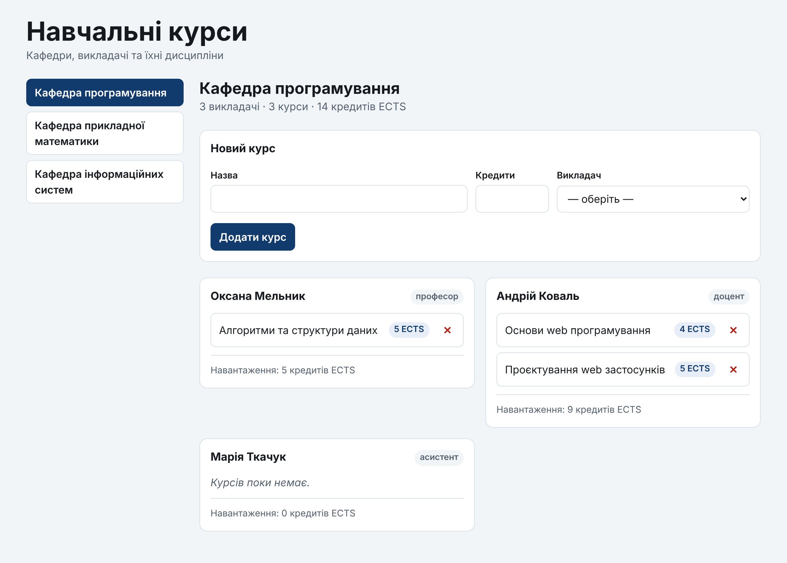
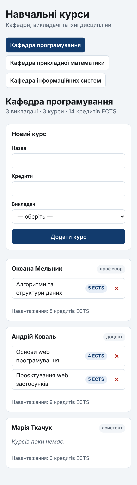

# Самостійна робота: React-аплікація «Навчальні курси»

> **Курс:** Основи web програмування · ЛНУ ім. Івана Франка · ФПМІ
> **Теорія:** [Лекція 6. React: компонентна модель, props, state](../../lectures/06-react-components-props-state.md)
> **Попередній приклад:** [«Кіносписок»](01-react-vite-movie-watchlist.md)
> **Інструменти:** WebStorm, Node.js 24 LTS, Vite 8, React 19
> **Час:** одна пара (≈ 80 хвилин) + додаткові завдання для тих, хто встигне

Ви самостійно, крок за кроком, створите аплікацію, яка показує кафедри,
викладачів і навчальні курси. Можна обрати кафедру, побачити її викладачів
із їхніми курсами, додати новий курс і видалити наявний.

У «Кіноспискові» дані були простим масивом фільмів. Тут дані **пов'язані між
собою**: курс належить викладачеві, а викладач — кафедрі. Саме це робить
приклад цікавим: ви побачите, як React працює з такими даними, що варто
зберігати в стані, а що — обчислювати, і чому.

---

## Як працювати з цією інструкцією

1. **Виконуйте кроки по черзі.** Кожен крок спирається на попередній.
2. **JSX набирайте самі**, а не копіюйте: так ви помітите кожну деталь
   і запам'ятаєте синтаксис. CSS можна копіювати.
3. **Після кожного кроку зупиняйтеся на контрольній точці ✅.** Якщо в
   браузері не те, що описано, — не йдіть далі. Загляньте в 🆘.
4. **Відповідайте на питання 🤔 самі**, і лише потім відкривайте відповідь.
   Ці питання — головне в занятті: вони перевіряють, чи ви **зрозуміли**,
   а не лише набрали код.
5. **Експерименти 🧪 обов'язкові.** Вони показують, що станеться, якщо
   зробити неправильно. Після експерименту завжди повертайте правильний код.
6. **Консоль браузера весь час відкрита** (`⌥⌘J` на macOS, `F12` на
   Windows/Linux → вкладка Console). Червоні повідомлення — це підказки.

Код кожного кроку — **повний вміст файлу**. Якщо файл змінюється кілька
разів, після коду є перелік, **що саме** змінилося.

---

## Зміст

0. [Що ми побудуємо](#0-що-ми-побудуємо)
1. [Створення проєкту](#1-створення-проєкту)
2. [Прибираємо шаблон](#2-прибираємо-шаблон)
3. [Дані та їхні зв'язки](#3-дані-та-їхні-звязки)
4. [Прості компоненти: Button і Badge](#4-прості-компоненти-button-і-badge)
5. [Курс і картка викладача](#5-курс-і-картка-викладача)
6. [Вибір кафедри: перший стан](#6-вибір-кафедри-перший-стан)
7. [Курси в стані: видалення](#7-курси-в-стані-видалення)
8. [Форма додавання курсу](#8-форма-додавання-курсу)
9. [Фінальна перевірка](#9-фінальна-перевірка)
10. [Типові помилки](#10-типові-помилки)
11. [Додаткові завдання](#11-додаткові-завдання)
12. [Корисні посилання](#12-корисні-посилання)

---

## 0. Що ми побудуємо



**Що вміє аплікація:**

- ліворуч — перелік кафедр; обрана кафедра виділена;
- праворуч — назва кафедри й підсумок: скільки викладачів, курсів і кредитів;
- картки викладачів обраної кафедри, у кожній — курси й навантаження;
- форма додавання курсу: назва, кількість кредитів, викладач зі списку;
- видалення курсу;
- на телефоні все в один стовпчик.

### 0.1. Модель даних

```
┌───────────────┐        ┌─────────────────────┐        ┌───────────────────┐
│    Кафедра    │        │      Викладач       │        │       Курс        │
├───────────────┤  1   N ├─────────────────────┤  1   N ├───────────────────┤
│ id            │◄───────┤ departmentId        │◄───────┤ lecturerId        │
│ name          │        │ id                  │        │ id                │
└───────────────┘        │ name                │        │ title             │
                         │ position            │        │ credits           │
                         └─────────────────────┘        └───────────────────┘
```

Зв'язки — через `id`, як у базі даних. У кафедри багато викладачів, у
викладача — багато курсів. **У курсу немає поля «кафедра»**: її завжди можна
знайти через викладача. Чому це важливо, з'ясуємо в кроці 3.

### 0.2. Дерево компонентів

```
App                          ← стан: courses, departmentId
├── DepartmentNav            ← перемикач кафедр
├── CourseForm               ← стан: поля форми, помилка
│   └── Button
└── LecturerCard × N
    ├── Badge                ← посада
    └── CourseItem × N
        ├── Badge            ← кредити
        └── Button           ← видалити
```

### 0.3. Що нового порівняно з «Кіносписком»

| Що нового | Де побачите |
|---|---|
| **Не все, що є в аплікації, — стан.** Кафедри й викладачі не змінюються, тому це звичайні константи | крок 3, крок 6 |
| **Пов'язані дані** і пошук пов'язаного запису через `find` | `getDepartmentId` в `App` |
| **У стані зберігаємо `id`, а не цілий об'єкт** | `departmentId` в `App` |
| **Агрегація** — сума через `reduce` | кредити кафедри й викладача |
| **Вкладені списки** і `key` на кожному рівні | `App` → `LecturerCard` → `CourseItem` |
| **Тернарний оператор** для двох гілок | порожня картка викладача |
| **Керований `<select>`**, опції якого залежать від props | `CourseForm` |
| **`key` для скидання стану компонента** | `<CourseForm key={departmentId}>` |
| **Кнопка лише з іконкою** і `aria-label` | `✕` у `CourseItem` |
| **Сітка без медіазапитів**: `repeat(auto-fill, minmax(…))` | `App.module.css` |
| **Правильні форми слів** після числа: 1 курс, 3 курси, 5 курсів | `utils/plural.js` |

---

## 1. Створення проєкту

**≈ 5 хвилин.** Детально з поясненнями цей крок описаний у
[«Кіноспискові», розділ 2](01-react-vite-movie-watchlist.md#2-створення-проєкту-у-webstorm).
Коротко:

1. WebStorm → **File | New | Project…** → у лівій панелі **Vite**.
2. **Location**: папка `university-courses` там, де ви зберігаєте роботи.
3. **Node runtime**: Node.js 24 LTS (мінімум 22.12).
4. **Vite**: `npx create-vite`; **Template**: `react`; прапорець TypeScript — **не ставте**.
5. **Create**. Дочекайтеся, поки WebStorm встановить залежності.
6. Запустіть конфігурацію **npm dev** (▶ угорі вікна) і відкрийте
   `http://localhost:5173/`.

Або в терміналі:

```bash
npm create vite@latest university-courses -- --template react
cd university-courses
npm install
npm run dev
```

#### ✅ Контрольна точка

Стартова сторінка шаблону з написом **Get started** і лічильником.

---

## 2. Прибираємо шаблон

**≈ 5 хвилин.**

### 2.1. Видаліть зайве

У вікні **Project** видаліть `src/App.css`, папку `src/assets` і
`public/icons.svg`. Файл `public/favicon.svg` залиште.

### 2.2. `index.html`

📄 **`index.html`**

```html
<!doctype html>
<html lang="uk">
  <head>
    <meta charset="UTF-8" />
    <link rel="icon" type="image/svg+xml" href="/favicon.svg" />
    <meta name="viewport" content="width=device-width, initial-scale=1.0" />
    <title>Навчальні курси</title>
  </head>
  <body>
    <div id="root"></div>
    <script type="module" src="/src/main.jsx"></script>
  </body>
</html>
```

### 2.3. Глобальні стилі

Замініть увесь `src/index.css`. Тут лише кольори у змінних, скидання
відступів і шрифт — те, що стосується **всієї** сторінки.

📄 **`src/index.css`**

```css
/* Глобальні стилі: кольори, скидання, базова типографіка.
   Усе, що стосується одного компонента, живе в його *.module.css. */

:root {
  --color-bg: #f2f5f8;
  --color-surface: #ffffff;
  --color-text: #16191d;
  --color-muted: #576270;
  --color-border: #d8e0e8;
  --color-accent: #123b6d;
  --color-accent-hover: #0d2c52;
  --color-accent-soft: #e7eef7;
  --color-danger: #b42318;
  --color-danger-soft: #fdecea;
  --radius: 0.75rem; /* 12px */

  font-family: system-ui, sans-serif;
  line-height: 1.5;
  color: var(--color-text);
  background: var(--color-bg);
}

*,
*::before,
*::after {
  box-sizing: border-box;
}

body,
h1,
h2,
h3,
p,
ul {
  margin: 0;
}

ul {
  padding: 0;
  list-style: none;
}

/* Поля, списки й кнопки за замовчуванням мають власний шрифт браузера */
button,
input,
select {
  font: inherit;
}
```

### 2.4. Тимчасовий `App.jsx`

📄 **`src/App.jsx`** — тимчасова версія

```jsx
function App() {
  return <h1>Навчальні курси</h1>;
}

export default App;
```

#### ✅ Контрольна точка

Лише заголовок «Навчальні курси» на світло-сірому тлі. Назва вкладки —
«Навчальні курси». Консоль без помилок.

> 🆘 **Червоний екран з `Failed to resolve import "./App.css"`.** Ви
> видалили `App.css`, але ще не замінили `App.jsx`. Замініть — помилка зникне.

---

## 3. Дані та їхні зв'язки

**≈ 10 хвилин.**

### 3.1. Структура папок

Створіть папки так, як радить лекція 6, §15:

```
src/
├── components/     ← універсальні компоненти: нічого не знають про курси
│   ├── Badge/
│   └── Button/
├── features/       ← компоненти предметної області
│   ├── courses/
│   ├── departments/
│   └── lecturers/
├── data/           ← початкові дані
└── utils/          ← чисті допоміжні функції
```

> 💡 Правою кнопкою по `src` → **New | File** → введіть шлях цілком,
> наприклад `data/university.js`. WebStorm створить відсутні папки сам.

### 3.2. Дані

📄 **`src/data/university.js`**

```js
// Довідкові дані. У цій аплікації кафедри й викладачі не змінюються,
// тому це звичайні константи, а НЕ стан. Змінюються лише курси.
//
// Зв'язки між сутностями — через id, як у базі даних:
//   курс --lecturerId--> викладач --departmentId--> кафедра
// Кафедру курсу ми НЕ зберігаємо: її завжди можна знайти через викладача.

export const departments = [
  { id: 'd1', name: 'Кафедра програмування' },
  { id: 'd2', name: 'Кафедра прикладної математики' },
  { id: 'd3', name: 'Кафедра інформаційних систем' },
];

export const lecturers = [
  { id: 'l1', name: 'Оксана Мельник', position: 'професор', departmentId: 'd1' },
  { id: 'l2', name: 'Андрій Коваль', position: 'доцент', departmentId: 'd1' },
  { id: 'l3', name: 'Марія Ткачук', position: 'асистент', departmentId: 'd1' },
  { id: 'l4', name: 'Ірина Бойко', position: 'доцент', departmentId: 'd2' },
  { id: 'l5', name: 'Тарас Гнатюк', position: 'професор', departmentId: 'd2' },
  { id: 'l6', name: 'Наталія Савчук', position: 'доцент', departmentId: 'd3' },
];

export const initialCourses = [
  { id: 'c1', title: 'Основи web програмування', credits: 4, lecturerId: 'l2' },
  { id: 'c2', title: 'Проєктування web застосунків', credits: 5, lecturerId: 'l2' },
  { id: 'c3', title: 'Алгоритми та структури даних', credits: 5, lecturerId: 'l1' },
  { id: 'c4', title: 'Чисельні методи', credits: 5, lecturerId: 'l4' },
  { id: 'c5', title: 'Теорія ймовірностей', credits: 4, lecturerId: 'l5' },
  { id: 'c6', title: 'Бази даних', credits: 5, lecturerId: 'l6' },
];
```

Зверніть увагу на дві речі:

- **Зв'язки через `id`.** Курс «Основи web програмування» має
  `lecturerId: 'l2'` — це Андрій Коваль. А в Андрія Коваля
  `departmentId: 'd1'` — Кафедра програмування.
- **Три іменовані експорти** з одного модуля. Імпортувати можна лише те,
  що потрібно: `import { lecturers } from …`.

#### 🤔 Перевір себе

**1. Чому в курсу немає поля `departmentId`? Адже так було б простіше
знайти кафедру курсу.**

<details>
<summary>Відповідь</summary>

Бо кафедру курсу вже визначає його викладач. Якби ми зберігали кафедру
і в курсі, і у викладача, ці два значення могли б розійтися: наприклад,
викладача перевели на іншу кафедру, а в його курсах залишилася стара.
Тоді аплікація показувала б різне в різних місцях.

Правило: **кожен факт зберігається в одному місці**, а все, що з нього
випливає, — обчислюється. Це той самий принцип, що й «мінімум стану»
з лекції 6, §9.5, тільки для даних загалом.

</details>

**2. До якої кафедри належить курс «Бази даних»?**

<details>
<summary>Відповідь</summary>

`c6` → `lecturerId: 'l6'` → Наталія Савчук → `departmentId: 'd3'` →
Кафедра інформаційних систем. Саме такий «ланцюжок» виконуватиме функція
`getDepartmentId` у кроці 6.

</details>

### 3.3. Допоміжна функція для чисел

У підсумках ми писатимемо «3 курси», «5 кредитів», «1 викладач». В
українській мові форма слова залежить від числа, і правила непрості
(1, 21, 101 → «курс»; 2–4, 22–24 → «курси»; 5–20, 0 → «курсів»).
Браузер уже знає ці правила — скористаємося ними.

📄 **`src/utils/plural.js`**

```js
// Правильна форма слова після числа: 1 курс, 2 курси, 5 курсів, 21 курс.
// Intl.PluralRules знає правила української мови — писати їх вручну не треба.
const rules = new Intl.PluralRules('uk');

/**
 * @param {number} count
 * @param {[string, string, string]} forms — форми для 1, 2 і 5
 * @returns {string} напр. formatCount(3, ['курс', 'курси', 'курсів']) → '3 курси'
 */
export function formatCount(count, [one, few, many]) {
  const forms = { one, few, many };
  return `${count} ${forms[rules.select(count)] ?? many}`;
}
```

- `Intl.PluralRules('uk')` — вбудований у JavaScript об'єкт.
  `rules.select(3)` повертає `'few'`, `rules.select(5)` — `'many'`,
  `rules.select(21)` — `'one'`.
- `[one, few, many]` у параметрах — **деструктуризація масиву**: три форми
  слова одразу отримують імена.
- `?? many` — запасний варіант для дробових чисел (для них правило
  повертає `'other'`).
- Це **чиста функція**: не має стану, нічого не змінює, для тих самих
  аргументів завжди дає той самий результат. Тому вона в `utils/`, а не
  в компоненті.

Перевірити функцію можна просто в консолі браузера:

```js
const rules = new Intl.PluralRules('uk');
[0, 1, 2, 5, 11, 21, 22].map((n) => `${n} → ${rules.select(n)}`);
```

---

## 4. Прості компоненти: Button і Badge

**≈ 10 хвилин.**

### 4.1. `Button`

Якщо ви робили «Кіносписок», скопіюйте звідти папку `components/Button`
без змін. Якщо ні — створіть файли:

📄 **`src/components/Button/Button.jsx`**

```jsx
import styles from './Button.module.css';

/**
 * Кнопка з варіантами оформлення.
 *
 * @param {Object} props
 * @param {'primary' | 'secondary' | 'danger'} [props.variant='primary']
 * @param {'button' | 'submit'} [props.type='button']
 * @param {string} [props.className] — додатковий клас від батька
 * Усі інші props (children, onClick, aria-*, disabled…) потрапляють
 * у ...rest і передаються на <button> як є.
 */
function Button({ variant = 'primary', type = 'button', className = '', ...rest }) {
  return (
    <button
      type={type}
      className={`${styles.button} ${styles[variant]} ${className}`}
      {...rest}
    />
  );
}

export default Button;
```

📄 **`src/components/Button/Button.module.css`**

```css
.button {
  display: inline-flex;
  align-items: center;
  justify-content: center;
  gap: 0.375rem;
  min-height: 2.5rem; /* 40px — зручна ціль для пальця */
  padding: 0.5rem 0.75rem;
  border: 1px solid transparent;
  border-radius: 0.5rem;
  font-weight: 600;
  cursor: pointer;
}

.button:focus-visible {
  outline: 3px solid var(--color-accent);
  outline-offset: 2px;
}

.primary {
  background: var(--color-accent);
  color: #fff;
}

.primary:hover {
  background: var(--color-accent-hover);
}

.secondary {
  background: var(--color-surface);
  border-color: var(--color-border);
  color: var(--color-text);
}

.secondary:hover {
  border-color: var(--color-accent);
}

.danger {
  background: transparent;
  color: var(--color-danger);
}

.danger:hover {
  background: var(--color-danger-soft);
}
```

Нагадування, що тут важливо:

- `variant = 'primary'` і `type = 'button'` — **значення за замовчуванням**
  (лекція 6, §6). Без `type = 'button'` кожна кнопка в `<form>` надсилала б
  форму.
- `...rest` — усі **інші** props (`onClick`, `aria-label`, `children` …)
  передаються на `<button>` як є (§6.4).
- `styles[variant]` — **CSS Modules** (§14.2): клас береться з об'єкта
  `styles` за назвою варіанта.

### 4.2. `Badge`

📄 **`src/components/Badge/Badge.jsx`**

```jsx
import styles from './Badge.module.css';

/**
 * Невелика позначка: посада, кількість кредитів тощо.
 *
 * @param {Object} props
 * @param {React.ReactNode} props.children — текст позначки
 * @param {'neutral' | 'accent'} [props.variant='neutral']
 */
function Badge({ children, variant = 'neutral' }) {
  return <span className={`${styles.badge} ${styles[variant]}`}>{children}</span>;
}

export default Badge;
```

📄 **`src/components/Badge/Badge.module.css`**

```css
.badge {
  display: inline-block;
  padding: 0.125rem 0.5rem;
  border-radius: 999px; /* «пігулка»: завжди круглі краї */
  font-size: 0.8125rem; /* 13px */
  font-weight: 600;
  white-space: nowrap;
}

.neutral {
  background: var(--color-bg);
  color: var(--color-muted);
}

.accent {
  background: var(--color-accent-soft);
  color: var(--color-accent);
}
```

`Badge` — найпростіший можливий компонент: приймає вміст через `children`
і варіант оформлення. Він нічого не знає ні про викладачів, ні про
кредити, тому лежить у `components/`.

### 4.3. Перевіряємо

📄 **`src/App.jsx`** — тимчасова версія

```jsx
import Badge from './components/Badge/Badge.jsx';
import Button from './components/Button/Button.jsx';

function App() {
  return (
    <>
      <h1>Навчальні курси</h1>
      <p>
        <Badge>доцент</Badge> <Badge variant="accent">5 ECTS</Badge>
      </p>
      <Button>Основна</Button>
      <Button variant="danger" onClick={() => console.log('Видалити!')}>
        ✕
      </Button>
    </>
  );
}

export default App;
```

#### ✅ Контрольна точка

Сіра позначка «доцент», синя «5 ECTS», темна кнопка «Основна» і червоний
хрестик. Клік по хрестику пише `Видалити!` у консоль.

#### 🤔 Перевір себе

**У `Button` немає параметра `children`. Звідки ж кнопка бере текст «✕»?**

<details>
<summary>Відповідь</summary>

Усе, що записано між `<Button>` і `</Button>`, React передає в prop
`children`. Ми не назвали `children` у деструктуризації
`{ variant, type, className, ...rest }`, тож він потрапив у `rest`.
А `{...rest}` передає його на `<button>`. Тому
`<button {...rest} />` хоч і записаний як самозакривний тег, але текст
у кнопці буде.

</details>

---

## 5. Курс і картка викладача

**≈ 15 хвилин.** Спершу — **статична** версія: показуємо дані, нічого не
змінюючи. Так одразу видно, які компоненти потрібні і що кожен отримує.

### 5.1. `CourseItem` — один курс

📄 **`src/features/courses/CourseItem.jsx`**

```jsx
import Badge from '../../components/Badge/Badge.jsx';
import Button from '../../components/Button/Button.jsx';
import styles from './CourseItem.module.css';

/**
 * Один курс: назва, кількість кредитів, кнопка видалення.
 *
 * @param {Object} props
 * @param {{id: string, title: string, credits: number}} props.course
 * @param {(id: string) => void} props.onDelete
 */
function CourseItem({ course, onDelete }) {
  return (
    <div className={styles.item}>
      <span className={styles.title}>{course.title}</span>
      <Badge variant="accent">{course.credits} ECTS</Badge>
      <Button
        variant="danger"
        onClick={() => onDelete(course.id)}
        aria-label={`Видалити курс «${course.title}»`}
      >
        ✕
      </Button>
    </div>
  );
}

export default CourseItem;
```

📄 **`src/features/courses/CourseItem.module.css`**

```css
.item {
  display: flex;
  align-items: center;
  gap: 0.5rem;
  padding: 0.25rem 0.25rem 0.25rem 0.75rem;
  border: 1px solid var(--color-border);
  border-radius: 0.5rem;
}

/* flex: 1 — назва забирає все вільне місце, позначка й кнопка — праворуч */
.title {
  flex: 1;
}
```

- **Компонент не видаляє курс сам.** Він лише повідомляє батька:
  `onDelete(course.id)`. Чий це список і як його змінити — вирішує
  той, кому список належить.
- **`onClick={() => onDelete(course.id)}`** — функція, яку React викличе
  під час кліку. Без стрілки (`onClick={onDelete(course.id)}`) курс
  видалявся б одразу під час рендеру (§11).
- **Кнопка з іконкою.** Видимого тексту немає, лише «✕». Програма екранного
  доступу прочитала б «множення» або нічого. Тому `aria-label` пояснює,
  **що саме** видаляємо: «Видалити курс «Бази даних»».

### 5.2. `LecturerCard` — викладач і його курси

📄 **`src/features/lecturers/LecturerCard.jsx`**

```jsx
import Badge from '../../components/Badge/Badge.jsx';
import CourseItem from '../courses/CourseItem.jsx';
import { formatCount } from '../../utils/plural.js';
import styles from './LecturerCard.module.css';

/**
 * Картка викладача з переліком його курсів.
 *
 * @param {Object} props
 * @param {{id: string, name: string, position: string}} props.lecturer
 * @param {Array<{id: string, title: string, credits: number}>} props.courses — лише курси ЦЬОГО викладача
 * @param {(id: string) => void} props.onDeleteCourse
 */
function LecturerCard({ lecturer, courses, onDeleteCourse }) {
  // Похідне значення: обчислюємо з props, у стані не зберігаємо
  const totalCredits = courses.reduce((sum, course) => sum + course.credits, 0);

  return (
    <article className={styles.card}>
      <header className={styles.header}>
        <h3 className={styles.name}>{lecturer.name}</h3>
        <Badge>{lecturer.position}</Badge>
      </header>

      {courses.length > 0 ? (
        <ul className={styles.courses}>
          {courses.map((course) => (
            <li key={course.id}>
              <CourseItem course={course} onDelete={onDeleteCourse} />
            </li>
          ))}
        </ul>
      ) : (
        <p className={styles.empty}>Курсів поки немає.</p>
      )}

      <footer className={styles.footer}>
        Навантаження: {formatCount(totalCredits, ['кредит', 'кредити', 'кредитів'])} ECTS
      </footer>
    </article>
  );
}

export default LecturerCard;
```

📄 **`src/features/lecturers/LecturerCard.module.css`**

```css
.card {
  display: grid;
  gap: 0.75rem;
  padding: 1rem;
  background: var(--color-surface);
  border: 1px solid var(--color-border);
  border-radius: var(--radius);
}

.header {
  display: flex;
  flex-wrap: wrap;
  align-items: center;
  justify-content: space-between;
  gap: 0.5rem;
}

.name {
  font-size: 1.0625rem; /* 17px */
}

.courses {
  display: grid;
  gap: 0.5rem;
}

.empty {
  color: var(--color-muted);
  font-style: italic;
}

.footer {
  padding-top: 0.75rem;
  border-top: 1px solid var(--color-border);
  color: var(--color-muted);
  font-size: 0.875rem; /* 14px */
}
```

- **`reduce`** складає кредити всіх курсів: починаємо з `0`, на кожному
  кроці додаємо `course.credits`.
- **`totalCredits` — не стан.** Це похідне значення: воно повністю
  визначається props `courses`. Обчислюємо на кожному рендері (§9.5).
- **Тернарний оператор** (§7) обирає одну з **двох** гілок: список або
  повідомлення «Курсів поки немає.».
- **`key` на `<li>`**, бо саме `<li>` — зовнішній елемент у `map` (§8).
- **Компонент із `features/lecturers` імпортує компонент із
  `features/courses`** — це нормально: картка викладача складається з курсів.

### 5.3. Показуємо всіх викладачів

📄 **`src/App.jsx`** — тимчасова версія

```jsx
import LecturerCard from './features/lecturers/LecturerCard.jsx';
import { lecturers, initialCourses } from './data/university.js';

function App() {
  return (
    <>
      {lecturers.map((lecturer) => (
        <LecturerCard
          key={lecturer.id}
          lecturer={lecturer}
          courses={initialCourses.filter((course) => course.lecturerId === lecturer.id)}
        />
      ))}
    </>
  );
}

export default App;
```

Для кожного викладача ми **відфільтровуємо** його курси й передаємо
готовий масив. Картка не знає про інших викладачів і їхні курси — вона
отримує рівно те, що їй потрібно.

#### ✅ Контрольна точка

- Шість карток одна під одною (розкладку зробимо пізніше).
- У Андрія Коваля — два курси й «Навантаження: 9 кредитів ECTS».
- У Марії Ткачук — «Курсів поки немає.» і «0 кредитів».
- Клацніть ✕ — курс **не зникне**, а в консолі з'явиться помилка
  `onDelete is not a function`. Це очікувано: картка чекає колбек, якого
  ми ще не передали. Даних, що змінюються, у нас поки немає.

#### 🧪 Експеримент: пастка `&&` з числом

У `LecturerCard` тимчасово замініть тернарний оператор цим:

```jsx
{courses.length && (
  <ul className={styles.courses}>
    {courses.map((course) => (
      <li key={course.id}>
        <CourseItem course={course} onDelete={onDeleteCourse} />
      </li>
    ))}
  </ul>
)}
```

Подивіться на картку Марії Ткачук — там з'явилася цифра **«0»**. Вираз
`0 && …` дорівнює `0`, а число React малює (§4.3). Поверніть тернарний
оператор.

#### 🤔 Перевір себе

**1. У `LecturerCard` є `key` на `<li>`, а в `App` — `key` на
`<LecturerCard>`. Чому ключ потрібен двічі?**

<details>
<summary>Відповідь</summary>

Тому що це два **різні** списки: список карток в `App` і список курсів
усередині кожної картки. `key` потрібен у кожному `map` і має бути
унікальним серед **сусідів** у своєму списку, а не на всю сторінку (§8.1).

</details>

**2. Чи можна взяти `key={course.title}`?**

<details>
<summary>Відповідь</summary>

Технічно можна, поки назви не повторюються. Але ніщо не заважає додати два
курси з однаковою назвою (наприклад, для різних спеціальностей) — і ключі
збіжаться. `id` для того й існує: він гарантовано унікальний і не
змінюється.

</details>

---

## 6. Вибір кафедри: перший стан

**≈ 15 хвилин.**

### 6.1. `DepartmentNav`

📄 **`src/features/departments/DepartmentNav.jsx`**

```jsx
import styles from './DepartmentNav.module.css';

/**
 * Перемикач кафедр. Яку кафедру обрано, вирішує батько (selectedId),
 * компонент лише показує кнопки й повідомляє про вибір (onSelect).
 *
 * @param {Object} props
 * @param {Array<{id: string, name: string}>} props.departments
 * @param {string} props.selectedId
 * @param {(id: string) => void} props.onSelect
 */
function DepartmentNav({ departments, selectedId, onSelect }) {
  return (
    <nav aria-label="Кафедри">
      <ul className={styles.list}>
        {departments.map((department) => (
          <li key={department.id}>
            <button
              type="button"
              className={styles.item}
              aria-pressed={department.id === selectedId}
              onClick={() => onSelect(department.id)}
            >
              {department.name}
            </button>
          </li>
        ))}
      </ul>
    </nav>
  );
}

export default DepartmentNav;
```

📄 **`src/features/departments/DepartmentNav.module.css`**

```css
/* Телефон: кнопки в рядок із переносом */
.list {
  display: flex;
  flex-wrap: wrap;
  gap: 0.5rem;
}

.item {
  min-height: 2.5rem; /* 40px */
  padding: 0.5rem 0.75rem;
  border: 1px solid var(--color-border);
  border-radius: 0.5rem;
  background: var(--color-surface);
  color: var(--color-text);
  font-weight: 600;
  text-align: left;
  cursor: pointer;
}

.item:hover {
  border-color: var(--color-accent);
}

.item:focus-visible {
  outline: 3px solid var(--color-accent);
  outline-offset: 2px;
}

/* Обрана кафедра: стан беремо з ARIA-атрибута, а не з окремого класу */
.item[aria-pressed='true'] {
  background: var(--color-accent);
  border-color: var(--color-accent);
  color: #fff;
}

/* Планшет і ширше: вертикальне меню на всю ширину колонки */
@media (min-width: 48rem) {
  .list {
    flex-direction: column;
  }

  .item {
    width: 100%;
  }
}
```

- **Компонент без власного стану.** Яку кафедру обрано, знає `App`;
  `DepartmentNav` отримує `selectedId` і повідомляє про вибір через
  `onSelect`.
- **`aria-pressed`** каже програмі екранного доступу, що це кнопка-перемикач
  і чи натиснута вона. У CSS обрану кнопку виділяємо **через цей самий
  атрибут** — одне джерело правди.
- **Медіазапит усередині модуля.** На телефоні кнопки в рядок, на
  ширшому екрані — вертикальне меню. Кожен компонент сам відповідає за
  свою адаптивність.

### 6.2. Стилі сторінки

📄 **`src/App.module.css`**

```css
/* Mobile first: базові правила — один стовпчик для телефона */
.app {
  max-width: 72rem; /* 1152px */
  margin-inline: auto;
  padding: 1.5rem 1rem 3rem;
}

.header {
  margin-bottom: 1.5rem;
}

.title {
  font-size: clamp(1.75rem, 1.4rem + 1.5vw, 2.5rem); /* 28px … 40px */
  line-height: 1.2;
}

.subtitle {
  color: var(--color-muted);
}

.layout {
  display: grid;
  gap: 1.5rem;
}

.content {
  display: grid;
  gap: 1.5rem;
}

.departmentName {
  font-size: 1.5rem; /* 24px */
  line-height: 1.25;
}

.stats {
  color: var(--color-muted);
}

/* Картки викладачів: стільки колонок, скільки влазить, кожна не вужча
   за 18rem (288px). min(100%, …) — щоб на вузькому телефоні картка
   не вилізла за екран. Жодного медіазапиту. */
.lecturers {
  display: grid;
  grid-template-columns: repeat(auto-fill, minmax(min(100%, 18rem), 1fr));
  align-items: start;
  gap: 1rem;
}

/* Планшет і ширше: меню кафедр ліворуч, вміст праворуч */
@media (min-width: 48rem) {
  .layout {
    grid-template-columns: 15rem minmax(0, 1fr); /* 240px | решта */
    align-items: start;
  }
}
```

Найцікавіше тут — сітка карток:

```css
grid-template-columns: repeat(auto-fill, minmax(min(100%, 18rem), 1fr));
```

Читається так: «створи **стільки колонок, скільки влізе**, кожна не вужча
за 18rem і рівно ділить залишок». На телефоні влізе одна, на планшеті —
одна-дві, на широкому екрані — дві-три. **Жодного медіазапиту.**
`min(100%, 18rem)` захищає від вузьких екранів: якщо контейнер вужчий за
18rem, колонка займе 100% і не вилізе за край.

### 6.3. `App` із вибором кафедри

📄 **`src/App.jsx`** — тимчасова версія

```jsx
import { useState } from 'react';
import DepartmentNav from './features/departments/DepartmentNav.jsx';
import LecturerCard from './features/lecturers/LecturerCard.jsx';
import { departments, lecturers, initialCourses } from './data/university.js';
import { formatCount } from './utils/plural.js';
import styles from './App.module.css';

// Кафедра курсу — через його викладача. Функція поза компонентом:
// вона залежить лише від незмінних довідкових даних, а не від стану.
function getDepartmentId(course) {
  const lecturer = lecturers.find((item) => item.id === course.lecturerId);
  return lecturer.departmentId;
}

function App() {
  // СТАН
  const [departmentId, setDepartmentId] = useState(departments[0].id);

  // ПОХІДНІ ДАНІ
  const department = departments.find((item) => item.id === departmentId);
  const departmentLecturers = lecturers.filter(
    (lecturer) => lecturer.departmentId === departmentId,
  );
  const departmentCourses = initialCourses.filter(
    (course) => getDepartmentId(course) === departmentId,
  );
  const totalCredits = departmentCourses.reduce(
    (sum, course) => sum + course.credits,
    0,
  );

  return (
    <div className={styles.app}>
      <header className={styles.header}>
        <h1 className={styles.title}>Навчальні курси</h1>
        <p className={styles.subtitle}>Кафедри, викладачі та їхні дисципліни</p>
      </header>

      <div className={styles.layout}>
        <DepartmentNav
          departments={departments}
          selectedId={departmentId}
          onSelect={setDepartmentId}
        />

        <main className={styles.content}>
          <header>
            <h2 className={styles.departmentName}>{department.name}</h2>
            <p className={styles.stats}>
              {formatCount(departmentLecturers.length, ['викладач', 'викладачі', 'викладачів'])}
              {' · '}
              {formatCount(departmentCourses.length, ['курс', 'курси', 'курсів'])}
              {' · '}
              {formatCount(totalCredits, ['кредит', 'кредити', 'кредитів'])} ECTS
            </p>
          </header>

          <div className={styles.lecturers}>
            {departmentLecturers.map((lecturer) => (
              <LecturerCard
                key={lecturer.id}
                lecturer={lecturer}
                courses={initialCourses.filter((course) => course.lecturerId === lecturer.id)}
              />
            ))}
          </div>
        </main>
      </div>
    </div>
  );
}

export default App;
```

Розберіть `App` згори донизу — він має ту саму будову, що й у «Кіноспискові»:

1. **Функція поза компонентом.** `getDepartmentId` проходить ланцюжок
   «курс → викладач → кафедра». Вона не залежить ні від props, ні від
   стану, тому немає сенсу створювати її заново на кожному рендері.
2. **Стан — одне значення:** `id` обраної кафедри.
3. **Похідні дані** — усе інше: сама кафедра, її викладачі, її курси, сума
   кредитів. Кожне значення обчислюється з `departmentId` і констант.
4. **Розмітка.** `onSelect={setDepartmentId}` — функцію оновлення стану
   передаємо як колбек напряму: вона вже приймає новий `id`.

**`{' · '}`** — рядок у фігурних дужках. Між двома JSX-виразами на різних
рядках JSX не залишає пробілу, тому розділювач із пробілами вставляємо
явно.

#### ✅ Контрольна точка

- Ліворуч три кафедри, «Кафедра програмування» темна.
- Праворуч: «Кафедра програмування», «3 викладачі · 3 курси · 14 кредитів
  ECTS» і три картки.
- Клацніть «Кафедра прикладної математики» — «2 викладачі · 2 курси ·
  9 кредитів ECTS». «Кафедра інформаційних систем» — «1 викладач · 1 курс ·
  5 кредитів ECTS». Зверніть увагу на форми слів.
- Звузьте вікно: кафедри стають рядком кнопок угорі, картки — одна під
  одною.
- **Components** у React Developer Tools → `App` → **hooks**: один
  `State` зі значенням `"d1"`. Перемикайте кафедри — значення змінюється.

> 🆘 **`Cannot read properties of undefined (reading 'departmentId')`.**
> Якийсь курс посилається на викладача, якого немає в `lecturers`
> (опечатка в `lecturerId`). `find` повертає `undefined`. Звірте дані
> з кроком 3.2.

#### 🤔 Перевір себе

**1. Кафедри й викладачі показуються на екрані. Чому вони — не стан?**

<details>
<summary>Відповідь</summary>

Перше з трьох питань лекції 6 (§9.5): **чи змінюється це з часом?** У цій
аплікації кафедри й викладачі не змінюються ніколи — ми їх не додаємо й
не видаляємо. Значення, яке не змінюється, не потребує `useState`:
звичайна константа робить те саме, простіше й швидше.

Стан — це не «дані, які показуються», а «дані, які **змінюються** і від
яких залежить вигляд».

</details>

**2. Чому в стані зберігаємо `departmentId`, а не цілий об'єкт кафедри
(`useState(departments[0])`)?**

<details>
<summary>Відповідь</summary>

Об'єкт кафедри вже є в масиві `departments`. Якби ми поклали його ще й у
стан, це була б **копія**. Поки кафедри не змінюються, різниці не видно.
Але щойно в аплікації з'явиться, скажімо, перейменування кафедри, копія в
стані залишиться зі старою назвою.

`id` — мінімальна інформація, яка однозначно визначає вибір. Сам об'єкт
знаходимо через `find` на кожному рендері — і він завжди актуальний.

</details>

**3. Скільки разів викликається `getDepartmentId` за один рендер?**

<details>
<summary>Відповідь</summary>

Стільки, скільки всього курсів (6), — один раз для кожного курсу в
`filter`. Для навчальної аплікації це дрібниця. У великих аплікаціях такі
обчислення оптимізують — про це в наступних лекціях.

</details>

---

## 7. Курси в стані: видалення

**≈ 10 хвилин.**

📄 **`src/App.jsx`** — тимчасова версія

```jsx
import { useState } from 'react';
import DepartmentNav from './features/departments/DepartmentNav.jsx';
import LecturerCard from './features/lecturers/LecturerCard.jsx';
import { departments, lecturers, initialCourses } from './data/university.js';
import { formatCount } from './utils/plural.js';
import styles from './App.module.css';

// Кафедра курсу — через його викладача. Функція поза компонентом:
// вона залежить лише від незмінних довідкових даних, а не від стану.
function getDepartmentId(course) {
  const lecturer = lecturers.find((item) => item.id === course.lecturerId);
  return lecturer.departmentId;
}

function App() {
  // СТАН — лише те, що змінюється і що неможливо обчислити
  const [courses, setCourses] = useState(initialCourses);
  const [departmentId, setDepartmentId] = useState(departments[0].id);

  // ПОХІДНІ ДАНІ — обчислюємо під час кожного рендеру
  const department = departments.find((item) => item.id === departmentId);
  const departmentLecturers = lecturers.filter(
    (lecturer) => lecturer.departmentId === departmentId,
  );
  const departmentCourses = courses.filter(
    (course) => getDepartmentId(course) === departmentId,
  );
  const totalCredits = departmentCourses.reduce(
    (sum, course) => sum + course.credits,
    0,
  );

  // ОБРОБНИКИ — єдине місце, де змінюється список курсів
  const handleDeleteCourse = (id) => {
    setCourses((prev) => prev.filter((course) => course.id !== id));
  };

  return (
    <div className={styles.app}>
      <header className={styles.header}>
        <h1 className={styles.title}>Навчальні курси</h1>
        <p className={styles.subtitle}>Кафедри, викладачі та їхні дисципліни</p>
      </header>

      <div className={styles.layout}>
        <DepartmentNav
          departments={departments}
          selectedId={departmentId}
          onSelect={setDepartmentId}
        />

        <main className={styles.content}>
          <header>
            <h2 className={styles.departmentName}>{department.name}</h2>
            <p className={styles.stats}>
              {formatCount(departmentLecturers.length, ['викладач', 'викладачі', 'викладачів'])}
              {' · '}
              {formatCount(departmentCourses.length, ['курс', 'курси', 'курсів'])}
              {' · '}
              {formatCount(totalCredits, ['кредит', 'кредити', 'кредитів'])} ECTS
            </p>
          </header>

          <div className={styles.lecturers}>
            {departmentLecturers.map((lecturer) => (
              <LecturerCard
                key={lecturer.id}
                lecturer={lecturer}
                courses={courses.filter((course) => course.lecturerId === lecturer.id)}
                onDeleteCourse={handleDeleteCourse}
              />
            ))}
          </div>
        </main>
      </div>
    </div>
  );
}

export default App;
```

**Що змінилося:**

- з'явився стан `courses` з початковим значенням `initialCourses`;
- **усі** місця, де раніше був `initialCourses`, тепер беруть `courses` —
  інакше видалення не впливало б на підсумки;
- обробник `handleDeleteCourse` створює **новий** масив через `filter`
  (§10) і використовує функціональне оновлення `prev => …` (§9.2);
- `onDeleteCourse={handleDeleteCourse}` передається в кожну картку, а
  картка передає його кожному курсу як `onDelete`.

Простежте шлях кліку по ✕:

```
CourseItem   onDelete(course.id)
   ↑ це той самий onDeleteCourse
LecturerCard
   ↑ це той самий handleDeleteCourse
App          setCourses(prev => prev.filter(…))   ← стан змінюється ТУТ
   ↓ новий рендер
усі похідні дані перераховуються, картки й підсумки оновлюються
```

#### ✅ Контрольна точка

- Видаліть «Основи web програмування»: курс зникає, у картці Андрія
  Коваля — «5 кредитів», угорі — «2 курси · 10 кредитів ECTS».
- Перейдіть на іншу кафедру й поверніться — видалений курс **не
  повернувся**.
- Перезавантажте сторінку — усе повернулося до початкових даних. Так і має
  бути: дані живуть лише в пам'яті браузера (збереження — лекція 7).

#### 🤔 Перевір себе

**1. Видаляєте курс у картці — і змінюються три числа в різних місцях:
навантаження викладача, кількість курсів і кредитів кафедри. Ми ж не
писали коду, який оновлює кожне з них. Як це працює?**

<details>
<summary>Відповідь</summary>

Жодне з цих чисел не зберігається — усі вони **обчислюються** з `courses`.
Змінився `courses` → React перерендерив `App` → `App` наново обчислив
`departmentCourses` і `totalCredits` і передав нові `courses` у картки →
кожна картка наново обчислила свій `totalCredits`.

Якби ці числа були окремими `useState`, довелося б оновлювати кожне
вручну в `handleDeleteCourse` — і рано чи пізно десь забути.

</details>

**2. Чому `handleDeleteCourse` живе в `App`, а не в `LecturerCard`, де
розташована кнопка?**

<details>
<summary>Відповідь</summary>

Бо стан `courses` належить `App`: від нього залежать і картки, і підсумки
кафедри, а `App` — їхній найближчий спільний предок. **Змінювати стан може
лише той компонент, якому він належить.** Діти отримують колбек і просять
змінити (підняття стану, §13).

</details>

---

## 8. Форма додавання курсу

**≈ 15 хвилин.**

### 8.1. `CourseForm`

📄 **`src/features/courses/CourseForm.jsx`**

```jsx
import { useState } from 'react';
import Button from '../../components/Button/Button.jsx';
import styles from './CourseForm.module.css';

const EMPTY_FORM = { title: '', credits: '', lecturerId: '' };

/**
 * Форма додавання курсу. Тримає лише стан своїх полів;
 * готовий курс віддає батькові через onAdd.
 *
 * @param {Object} props
 * @param {Array<{id: string, name: string}>} props.lecturers — викладачі, яких можна обрати
 * @param {(course: {title: string, credits: number, lecturerId: string}) => void} props.onAdd
 */
function CourseForm({ lecturers, onAdd }) {
  const [form, setForm] = useState(EMPTY_FORM);
  const [error, setError] = useState('');

  // Один обробник на всі поля, зокрема й на <select>
  const handleChange = (event) => {
    const { name, value } = event.target;
    setForm((prev) => ({ ...prev, [name]: value }));
  };

  const handleSubmit = (event) => {
    event.preventDefault();

    const title = form.title.trim();
    const credits = Number(form.credits);

    if (title === '') {
      setError('Введіть назву курсу.');
      return;
    }
    if (!Number.isInteger(credits) || credits < 1 || credits > 15) {
      setError('Кількість кредитів — ціле число від 1 до 15.');
      return;
    }
    if (form.lecturerId === '') {
      setError('Оберіть викладача.');
      return;
    }

    onAdd({ title, credits, lecturerId: form.lecturerId });
    setForm(EMPTY_FORM);
    setError('');
  };

  return (
    <form className={styles.form} onSubmit={handleSubmit} noValidate>
      <h3 className={styles.heading}>Новий курс</h3>

      <div className={styles.fields}>
        <div className={styles.field}>
          <label htmlFor="course-title">Назва</label>
          <input
            id="course-title"
            name="title"
            type="text"
            autoComplete="off"
            value={form.title}
            onChange={handleChange}
          />
        </div>

        <div className={styles.field}>
          <label htmlFor="course-credits">Кредити</label>
          <input
            id="course-credits"
            name="credits"
            type="number"
            min="1"
            max="15"
            value={form.credits}
            onChange={handleChange}
          />
        </div>

        <div className={styles.field}>
          <label htmlFor="course-lecturer">Викладач</label>
          <select
            id="course-lecturer"
            name="lecturerId"
            value={form.lecturerId}
            onChange={handleChange}
          >
            <option value="">— оберіть —</option>
            {lecturers.map((lecturer) => (
              <option key={lecturer.id} value={lecturer.id}>
                {lecturer.name}
              </option>
            ))}
          </select>
        </div>
      </div>

      {error && (
        <p className={styles.error} role="alert">
          {error}
        </p>
      )}

      <Button type="submit" className={styles.submit}>
        Додати курс
      </Button>
    </form>
  );
}

export default CourseForm;
```

📄 **`src/features/courses/CourseForm.module.css`**

```css
.form {
  display: grid;
  gap: 1rem;
  padding: 1rem;
  background: var(--color-surface);
  border: 1px solid var(--color-border);
  border-radius: var(--radius);
}

.heading {
  font-size: 1.0625rem; /* 17px */
}

/* Телефон: поля одне під одним */
.fields {
  display: grid;
  gap: 0.75rem;
}

.field {
  display: grid;
  gap: 0.25rem;
}

.field label {
  font-size: 0.875rem; /* 14px */
  font-weight: 600;
}

.field input,
.field select {
  width: 100%;
  min-height: 2.5rem; /* 40px */
  padding: 0.5rem 0.75rem;
  border: 1px solid var(--color-border);
  border-radius: 0.5rem;
  background: var(--color-surface);
  color: inherit;
}

.field input:focus-visible,
.field select:focus-visible {
  outline: 3px solid var(--color-accent);
  outline-offset: 1px;
}

.error {
  color: var(--color-danger);
  font-size: 0.875rem; /* 14px */
}

/* Ширший екран: три поля в один рядок, кнопка — за вмістом */
@media (min-width: 40rem) {
  .fields {
    grid-template-columns: minmax(0, 2fr) 7rem minmax(0, 1.5fr); /* назва | 112px | викладач */
  }

  .submit {
    justify-self: start;
  }
}
```

- **Керовані поля** (§12): значення кожного поля — у стані `form`.
- **Один обробник на всі поля** — і на `<input>`, і на `<select>`.
  Атрибут `name` поля збігається з ключем в об'єкті `form`.
- **Керований `<select>`.** `value={form.lecturerId}` визначає, яку опцію
  обрано. Перша опція з порожнім `value` — «нічого не обрано»; саме її
  перевіряє умова `form.lecturerId === ''`.
- **Опції залежать від props.** Форма показує лише тих викладачів, яких
  їй передали. Яких саме — вирішує `App`.
- **Значення полів — завжди рядки**, навіть у `type="number"`. Тому
  `Number(form.credits)` перед перевіркою й перед передачею в `onAdd`.
- **Форма тримає лише власний стан** (§9.6): текст у полях і помилку.
  Список курсів їй не належить — готовий курс вона віддає через `onAdd`.

### 8.2. Фінальний `App.jsx`

📄 **`src/App.jsx`**

```jsx
import { useState } from 'react';
import DepartmentNav from './features/departments/DepartmentNav.jsx';
import CourseForm from './features/courses/CourseForm.jsx';
import LecturerCard from './features/lecturers/LecturerCard.jsx';
import { departments, lecturers, initialCourses } from './data/university.js';
import { formatCount } from './utils/plural.js';
import styles from './App.module.css';

// Кафедра курсу — через його викладача. Функція поза компонентом:
// вона залежить лише від незмінних довідкових даних, а не від стану.
function getDepartmentId(course) {
  const lecturer = lecturers.find((item) => item.id === course.lecturerId);
  return lecturer.departmentId;
}

function App() {
  // СТАН — лише те, що змінюється і що неможливо обчислити
  const [courses, setCourses] = useState(initialCourses);
  const [departmentId, setDepartmentId] = useState(departments[0].id);

  // ПОХІДНІ ДАНІ — обчислюємо під час кожного рендеру
  const department = departments.find((item) => item.id === departmentId);
  const departmentLecturers = lecturers.filter(
    (lecturer) => lecturer.departmentId === departmentId,
  );
  const departmentCourses = courses.filter(
    (course) => getDepartmentId(course) === departmentId,
  );
  const totalCredits = departmentCourses.reduce(
    (sum, course) => sum + course.credits,
    0,
  );

  // ОБРОБНИКИ — єдине місце, де змінюється список курсів
  const handleAddCourse = ({ title, credits, lecturerId }) => {
    const newCourse = { id: crypto.randomUUID(), title, credits, lecturerId };
    setCourses((prev) => [...prev, newCourse]);
  };

  const handleDeleteCourse = (id) => {
    setCourses((prev) => prev.filter((course) => course.id !== id));
  };

  return (
    <div className={styles.app}>
      <header className={styles.header}>
        <h1 className={styles.title}>Навчальні курси</h1>
        <p className={styles.subtitle}>Кафедри, викладачі та їхні дисципліни</p>
      </header>

      <div className={styles.layout}>
        <DepartmentNav
          departments={departments}
          selectedId={departmentId}
          onSelect={setDepartmentId}
        />

        <main className={styles.content}>
          <header>
            <h2 className={styles.departmentName}>{department.name}</h2>
            <p className={styles.stats}>
              {formatCount(departmentLecturers.length, ['викладач', 'викладачі', 'викладачів'])}
              {' · '}
              {formatCount(departmentCourses.length, ['курс', 'курси', 'курсів'])}
              {' · '}
              {formatCount(totalCredits, ['кредит', 'кредити', 'кредитів'])} ECTS
            </p>
          </header>

          <CourseForm
            key={departmentId}
            lecturers={departmentLecturers}
            onAdd={handleAddCourse}
          />

          <div className={styles.lecturers}>
            {departmentLecturers.map((lecturer) => (
              <LecturerCard
                key={lecturer.id}
                lecturer={lecturer}
                courses={courses.filter((course) => course.lecturerId === lecturer.id)}
                onDeleteCourse={handleDeleteCourse}
              />
            ))}
          </div>
        </main>
      </div>
    </div>
  );
}

export default App;
```

**Що змінилося:**

- імпорт `CourseForm`;
- обробник `handleAddCourse`: новий курс отримує `id` і додається **в кінець**
  нового масиву `[...prev, newCourse]`;
- `<CourseForm>` між заголовком кафедри й картками, і в нього **два
  важливі props**:
  - `lecturers={departmentLecturers}` — у списку лише викладачі обраної
    кафедри;
  - **`key={departmentId}`** — про нього нижче.

> ⚠️ `crypto.randomUUID()` працює на `localhost` і `https://`, але не на
> `http://192.168…` (якщо відкривати з телефона за IP-адресою). Для такої
> перевірки тимчасово використайте `id: String(Date.now())`.

### 8.3. Навіщо `key` на формі

Ви вже знаєте `key` у списках. Але `key` працює на **будь-якому**
компоненті й означає «це — інший екземпляр». Коли `key` змінюється, React
**викидає старий компонент разом з його станом** і створює новий.

`key={departmentId}` каже: «форма для кафедри програмування і форма для
кафедри математики — це **різні** форми». Тож при зміні кафедри форма
повністю очищується.

#### 🧪 Експеримент: форма без `key`

1. Тимчасово приберіть рядок `key={departmentId}` з `<CourseForm>`.
2. На «Кафедрі програмування» введіть назву «Чернетка» й оберіть
   викладачку **Марію Ткачук**.
3. Перейдіть на «Кафедру прикладної математики». Назва «Чернетка»
   **залишилася** в полі, а в списку викладачів — «— оберіть —».
4. Введіть кредити `3` і натисніть **Додати курс**. Помилки немає… але
   й курсу на цій кафедрі немає!
5. Поверніться на «Кафедру програмування» — «Чернетка» з'явилася в
   картці **Марії Ткачук**.

Що сталося: без `key` React вважав, що це **та сама** форма, і зберіг її
стан — разом із `lecturerId: 'l3'`. Нових опцій серед викладачів
математики з таким `id` немає, тому `<select>` **показав** першу опцію,
але **в стані** залишилася Марія Ткачук. Курс пішов не туди.

Це справжня, дуже підступна помилка: на екрані все виглядає правильно.
**Поверніть `key={departmentId}`.**

#### ✅ Контрольна точка

Якщо в кроці 7 ви видаляли курси, спершу перезавантажте сторінку — числа
нижче розраховані на початкові дані.

- Порожня форма → «Введіть назву курсу.».
- Назва + кредити `20` → «Кількість кредитів — ціле число від 1 до 15.».
- Назва + кредити `3`, викладача не обрано → «Оберіть викладача.».
- «Web-технології», `3`, Марія Ткачук → курс з'являється в її картці,
  у неї «3 кредити», угорі «4 курси · 17 кредитів ECTS», форма порожня.
- Почніть заповнювати форму й перемкніть кафедру — форма очищується,
  у списку викладачів — лише викладачі нової кафедри.

#### 🤔 Перевір себе

**1. Чому список курсів (`courses`) — у стані `App`, а текст у полі
«Назва» — у стані `CourseForm`?**

<details>
<summary>Відповідь</summary>

Стан має жити якомога ближче до тих, кому він потрібен (§9.6, §13).
Список курсів потрібен і формі (додати), і карткам (показати, видалити), і
заголовку (підсумки) — тому він у їхньому спільному предку `App`. А
недописану назву бачить і використовує лише форма. Якби вона жила в `App`,
`App` перерендерювався б на кожну натиснуту клавішу і знав би про деталі,
які його не стосуються.

</details>

**2. Новий курс — `{ id, title, credits, lecturerId }`. Чому в ньому немає
кафедри, хоча форма знає, на якій кафедрі її заповнили?**

<details>
<summary>Відповідь</summary>

З тієї самої причини, що й у кроці 3: кафедра курсу визначається його
викладачем. Курс автоматично «потрапить» на правильну кафедру через
`getDepartmentId`. Зберігати її окремо — створювати можливість для
розбіжності.

</details>

**3. Що станеться, якщо в `handleAddCourse` написати
`courses.push(newCourse); setCourses(courses);`?**

<details>
<summary>Відповідь</summary>

Нічого не з'явиться на екрані. `push` змінює **той самий** масив, тож
посилання не змінилося, і React вирішить, що стан не змінився (§10).
До того ж ми зіпсували б масив `initialCourses`, з якого стан
починався.

</details>

---

## 9. Фінальна перевірка

**≈ 5 хвилин.**

### 9.1. Лінтер і збірка

```bash
npm run lint      # нічого не виводить — зауважень немає
npm run build     # збірка в dist/
npm run preview   # перегляд збірки на http://localhost:4173/
```

### 9.2. Структура проєкту

```
university-courses/
├── index.html
├── package.json
├── vite.config.js
├── .oxlintrc.json
├── public/
│   └── favicon.svg
└── src/
    ├── main.jsx
    ├── index.css
    ├── App.jsx
    ├── App.module.css
    ├── data/
    │   └── university.js
    ├── utils/
    │   └── plural.js
    ├── components/
    │   ├── Badge/
    │   │   ├── Badge.jsx
    │   │   └── Badge.module.css
    │   └── Button/
    │       ├── Button.jsx
    │       └── Button.module.css
    └── features/
        ├── courses/
        │   ├── CourseForm.jsx
        │   ├── CourseForm.module.css
        │   ├── CourseItem.jsx
        │   └── CourseItem.module.css
        ├── departments/
        │   ├── DepartmentNav.jsx
        │   └── DepartmentNav.module.css
        └── lecturers/
            ├── LecturerCard.jsx
            └── LecturerCard.module.css
```

### 9.3. Як аплікація виглядає на телефоні



### 9.4. Чек-лист самоперевірки

- [ ] Стан лише в двох місцях: `App` (`courses`, `departmentId`) і `CourseForm` (поля, помилка).
- [ ] Кафедри й викладачі — константи, не стан.
- [ ] У курсі немає поля кафедри; кафедра знаходиться через викладача.
- [ ] Жодне число на екрані (курси, кредити, викладачі) не зберігається в стані — усі обчислюються.
- [ ] Масив курсів змінюється лише через `filter` і spread, жодного `push`.
- [ ] Кожен `map` має `key` з даних, на зовнішньому елементі.
- [ ] `<CourseForm>` має `key={departmentId}`, і ви можете пояснити навіщо.
- [ ] Кнопка ✕ має `aria-label`.
- [ ] У консолі жодного попередження React; `npm run lint` нічого не виводить.

---

## 10. Типові помилки

| Симптом | Причина | Як виправити |
|---|---|---|
| `Failed to resolve import "./…"` | Помилка в шляху, назві файлу чи регістрі букв | Перевірте шлях і розширення `.jsx`; `Badge.jsx` ≠ `badge.jsx` |
| `… is not defined` | Забули `import` | `⌥⏎` / `Alt+Enter` на підкресленому імені у WebStorm |
| `Cannot read properties of undefined (reading 'departmentId')` | `lecturerId` курсу не відповідає жодному викладачу | Перевірте дані в `university.js` |
| `Each child in a list should have a unique "key" prop` | Немає `key` у `map` або він не на зовнішньому елементі | `key={…id}` на `<li>` чи на компоненті в `map` |
| Курс видаляється одразу при завантаженні | `onClick={onDelete(course.id)}` | `onClick={() => onDelete(course.id)}` |
| Видалення не змінює підсумки кафедри | Підсумки рахуються з `initialCourses`, а не з `courses` | Скрізь у `App` — `courses` |
| У порожній картці викладача з'являється «0» | `courses.length && …` | Тернарний оператор або `courses.length > 0 &&` |
| Додані курси «зникають» після зміни кафедри | Немає `key={departmentId}` на `<CourseForm>` | Додайте `key` (див. крок 8.3) |
| Замість суми кредитів — «склеєні» цифри: 14 + «3» = «143» | Значення поля — рядок | `Number(form.credits)` |
| Сторінка перезавантажується після «Додати курс» | Немає `event.preventDefault()` | Перший рядок `handleSubmit` |
| «1 курсів», «2 кредитів» | Форми слова записані не в тому порядку | `['курс', 'курси', 'курсів']` — для 1, 2, 5 |
| `crypto.randomUUID is not a function` | Сторінка відкрита за IP через `http://` | Відкривайте `localhost` (див. крок 8.2) |

---

## 11. Додаткові завдання

Для тих, хто завершив основну частину. Кожне закріплює конкретний
принцип — у дужках.

**1. Кількість курсів у меню кафедр** (похідні дані). Біля назви кожної
кафедри в `DepartmentNav` покажіть кількість її курсів. Обчисліть її в `App`
і передайте як prop. Жодного нового `useState`.

**2. Сортування курсів у картці** (`toSorted`). Показуйте курси викладача
за алфавітом: `courses.toSorted((a, b) => a.title.localeCompare(b.title, 'uk'))`.
Подумайте, **де** сортувати: у стані чи під час рендеру? Чому?

**3. Заборона дублікатів** (перевірка з даними батька). Форма не має
дозволяти курс із назвою, яка вже є на цій кафедрі. Чого для цього не
вистачає формі? Що їй потрібно передати?

**4. Зміна кредитів** (оновлення поля об'єкта без мутації). Кнопки «−» і
«+» біля позначки кредитів у `CourseItem`. Обробник
`handleChangeCredits(id, delta)` в `App` — через `map` і
`{ ...course, credits: … }`. Не дозволяйте вийти за межі 1–15.

**5. Додавання викладача** (коли константа стає станом). Форма «Новий
викладач»: ім'я, посада (`<select>`: асистент / доцент / професор). Тепер
`lecturers` змінюється — отже, мусить стати станом. Що доведеться змінити
в `getDepartmentId`? (Підказка: функція поза компонентом більше не бачить
актуальних викладачів.)

**6. Пошук курсу** (кероване поле + похідні дані). Поле пошуку над
картками: показуються лише курси, назва яких містить введений текст, без
урахування регістру. Чи треба приховувати картки викладачів, у яких після
пошуку не залишилося курсів? Зробіть так, як вам здається правильним, і
поясніть рішення.

---

## 12. Корисні посилання

- [Лекція 6 курсу](../../lectures/06-react-components-props-state.md) — усі посилання на розділи (§) ведуть туди.
- [«Кіносписок»](01-react-vite-movie-watchlist.md) — попередній приклад із детальним описом створення проєкту у WebStorm.
- [react.dev — Choosing the State Structure](https://react.dev/learn/choosing-the-state-structure) — чому не дублювати дані в стані й зберігати `id` замість об'єкта.
- [react.dev — Preserving and Resetting State](https://react.dev/learn/preserving-and-resetting-state) — як працює `key` для скидання стану (крок 8.3).
- [react.dev — Sharing State Between Components](https://react.dev/learn/sharing-state-between-components) — підняття стану.
- [react.dev — Rendering Lists](https://react.dev/learn/rendering-lists) — `map` і `key`.
- [MDN — Intl.PluralRules](https://developer.mozilla.org/en-US/docs/Web/JavaScript/Reference/Global_Objects/Intl/PluralRules) — форми слів після чисел.
- [MDN — Array.prototype.reduce()](https://developer.mozilla.org/en-US/docs/Web/JavaScript/Reference/Global_Objects/Array/reduce).
