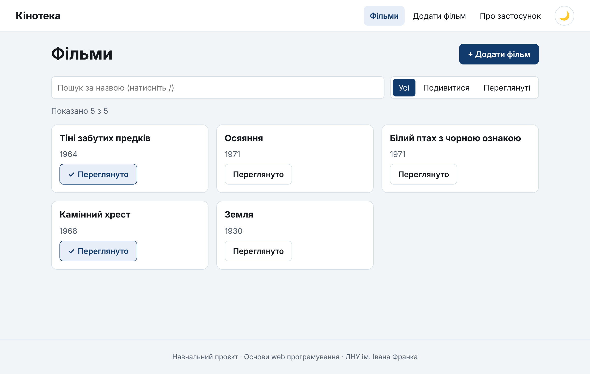
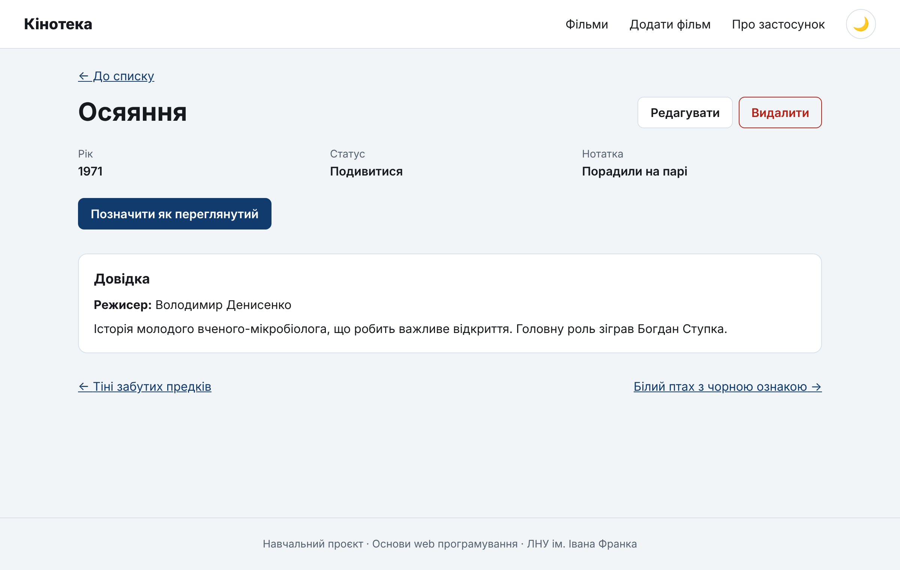
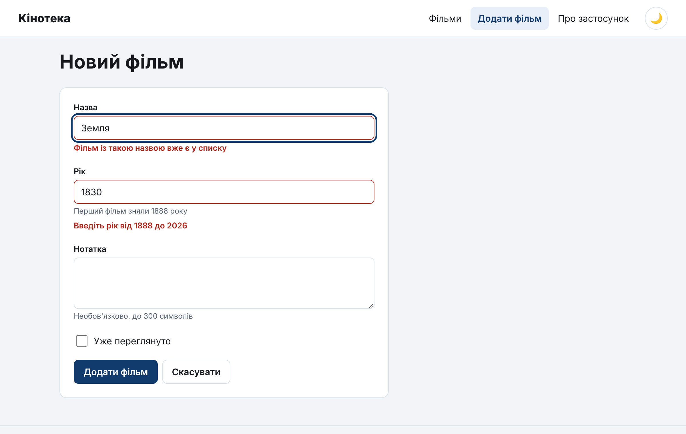
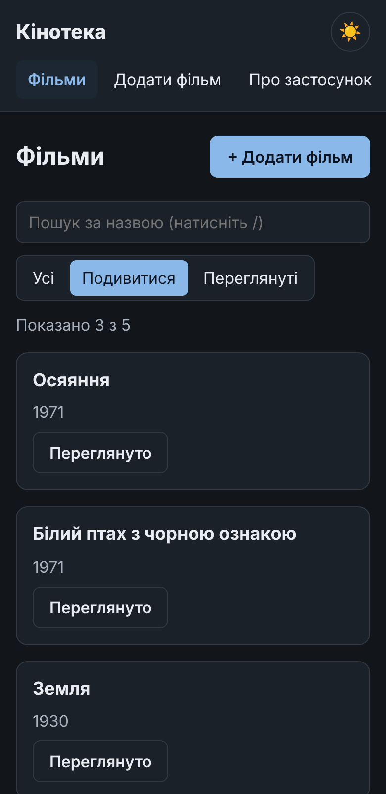
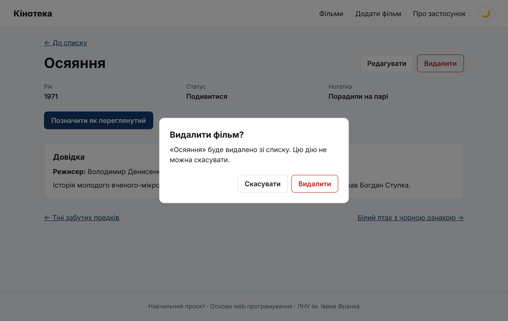

# React-аплікація «Кінотека»: хуки, Context + Reducer, маршрути й форми

> **Курс:** Основи web програмування · ЛНУ ім. Івана Франка · ФПМІ
> **Заняття:** 21 жовтня 2026 р.
> **Теорія:**
> [Лекція 7. Хуки та побічні ефекти](../../lectures/07-react-hooks-effects.md) ·
> [Лекція 8. Context і Reducer](../../lectures/08-react-context-reducer.md) ·
> [Лекція 9. Маршрутизація, форми та валідація](../../lectures/09-react-routing-forms.md)
> **Інструменти:** WebStorm 2026.2, Node.js 24 LTS, Vite 8, React 19, React Router 8
> **Тривалість:** близько 4 академічних годин (дві пари)

Покрокова інструкція до аплікації, яка зводить разом три лекції. «Кінотека» —
особистий список фільмів: окрема сторінка для кожного фільму, довідка, що
завантажується із «сервера», форма додавання й редагування з валідацією,
фільтри в адресному рядку, темна тема. Усе зберігається в `localStorage`.

Аплікація навмисно невелика: 5 сторінок, 6 компонентів, 4 власні хуки,
і жоден файл не довший за ~150 рядків. Зате кожен
фрагмент показує конкретне правило з лекцій, і в таблиці в розділі 0.4
видно, яке саме і де.

**Як працювати з інструкцією:**

- Код кожного кроку — **повний вміст файлу**, його можна скопіювати цілком.
  Якщо файл позначено «тимчасова версія», пізніше ми замінимо його повністю.
- Після кожного кроку є **✅ контрольна точка** — що саме ви маєте побачити.
  Якщо бачите інше, не йдіть далі: знайдіть розбіжність.
- **🧪 Експерименти** — найважливіша частина. Ви навмисно ламаєте код
  і бачите наслідок, про який говорила лекція. **Після кожного експерименту
  поверніть код як було** (`⌘Z` / `Ctrl+Z` або **Local History** у WebStorm).
- Посилання виду «Л7 §4.2» — це лекція 7, розділ 4.2.

---

## Зміст

0. [Що ми побудуємо](#0-що-ми-побудуємо)
1. [Створення проєкту](#1-створення-проєкту)
2. [Прибираємо шаблон](#2-прибираємо-шаблон)
3. [Дані й редюсер](#3-дані-й-редюсер)
4. [Context: стан для всієї аплікації](#4-context-стан-для-всієї-аплікації)
5. [Маршрути, макет, 404 і межа помилок](#5-маршрути-макет-404-і-межа-помилок)
6. [Список фільмів: фільтри в URL, `useRef`, `memo`](#6-список-фільмів-фільтри-в-url-useref-memo)
7. [Сторінка фільму: завантаження даних в ефекті](#7-сторінка-фільму-завантаження-даних-в-ефекті)
8. [Форма створення й редагування](#8-форма-створення-й-редагування)
9. [Темна тема: другий контекст і `useLocalStorage`](#9-темна-тема-другий-контекст-і-uselocalstorage)
10. [Лабораторія: перерендери, мутації, StrictMode](#10-лабораторія-перерендери-мутації-strictmode)
11. [Фінальна перевірка](#11-фінальна-перевірка)
12. [Типові помилки](#12-типові-помилки)
13. [Завдання для самостійної роботи](#13-завдання-для-самостійної-роботи)
14. [Корисні посилання](#14-корисні-посилання)

---

## 0. Що ми побудуємо



**Що вміє аплікація:**

- список фільмів із пошуком і фільтром «усі / подивитися / переглянуті» —
  обидва зберігаються в адресі (`/?q=зем&status=toWatch`), тож посилання
  можна надіслати, а кнопка «Назад» повертає попередній фільтр;
- клавіша `/` переводить фокус у пошук;
- сторінка фільму `/films/:id` з довідкою, яка завантажується з «сервера»
  із затримкою (видно стан завантаження), перехід до сусідніх фільмів,
  видалення з підтвердженням у модальному вікні;
- одна форма для створення (`/films/new`) і редагування
  (`/films/:id/edit`) з валідацією, повідомленнями про помилки й фокусом
  на першу помилку;
- попередження браузера, якщо закрити вкладку з незбереженою формою;
- темна тема, що переживає перезавантаження;
- сторінка «Про застосунок», яка завантажується окремим файлом лише при
  першому переході;
- сторінка 404 і межа помилок: якщо сторінка «впаде», меню лишається робочим.

| Сторінка фільму | Форма з помилками | Телефон, темна тема |
|---|---|---|
|  |  |  |

**Чого немає — навмисно.** Справжнього сервера (лекція 10): «сервер» —
JSON-файл у `public/` зі штучною затримкою. Захищених маршрутів (Л9 §7):
у нас немає користувачів. Завантаження зображень (Л9 §13). Бібліотек
керування станом і форм — усе на вбудованих засобах React.

### 0.1. Маршрути

| Адреса | Сторінка | Що показує з лекції 9 |
|---|---|---|
| `/` | `FilmsPage` | `useSearchParams` (§6), `index`-маршрут |
| `/films/new` | `FilmFormPage` | одна форма для створення… (§10.1) |
| `/films/:id` | `FilmDetailsPage` | `useParams` (§4), `useNavigate` (§3.2) |
| `/films/:id/edit` | `FilmFormPage` | …і для редагування |
| `/about` | `AboutPage` | `lazy` + `Suspense` (§8) |
| `*` | `NotFoundPage` | 404 (§9) |

Усі сторінки вкладені в `Layout` — спільну шапку з меню (§5).

### 0.2. Дерево провайдерів і компонентів

```
StrictMode
└── BrowserRouter                      ← адреса браузера
    └── ThemeProvider                  ← тема: 'light' | 'dark'
        └── FilmsProvider              ← useReducer: список фільмів
            └── App  (Routes)
                └── Layout             ← шапка, NavLink, <Outlet />
                    └── ErrorBoundary
                        ├── FilmsPage
                        │   └── FilmCard × N   (memo)
                        ├── FilmDetailsPage
                        │   └── ConfirmDialog  (<dialog>)
                        ├── FilmFormPage
                        │   └── FilmForm
                        │       └── Field × 3  (useId)
                        ├── AboutPage          (lazy)
                        └── NotFoundPage
```

### 0.3. Як рухаються дані

```
         FilmsProvider
         films ──────────► FilmsContext ────────► FilmsPage, FilmDetailsPage, FilmForm …
         dispatch
           ▲   addFilm, updateFilm,
           │   deleteFilm, toggleWatched ──► FilmActionsContext ──► FilmCard, сторінки
           │
       filmsReducer  ◄── дії { type, payload } від творців дій
```

Порівняно з «Кіносписком» (заняття 14.10) зникла передача `films`
і колбеків через props на кілька рівнів (prop drilling, Л8 §6): будь-який
компонент бере що треба з контексту. Але **правило лишилося те саме**:
компонент не змінює стан сам, а «повідомляє, що сталося» — тепер дією
(`dispatch`), а не колбеком.

### 0.4. Що з лекцій де показано

| Тема | Де в аплікації | Крок |
|---|---|---|
| **Лекція 7** | | |
| Правила хуків, хуки до умовного `return` (§1) | `FilmDetailsPage`, `FilmFormPage` | 7 |
| `useEffect` для синхронізації із зовнішньою системою (§2, §5.5) | `localStorage` у `FilmsProvider`, `document.title`, `data-theme` | 4, 5, 9 |
| Масив залежностей (§3) | `useFilmInfo` — `[id]` | 7 |
| Очищення: слухачі подій (§4.1) | клавіша `/` у `FilmsPage`, `beforeunload` | 6, 8 |
| Гонки запитів і `AbortController` (§4.2) | `useFilmInfo` | 7 |
| Коли ефект НЕ потрібен: похідні дані (§5.1), реакція на дію (§5.2), скидання стану через `key` (§5.3) | `visibleFilms`, `isDirty`, `navigate` в обробнику, `<FilmForm key>` | 6, 8 |
| `useRef` для DOM-елемента (§6.1) | поле пошуку, `<dialog>`, `<form>` | 6, 7, 8 |
| `useMemo` (§7.2), `memo` (§7.4) | `visibleFilms`, схема валідації, `FilmCard` | 6, 8 |
| Власні хуки (§8): `useLocalStorage` і свої | `useLocalStorage`, `useDocumentTitle`, `useFilmInfo`, `useUnsavedChangesWarning` | 5–9 |
| `useId` (§10) | `Field`, `ConfirmDialog` | 7, 8 |
| Налагодження перерендерів (§11) | лабораторія | 10 |
| **Лекція 8** | | |
| `useReducer` (§2), константи й творці дій (§3) | `filmsReducer.js` | 3 |
| Чистий редюсер, `id` і дата — у творці дії (§4) | `filmAdded` | 3 |
| Один статус замість прапорців (§5.4) | `useFilmInfo` | 7 |
| Context, `<Ctx value>` у React 19 (§7) | `FilmsContext`, `ThemeContext` | 4, 9 |
| Власний хук доступу з помилкою без провайдера (§8) | `useFilms`, `useFilmActions`, `useTheme` | 4, 9 |
| Розділення контекстів стану й дій (§11.2), `memo` для елементів списку (§11.3) | `FilmsContext` + `FilmActionsContext`, `FilmCard` | 4, 10 |
| `useMemo` для значення контексту | `actions`, `ThemeProvider` | 4, 9 |
| Синхронізація з `localStorage`, ліниве початкове значення, версія ключа (§12) | `FilmsProvider` | 4 |
| **Лекція 9** | | |
| `BrowserRouter`, `Routes`, `Route` (§2) | `main.jsx`, `App.jsx` | 4, 5 |
| `Link`, `NavLink` з `isActive`, `end` (§3.1) | `Layout` | 5 |
| `useNavigate`, `replace` (§3.2) | після видалення й збереження | 7, 8 |
| `useParams` — рядки (§4) | сторінки фільму й форми | 5, 7 |
| Вкладені маршрути, `Outlet` (§5) | `Layout` | 5 |
| Стан у query-параметрах, `replace` для пошуку (§6) | `FilmsPage` | 6 |
| `lazy` + `Suspense` (§8) | `AboutPage` | 5 |
| 404 і межа помилок (§9) | `NotFoundPage`, `ErrorBoundary` | 5 |
| Одна форма для створення й редагування (§10.1), переюзане поле (§10.2) | `FilmForm`, `Field` | 8 |
| Правила валідації як дані, схема (§11) | `filmValidation.js` | 8 |
| UX помилок: коли показувати, кнопку не блокуємо, фокус на першу помилку (§12) | `FilmForm` | 8 |
| Захист від втрати даних (§14) | `useUnsavedChangesWarning` | 8 |
| Доступність форм: `label`, `aria-invalid`, `aria-describedby`, `role="alert"` (§15) | `Field` | 8 |
| Модальне вікно на `<dialog>` | `ConfirmDialog` | 7 |

---

## 1. Створення проєкту

**Орієнтовно 10 хвилин.** Детально створення проєкту у WebStorm
розібрано в інструкції до «Кіносписку»
([кроки 1–3](../10.14/01-react-vite-movie-watchlist.md#1-підготовка-середовища)),
тут — коротко.

### 1.1. Node.js

**React Router 8** потребує Node.js **22.22 або новішої**. Перевірте:

```bash
node -v    # v24.x.x — рекомендовано
```

### 1.2. Новий проєкт у WebStorm

1. **File | New | Project…** → у лівій панелі **Vite**.
2. **Location** — `…/film-library`; **Template** — `react`; TypeScript —
   **не ставте**.
3. **Create**. WebStorm сам виконає `npm install`.

Альтернатива в терміналі:

```bash
npm create vite@latest film-library -- --template react
cd film-library
npm install
```

### 1.3. React Router

Відкрийте термінал WebStorm (**View | Tool Windows | Terminal**,
`⌥F12` / `Alt+F12`) і встановіть маршрутизатор:

```bash
npm install react-router
```

У `package.json` у `dependencies` з'явиться `"react-router": "^8.…"`.

> 💡 **React Router 8.** Версія 8 вийшла в червні 2026 р.; порівняно з v7
> **декларативний режим** (`BrowserRouter`, `Routes`, `Route`, `Link`,
> `useParams`…) у ній не змінився (Л9 §2). Імпортуємо все з пакета
> `react-router`. Старий пакет
> `react-router-dom` у версії 8 більше не існує: якщо в якомусь прикладі
> з інтернету бачите його — просто замініть назву пакета.

### 1.4. Запуск

Run widget угорі вікна → **npm dev** → ▶ (`⌃R` / `Shift+F10`),
або `npm run dev` у терміналі. Відкрийте адресу з вікна **Run** —
зазвичай `http://localhost:5173/`.

#### ✅ Контрольна точка

Стартова сторінка шаблону Vite з кнопкою **Count is 0**.

---

## 2. Прибираємо шаблон

**Орієнтовно 10 хвилин.**

### 2.1. Видаліть зайве

У вікні **Project** видаліть (`⌫` / `Delete`):

- `src/App.css`;
- папку `src/assets`;
- `public/icons.svg`.

### 2.2. `index.html`

Змініть мову сторінки й заголовок вкладки:

📄 **`index.html`**

```html
<!doctype html>
<html lang="uk">
  <head>
    <meta charset="UTF-8" />
    <link rel="icon" type="image/svg+xml" href="/favicon.svg" />
    <meta name="viewport" content="width=device-width, initial-scale=1.0" />
    <title>Кінотека</title>
  </head>
  <body>
    <div id="root"></div>
    <script type="module" src="/src/main.jsx"></script>
  </body>
</html>
```

### 2.3. Глобальні стилі

Повністю замініть вміст `src/index.css`. Тут кольори **обох тем** у
CSS-змінних, скидання стилів і кілька спільних класів (`.button`,
`.page-header`, `.stack`…), які використовуватимуть різні сторінки.
Стилі окремих компонентів житимуть у їхніх `*.module.css`.

📄 **`src/index.css`**

```css
/* ==========================================================================
   Глобальні стилі: кольори обох тем, скидання, типографіка й кілька
   спільних класів (.button, .page-header…), які використовують різні сторінки.
   Стилі окремих компонентів — у їхніх *.module.css.
   ========================================================================== */

:root {
  --color-bg: #f2f5f8;
  --color-surface: #ffffff;
  --color-text: #16191d;
  --color-muted: #576270;
  --color-border: #d8e0e8;
  --color-accent: #123b6d;
  --color-accent-hover: #0d2c52;
  --color-accent-soft: #e7eef7;
  --color-on-accent: #ffffff;
  --color-danger: #b42318;
  --color-danger-soft: #fdecea;
  --radius: 0.75rem; /* 12px */

  color-scheme: light;
  font-family: system-ui, sans-serif;
  line-height: 1.5;
  color: var(--color-text);
  background: var(--color-bg);
}

/* Темна тема: ThemeProvider ставить data-theme="dark" на <html>.
   Змінюються лише значення змінних — жодне правило нижче не дублюється. */
:root[data-theme='dark'] {
  --color-bg: #12161b;
  --color-surface: #1b2129;
  --color-text: #e9edf2;
  --color-muted: #a7b2be;
  --color-border: #2f3843;
  --color-accent: #8ab8e8;
  --color-accent-hover: #a9cbef;
  --color-accent-soft: #1c2733;
  --color-on-accent: #0c1420;
  --color-danger: #ff8a80;
  --color-danger-soft: #3a1d1b;

  color-scheme: dark;
}

*,
*::before,
*::after {
  box-sizing: border-box;
}

body,
h1,
h2,
h3,
p,
ul,
dl,
dd {
  margin: 0;
}

ul {
  padding: 0;
  list-style: none;
}

button,
input,
textarea {
  font: inherit;
}

a {
  color: var(--color-accent);
}

:focus-visible {
  outline: 3px solid var(--color-accent);
  outline-offset: 2px;
}

/* --- Спільні класи ------------------------------------------------------- */

/* Кнопка. Клас, а не компонент: його отримують і <button>, і <Link>. */
.button {
  display: inline-flex;
  align-items: center;
  justify-content: center;
  gap: 0.375rem;
  min-height: 2.5rem; /* 40px */
  padding: 0.5rem 1rem;
  border: 1px solid transparent;
  border-radius: 0.5rem;
  background: var(--color-accent);
  color: var(--color-on-accent);
  font-weight: 600;
  text-decoration: none;
  cursor: pointer;
}

.button:hover {
  background: var(--color-accent-hover);
}

.button--secondary {
  background: var(--color-surface);
  border-color: var(--color-border);
  color: var(--color-text);
}

.button--secondary:hover {
  background: var(--color-surface);
  border-color: var(--color-accent);
}

.button--danger {
  background: transparent;
  border-color: var(--color-danger);
  color: var(--color-danger);
}

.button--danger:hover {
  background: var(--color-danger-soft);
}

/* Заголовок сторінки з кнопками праворуч */
.page-header {
  display: flex;
  flex-wrap: wrap;
  align-items: center;
  justify-content: space-between;
  gap: 1rem;
  margin-bottom: 1.5rem;
}

.page-title {
  font-size: clamp(1.5rem, 1.2rem + 1.2vw, 2.25rem); /* 24px … 36px */
  line-height: 1.2;
}

.muted {
  color: var(--color-muted);
}

/* Ряд кнопок */
.actions {
  display: flex;
  flex-wrap: wrap;
  gap: 0.5rem;
}

/* Посилання «Перейти до вмісту»: видиме лише при фокусі з клавіатури */
.skip-link {
  position: absolute;
  top: -4rem;
  left: 1rem;
  z-index: 10;
  padding: 0.5rem 1rem;
  background: var(--color-accent);
  color: var(--color-on-accent);
}

.skip-link:focus {
  top: 1rem;
}

/* Вертикальна «стопка» елементів із проміжками */
.stack {
  display: grid;
  gap: 1rem;
  justify-items: start;
}
```

Зверніть увагу на блок `:root[data-theme='dark']`: темна тема — це
**ті самі правила з іншими значеннями змінних**. Атрибут `data-theme`
на `<html>` ставитиме React на кроці 9.

### 2.4. Тимчасовий `App.jsx`

📄 **`src/App.jsx`** — тимчасова версія

```jsx
function App() {
  return <h1>Кінотека</h1>;
}

export default App;
```

`src/main.jsx` поки не змінюйте.

#### ✅ Контрольна точка

Сторінка з заголовком **Кінотека** на світло-сірому тлі, вкладка браузера
називається «Кінотека». У консолі браузера — жодних помилок.

---

## 3. Дані й редюсер

**Орієнтовно 20 хвилин.** Л8 §2–§4.

### 3.1. Структура папок

Створіть у `src/` папки (**New | Directory**):

```
src/
├── api/          ← «сервер»: функції запитів
├── components/   ← спільні компоненти (не знають про фільми)
├── context/      ← контексти й провайдери
├── data/         ← початкові дані
├── features/
│   └── films/    ← компоненти, що знають про фільми
├── hooks/        ← власні хуки
├── pages/        ← сторінки (по одній на маршрут)
├── store/        ← редюсер і дії
└── validation/   ← правила валідації
```

### 3.2. Початкові дані

📄 **`src/data/seedFilms.js`**

```js
// Початкові дані. Використовуються, лише поки в localStorage нічого немає.
export const seedFilms = [
  { id: 'f1', title: 'Тіні забутих предків', year: 1964, watched: true, note: '' },
  { id: 'f2', title: 'Осяяння', year: 1971, watched: false, note: 'Порадили на парі' },
  { id: 'f3', title: 'Білий птах з чорною ознакою', year: 1971, watched: false, note: '' },
  { id: 'f4', title: 'Камінний хрест', year: 1968, watched: true, note: '' },
  { id: 'f5', title: 'Земля', year: 1930, watched: false, note: 'Німе кіно' },
];
```

Це дані **для першого запуску**. Коли користувач щось змінить, список
житиме в `localStorage`, і цей файл більше не читатиметься.

### 3.3. Редюсер

Усі зміни списку фільмів — в одному місці. Компоненти не викликають
`setFilms(…)` із різною логікою, а надсилають **дію**: «фільм додано»,
«фільм видалено». Що саме зробити зі станом — вирішує редюсер.

📄 **`src/store/filmsReducer.js`**

```js
// --- Типи дій ---------------------------------------------------------------
// Константи замість рядків: описка в імені константи — помилка одразу,
// описка в рядку — мовчазний баг.
export const FILM_ADDED = 'films/added';
export const FILM_UPDATED = 'films/updated';
export const FILM_DELETED = 'films/deleted';
export const WATCHED_TOGGLED = 'films/watchedToggled';

// --- Творці дій ---------------------------------------------------------------
// id і дата створюються ТУТ, а не в редюсері: редюсер має бути чистим.
export const filmAdded = (data) => ({
  type: FILM_ADDED,
  payload: { ...data, id: crypto.randomUUID(), createdAt: new Date().toISOString() },
});

export const filmUpdated = (id, changes) => ({
  type: FILM_UPDATED,
  payload: { id, changes },
});

export const filmDeleted = (id) => ({ type: FILM_DELETED, payload: id });

export const watchedToggled = (id) => ({ type: WATCHED_TOGGLED, payload: id });

// --- Редюсер ------------------------------------------------------------------
// Чиста функція: (поточний стан, дія) → новий стан.
// Жодних мутацій, запитів, localStorage, Date.now() чи Math.random().
export function filmsReducer(films, action) {
  switch (action.type) {
    case FILM_ADDED:
      return [action.payload, ...films];

    case FILM_UPDATED: {
      const { id, changes } = action.payload;
      return films.map((film) => (film.id === id ? { ...film, ...changes } : film));
    }

    case FILM_DELETED:
      return films.filter((film) => film.id !== action.payload);

    case WATCHED_TOGGLED:
      return films.map((film) =>
        film.id === action.payload ? { ...film, watched: !film.watched } : film,
      );

    default:
      return films;
  }
}
```

**Розберімо три рішення:**

1. **Константи типів** (Л8 §3.2). Описка в `FILM_ADEDD` — помилка
   імпорту, яку одразу підкреслить WebStorm. Описка в рядку
   `'films/aded'` — тихий баг: редюсер піде в `default` і нічого не
   зробить.
2. **Творці дій** (Л8 §3.3). `crypto.randomUUID()` і `new Date()` дають
   щоразу інший результат, тому їм не місце в редюсері: редюсер має бути
   **чистою функцією** — однаковий вхід, однаковий вихід (Л8 §4.1).
   Для дії `filmAdded` усе випадкове обчислюється заздалегідь і
   приходить у `payload`.
3. **Жодних мутацій.** `map`, `filter`, spread — завжди новий масив і новий
   об'єкт **лише для зміненого фільму**. Інші об'єкти лишаються тими
   самими — це знадобиться для `memo` на кроці 10.

#### 🤔 Перевір себе

1. Чому `default: return films`, а не `throw new Error(…)`? *(Обидва
   варіанти зустрічаються. Повернення стану безпечніше, якщо в одну
   функцію `dispatch` надходять дії, які цей редюсер не обробляє.
   Помилка ж швидше виявляє описки.)*
2. Що поверне `filmsReducer(films, watchedToggled('f2'))` для фільму
   `f1`? *(Той самий об'єкт `f1`: `film.id === 'f2'` хибне — повертаємо
   `film` без змін.)*

---

## 4. Context: стан для всієї аплікації

**Орієнтовно 25 хвилин.** Л8 §6–§9, §11.2, §12.

### 4.1. Контексти й хуки доступу

📄 **`src/context/FilmsContext.js`**

```js
import { createContext, useContext } from 'react';

// Два контексти замість одного:
//  • FilmsContext — сам список (змінюється часто);
//  • FilmActionsContext — функції для змін (не змінюються ніколи).
// Компонент, якому потрібні лише дії, не перемальовується, коли змінюється список.
export const FilmsContext = createContext(null);
export const FilmActionsContext = createContext(null);

export function useFilms() {
  const films = useContext(FilmsContext);
  if (films === null) {
    throw new Error('useFilms() має викликатися всередині <FilmsProvider>.');
  }
  return films;
}

export function useFilmActions() {
  const actions = useContext(FilmActionsContext);
  if (actions === null) {
    throw new Error('useFilmActions() має викликатися всередині <FilmsProvider>.');
  }
  return actions;
}
```

**Чому `null` за замовчуванням і `throw`** (Л8 §8). Якщо хтось забуде
обгорнути аплікацію провайдером, `useContext` поверне `null`, і помилка
вилізе десь далеко: `Cannot read properties of null (reading 'filter')`.
Хук доступу перевіряє це одразу й пояснює людською мовою, що не так.

**Чому файл `.js`, а не `.jsx`.** Тут немає JSX. А провайдер (компонент)
ми винесемо в окремий файл: Vite Fast Refresh коректно оновлює лише
файли, які експортують **тільки компоненти**. Лінтер Oxlint стежить за
цим правилом (`only-export-components`).

### 4.2. Провайдер

📄 **`src/context/FilmsProvider.jsx`**

```jsx
import { useEffect, useMemo, useReducer } from 'react';
import { FilmActionsContext, FilmsContext } from './FilmsContext.js';
import {
  filmAdded,
  filmDeleted,
  filmsReducer,
  filmUpdated,
  watchedToggled,
} from '../store/filmsReducer.js';
import { seedFilms } from '../data/seedFilms.js';

// Версія в ключі: коли зміниться структура даних, змінимо на :v2,
// і стара збережена версія не зламає аплікацію.
const STORAGE_KEY = 'film-library:films:v1';

// Початковий стан читаємо ОДИН раз — третім аргументом useReducer.
function loadFilms() {
  try {
    const raw = localStorage.getItem(STORAGE_KEY);
    return raw ? JSON.parse(raw) : seedFilms;
  } catch {
    return seedFilms;
  }
}

export function FilmsProvider({ children }) {
  const [films, dispatch] = useReducer(filmsReducer, null, loadFilms);

  // Синхронізація із зовнішньою системою (localStorage) — справжня робота для ефекту
  useEffect(() => {
    try {
      localStorage.setItem(STORAGE_KEY, JSON.stringify(films));
    } catch (error) {
      console.warn('Не вдалося зберегти фільми:', error);
    }
  }, [films]);

  // Дії, прив'язані до dispatch. dispatch стабільний, тому об'єкт створюється
  // один раз і споживачі FilmActionsContext ніколи не перемальовуються через нього.
  const actions = useMemo(
    () => ({
      addFilm: (data) => {
        const action = filmAdded(data);
        dispatch(action);
        return action.payload; // новий фільм разом з id — щоб перейти на його сторінку
      },
      updateFilm: (id, changes) => dispatch(filmUpdated(id, changes)),
      deleteFilm: (id) => dispatch(filmDeleted(id)),
      toggleWatched: (id) => dispatch(watchedToggled(id)),
    }),
    [],
  );

  return (
    <FilmActionsContext value={actions}>
      <FilmsContext value={films}>{children}</FilmsContext>
    </FilmActionsContext>
  );
}
```

**Що тут відбувається:**

- **`useReducer(filmsReducer, null, loadFilms)`** — третій аргумент
  (функція ініціалізації) викликається **один раз**. Якби ми написали
  `useReducer(filmsReducer, loadFilms())`, `localStorage` читався б
  і розбирався б на **кожному** рендері, а результат одразу
  викидався б (Л8 §12).
- **`:v1` у ключі.** Якщо колись зміниться структура фільму, змінимо
  ключ на `:v2` — старі дані не зламають нову версію аплікації.
- **`useEffect` з `[films]`** — це справжня робота для ефекту:
  синхронізація стану React із **зовнішньою системою** (`localStorage`).
- **`actions` через `useMemo` з `[]`.** `dispatch` стабільний (React
  гарантує, що це та сама функція на кожному рендері), тому об'єкт дій
  створюється один раз. Компоненти, яким потрібні лише дії, ніколи не
  перемальовуються через `FilmActionsContext`.
- **`<FilmsContext value={…}>`** — у React 19 контекст сам є
  провайдером; старий запис `<FilmsContext.Provider>` теж працює.
- **`addFilm` повертає новий фільм** — щоб після збереження форми
  перейти на сторінку саме цього фільму (крок 8).

### 4.3. Підключаємо провайдер і маршрутизатор

📄 **`src/main.jsx`** — тимчасова версія

```jsx
import { StrictMode } from 'react';
import { createRoot } from 'react-dom/client';
import { BrowserRouter } from 'react-router';
import { FilmsProvider } from './context/FilmsProvider.jsx';
import App from './App.jsx';
import './index.css';

createRoot(document.getElementById('root')).render(
  <StrictMode>
    <BrowserRouter>
      <FilmsProvider>
        <App />
      </FilmsProvider>
    </BrowserRouter>
  </StrictMode>,
);
```

`BrowserRouter` додаємо вже зараз: він має бути **вище** за все, що
користується маршрутами. На наступному кроці з'являться самі маршрути.

📄 **`src/App.jsx`** — тимчасова версія

```jsx
import { useFilmActions, useFilms } from './context/FilmsContext.js';

// Тимчасова версія: перевіряємо, що контекст і редюсер працюють
function App() {
  const films = useFilms();
  const { toggleWatched } = useFilmActions();

  return (
    <main style={{ padding: '1rem' }}>
      <h1>Кінотека</h1>
      <p>У списку {films.length} фільмів</p>
      <ul>
        {films.map((film) => (
          <li key={film.id}>
            <label>
              <input
                type="checkbox"
                checked={film.watched}
                onChange={() => toggleWatched(film.id)}
              />{' '}
              {film.title} ({film.year})
            </label>
          </li>
        ))}
      </ul>
    </main>
  );
}

export default App;
```

#### ✅ Контрольна точка

- Список із 5 фільмів, біля двох (Тіні…, Камінний хрест) стоїть позначка.
- Клацніть позначку біля «Осяяння» й **перезавантажте сторінку** —
  позначка лишилася.
- DevTools → **Application** → **Local Storage** → `http://localhost:5173`:
  є ключ `film-library:films:v1` з масивом фільмів.

#### 🧪 Експеримент: забули провайдер

У `main.jsx` закоментуйте обгортку (`⌘/` / `Ctrl+/` на кожному з двох
рядків):

```jsx
      {/* <FilmsProvider> */}
        <App />
      {/* </FilmsProvider> */}
```

Сторінка порожня, а в консолі — наше повідомлення:
`useFilms() має викликатися всередині <FilmsProvider>.` Саме для цього
потрібен хук доступу. На кроці 5 ми повторимо цей експеримент,
і результат буде іншим. **Поверніть провайдер.**

#### 🧪 Експеримент: скинути дані

Щоб повернутися до початкового списку, видаліть ключ у **Application →
Local Storage** (правою кнопкою → **Delete**) і перезавантажте сторінку.
Знадобиться ще не раз.

---

## 5. Маршрути, макет, 404 і межа помилок

**Орієнтовно 30 хвилин.** Л9 §2–§5, §8, §9; Л7 §4, §8.

### 5.1. Хук `useDocumentTitle`

Перший власний хук: кожна сторінка встановлює свій заголовок вкладки.

📄 **`src/hooks/useDocumentTitle.js`**

```js
import { useEffect } from 'react';

/**
 * Заголовок вкладки браузера для поточної сторінки.
 * @param {string} title
 */
export function useDocumentTitle(title) {
  useEffect(() => {
    const previous = document.title;
    document.title = `${title} · Кінотека`;

    // Очищення: повертаємо попередній заголовок, коли сторінка зникає
    return () => {
      document.title = previous;
    };
  }, [title]);
}
```

Функція очищення повертає попередній заголовок, коли сторінка зникає
(Л7 §4). Без неї заголовок «застряг» би від попередньої сторінки, якщо
нова свого не встановлює.

### 5.2. Межа помилок

📄 **`src/components/ErrorBoundary.jsx`**

```jsx
import { Component } from 'react';

// Межа помилок ловить помилки РЕНДЕРИНГУ в дочірніх компонентах
// і показує запасний інтерфейс замість «білого екрана».
// Єдине місце в сучасному React, де потрібен класовий компонент.
//
// props.resetKey — будь-яке значення; коли воно змінюється, помилка скидається.
class ErrorBoundary extends Component {
  state = { error: null, resetKey: this.props.resetKey };

  // Помилка в дочірньому компоненті → запам'ятовуємо її
  static getDerivedStateFromError(error) {
    return { error };
  }

  // Нова адреса (новий resetKey) → забуваємо помилку, сторінка пробує відмалюватися знову
  static getDerivedStateFromProps(props, state) {
    if (props.resetKey !== state.resetKey) {
      return { error: null, resetKey: props.resetKey };
    }
    return null;
  }

  componentDidCatch(error, info) {
    console.error('Помилка рендерингу:', error, info.componentStack);
  }

  render() {
    if (this.state.error) {
      return (
        <div className="stack" role="alert">
          <h1 className="page-title">Щось пішло не так</h1>
          <p className="muted">{this.state.error.message}</p>
          <button type="button" className="button" onClick={() => this.setState({ error: null })}>
            Спробувати ще раз
          </button>
        </div>
      );
    }
    return this.props.children;
  }
}

export default ErrorBoundary;
```

Це **єдиний класовий компонент** у проєкті: хука для перехоплення
помилок рендерингу в React немає (Л9 §9). Prop `resetKey` скидає помилку:
коли він змінюється (а ми передаватимемо адресу сторінки), помилка
забувається. Без цього після «падіння» однієї сторінки
меню вело б на інші адреси, а на екрані так і лишалося б «Щось пішло не так».

> ⚠️ Межа помилок **не ловить** помилки в обробниках подій
> (`onClick`) і в асинхронному коді. Лише помилки під час рендерингу.

### 5.3. Макет

📄 **`src/components/Layout.jsx`** — тимчасова версія (без перемикача теми)

```jsx
import { Link, NavLink, Outlet, useLocation } from 'react-router';
import ErrorBoundary from './ErrorBoundary.jsx';
import styles from './Layout.module.css';

// NavLink сам знає, чи він активний, і передає це у функцію className
const navLinkClass = ({ isActive }) =>
  isActive ? `${styles.navLink} ${styles.active}` : styles.navLink;

function Layout() {
  const location = useLocation();

  return (
    <div className={styles.layout}>
      <a className="skip-link" href="#main">
        Перейти до основного вмісту
      </a>

      <header className={styles.header}>
        <Link to="/" className={styles.logo}>
          Кінотека
        </Link>

        <nav className={styles.nav} aria-label="Основна навігація">
          <ul className={styles.navList}>
            <li>
              <NavLink to="/" end className={navLinkClass}>
                Фільми
              </NavLink>
            </li>
            <li>
              <NavLink to="/films/new" className={navLinkClass}>
                Додати фільм
              </NavLink>
            </li>
            <li>
              <NavLink to="/about" className={navLinkClass}>
                Про застосунок
              </NavLink>
            </li>
          </ul>
        </nav>
      </header>

      <main id="main" className={styles.main}>
        {/* Якщо сторінка «впаде», шапка й меню лишаться робочими.
            resetKey: на новій адресі межа помилок спробує відмалювати сторінку знову. */}
        <ErrorBoundary resetKey={location.pathname}>
          {/* Сюди React Router підставляє сторінку поточного маршруту */}
          <Outlet />
        </ErrorBoundary>
      </main>

      <footer className={styles.footer}>
        Навчальний проєкт · Основи web програмування · ЛНУ ім. Івана Франка
      </footer>
    </div>
  );
}

export default Layout;
```

📄 **`src/components/Layout.module.css`**

```css
/* Шапка — підвал завжди внизу, навіть на короткій сторінці */
.layout {
  display: grid;
  grid-template-rows: auto 1fr auto;
  /* minmax(0, 1fr): колонка не розширюється під довгий вміст (меню прокручується) */
  grid-template-columns: minmax(0, 1fr);
  min-height: 100dvh;
}

/* Телефон: логотип і перемикач теми в першому рядку, меню — у другому */
.header {
  display: flex;
  flex-wrap: wrap;
  align-items: center;
  gap: 0.5rem 1rem;
  padding: 0.75rem 1rem;
  background: var(--color-surface);
  border-bottom: 1px solid var(--color-border);
}

.logo {
  margin-right: auto; /* відштовхує все інше праворуч */
  color: var(--color-text);
  font-size: 1.25rem;
  font-weight: 800;
  text-decoration: none;
}

.nav {
  order: 1; /* після перемикача теми */
  flex-basis: 100%;
}

.navList {
  display: flex;
  gap: 0.25rem;
  overflow-x: auto;
}

.navLink {
  display: block;
  padding: 0.5rem 0.75rem;
  border-radius: 0.5rem;
  color: var(--color-text);
  text-decoration: none;
  white-space: nowrap;
}

.navLink:hover {
  background: var(--color-bg);
}

.active {
  background: var(--color-accent-soft);
  color: var(--color-accent);
  font-weight: 600;
}

.themeToggle {
  width: 2.5rem;
  height: 2.5rem;
  border: 1px solid var(--color-border);
  border-radius: 50%;
  background: var(--color-surface);
  font-size: 1.125rem;
  cursor: pointer;
}

.main {
  width: 100%;
  max-width: 64rem; /* 1024px */
  margin-inline: auto;
  padding: 1.5rem 1rem 3rem;
}

.footer {
  padding: 1.5rem 1rem;
  border-top: 1px solid var(--color-border);
  color: var(--color-muted);
  font-size: 0.875rem;
  text-align: center;
}

/* Планшет і ширше: усе в один рядок */
@media (min-width: 48rem) {
  .header {
    padding-inline: 2rem;
  }

  .nav {
    order: 0;
    flex-basis: auto;
  }
}
```

**Що тут з лекції 9:**

- **`<Outlet />`** (§5) — «дірка» в макеті, куди підставляється сторінка
  вкладеного маршруту. Шапка й підвал не перемальовуються при переході.
- **`NavLink`** (§3.1) передає у функцію `className` об'єкт
  `{ isActive }` і сам ставить `aria-current="page"` активному пункту.
- **`end`** — лише точний збіг адреси. Для `/` React Router і так вимагає
  точного збігу, тож тут `end` лише робить намір явним. А от, наприклад,
  `<NavLink to="/films">` без `end` був би активним і на `/films/f2`,
  і на `/films/new`.
- **`Link`**, а не `<a href>`: звичайне посилання перезавантажило б
  сторінку і весь стан React зник би. `Link` змінює адресу через History
  API (§1.2) без перезавантаження.
- **`useLocation`** дає поточну адресу — передаємо її в `resetKey`.
- **Посилання «Перейти до основного вмісту»** невидиме, доки на нього не
  потрапить фокус клавіатури (`Tab` одразу після завантаження).

### 5.4. Сторінки 404 і «Про застосунок»

📄 **`src/pages/NotFoundPage.jsx`**

```jsx
import { Link } from 'react-router';

/**
 * @param {Object} props
 * @param {string} [props.message]
 */
function NotFoundPage({ message = 'Такої сторінки не існує.' }) {
  return (
    <div className="stack">
      <h1 className="page-title">404</h1>
      <p>{message}</p>
      <Link to="/" className="button">
        На головну
      </Link>
    </div>
  );
}

export default NotFoundPage;
```

📄 **`src/pages/AboutPage.jsx`**

```jsx
import { useDocumentTitle } from '../hooks/useDocumentTitle.js';

// Ця сторінка підключена через lazy(): її код — окремий файл (chunk),
// який браузер завантажує лише при першому переході на /about.
// Перевірте у DevTools → Network.
function AboutPage() {
  useDocumentTitle('Про застосунок');

  return (
    <div className="stack">
      <h1 className="page-title">Про застосунок</h1>
      <p>
        «Кінотека» — навчальний проєкт до лекцій 7–9: хуки й ефекти, Context і Reducer,
        маршрутизація та форми.
      </p>
      <p className="muted">Дані зберігаються лише у вашому браузері (localStorage).</p>
    </div>
  );
}

export default AboutPage;
```

### 5.5. Заглушки для решти сторінок

Повні версії напишемо на кроках 6–8. Зараз потрібні лише для того,
щоб запрацювали маршрути.

📄 **`src/pages/FilmsPage.jsx`** — тимчасова версія

```jsx
import { Link } from 'react-router';
import { useFilms } from '../context/FilmsContext.js';

// Тимчасова заглушка — повну сторінку напишемо на кроці 6
function FilmsPage() {
  const films = useFilms();

  return (
    <>
      <h1 className="page-title">Фільми</h1>
      <ul>
        {films.map((film) => (
          <li key={film.id}>
            <Link to={`/films/${film.id}`}>{film.title}</Link>
          </li>
        ))}
      </ul>
    </>
  );
}

export default FilmsPage;
```

📄 **`src/pages/FilmDetailsPage.jsx`** — тимчасова версія

```jsx
import { useParams } from 'react-router';

// Тимчасова заглушка — повну сторінку напишемо на кроці 7
function FilmDetailsPage() {
  const { id } = useParams();

  return (
    <h1 className="page-title">
      Фільм з id = {id} (тип: {typeof id})
    </h1>
  );
}

export default FilmDetailsPage;
```

📄 **`src/pages/FilmFormPage.jsx`** — тимчасова версія

```jsx
import { useParams } from 'react-router';

// Тимчасова заглушка — повну сторінку напишемо на кроці 8
function FilmFormPage() {
  const { id } = useParams();

  return <h1 className="page-title">{id === undefined ? 'Новий фільм' : `Редагування ${id}`}</h1>;
}

export default FilmFormPage;
```

### 5.6. Маршрути

📄 **`src/App.jsx`**

```jsx
import { lazy, Suspense } from 'react';
import { Route, Routes } from 'react-router';
import Layout from './components/Layout.jsx';
import FilmsPage from './pages/FilmsPage.jsx';
import FilmDetailsPage from './pages/FilmDetailsPage.jsx';
import FilmFormPage from './pages/FilmFormPage.jsx';
import NotFoundPage from './pages/NotFoundPage.jsx';

// Рідко відвідувана сторінка — окремим файлом, завантажується при першому переході
const AboutPage = lazy(() => import('./pages/AboutPage.jsx'));

function App() {
  return (
    <Routes>
      {/* Батьківський маршрут — спільний макет; вкладені сторінки з'являються в його <Outlet /> */}
      <Route path="/" element={<Layout />}>
        <Route index element={<FilmsPage />} />
        <Route path="films/new" element={<FilmFormPage />} />
        <Route path="films/:id" element={<FilmDetailsPage />} />
        <Route path="films/:id/edit" element={<FilmFormPage />} />
        <Route
          path="about"
          element={
            <Suspense fallback={<p className="muted">Завантаження…</p>}>
              <AboutPage />
            </Suspense>
          }
        />
        <Route path="*" element={<NotFoundPage />} />
      </Route>
    </Routes>
  );
}

export default App;
```

- **Вкладені `Route`** (Л9 §5): усі сторінки — діти маршруту з
  `Layout`, тому з'являються в його `<Outlet />`.
- **`index`** — сторінка для адреси самого батька (`/`).
- **`:id`** — параметр шляху. Один маршрут обслуговує будь-який фільм.
- **`films/new` і `films/:id`** не конфліктують: React Router обирає
  **найточніший** збіг, тому `/films/new` — це форма, а не фільм з
  `id = "new"`. Порядок маршрутів значення не має.
- **`lazy`** (Л9 §8): код `AboutPage` потрапить в окремий файл, який
  браузер завантажить при першому переході на `/about`. Поки файл
  вантажиться, `Suspense` показує `fallback`.

#### ✅ Контрольна точка

- Шапка з меню; активний пункт підсвічений. Перейдіть **Фільми →
  Додати фільм → Про застосунок** — сторінка не перезавантажується
  (у вкладці **Network** немає нового запиту документа), а заголовок
  вкладки змінюється.
- Клацніть фільм у списку: адреса `/films/f2`, на сторінці
  «Фільм з id = f2 (тип: **string**)». Параметри шляху — **завжди
  рядки** (Л9 §4). Тому порівнюємо `film.id === id`, а якби `id` були
  числами, довелося б писати `Number(id)`.
- Введіть в адресному рядку `/films/f2/edit` — «Редагування f2»;
  `/qwerty` — сторінка 404.
- Кнопки браузера **Назад / Вперед** працюють.
- Звузьте вікно до ширини телефону (DevTools → **Toggle device toolbar**,
  `⌘⇧M` / `Ctrl+Shift+M`): меню переходить у другий рядок і
  прокручується горизонтально, сторінка — без горизонтальної прокрутки.

#### 🧪 Експеримент: лінива сторінка

DevTools → **Network** → фільтр **JS**. Відкрийте `/` і перезавантажте
сторінку. Потім клацніть **Про застосунок** — з'явиться новий запит
`AboutPage.jsx`. Другий перехід — нового запиту немає: модуль уже
завантажено. (У продакшен-збірці це буде окремий файл
`AboutPage-xxxx.js` — перевіримо на кроці 11.)

#### 🧪 Експеримент: межа помилок

Повторіть експеримент із кроку 4: закоментуйте `<FilmsProvider>`
у `main.jsx`. Тепер замість порожньої сторінки — шапка, меню й
повідомлення «Щось пішло не так» із текстом нашої помилки: `FilmsPage`
впала, але `ErrorBoundary` не дав їй «покласти» всю аплікацію.
Перейдіть на **Про застосунок** — ця сторінка контексту фільмів не
використовує і працює. **Поверніть провайдер.**

#### 🧪 Експеримент: `Link` проти `<a>`

Тимчасово замініть у `Layout` один `NavLink` на
`<a href="/about">Про застосунок</a>`. Клацніть по ньому з відкритою
вкладкою **Network**: сторінка **повністю перезавантажується**
(новий запит документа, усі скрипти заново). **Поверніть `NavLink`.**

#### 🤔 Перевір себе

1. Приберіть `end` у `NavLink` для `/` — чи зміниться щось? *(Ні: для `/`
   збіг і так точний. `end` потрібен посиланням на кшталт `/films`, щоб
   вони не підсвічувалися на вкладених адресах `/films/…`.)*
2. Чому на хостингу пряме відкриття `https://…/films/f2` може дати 404
   від сервера, хоча на `localhost` усе працює? *(Сервер шукає файл
   `films/f2`, якого немає. Треба налаштувати хостинг віддавати
   `index.html` на будь-яку адресу — Л9 §1.3. Сервер розробки Vite
   робить це сам.)*

---

## 6. Список фільмів: фільтри в URL, `useRef`, `memo`

**Орієнтовно 30 хвилин.** Л9 §6; Л7 §4.1, §5.1, §6.1, §7.

### 6.1. Картка фільму

📄 **`src/features/films/FilmCard.jsx`**

```jsx
import { memo } from 'react';
import { Link } from 'react-router';
import { useFilmActions } from '../../context/FilmsContext.js';
import styles from './FilmCard.module.css';

/**
 * Картка фільму у списку.
 * @param {Object} props
 * @param {{id: string, title: string, year: number, watched: boolean}} props.film
 */
function FilmCard({ film }) {
  // Лише дії — тому картка НЕ залежить від FilmsContext і не перемальовується,
  // коли змінюється якийсь інший фільм
  const { toggleWatched } = useFilmActions();

  return (
    <article className={styles.card}>
      <h2 className={styles.title}>
        <Link to={`/films/${film.id}`}>{film.title}</Link>
      </h2>
      <p className="muted">{film.year}</p>

      {/* aria-pressed — кнопка-перемикач: читач екрана оголосить «натиснуто» */}
      <button
        type="button"
        className={`button button--secondary ${styles.toggle}`}
        aria-pressed={film.watched}
        onClick={() => toggleWatched(film.id)}
      >
        Переглянуто
      </button>
    </article>
  );
}

// memo: якщо prop film — той самий об'єкт, що й минулого разу, рендер пропускається.
// Редюсер створює новий об'єкт лише для зміненого фільму — решта карток «відпочиває».
export default memo(FilmCard);
```

📄 **`src/features/films/FilmCard.module.css`**

```css
.card {
  display: grid;
  gap: 0.5rem;
  align-content: start;
  padding: 1rem;
  border: 1px solid var(--color-border);
  border-radius: var(--radius);
  background: var(--color-surface);
}

.title {
  font-size: 1.125rem; /* 18px */
  line-height: 1.3;
}

.title a {
  color: inherit;
  text-decoration: none;
}

.title a:hover {
  color: var(--color-accent);
  text-decoration: underline;
}

.toggle {
  justify-self: start;
}

/* Вигляд залежить від стану, який уже є в розмітці, — окремий клас не потрібен */
.toggle[aria-pressed='true'] {
  background: var(--color-accent-soft);
  border-color: var(--color-accent);
  color: var(--color-accent);
}

.toggle[aria-pressed='true']::before {
  content: '✓';
}
```

- **Картка сама бере `toggleWatched` з контексту** — `FilmsPage` не
  передає їй колбеків. Зате вона бере **лише дії**, а не список: про це
  буде експеримент на кроці 10.
- **`memo`** (Л7 §7.4): React пропустить рендер картки, якщо `film` —
  **той самий об'єкт**, що й минулого разу. Саме тому редюсер на кроці 3
  створює новий об'єкт лише для зміненого фільму.
- **`aria-pressed`** робить кнопку перемикачем: читач екрана оголосить
  «Переглянуто, натиснуто». А CSS бере стан **з того самого атрибута**
  (`.toggle[aria-pressed='true']`) — окремий клас не потрібен. Текст
  кнопки однаковий в обох станах, змінюються лише вигляд і `aria-pressed`.

### 6.2. Сторінка списку

📄 **`src/pages/FilmsPage.jsx`**

```jsx
import { useEffect, useMemo, useRef } from 'react';
import { Link, useSearchParams } from 'react-router';
import FilmCard from '../features/films/FilmCard.jsx';
import { useFilms } from '../context/FilmsContext.js';
import { useDocumentTitle } from '../hooks/useDocumentTitle.js';
import styles from './FilmsPage.module.css';

const STATUS_OPTIONS = [
  { value: 'all', label: 'Усі' },
  { value: 'toWatch', label: 'Подивитися' },
  { value: 'watched', label: 'Переглянуті' },
];

function FilmsPage() {
  const films = useFilms();
  const searchRef = useRef(null);
  useDocumentTitle('Фільми');

  // Стан фільтрів живе в URL: ?q=тіні&status=watched
  // Таке посилання можна скопіювати, а кнопка «Назад» повертає попередній фільтр.
  const [searchParams, setSearchParams] = useSearchParams();
  const query = searchParams.get('q') ?? '';
  const status = searchParams.get('status') ?? 'all';

  const updateParam = (key, value, options) => {
    setSearchParams((prev) => {
      const next = new URLSearchParams(prev);
      // Значення за замовчуванням з адреси прибираємо — URL лишається чистим
      if (value === '' || value === 'all') next.delete(key);
      else next.set(key, value);
      return next;
    }, options);
  };

  // Клавіша «/» переводить фокус у поле пошуку.
  // Слухач на window — зовнішня система, тому ефект з очищенням.
  useEffect(() => {
    const handleKeyDown = (event) => {
      if (event.key === '/' && document.activeElement !== searchRef.current) {
        event.preventDefault();
        searchRef.current.focus();
      }
    };

    window.addEventListener('keydown', handleKeyDown);
    return () => window.removeEventListener('keydown', handleKeyDown);
  }, []);

  // Похідні дані: не стан і не ефект, а обчислення під час рендера.
  // useMemo — щоб не фільтрувати заново, коли змінилося щось інше.
  const visibleFilms = useMemo(() => {
    const normalized = query.trim().toLowerCase();
    return films.filter((film) => {
      if (status === 'watched' && !film.watched) return false;
      if (status === 'toWatch' && film.watched) return false;
      return film.title.toLowerCase().includes(normalized);
    });
  }, [films, query, status]);

  return (
    <>
      <div className="page-header">
        <h1 className="page-title">Фільми</h1>
        <Link to="/films/new" className="button">
          + Додати фільм
        </Link>
      </div>

      <div className={styles.toolbar}>
        <input
          ref={searchRef}
          type="search"
          className={styles.search}
          placeholder="Пошук за назвою (натисніть /)"
          aria-label="Пошук за назвою"
          value={query}
          // replace: кожна літера НЕ стає окремим записом в історії
          onChange={(event) => updateParam('q', event.target.value, { replace: true })}
        />

        <div className={styles.filters} role="group" aria-label="Фільтр за статусом">
          {STATUS_OPTIONS.map((option) => (
            <button
              key={option.value}
              type="button"
              className={styles.filter}
              aria-pressed={status === option.value}
              onClick={() => updateParam('status', option.value)}
            >
              {option.label}
            </button>
          ))}
        </div>
      </div>

      {/* aria-live: читач екрана оголосить нову кількість після фільтрації */}
      <p className="muted" aria-live="polite">
        Показано {visibleFilms.length} з {films.length}
      </p>

      {visibleFilms.length > 0 ? (
        <ul className={styles.grid}>
          {visibleFilms.map((film) => (
            <li key={film.id}>
              <FilmCard film={film} />
            </li>
          ))}
        </ul>
      ) : (
        <div className={`stack ${styles.empty}`}>
          <p>Нічого не знайдено.</p>
          <button
            type="button"
            className="button button--secondary"
            onClick={() => setSearchParams({})}
          >
            Скинути фільтри
          </button>
        </div>
      )}
    </>
  );
}

export default FilmsPage;
```

📄 **`src/pages/FilmsPage.module.css`**

```css
.toolbar {
  display: flex;
  flex-wrap: wrap;
  gap: 0.75rem;
  margin-bottom: 0.75rem;
}

.search {
  flex: 1 1 16rem; /* росте, але не вужче 256px (інакше — перенос) */
  min-height: 2.5rem;
  padding: 0.5rem 0.75rem;
  border: 1px solid var(--color-border);
  border-radius: 0.5rem;
  background: var(--color-surface);
  color: inherit;
}

.filters {
  display: flex;
  gap: 0.25rem;
  padding: 0.25rem;
  border: 1px solid var(--color-border);
  border-radius: 0.5rem;
  background: var(--color-surface);
}

.filter {
  padding: 0.375rem 0.75rem;
  border: 0;
  border-radius: 0.375rem;
  background: transparent;
  color: var(--color-text);
  cursor: pointer;
}

.filter[aria-pressed='true'] {
  background: var(--color-accent);
  color: var(--color-on-accent);
}

/* Сітка без медіазапитів: стільки колонок, скільки вміщається по 240px */
.grid {
  display: grid;
  grid-template-columns: repeat(auto-fill, minmax(min(100%, 15rem), 1fr));
  gap: 1rem;
  margin-top: 1rem;
}

/* Картки в одному ряду однакової висоти */
.grid > li {
  display: grid;
}

.empty {
  margin-top: 1rem;
  padding: 2rem 1rem;
  border: 1px dashed var(--color-border);
  border-radius: var(--radius);
  text-align: center;
  justify-items: center;
}
```

**Ключові рішення:**

1. **Стан фільтрів — в адресі, а не в `useState`** (Л9 §6). Пошук і
   статус читаються з `searchParams`, а зміна — це `setSearchParams`.
   Тому посилання `/?status=watched` відкриває вже відфільтрований
   список, а кнопка «Назад» повертає попередній фільтр.
2. **`replace: true` лише для пошуку.** Кожна введена літера — це зміна
   адреси. Без `replace` слово «Тіні» створило б 4 записи в історії
   і кнопка «Назад» стала б непридатною. А перемикання статусу —
   свідома дія, її в історії лишаємо.
3. **Значення за замовчуванням прибираємо з адреси** (`q=''`,
   `status=all`): адреса лишається чистою — `/`, а не
   `/?q=&status=all`.
4. **`setSearchParams(prev => …)`** — функціональне оновлення, як
   у `setState`: змінюємо один параметр і не губимо інші.
5. **`visibleFilms` — похідні дані** (Л7 §5.1). Не окремий стан і
   не ефект «коли змінився фільтр — онови відфільтрований список», а
   звичайне обчислення під час рендера. `useMemo` (§7.2) лише не
   повторює його, якщо `films`, `query` і `status` не змінилися.
6. **Клавіша `/`.** Слухач на `window` — це зовнішня система, тому
   ефект, і обов'язкове очищення (Л7 §4.1). `useRef` дає доступ до
   DOM-елемента поля (§6.1), щоб викликати `focus()`.
7. **`aria-live="polite"`** — читач екрана оголосить нову кількість
   фільмів після фільтрації.

#### ✅ Контрольна точка

- Сітка карток: на широкому екрані 3 колонки, на телефоні — одна.
- **Переглянуто** перемикає позначку (✓ і підсвітка); після
  перезавантаження позначки на місці.
- **Переглянуті** → адреса `/?status=watched`, лишилися тільки позначені
  фільми, лічильник «Показано N з 5» змінився.
- Натисніть `/` — курсор у полі пошуку. Наберіть `з` → адреса
  `/?status=watched&q=з`. Відкрийте **цю адресу в новій вкладці** —
  той самий відфільтрований список.
- Натисніть **Назад** у браузері: ви повертаєтеся до списку **без
  фільтра статусу**, а не до проміжних літер пошуку.
- Наберіть `zzz` — «Нічого не знайдено» і кнопка **Скинути фільтри**,
  що повертає адресу `/`.

#### 🧪 Експеримент: історія без `replace`

У `onChange` поля пошуку приберіть третій аргумент:
`updateParam('q', event.target.value)`. Наберіть «тіні» й натисніть
**Назад** кілька разів: адреса відступає по одній літері. Довге
утримання кнопки **Назад** показує весь цей «мотлох» в історії.
**Поверніть `{ replace: true }`.**

#### 🧪 Експеримент: забуте очищення

Закоментуйте рядок очищення в ефекті клавіші `/`:

```js
    // return () => window.removeEventListener('keydown', handleKeyDown);
```

Відкрийте будь-який фільм і натисніть `/` (не в полі введення).
У консолі з'являться **дві** помилки
`Cannot read properties of null (reading 'focus')`:

- сторінки списку вже немає, а її слухачі лишилися на `window`;
- їх **два**, бо StrictMode у режимі розробки монтує компонент,
  демонтує й монтує знову — саме щоб виявити забуте очищення (Л7 §4).

Це **витік**: кожен візит на список додає ще один «мертвий» слухач.
**Поверніть очищення.**

#### 🤔 Перевір себе

1. Чому `searchRef`, а не `document.querySelector('input[type=search]')`?
   *(Запит знайде **перше** таке поле на сторінці, можливо чуже. Ref
   прив'язаний саме до нашого елемента.)*
2. Чи можна зберігати `query` в `useState`, а в URL записувати в ефекті?
   *(Можна, але тоді є два джерела правди, які треба синхронізувати.
   URL уже є станом — читаємо прямо з нього.)*

---

## 7. Сторінка фільму: завантаження даних в ефекті

**Орієнтовно 35 хвилин.** Л7 §1, §3, §4.2; Л8 §5.4; Л9 §3.2, §4.

### 7.1. «Сервер»

Довідка про фільми лежить у JSON-файлі. Файли з `public/` віддаються
«як є» за адресою від кореня сайту, тож `public/data/film-info.json`
доступний як `/data/film-info.json`.

Створіть папку `public/data` і файл:

📄 **`public/data/film-info.json`**

```json
{
  "f1": {
    "director": "Сергій Параджанов",
    "description": "Екранізація однойменної повісті Михайла Коцюбинського про кохання Івана й Марічки на тлі гуцульських звичаїв."
  },
  "f2": {
    "director": "Володимир Денисенко",
    "description": "Історія молодого вченого-мікробіолога, що робить важливе відкриття. Головну роль зіграв Богдан Ступка."
  },
  "f3": {
    "director": "Юрій Іллєнко",
    "description": "Драма про буковинську родину, долі синів якої розходяться в роки Другої світової війни."
  },
  "f4": {
    "director": "Леонід Осика",
    "description": "Фільм за новелами Василя Стефаника про селянина, який назавжди покидає рідну землю."
  },
  "f5": {
    "director": "Олександр Довженко",
    "description": "Німий фільм про українське село в часи колективізації — одна з найвідоміших стрічок світового кіно."
  }
}
```

Довідки для нових фільмів, доданих через форму, у файлі немає — це
теж окремий стан, який сторінка має показати.

📄 **`src/api/filmInfo.js`**

```js
// «Сервер» для довідкової інформації про фільми.
// Дані лежать у public/data/film-info.json; затримку додаємо штучно,
// щоб побачити стан завантаження і гонки запитів.

function wait(ms, signal) {
  return new Promise((resolve, reject) => {
    const timer = setTimeout(resolve, ms);
    // Якщо запит скасували — припиняємо очікування
    signal?.addEventListener(
      'abort',
      () => {
        clearTimeout(timer);
        reject(signal.reason);
      },
      { once: true },
    );
  });
}

/**
 * @param {string} id
 * @param {{ signal?: AbortSignal }} [options]
 * @returns {Promise<{director: string, description: string} | null>}
 */
export async function fetchFilmInfo(id, { signal } = {}) {
  const response = await fetch('/data/film-info.json', { signal });
  if (!response.ok) {
    throw new Error(`Сервер відповів кодом ${response.status}`);
  }
  const allInfo = await response.json();

  await wait(300 + Math.random() * 1200, signal); // 0,3–1,5 с «мережі»

  return allInfo[id] ?? null;
}
```

Функція `wait` додає **випадкову** затримку 0,3–1,5 с — як справжня
мережа. Вона ж уміє зупинятися за сигналом `AbortController`:
так ми побачимо, як скасування запиту працює «зсередини».

### 7.2. Хук `useFilmInfo`

📄 **`src/hooks/useFilmInfo.js`**

```js
import { useEffect, useState } from 'react';
import { fetchFilmInfo } from '../api/filmInfo.js';

const LOADING = { status: 'loading', data: null, error: null };

/**
 * Завантажує довідку про фільм із «сервера».
 * Один статус замість кількох прапорців: стани на кшталт
 * «завантажується і водночас помилка» стають неможливими.
 *
 * @param {string} id
 * @returns {{ status: 'loading' | 'success' | 'error', data: object | null, error: Error | null }}
 */
export function useFilmInfo(id) {
  // Запам'ятовуємо, ДЛЯ ЯКОГО id отримано результат
  const [result, setResult] = useState({ id: null, ...LOADING });

  useEffect(() => {
    const controller = new AbortController();

    fetchFilmInfo(id, { signal: controller.signal })
      .then((data) => setResult({ id, status: 'success', data, error: null }))
      .catch((error) => {
        // Скасований запит — не помилка: ми самі його скасували
        if (error.name !== 'AbortError') {
          setResult({ id, status: 'error', data: null, error });
        }
      });

    // Очищення: користувач перейшов до іншого фільму — старий запит більше не потрібен
    return () => controller.abort();
  }, [id]);

  // «Завантаження» не зберігаємо в стані, а обчислюємо: результат є,
  // але для іншого фільму — значить, новий ще в дорозі
  return result.id === id ? result : LOADING;
}
```

**Розберімо по рядках:**

- **`status: 'loading' | 'success' | 'error'`** — один статус замість
  `isLoading`, `isError`, `data` окремими станами (Л8 §5.4). Неможливо
  випадково отримати «завантажується і водночас помилка».
- **`[id]` у залежностях** (Л7 §3): перейшли до іншого фільму —
  ефект виконується знову.
- **Очищення скасовує запит** (Л7 §4.2). Користувач клацнув
  «наступний фільм», не дочекавшись відповіді, — старий запит більше не
  потрібен. React викликає очищення **перед** наступним запуском
  ефекту та при зникненні компонента.
- **`AbortError` — не помилка**: ми самі скасували запит, показувати
  користувачу «Не вдалося завантажити» не треба.
- **«Завантаження» не зберігається, а обчислюється.** У стані лежить
  результат разом з `id`, для якого він отриманий. Якщо `id` інший —
  новий запит ще в дорозі, повертаємо `LOADING`.

> 💡 **Чому не `setState({ status: 'loading' })` на початку ефекту?**
> Так написано в багатьох прикладах, і код працює. Але лінтер попередить:
> `Calling setState synchronously within an effect can trigger cascading
> renders`. Синхронний `setState` в ефекті — це зайвий рендер: React щойно
> показав сторінку, і ефект одразу ж змушує перемалювати її знову.
> Обчислити «завантаження» під час рендера — дешевше й надійніше.

### 7.3. Модальне вікно підтвердження

📄 **`src/components/ConfirmDialog.jsx`**

```jsx
import { useEffect, useId, useRef } from 'react';
import styles from './ConfirmDialog.module.css';

/**
 * Модальне вікно підтвердження на основі нативного <dialog>.
 * showModal() безкоштовно дає підкладку, пастку фокуса й закриття клавішею Escape.
 *
 * @param {Object} props
 * @param {boolean} props.open
 * @param {string} props.title
 * @param {string} props.message
 * @param {string} [props.confirmLabel='Підтвердити']
 * @param {() => void} props.onConfirm
 * @param {() => void} props.onCancel
 */
function ConfirmDialog({ open, title, message, confirmLabel = 'Підтвердити', onConfirm, onCancel }) {
  const dialogRef = useRef(null);
  const titleId = useId();

  // React знає лише prop open, а <dialog> відкривається методами DOM.
  // Ефект синхронізує одне з іншим.
  useEffect(() => {
    const dialog = dialogRef.current;
    if (open && !dialog.open) dialog.showModal();
    if (!open && dialog.open) dialog.close();
  }, [open]);

  return (
    <dialog
      ref={dialogRef}
      className={styles.dialog}
      aria-labelledby={titleId}
      onClose={onCancel} // спрацьовує і на Escape
    >
      <h2 id={titleId} className={styles.title}>
        {title}
      </h2>
      <p>{message}</p>
      <div className={`actions ${styles.actions}`}>
        <button type="button" className="button button--secondary" onClick={onCancel}>
          Скасувати
        </button>
        <button type="button" className="button button--danger" onClick={onConfirm}>
          {confirmLabel}
        </button>
      </div>
    </dialog>
  );
}

export default ConfirmDialog;
```

📄 **`src/components/ConfirmDialog.module.css`**

```css
.dialog {
  max-width: min(28rem, calc(100% - 2rem));
  padding: 1.5rem;
  border: 1px solid var(--color-border);
  border-radius: var(--radius);
  background: var(--color-surface);
  color: var(--color-text);
}

/* Затемнена підкладка під модальним вікном */
.dialog::backdrop {
  background: rgb(0 0 0 / 0.5);
}

.title {
  margin-bottom: 0.5rem;
  font-size: 1.25rem; /* 20px */
}

.actions {
  justify-content: flex-end;
  margin-top: 1.5rem;
}
```

Нативний `<dialog>` з методом `showModal()` безкоштовно дає затемнену
підкладку, «пастку» фокуса всередині вікна й закриття клавішею `Escape`.
Але відкривається він **методом DOM**, а React знає лише prop `open`.
Ефект синхронізує одне з іншим — ще одна «зовнішня система», а `useRef`
дає доступ до елемента. `useId` (Л7 §10) генерує унікальний `id` для
зв'язку `aria-labelledby` із заголовком.

### 7.4. Сторінка фільму

📄 **`src/pages/FilmDetailsPage.jsx`**

```jsx
import { useState } from 'react';
import { Link, useNavigate, useParams } from 'react-router';
import ConfirmDialog from '../components/ConfirmDialog.jsx';
import { useFilmActions, useFilms } from '../context/FilmsContext.js';
import { useDocumentTitle } from '../hooks/useDocumentTitle.js';
import { useFilmInfo } from '../hooks/useFilmInfo.js';
import NotFoundPage from './NotFoundPage.jsx';
import styles from './FilmDetailsPage.module.css';

function FilmDetailsPage() {
  const { id } = useParams(); // параметри шляху — завжди рядки
  const films = useFilms();
  const { toggleWatched, deleteFilm } = useFilmActions();
  const navigate = useNavigate();
  const [isConfirmOpen, setIsConfirmOpen] = useState(false);

  const index = films.findIndex((item) => item.id === id);
  const film = films[index];

  // Усі хуки — ДО умовного return: їхня кількість і порядок не мають змінюватися
  useDocumentTitle(film ? film.title : 'Фільм не знайдено');
  const info = useFilmInfo(id);

  if (!film) {
    return <NotFoundPage message="Такого фільму немає у списку." />;
  }

  const previous = films[index - 1];
  const next = films[index + 1];

  const handleDelete = () => {
    deleteFilm(film.id);
    // replace: сторінки видаленого фільму не має бути в історії «Назад»
    navigate('/', { replace: true });
  };

  return (
    <article>
      <Link to="/" className={styles.back}>
        ← До списку
      </Link>

      <div className="page-header">
        <h1 className="page-title">{film.title}</h1>
        <div className="actions">
          <Link to={`/films/${film.id}/edit`} className="button button--secondary">
            Редагувати
          </Link>
          <button
            type="button"
            className="button button--danger"
            onClick={() => setIsConfirmOpen(true)}
          >
            Видалити
          </button>
        </div>
      </div>

      <dl className={styles.facts}>
        <div>
          <dt>Рік</dt>
          <dd>{film.year}</dd>
        </div>
        <div>
          <dt>Статус</dt>
          <dd>{film.watched ? 'Переглянуто' : 'Подивитися'}</dd>
        </div>
        {film.note && (
          <div>
            <dt>Нотатка</dt>
            <dd>{film.note}</dd>
          </div>
        )}
      </dl>

      <button type="button" className="button" onClick={() => toggleWatched(film.id)}>
        {film.watched ? 'Позначити як непереглянутий' : 'Позначити як переглянутий'}
      </button>

      <section className={styles.info} aria-labelledby="info-title" aria-busy={info.status === 'loading'}>
        <h2 id="info-title">Довідка</h2>
        {info.status === 'loading' && <p className="muted">Завантаження довідки…</p>}
        {info.status === 'error' && (
          <p className={styles.error} role="alert">
            Не вдалося завантажити довідку: {info.error.message}
          </p>
        )}
        {info.status === 'success' && info.data === null && (
          <p className="muted">Для цього фільму довідки поки немає.</p>
        )}
        {info.status === 'success' && info.data !== null && (
          <>
            <p>
              <strong>Режисер:</strong> {info.data.director}
            </p>
            <p>{info.data.description}</p>
          </>
        )}
      </section>

      <nav className={styles.pager} aria-label="Сусідні фільми">
        {previous && <Link to={`/films/${previous.id}`}>← {previous.title}</Link>}
        {next && (
          <Link to={`/films/${next.id}`} className={styles.next}>
            {next.title} →
          </Link>
        )}
      </nav>

      <ConfirmDialog
        open={isConfirmOpen}
        title="Видалити фільм?"
        message={`«${film.title}» буде видалено зі списку. Цю дію не можна скасувати.`}
        confirmLabel="Видалити"
        onConfirm={handleDelete}
        onCancel={() => setIsConfirmOpen(false)}
      />
    </article>
  );
}

export default FilmDetailsPage;
```

📄 **`src/pages/FilmDetailsPage.module.css`**

```css
.back {
  display: inline-block;
  margin-bottom: 1rem;
}

.facts {
  display: grid;
  grid-template-columns: repeat(auto-fit, minmax(10rem, 1fr));
  gap: 1rem;
  margin-bottom: 1.5rem;
}

.facts dt {
  color: var(--color-muted);
  font-size: 0.875rem; /* 14px */
}

.facts dd {
  font-weight: 600;
}

.info {
  display: grid;
  gap: 0.5rem;
  margin-top: 2rem;
  padding: 1.25rem;
  border: 1px solid var(--color-border);
  border-radius: var(--radius);
  background: var(--color-surface);
}

.info h2 {
  font-size: 1.125rem;
}

.error {
  color: var(--color-danger);
}

.pager {
  display: flex;
  flex-wrap: wrap;
  gap: 1rem;
  margin-top: 2rem;
}

.next {
  margin-left: auto; /* «наступний» завжди праворуч, навіть без «попереднього» */
}
```

**На що звернути увагу:**

- **Усі хуки — до `if (!film) return …`** (Л7 §1). Якщо фільму немає,
  компонент поверне 404 — але `useDocumentTitle` і `useFilmInfo` мають
  бути викликані **в тій самій кількості й порядку** на кожному рендері.
  Тому `useDocumentTitle(film ? film.title : …)`, а не
  `if (film) useDocumentTitle(film.title)`.
- **`navigate('/', { replace: true })` після видалення** (Л9 §3.2).
  Без `replace` кнопка «Назад» повела б на сторінку щойно видаленого
  фільму — тобто на 404.
- **Навігація — в обробнику події, а не в ефекті** (Л7 §5.2): «видалив →
  перейди на список» — це реакція на дію користувача.
- **Чотири стани довідки** — без вкладених тернарних операторів, кожен
  окремим `&&`: завантаження, помилка, «довідки немає», дані.
- **Сусідні фільми** — за порядком у масиві: `films[index ± 1]`.
  Похідні дані, обчислюються під час рендера.

#### ✅ Контрольна точка

- Клацніть назву фільму: заголовок, рік, статус, нотатка (якщо є),
  на 0,3–1,5 с «Завантаження довідки…», потім режисер і опис.
- Кнопка **Позначити як переглянутий** змінює статус; поверніться до
  списку — картка теж змінилася (дані спільні, з контексту).
- Посилання внизу ведуть до сусідніх фільмів; у першого немає «←»,
  в останнього — «→».
- **Видалити** → модальне вікно. `Escape` або **Скасувати** закриває
  його. **Видалити** у вікні → список без цього фільму, а **Назад**
  у браузері не веде на сторінку видаленого фільму.
- `/films/abc` — «404. Такого фільму немає у списку.»



#### 🧪 Експеримент: StrictMode і скасування

Додайте в `useFilmInfo` тимчасовий `console.log`:

```js
      .then((data) => {
        console.log('Відповідь для', id);
        setResult({ id, status: 'success', data, error: null });
      })
```

Відкрийте сторінку фільму з чистою консоллю. У вкладці **Network**
видно **два** запити `film-info.json`, і перший має статус
**(canceled)**: StrictMode змонтував компонент, демонтував (очищення
скасувало перший запит) і змонтував знову. А
в консолі — **один** рядок «Відповідь для …»: скасований запит
до `setResult` не дійшов. У продакшен-збірці запит буде один.

#### 🧪 Експеримент: гонка запитів

Залиште `console.log` і **закоментуйте очищення**:

```js
    // return () => controller.abort();
```

Швидко поклацайте посилання на сусідні фільми «→», «←», «→»… У консолі
з'являються відповіді для фільмів, з яких ви **вже пішли**. Запити не
скасовуються, і їхні відповіді приходять у випадковому порядку (затримка
випадкова).

Тепер іще й замініть останній рядок хука на `return result;`. Відкрийте
«Осяяння», клацніть «Білий птах… →» і одразу «← Осяяння». Повторіть
кілька разів: приблизно в половині спроб на сторінці «Осяяння» з'явиться
**довідка про «Білого птаха»** — відповідь на старий запит прийшла
пізніше й перезаписала свіжу. Це і є гонка (Л7 §4.2).

(Якщо повернути лише `return result.id === id ? result : LOADING`, а
очищення не повертати, гонка проявиться інакше: сторінка іноді
«зависає» на «Завантаження довідки…».)

**Поверніть обидва рядки й приберіть `console.log`.**

#### 🧪 Експеримент: забута залежність

У `useFilmInfo` замініть `[id]` на `[]`. WebStorm/Oxlint одразу
підкреслить: `React Hook useEffect has a missing dependency: 'id'`.
Відкрийте фільм і перейдіть до сусіднього: «Завантаження довідки…»
не зникає — ефект виконався лише для першого `id`. **Поверніть `[id]`.**

#### 🧪 Експеримент: хук після `return`

Перенесіть рядок `const info = useFilmInfo(id);` нижче
`if (!film) { … }`. У терміналі виконайте `npm run lint`:

```
error react-hooks(rules-of-hooks): React Hook "useFilmInfo" is called
conditionally.
```

Тепер видаліть будь-який фільм зі сторінки фільму. Після `deleteFilm`
сторінка ще раз рендериться **до** переходу на список — уже без фільму,
тобто без одного хука. У консолі з'явиться помилка
`There was an error during concurrent rendering…`: React побачив
менше хуків, ніж на попередньому рендері. Цього разу він «викрутився»,
перемалювавши все заново, але покладатися на це не можна.
**Поверніть рядок на місце.**

#### 🤔 Перевір себе

1. Чому `id` порівнюємо як рядки (`item.id === id`)? *(`useParams`
   завжди повертає рядки, і в наших даних `id` теж рядки. Якби `id` у
   даних були числами, порівняння `===` завжди було б хибним.)*
2. Що станеться, якщо видалити фільм, **поки** його довідка
   завантажується? *(Сторінка зникає → очищення ефекту скасовує
   запит → `setResult` не викликається.)*

---

## 8. Форма створення й редагування

**Орієнтовно 40 хвилин.** Л9 §10–§12, §14, §15; Л7 §5.3, §6.1.

### 8.1. Правила валідації

📄 **`src/validation/filmValidation.js`**

```js
// --- Правила -----------------------------------------------------------------
// Кожне правило — функція, що повертає текст помилки або null.
// Правила описані окремо від компонента: їх легко читати, комбінувати й тестувати.

const required = (message = "Обов'язкове поле") => (value) =>
  String(value ?? '').trim() === '' ? message : null;

const minLength = (min) => (value) =>
  String(value).trim().length < min ? `Мінімум ${min} символи` : null;

const maxLength = (max) => (value) =>
  String(value).length > max ? `Максимум ${max} символів` : null;

const integerInRange = (min, max) => (value) => {
  const number = Number(value);
  return Number.isInteger(number) && number >= min && number <= max
    ? null
    : `Введіть рік від ${min} до ${max}`;
};

const uniqueTitle = (films, currentId) => (value) => {
  const title = String(value).trim().toLowerCase();
  const exists = films.some(
    (film) => film.id !== currentId && film.title.trim().toLowerCase() === title,
  );
  return exists ? 'Фільм із такою назвою вже є у списку' : null;
};

// --- Схема ---------------------------------------------------------------------
// Для кожного поля — список правил. Перевіряються по черзі до першої помилки.

/**
 * @param {Array<{id: string, title: string}>} films — для перевірки унікальності
 * @param {string} [currentId] — id фільму, який редагуємо (його назва «не заважає» сама собі)
 */
export function buildFilmSchema(films, currentId) {
  return {
    title: [required(), minLength(2), maxLength(100), uniqueTitle(films, currentId)],
    year: [required(), integerInRange(1888, new Date().getFullYear())],
    note: [maxLength(300)],
  };
}

export function validateField(schema, name, value) {
  for (const rule of schema[name] ?? []) {
    const error = rule(value);
    if (error) return error;
  }
  return null;
}

export function validateAll(schema, values) {
  const errors = {};
  for (const name of Object.keys(schema)) {
    const error = validateField(schema, name, values[name]);
    if (error) errors[name] = error;
  }
  return errors;
}
```

**Правила як дані** (Л9 §11.1): кожне правило — маленька функція
«значення → текст помилки або `null`». Схема — це просто об'єкт
«поле → список правил». Такий код легко читати й тестувати, і він не
залежить від React.

Повідомлення кажуть **що не так і як виправити** (§12.2): не «Помилка»,
а «Введіть рік від 1888 до 2026».

`uniqueTitle(films, currentId)` перевіряє, чи немає такої назви в
**інших** фільмах. Під час редагування назва фільму не має «заважати»
сама собі — для цього `currentId`.

### 8.2. Поле форми

📄 **`src/components/Field.jsx`**

```jsx
import { useId } from 'react';
import styles from './Field.module.css';

/**
 * Поле форми: підпис, підказка, помилка і всі aria-зв'язки між ними.
 * Сам елемент введення малює батько — через функцію в children
 * (так один Field підходить і для <input>, і для <textarea>).
 *
 * @param {Object} props
 * @param {string} props.label
 * @param {string} [props.hint]
 * @param {string | null} [props.error]
 * @param {(fieldProps: object) => React.ReactNode} props.children
 */
function Field({ label, hint, error, children }) {
  // Унікальний id для зв'язку label ↔ input, навіть якщо Field на сторінці кілька
  const id = useId();
  const hintId = `${id}-hint`;
  const errorId = `${id}-error`;

  const describedBy = [hint && hintId, error && errorId].filter(Boolean).join(' ');

  return (
    <div className={styles.field}>
      <label htmlFor={id} className={styles.label}>
        {label}
      </label>

      {children({
        id,
        'aria-invalid': error ? true : undefined,
        'aria-describedby': describedBy || undefined,
      })}

      {hint && (
        <p id={hintId} className={styles.hint}>
          {hint}
        </p>
      )}
      {error && (
        <p id={errorId} className={styles.error} role="alert">
          {error}
        </p>
      )}
    </div>
  );
}

export default Field;
```

📄 **`src/components/Field.module.css`**

```css
.field {
  display: grid;
  gap: 0.25rem;
}

.label {
  font-size: 0.875rem; /* 14px */
  font-weight: 600;
}

.field input,
.field textarea {
  width: 100%;
  min-height: 2.5rem; /* 40px */
  padding: 0.5rem 0.75rem;
  border: 1px solid var(--color-border);
  border-radius: 0.5rem;
  background: var(--color-surface);
  color: inherit;
}

/* Поле з помилкою — стан беремо з aria-invalid, який ставить сам Field */
.field [aria-invalid='true'] {
  border-color: var(--color-danger);
}

.hint {
  color: var(--color-muted);
  font-size: 0.8125rem; /* 13px */
}

.error {
  color: var(--color-danger);
  font-size: 0.875rem; /* 14px */
  font-weight: 600;
}
```

`Field` бере на себе всю доступність (Л9 §15):

- **`useId`** — унікальний `id` для зв'язку `<label htmlFor>` ↔ поле,
  навіть якщо на сторінці два однакові `Field`;
- **`aria-invalid`** — читач екрана скаже «недійсне»; той самий атрибут
  фарбує рамку в червоне (`[aria-invalid='true']` у CSS);
- **`aria-describedby`** — підказка й помилка зачитуються разом із полем;
- **`role="alert"`** — нову помилку буде оголошено одразу.

Сам елемент введення малює **батько** через функцію в `children`
(render prop): `{(fieldProps) => <input {...fieldProps} … />}`. Так один
`Field` підходить і для `<input>`, і для `<textarea>` (Л9 §10.2). Варіант
із `cloneElement`, який часто трапляється в прикладах, документація React
радить не використовувати: з нього не видно, які props додаються.

### 8.3. Хук захисту від втрати даних

📄 **`src/hooks/useUnsavedChangesWarning.js`**

```js
import { useEffect } from 'react';

/**
 * Попередження браузера при закритті вкладки чи перезавантаженні,
 * якщо у формі є незбережені зміни.
 * @param {boolean} isDirty
 */
export function useUnsavedChangesWarning(isDirty) {
  useEffect(() => {
    if (!isDirty) return; // змін немає — слухач не потрібен

    const handleBeforeUnload = (event) => event.preventDefault();
    window.addEventListener('beforeunload', handleBeforeUnload);

    // Без очищення слухач лишився б і після збереження форми
    return () => window.removeEventListener('beforeunload', handleBeforeUnload);
  }, [isDirty]);
}
```

Слухач `beforeunload` додається, **лише коли** `isDirty === true`, і
знімається, щойно змін не стало (або форма зникла).

### 8.4. Форма

📄 **`src/features/films/FilmForm.jsx`**

```jsx
import { useMemo, useRef, useState } from 'react';
import Field from '../../components/Field.jsx';
import { useFilms } from '../../context/FilmsContext.js';
import { useUnsavedChangesWarning } from '../../hooks/useUnsavedChangesWarning.js';
import { buildFilmSchema, validateAll, validateField } from '../../validation/filmValidation.js';
import styles from './FilmForm.module.css';

const EMPTY_VALUES = { title: '', year: '', note: '', watched: false };

/**
 * Одна форма і для створення, і для редагування.
 * Форма нічого не знає про маршрути чи редюсер — лише віддає дані через onSubmit.
 *
 * @param {Object} props
 * @param {typeof EMPTY_VALUES} [props.initialValues]
 * @param {string} [props.currentId] — id фільму, що редагується
 * @param {string} props.submitLabel
 * @param {(values: object) => void} props.onSubmit
 * @param {() => void} props.onCancel
 */
function FilmForm({ initialValues = EMPTY_VALUES, currentId, submitLabel, onSubmit, onCancel }) {
  const films = useFilms();
  const [values, setValues] = useState(initialValues);
  const [errors, setErrors] = useState({});
  const formRef = useRef(null);

  // Схема залежить від списку фільмів (перевірка унікальності назви)
  const schema = useMemo(() => buildFilmSchema(films, currentId), [films, currentId]);

  // Похідне значення: обчислюємо під час рендера — ні стану, ні ефекту не треба
  const isDirty = JSON.stringify(values) !== JSON.stringify(initialValues);
  useUnsavedChangesWarning(isDirty);

  const handleChange = (event) => {
    const { name, type, value, checked } = event.target;
    const nextValue = type === 'checkbox' ? checked : value;

    setValues((prev) => ({ ...prev, [name]: nextValue }));

    // Поле вже з помилкою — перевіряємо на кожен символ:
    // помилка зникає «рано», щойно значення стало правильним
    if (errors[name]) {
      setErrors((prev) => ({ ...prev, [name]: validateField(schema, name, nextValue) }));
    }
  };

  // …а з'являється «пізно» — коли користувач покинув поле
  const handleBlur = (event) => {
    // Фокус перейшов на кнопку відправки — усе перевірить handleSubmit.
    // Інакше помилка з'явиться ще до відпускання миші, зсуне кнопку вниз — і клік «промахнеться».
    if (event.relatedTarget?.type === 'submit') return;

    const { name, value } = event.target;
    setErrors((prev) => ({ ...prev, [name]: validateField(schema, name, value) }));
  };

  const handleSubmit = (event) => {
    event.preventDefault(); // без цього браузер перезавантажить сторінку

    const nextErrors = validateAll(schema, values);
    setErrors(nextErrors);

    const firstInvalid = Object.keys(nextErrors)[0];
    if (firstInvalid) {
      // Фокус на перше помилкове поле: користувач одразу бачить, що виправляти
      formRef.current.elements.namedItem(firstInvalid).focus();
      return;
    }

    onSubmit({
      title: values.title.trim(),
      year: Number(values.year), // з <input> завжди приходить рядок
      note: values.note.trim(),
      watched: values.watched,
    });
  };

  return (
    // noValidate: вимикаємо стандартні підказки браузера — валідуємо самі
    <form ref={formRef} className={styles.form} onSubmit={handleSubmit} noValidate>
      <Field label="Назва" error={errors.title}>
        {(fieldProps) => (
          <input
            {...fieldProps}
            name="title"
            value={values.title}
            onChange={handleChange}
            onBlur={handleBlur}
            autoComplete="off"
          />
        )}
      </Field>

      <Field label="Рік" hint="Перший фільм зняли 1888 року" error={errors.year}>
        {(fieldProps) => (
          <input
            {...fieldProps}
            name="year"
            type="number"
            inputMode="numeric"
            value={values.year}
            onChange={handleChange}
            onBlur={handleBlur}
          />
        )}
      </Field>

      <Field label="Нотатка" hint="Необов'язково, до 300 символів" error={errors.note}>
        {(fieldProps) => (
          <textarea
            {...fieldProps}
            name="note"
            rows={3}
            value={values.note}
            onChange={handleChange}
            onBlur={handleBlur}
          />
        )}
      </Field>

      <label className={styles.checkbox}>
        <input
          type="checkbox"
          name="watched"
          checked={values.watched}
          onChange={handleChange}
        />
        Уже переглянуто
      </label>

      {/* Кнопку НЕ блокуємо, поки форма невалідна: краще показати, що не так */}
      <div className="actions">
        <button type="submit" className="button">
          {submitLabel}
        </button>
        <button type="button" className="button button--secondary" onClick={onCancel}>
          Скасувати
        </button>
      </div>
    </form>
  );
}

export default FilmForm;
```

📄 **`src/features/films/FilmForm.module.css`**

```css
.form {
  display: grid;
  gap: 1.25rem;
  max-width: 36rem; /* 576px */
  padding: 1.5rem;
  border: 1px solid var(--color-border);
  border-radius: var(--radius);
  background: var(--color-surface);
}

.checkbox {
  display: flex;
  align-items: center;
  gap: 0.5rem;
  cursor: pointer;
}

.checkbox input {
  width: 1.25rem; /* 20px */
  height: 1.25rem;
  accent-color: var(--color-accent);
}
```

**UX помилок** (Л9 §12.1) — помилка з'являється «пізно», а зникає «рано»:

| Момент | Що робить форма |
|---|---|
| Користувач друкує в «чистому» полі | нічого — він ще не закінчив |
| Поле втратило фокус (`blur`) | перевіряємо це поле |
| Друкує в полі, що **вже** має помилку | перевіряємо на кожен символ: помилка оновлюється або зникає |
| Натиснув «Додати фільм» | перевіряємо все, фокус — на перше помилкове поле |

**Ще кілька рішень:**

- **Кнопку не блокуємо, поки форма невалідна** (§12.3). Неактивна кнопка
  нічого не пояснює; краще дати натиснути й показати, що виправити.
- **`noValidate`** вимикає вбудовані підказки браузера — валідуємо самі,
  однаково в усіх браузерах.
- **`formRef.current.elements.namedItem('year')`** — стандартний DOM-спосіб
  знайти поле форми за `name`, без `document.querySelector` по всій сторінці.
- **`isDirty` — похідне значення** (Л7 §5.1), обчислюється під час рендера.
- **`year: Number(values.year)`**: з `<input>` завжди приходить рядок.
  У стані форми рік — рядок (так працює поле), у даних фільму — число.
- **`relatedTarget?.type === 'submit'`** — дивіться експеримент нижче.
- **Форма нічого не знає про маршрути й редюсер**: отримує
  `initialValues`, віддає значення через `onSubmit`. Куди їх
  зберегти й куди перейти — вирішує сторінка.

### 8.5. Сторінка форми

📄 **`src/pages/FilmFormPage.jsx`**

```jsx
import { useNavigate, useParams } from 'react-router';
import FilmForm from '../features/films/FilmForm.jsx';
import { useFilmActions, useFilms } from '../context/FilmsContext.js';
import { useDocumentTitle } from '../hooks/useDocumentTitle.js';
import NotFoundPage from './NotFoundPage.jsx';

// Одна сторінка для двох маршрутів: /films/new і /films/:id/edit
function FilmFormPage() {
  const { id } = useParams();
  const isEdit = id !== undefined;
  const films = useFilms();
  const { addFilm, updateFilm } = useFilmActions();
  const navigate = useNavigate();

  const film = isEdit ? films.find((item) => item.id === id) : null;
  useDocumentTitle(isEdit ? 'Редагування' : 'Новий фільм');

  if (isEdit && !film) {
    return <NotFoundPage message="Фільм для редагування не знайдено." />;
  }

  // Рік у формі — рядок: так працює <input>
  const initialValues = film
    ? { title: film.title, year: String(film.year), note: film.note, watched: film.watched }
    : undefined;

  const handleSubmit = (values) => {
    if (isEdit) {
      updateFilm(id, values);
      navigate(`/films/${id}`, { replace: true });
    } else {
      const created = addFilm(values);
      // replace: після збереження «Назад» не повертає до заповненої форми
      navigate(`/films/${created.id}`, { replace: true });
    }
  };

  const handleCancel = () => navigate(isEdit ? `/films/${id}` : '/');

  return (
    <>
      <div className="page-header">
        <h1 className="page-title">{isEdit ? `Редагування: ${film.title}` : 'Новий фільм'}</h1>
      </div>

      {/* key: при переході «редагування» → «новий» React створює форму заново,
          і її стан (values, errors) скидається */}
      <FilmForm
        key={id ?? 'new'}
        initialValues={initialValues}
        currentId={id}
        submitLabel={isEdit ? 'Зберегти зміни' : 'Додати фільм'}
        onSubmit={handleSubmit}
        onCancel={handleCancel}
      />
    </>
  );
}

export default FilmFormPage;
```

- **Один компонент — два маршрути** (Л9 §10.1): `id` є — редагування,
  `id` немає — створення.
- **`replace: true` після збереження**: інакше «Назад» зі сторінки нового
  фільму повертав би до заповненої форми.
- **`key={id ?? 'new'}`** (Л7 §5.3). Дивіться експеримент нижче.

#### ✅ Контрольна точка


- **Додати фільм** з порожньою формою → під «Назва» і «Рік» —
  «Обов'язкове поле», курсор — у полі «Назва».
- Введіть «Земля» і перейдіть у наступне поле (`Tab`) → «Фільм із
  такою назвою вже є у списку». Допишіть « 2» — помилка зникає одразу.
- Рік `1830` → «Введіть рік від 1888 до …»; виправте на `1971` —
  помилка зникає під час набору.
- Заповніть правильно й натисніть **Додати фільм** → сторінка нового
  фільму («Для цього фільму довідки поки немає»), у списку він перший.
- **Редагувати** → форма з даними фільму; збережіть, не змінюючи назви, —
  помилки унікальності немає.
- Почніть заповнювати нову форму й натисніть `⌘R` / `F5` — браузер
  запитає, чи залишити сайт.
- Перевірте з клавіатури: `Tab` по полях, `Space` на чекбоксі, `Enter`
  відправляє форму.

#### 🧪 Експеримент: навіщо `key`

Відкрийте **Редагувати** для будь-якого фільму, змініть назву й, **не
зберігаючи**, клацніть у меню **Додати фільм**. Форма порожня — так і має
бути.

Тепер приберіть `key={id ?? 'new'}` і повторіть. Форма «нового» фільму
показує дані **старого**! Обидві адреси рендерять той самий `FilmFormPage`
→ `FilmForm` на тому самому місці дерева, тож React зберігає його стан
(`useState(initialValues)` читає `initialValues` лише при першому
монтуванні). Інший `key` — інший компонент для React: старий
демонтується, новий створюється з чистим станом. Без жодного ефекту
«коли змінився `id` — скинь поля». **Поверніть `key`.**

#### 🧪 Експеримент: «зникаючий» клік

Закоментуйте в `handleBlur` рядок
`if (event.relatedTarget?.type === 'submit') return;`. Відкрийте
**Редагувати**, введіть рік `2100` і **одразу мишею** натисніть
**Зберегти зміни**. Найчастіше нічого не відбудеться: натискання миші
забирає фокус із поля → `blur` показує помилку під полем → кнопка
з'їжджає вниз → кнопку миші відпускають уже **не над кнопкою**, і клік
не спрацьовує. Користувач думає, що форма «зависла». Рядок із
`relatedTarget` (елемент, що отримує фокус) пропускає перевірку при
`blur`, якщо фокус іде на кнопку відправки, — однаково все перевірить
`handleSubmit`. **Поверніть рядок.**

> 💡 Safari на macOS не переводить фокус на кнопку при кліку, тому
> `relatedTarget` там `null` і проблема може лишитися. Надійніше рішення —
> заздалегідь резервувати місце під повідомлення про помилку. Спробуйте
> як додаткове завдання.

#### 🤔 Перевір себе

1. Чому `initialValues` для редагування містить `year: String(film.year)`?
   *(Інакше `isDirty` порівнював би `"1971"` з `1971` і вважав форму
   зміненою одразу після відкриття.)*
2. Чому `schema` загорнута в `useMemo`? *(Схема залежить від списку фільмів;
   без `useMemo` вона створювалася б заново на кожен символ. Тут це
   дешево — але так видно, від чого схема залежить.)*

---

## 9. Темна тема: другий контекст і `useLocalStorage`

**Орієнтовно 20 хвилин.** Л7 §8.2, §8.4; Л8 §7.

### 9.1. Хук `useLocalStorage`

📄 **`src/hooks/useLocalStorage.js`**

```js
import { useEffect, useState } from 'react';

/**
 * Як useState, але значення переживає перезавантаження сторінки.
 * @param {string} key — ключ у localStorage
 * @param {*} initialValue — значення, якщо в сховищі нічого немає
 */
export function useLocalStorage(key, initialValue) {
  // Ліниве початкове значення: читаємо сховище один раз, а не на кожному рендері
  const [value, setValue] = useState(() => {
    try {
      const raw = localStorage.getItem(key);
      return raw === null ? initialValue : JSON.parse(raw);
    } catch {
      return initialValue;
    }
  });

  useEffect(() => {
    try {
      localStorage.setItem(key, JSON.stringify(value));
    } catch (error) {
      console.warn('Не вдалося зберегти в localStorage:', error);
    }
  }, [key, value]);

  return [value, setValue];
}
```

Повторює інтерфейс `useState` — `[value, setValue]`, — але значення
переживає перезавантаження. Ліниве початкове значення
`useState(() => …)` читає сховище **один раз**. `JSON.stringify` /
`JSON.parse` дозволяють зберігати не лише рядки, а й числа, масиви,
об'єкти. Кожен виклик хука має **власний** стан (Л7 §8.4): два компоненти
з різними ключами не заважають один одному.

### 9.2. Контекст теми

📄 **`src/context/ThemeContext.js`**

```js
import { createContext, useContext } from 'react';

export const ThemeContext = createContext(null);

// Власний хук доступу: зрозуміла помилка замість «Cannot read properties of null»
export function useTheme() {
  const context = useContext(ThemeContext);
  if (context === null) {
    throw new Error('useTheme() має викликатися всередині <ThemeProvider>.');
  }
  return context;
}
```

📄 **`src/context/ThemeProvider.jsx`**

```jsx
import { useEffect, useMemo } from 'react';
import { ThemeContext } from './ThemeContext.js';
import { useLocalStorage } from '../hooks/useLocalStorage.js';

export function ThemeProvider({ children }) {
  const [theme, setTheme] = useLocalStorage('film-library:theme', 'light');

  // Синхронізуємо React-стан із DOM: CSS перемикає кольори за атрибутом на <html>
  useEffect(() => {
    document.documentElement.dataset.theme = theme;
  }, [theme]);

  // useMemo: без нього value був би новим об'єктом на кожному рендері,
  // і всі споживачі контексту перемальовувалися б щоразу
  const value = useMemo(
    () => ({
      theme,
      toggleTheme: () => setTheme((prev) => (prev === 'light' ? 'dark' : 'light')),
    }),
    [theme, setTheme],
  );

  return <ThemeContext value={value}>{children}</ThemeContext>;
}
```

- Ефект синхронізує стан React з атрибутом `data-theme` на `<html>`
  (зовнішня система — DOM поза деревом React). CSS із кроку 2 робить решту.
- `toggleTheme` використовує **функціональне оновлення**
  `setTheme(prev => …)`: функція не залежить від поточного `theme`.

### 9.3. Підключаємо

📄 **`src/main.jsx`**

```jsx
import { StrictMode } from 'react';
import { createRoot } from 'react-dom/client';
import { BrowserRouter } from 'react-router';
import { ThemeProvider } from './context/ThemeProvider.jsx';
import { FilmsProvider } from './context/FilmsProvider.jsx';
import App from './App.jsx';
import './index.css';

createRoot(document.getElementById('root')).render(
  <StrictMode>
    <BrowserRouter>
      <ThemeProvider>
        <FilmsProvider>
          <App />
        </FilmsProvider>
      </ThemeProvider>
    </BrowserRouter>
  </StrictMode>,
);
```

`ThemeProvider` вище за `FilmsProvider`: тема не залежить від фільмів,
а порядок незалежних провайдерів довільний.

📄 **`src/components/Layout.jsx`**

```jsx
import { Link, NavLink, Outlet, useLocation } from 'react-router';
import ErrorBoundary from './ErrorBoundary.jsx';
import { useTheme } from '../context/ThemeContext.js';
import styles from './Layout.module.css';

// NavLink сам знає, чи він активний, і передає це у функцію className
const navLinkClass = ({ isActive }) =>
  isActive ? `${styles.navLink} ${styles.active}` : styles.navLink;

function Layout() {
  const { theme, toggleTheme } = useTheme();
  const location = useLocation();

  return (
    <div className={styles.layout}>
      <a className="skip-link" href="#main">
        Перейти до основного вмісту
      </a>

      <header className={styles.header}>
        <Link to="/" className={styles.logo}>
          Кінотека
        </Link>

        <nav className={styles.nav} aria-label="Основна навігація">
          <ul className={styles.navList}>
            <li>
              <NavLink to="/" end className={navLinkClass}>
                Фільми
              </NavLink>
            </li>
            <li>
              <NavLink to="/films/new" className={navLinkClass}>
                Додати фільм
              </NavLink>
            </li>
            <li>
              <NavLink to="/about" className={navLinkClass}>
                Про застосунок
              </NavLink>
            </li>
          </ul>
        </nav>

        <button
          type="button"
          className={styles.themeToggle}
          onClick={toggleTheme}
          aria-label={theme === 'light' ? 'Увімкнути темну тему' : 'Увімкнути світлу тему'}
        >
          {theme === 'light' ? '🌙' : '☀️'}
        </button>
      </header>

      <main id="main" className={styles.main}>
        {/* Якщо сторінка «впаде», шапка й меню лишаться робочими.
            resetKey: на новій адресі межа помилок спробує відмалювати сторінку знову. */}
        <ErrorBoundary resetKey={location.pathname}>
          {/* Сюди React Router підставляє сторінку поточного маршруту */}
          <Outlet />
        </ErrorBoundary>
      </main>

      <footer className={styles.footer}>
        Навчальний проєкт · Основи web програмування · ЛНУ ім. Івана Франка
      </footer>
    </div>
  );
}

export default Layout;
```

Додалися три речі: імпорт `useTheme`, виклик хука й кнопка-перемикач.
`aria-label` описує **дію**, а не стан: «Увімкнути темну тему».

#### ✅ Контрольна точка

- Кнопка 🌙 у шапці перемикає тему; іконка змінюється на ☀️.
- Перезавантажте сторінку — тема збереглася. У **Local Storage** —
  ключ `film-library:theme` зі значенням `"dark"` (у лапках: це JSON).
- У **Elements** у тега `<html>` є атрибут `data-theme="dark"`.
- Перевірте всі сторінки й модальне вікно в темній темі.

#### 🤔 Перевір себе

1. Приберіть у `ThemeProvider` `useMemo` і передайте об'єкт напряму.
   Чи зміниться щось у кількості рендерів? *(Ні. `ThemeProvider`
   перемальовується лише тоді, коли змінюється його власний стан `theme`,
   а тоді об'єкт однаково має бути новим. `useMemo` стане потрібним,
   щойно провайдер почне перемальовуватися з інших причин, наприклад
   через стан батька. Порівняйте з `FilmsProvider`, де `actions` справді
   рятує від зайвих рендерів.)*
2. Перезавантажте сторінку в темній темі й придивіться: інколи на мить
   блимає світла тема. Чому? *(`useEffect` виконується **після**
   того, як браузер показав сторінку. Як це виправити — у додаткових
   завданнях.)*

---

## 10. Лабораторія: перерендери, мутації, StrictMode

**Орієнтовно 25 хвилин.** Л7 §7, §11; Л8 §4, §11. Нового коду немає,
лише експерименти. Перед початком скиньте дані (видаліть ключ
`film-library:films:v1` у **Local Storage**).

### 10.1. Як побачити рендери

Два способи — використайте обидва:

1. **React DevTools** → вкладка **Components** → ⚙ (налаштування) →
   **Highlight updates when components render**. Кожен рендер
   компонента підсвічується рамкою.
2. Тимчасовий `console.log` у `FilmCard`:

   ```js
     const { toggleWatched } = useFilmActions();
     console.log('Рендер картки:', film.title);
   ```

   Кожне повідомлення виведеться **двічі** — це StrictMode (друге
   браузер показує блідішим). Рахуйте пари.

#### 🧪 Експеримент 1: `memo` працює

На сторінці списку очистіть консоль і клацніть **Переглянуто** в картці
«Осяяння». У консолі — **лише** «Рендер картки: Осяяння». Чотири інші
картки отримали **ті самі** об'єкти `film`, і `memo` пропустив їхні рендери.

Наберіть у пошуку `з`. У консолі — **нічого**: `FilmsPage`
перемалювалася, але картки, що лишилися, отримали ті самі об'єкти.

#### 🧪 Експеримент 2: без `memo`

У `FilmCard.jsx` замініть `export default memo(FilmCard);` на
`export default FilmCard;`. Повторіть: тепер клік по одній картці
перемальовує **всі п'ять**, а кожна літера в пошуку — усі видимі картки.
На п'яти картках цього не відчути, а на п'яти тисячах — цілком.
**Поверніть `memo`.**

#### 🧪 Експеримент 3: навіщо два контексти

Додайте у `FilmCard` підписку на список (наприклад, щоб показати
«N-й із M»):

```js
  const { toggleWatched } = useFilmActions();
  const films = useFilms(); // + імпорт useFilms
```

Клікніть **Переглянуто** — знову перемальовуються **всі** картки, хоча
`memo` на місці. `memo` порівнює лише props; а компонент, що читає
контекст, перемальовується **щоразу, коли змінюється значення контексту**.
Тому ми й розділили «список» і «дії» на два контексти (Л8 §11.2): картці
потрібні тільки дії, а вони не змінюються ніколи. **Приберіть рядок.**

#### 🧪 Експеримент 4: мутація в редюсері

Замініть у `filmsReducer.js` гілку `WATCHED_TOGGLED` на «просту»:

```js
    case WATCHED_TOGGLED: {
      const film = films.find((item) => item.id === action.payload);
      film.watched = !film.watched;
      return films;
    }
```

Клік по **Переглянуто** нічого не змінює. Редюсер повернув **той самий**
масив, і React вирішив, що стан не змінився.

Тепер замініть `return films;` на `return [...films];` — новий масив,
але старий об'єкт фільму змінено напряму. Клік знову нічого не
змінює! Причина — StrictMode: у режимі розробки він викликає редюсер
**двічі**, щоб перевірити, що той чистий. Перший виклик перемкнув
`watched`, другий — перемкнув назад. Чистий редюсер від подвійного виклику
не страждає, «брудний» — ламається. У продакшен-збірці ця мутація
«працювала» б — до першого дивного багу з `memo`, історією чи
збереженням (Л8 §4.1). **Поверніть оригінальний код.**

#### 🧪 Експеримент 5: Profiler

React DevTools → **Profiler** → ⏺ → клікніть **Переглянуто** → ⏹.
У діаграмі видно, які компоненти рендерилися (кольорові) і які ні
(сірі), і **чому**: увімкніть ⚙ → **Record why each component rendered
while profiling** і повторіть запис.

#### 🤔 Перевір себе

1. Чому `FilmsPage` перемальовується, коли змінюється тема? *(Не
   перемальовується: вона не читає `ThemeContext`, а `FilmsProvider`
   отримує ті самі `children`. Перевірте підсвіткою.)*
2. Чи варто обгорнути в `memo` кожен компонент? *(Ні. `memo` теж має
   ціну — порівняння props. Мемоізуйте, коли вимірювання показали
   проблему, або для елементів довгих списків, Л7 §7.5.)*

---

## 11. Фінальна перевірка

**Орієнтовно 10 хвилин.**

### 11.1. Лінтер

```bash
npm run lint
```

Oxlint не має вивести **нічого**. Він перевіряє зокрема правила хуків
(`rules-of-hooks`), залежності ефектів (`exhaustive-deps`) і синхронний
`setState` в ефектах.

### 11.2. Продакшен-збірка

```bash
npm run build
```

У виводі — **два** JS-файли:

```
dist/assets/AboutPage-….js    0.59 kB
dist/assets/index-….js      276 kB
```

Окремий маленький файл — це наша лінива сторінка. Перегляньте збірку:

```bash
npm run preview
```

Відкрийте `http://localhost:4173/`, вкладку **Network**, і перейдіть
на **Про застосунок** — завантажиться `AboutPage-….js`. На сторінці
фільму тепер **один** запит `film-info.json` (StrictMode працює лише
в режимі розробки).

### 11.3. Фінальна структура

```
film-library/
├── index.html
├── package.json
├── vite.config.js
├── .oxlintrc.json
├── public/
│   ├── favicon.svg
│   └── data/
│       └── film-info.json
└── src/
    ├── main.jsx
    ├── index.css
    ├── App.jsx
    ├── api/
    │   └── filmInfo.js
    ├── components/
    │   ├── ConfirmDialog.jsx
    │   ├── ConfirmDialog.module.css
    │   ├── ErrorBoundary.jsx
    │   ├── Field.jsx
    │   ├── Field.module.css
    │   ├── Layout.jsx
    │   └── Layout.module.css
    ├── context/
    │   ├── FilmsContext.js
    │   ├── FilmsProvider.jsx
    │   ├── ThemeContext.js
    │   └── ThemeProvider.jsx
    ├── data/
    │   └── seedFilms.js
    ├── features/
    │   └── films/
    │       ├── FilmCard.jsx
    │       ├── FilmCard.module.css
    │       ├── FilmForm.jsx
    │       └── FilmForm.module.css
    ├── hooks/
    │   ├── useDocumentTitle.js
    │   ├── useFilmInfo.js
    │   ├── useLocalStorage.js
    │   └── useUnsavedChangesWarning.js
    ├── pages/
    │   ├── AboutPage.jsx
    │   ├── FilmDetailsPage.jsx
    │   ├── FilmDetailsPage.module.css
    │   ├── FilmFormPage.jsx
    │   ├── FilmsPage.jsx
    │   ├── FilmsPage.module.css
    │   └── NotFoundPage.jsx
    ├── store/
    │   └── filmsReducer.js
    └── validation/
        └── filmValidation.js
```

### 11.4. Чек-лист

- [ ] Кожен ефект синхронізує React із чимось **зовнішнім**
  (`localStorage`, `document.title`, `window`, мережа, `<dialog>`).
  Жодного ефекту, що лише перекладає один стан в інший.
- [ ] Кожен ефект, що підписується на подію чи запускає запит, має очищення.
- [ ] Масиви залежностей повні — лінтер мовчить.
- [ ] Усі хуки — на верхньому рівні компонента, до будь-якого `return`.
- [ ] Редюсер чистий: жодних мутацій, `Date`, `random`, `localStorage`.
- [ ] Компоненти беруть з контексту лише те, що їм потрібно.
- [ ] Пошук і фільтр — в адресі; пошук оновлює її з `replace`.
- [ ] Після видалення та збереження «Назад» не веде на неіснуючу чи
  вже заповнену сторінку.
- [ ] Форма: помилки з'являються після `blur` або відправки, зникають під
  час виправлення, фокус — на першу помилку; кнопка ніколи не заблокована.
- [ ] У консолі браузера немає попереджень React.
- [ ] `npm run lint` — порожньо, `npm run build` — без помилок.

---

## 12. Типові помилки

| Симптом | Причина | Як виправити |
|---|---|---|
| `useFilms() має викликатися всередині <FilmsProvider>` | Компонент поза провайдером | Перевірте `main.jsx` |
| `useLocation() may be used only in the context of a <Router>` (або інший хук маршрутизатора) | Немає `BrowserRouter` вище | Обгорніть аплікацію в `main.jsx` |
| `Failed to resolve import "react-router-dom"` | Приклад для старої версії | Імпортуйте з `react-router` |
| Пункт меню (напр. `/films`) підсвічений і на вкладених сторінках | Немає `end` у `NavLink` | Додайте `end` |
| Клік по пункту меню перезавантажує сторінку, стан зникає | `<a href>` замість `Link` | `Link` / `NavLink` |
| Сторінка порожня, хоча адреса правильна | У `Layout` немає `<Outlet />` | Додайте |
| Фільм «не знайдено», хоча він є | `film.id === Number(id)` або навпаки | Порівнюйте однакові типи; `useParams` дає рядки |
| Нескінченний цикл запитів, вкладка «гальмує» | `setState` в ефекті, а цей стан — у його ж залежностях | Обчислюйте значення під час рендера; див. Л7 §11.3 |
| На сторінці фільму довідка про інший фільм | Немає `AbortController` / очищення | `return () => controller.abort()` |
| Довідка не оновлюється при переході до сусіднього фільму | `[]` замість `[id]` | Повні залежності |
| Після переходу між «Редагувати» і «Додати» форма показує старі дані | Немає `key` на `FilmForm` | `key={id ?? 'new'}` |
| `Rendered fewer hooks than expected` | Хук після умовного `return` | Перенесіть усі хуки на початок |
| Клік по «Переглянуто» нічого не змінює | Мутація в редюсері | `map` + `{ ...film, … }` |
| Після перезавантаження аплікація падає на старих даних | Змінили структуру, а ключ сховища той самий | Змініть версію ключа (`:v2`) |
| `crypto.randomUUID is not a function` | Сайт відкрито за IP по `http://` | Відкривайте `localhost` |
| Модальне вікно не відкривається | `<dialog open>` замість `showModal()` / немає `ref` | Див. `ConfirmDialog` |
| `console.log` виводиться двічі, запитів два | StrictMode у режимі розробки | Так і має бути |

---

## 13. Завдання для самостійної роботи

За зростанням складності. У дужках — розділ лекції.

**1. Лічильники у фільтрах** (Л7 §5.1). «Усі 5 · Подивитися 3 ·
Переглянуті 2». Обчисліть одним проходом по `films` у `useMemo`.

**2. Сортування в адресі** (Л9 §6). Параметр `sort=title|year`,
значення за замовчуванням — порядок додавання (з адреси прибирається).
Сортуйте копію через `toSorted`, назви — `localeCompare(…, 'uk')`.

**3. `useDebounce` для пошуку** (Л7 §8.1). Адреса оновлюється на кожну
літеру, а фільтрування — через 300 мс після останньої. Перевірте з
`console.log` у `useMemo`, скільки разів воно виконується.

**4. `ref` як prop** (Л7 §6.4). Винесіть поле пошуку в компонент
`SearchInput({ ref, ...props })` у `components/`. У React 19 `ref` —
звичайний prop, `forwardRef` не потрібен.

**5. Незбережені зміни всередині аплікації** (Л9 §14). Якщо форма
змінена, кнопка **Скасувати** спершу відкриває `ConfirmDialog`
«Залишити сторінку без збереження?». `isDirty` форма має повідомити
сторінці — подумайте, через який prop.

**6. Тема без блимання.** Додайте в `index.html` перед підключенням
скрипта маленький `<script>`, який читає `localStorage` і ставить
`data-theme` ще до першого відмальовування. Друге поліпшення: якщо тема
ще не обрана, візьміть системну (`matchMedia('(prefers-color-scheme:
dark)')`, Л7 §8.3).

**7. Зведення помилок** (Л9 §12.5). Над формою після невдалої
відправки — список помилок із посиланнями на поля. Заразом зарезервуйте
місце під повідомлення в `Field`, щоб нічого не «стрибало» (див.
експеримент «зникаючий клік»).

**8. Скасування видалення** (Л8 §3). Після видалення на списку 5 секунд
показується повідомлення «Фільм видалено · Повернути». Подумайте, яка
нова дія потрібна редюсеру і де зберігати видалений фільм.

**9. Тести для редюсера й валідації** (Л8 §4.3). Обидва модулі не
залежать від React — це звичайні функції. Встановіть Vitest
(`npm install -D vitest`) і напишіть по 3–4 тести.

---

## 14. Корисні посилання

**React**

- [Synchronizing with Effects](https://react.dev/learn/synchronizing-with-effects) і
  [You Might Not Need an Effect](https://react.dev/learn/you-might-not-need-an-effect) —
  головні тексти до лекції 7.
- [Lifecycle of Reactive Effects](https://react.dev/learn/lifecycle-of-reactive-effects) —
  про залежності.
- [Reusing Logic with Custom Hooks](https://react.dev/learn/reusing-logic-with-custom-hooks).
- [Extracting State Logic into a Reducer](https://react.dev/learn/extracting-state-logic-into-a-reducer) і
  [Scaling Up with Reducer and Context](https://react.dev/learn/scaling-up-with-reducer-and-context) —
  до лекції 8.
- [`memo`](https://react.dev/reference/react/memo),
  [`useMemo`](https://react.dev/reference/react/useMemo),
  [`useId`](https://react.dev/reference/react/useId).
- [Preserving and Resetting State](https://react.dev/learn/preserving-and-resetting-state) —
  чому працює `key` на формі.
- [Error boundaries](https://react.dev/reference/react/Component#catching-rendering-errors-with-an-error-boundary).

**React Router**

- [Документація React Router](https://reactrouter.com/) — розділ
  **Declarative Mode**.
- [Релізи React Router на GitHub](https://github.com/remix-run/react-router/releases) —
  що змінилося у версії 8.

**Вебплатформа (MDN)**

- [`<dialog>`](https://developer.mozilla.org/en-US/docs/Web/HTML/Element/dialog),
  [`AbortController`](https://developer.mozilla.org/en-US/docs/Web/API/AbortController),
  [`beforeunload`](https://developer.mozilla.org/en-US/docs/Web/API/Window/beforeunload_event),
  [`URLSearchParams`](https://developer.mozilla.org/en-US/docs/Web/API/URLSearchParams),
  [`aria-pressed`](https://developer.mozilla.org/en-US/docs/Web/Accessibility/ARIA/Attributes/aria-pressed).

**Інструменти**

- [WebStorm — Vite](https://www.jetbrains.com/help/webstorm/vite.html).
- [React Developer Tools](https://react.dev/learn/react-developer-tools).
- Попередні заняття: [«Кіносписок»](../10.14/01-react-vite-movie-watchlist.md),
  [«Навчальні курси»](../10.14/02-react-vite-university-courses.md).
