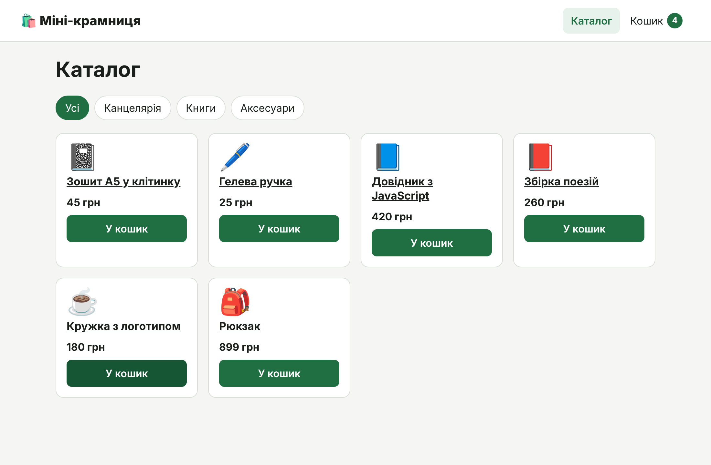
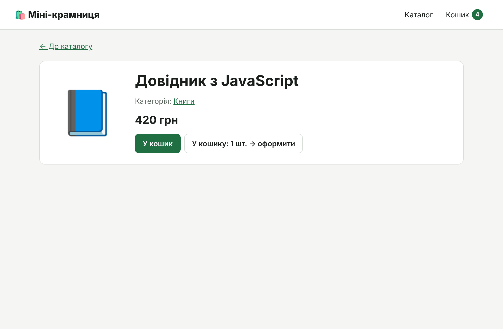
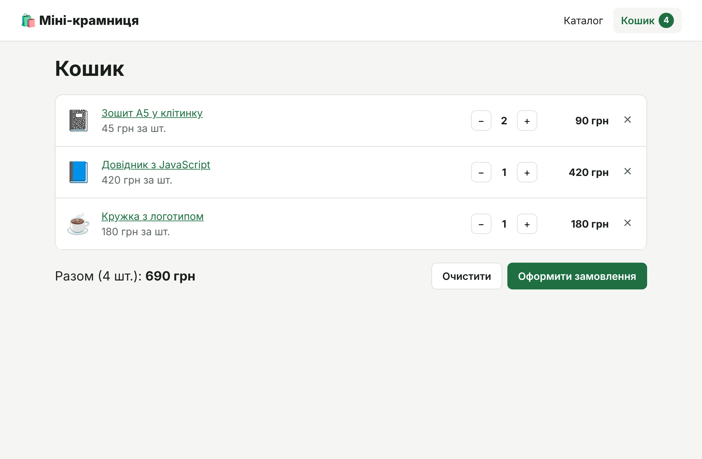
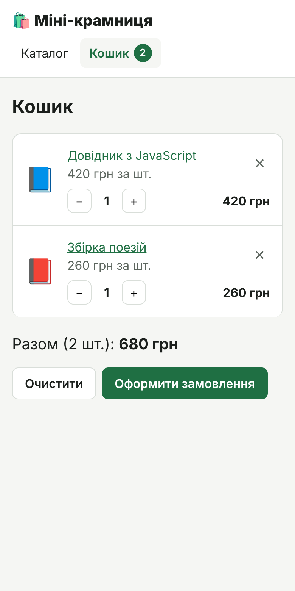

# Самостійна робота: «Міні-крамниця» — React Router, Context і Reducer

> **Курс:** Основи web програмування · ЛНУ ім. Івана Франка · ФПМІ
> **Заняття:** 28 жовтня 2026 р.
> **Теорія:**
> [Лекція 8. Context і Reducer](../../lectures/08-react-context-reducer.md) ·
> [Лекція 9. Маршрутизація, форми та валідація](../../lectures/09-react-routing-forms.md)
> **Інструменти:** WebStorm 2026.2, Node.js 24 LTS, Vite 8, React 19, React Router 8
> **Тривалість:** близько 2 академічних годин

Ви покроково створите крихітний інтернет-магазин: каталог товарів, сторінку
товару й кошик. Аплікація навмисно примітивна — ні сервера, ні форм, ні
збереження. Зате в ній чітко видно дві речі, заради яких її написано:

- **React Router** — як одна HTML-сторінка стає кількома «сторінками» з
  власними адресами: `/`, `/products/p3`, `/cart`;
- **Context + Reducer** — як кошик, з яким працюють шапка, каталог,
  сторінка товару й сторінка кошика, живе в одному місці, а всі зміни в
  ньому проходять через одну функцію.

---

## Як працювати з цією інструкцією

1. Виконуйте кроки **по черзі**. Код кожного кроку — **повний вміст файлу**:
   копіюйте його цілком. Файл з позначкою «тимчасова версія» пізніше буде
   замінено повністю.
2. Після кроку є **✅ контрольна точка** — що саме ви маєте побачити.
   Бачите інше — не йдіть далі, знайдіть розбіжність.
3. **🤔 Перевір себе** — питання, на які варто відповісти **до** того,
   як розгорнете відповідь. Відповідь — у дужках курсивом.
4. **🧪 Експерименти** — найцікавіше. Ви навмисно змінюєте код і дивитеся,
   що зламається. **Після кожного експерименту поверніть код як було**
   (`⌘Z` / `Ctrl+Z`).
5. Посилання виду «Л8 §3.3» — це лекція 8, розділ 3.3.
6. Тримайте відкритими **консоль браузера** (`⌥⌘I` / `F12` → Console):
   там з'являтимуться помилки й наші повідомлення.

Якщо ви ще не створювали проєкт Vite у WebStorm, спершу перегляньте кроки
1–3 інструкції [«Кіносписок»](../10.14/01-react-vite-movie-watchlist.md).

---

## Зміст

0. [Що ми побудуємо](#0-що-ми-побудуємо)
1. [Створення проєкту](#1-створення-проєкту)
2. [Прибираємо шаблон](#2-прибираємо-шаблон)
3. [Дані: каталог і ціни](#3-дані-каталог-і-ціни)
4. [Редюсер кошика](#4-редюсер-кошика)
5. [Context: кошик для всієї аплікації](#5-context-кошик-для-всієї-аплікації)
6. [Маршрути й макет](#6-маршрути-й-макет)
7. [Каталог і фільтр в адресі](#7-каталог-і-фільтр-в-адресі)
8. [Сторінка товару: параметр шляху](#8-сторінка-товару-параметр-шляху)
9. [Кошик і оформлення замовлення](#9-кошик-і-оформлення-замовлення)
10. [Лабораторія: досліджуємо Context і Reducer](#10-лабораторія-досліджуємо-context-і-reducer)
11. [Фінальна перевірка](#11-фінальна-перевірка)
12. [Типові помилки](#12-типові-помилки)
13. [Додаткові завдання](#13-додаткові-завдання)
14. [Корисні посилання](#14-корисні-посилання)

---

## 0. Що ми побудуємо



| Сторінка товару | Кошик | Кошик на телефоні |
|---|---|---|
|  |  |  |

**Що вміє аплікація:**

- каталог із шести товарів і фільтр за категорією, який зберігається в адресі
  (`/?category=books`);
- окрема сторінка кожного товару (`/products/p3`);
- кнопка «У кошик» на картці й на сторінці товару; лічильник у шапці
  показує, скільки товарів у кошику;
- кошик: змінити кількість (− / +), прибрати товар, очистити все, оформити
  замовлення;
- сторінка подяки й сторінка 404.

**Чого немає — навмисно.** Кошик зникає після перезавантаження сторінки:
стан живе в пам'яті JavaScript. Як це виправити — у додаткових завданнях
(знадобиться `useEffect`, лекція 7).

### 0.1. Маршрути

| Адреса | Сторінка | Що показує |
|---|---|---|
| `/` | `CatalogPage` | `index`-маршрут, `useSearchParams` |
| `/products/:productId` | `ProductPage` | параметр шляху, `useParams` |
| `/cart` | `CartPage` | `useNavigate` після оформлення |
| `/thanks` | `ThanksPage` | `state` у навігації, `useLocation` |
| будь-яка інша | `NotFoundPage` | маршрут `*` |

Усі сторінки вкладені в `Layout` — спільну шапку з меню й лічильником кошика.

### 0.2. Дерево компонентів

```
StrictMode
└── BrowserRouter              ← стежить за адресою браузера
    └── CartProvider           ← useReducer: стан кошика
        └── App  (Routes)
            └── Layout         ← шапка, NavLink, лічильник, <Outlet />
                ├── CatalogPage
                │   └── ProductCard × 6
                │       └── AddToCartButton
                ├── ProductPage
                │   └── AddToCartButton
                ├── CartPage
                │   └── CartItem × N
                ├── ThanksPage
                └── NotFoundPage
```

### 0.3. Як рухаються дані кошика

```
                     CartProvider
          ┌────────── cart ──────────┐       ┌──── dispatch ────┐
          ▼                          │       ▼                  │
     CartContext                     │  CartDispatchContext     │
     (читають: Layout,               │  (читають: AddToCartButton,
      ProductPage, CartPage)         │   CartItem, CartPage)    │
                                     │                          │
                         cartReducer(cart, дія) ◄── dispatch(itemAdded('p1'))
```

Ніхто не змінює кошик напряму. Компонент лише **повідомляє, що сталося**:
`dispatch(itemAdded('p1'))` — «товар p1 додано». Як від цього зміниться
стан, вирішує одна функція — `cartReducer`. Новий стан React роздає всім,
хто читає `CartContext`.

---

## 1. Створення проєкту

**Орієнтовно 10 хвилин.**

1. Перевірте Node.js: `node -v` → **v24.x** (React Router 8 потребує щонайменше
   22.22).
2. У WebStorm: **File | New | Project…** → **Vite** → **Location**
   `…/mini-shop` → **Template** `react` → TypeScript **не ставте** → **Create**.

   Або в терміналі:

   ```bash
   npm create vite@latest mini-shop -- --template react
   cd mini-shop
   npm install
   ```

3. Встановіть React Router (термінал WebStorm: **View | Tool Windows |
   Terminal**):

   ```bash
   npm install react-router
   ```

4. Запустіть сервер розробки: **npm dev** ▶ у Run widget або `npm run dev`.

#### ✅ Контрольна точка

За адресою `http://localhost:5173/` — стартова сторінка Vite з кнопкою
**Count is 0**. У `package.json` серед `dependencies` є `"react-router"`.

---

## 2. Прибираємо шаблон

**Орієнтовно 10 хвилин.**

### 2.1. Видаліть зайве

`src/App.css`, папку `src/assets`, `public/icons.svg`.

### 2.2. `index.html`

📄 **`index.html`**

```html
<!doctype html>
<html lang="uk">
  <head>
    <meta charset="UTF-8" />
    <link rel="icon" type="image/svg+xml" href="/favicon.svg" />
    <meta name="viewport" content="width=device-width, initial-scale=1.0" />
    <title>Міні-крамниця</title>
  </head>
  <body>
    <div id="root"></div>
    <script type="module" src="/src/main.jsx"></script>
  </body>
</html>
```

### 2.3. Глобальні стилі

Повністю замініть вміст `src/index.css`:

📄 **`src/index.css`**

```css
/* Глобальні стилі: кольори, скидання, кнопки.
   Стилі окремих компонентів — у їхніх *.module.css. */

:root {
  --color-bg: #f5f6f3;
  --color-surface: #ffffff;
  --color-text: #1b1f1c;
  --color-muted: #5d665f;
  --color-border: #d9ded9;
  --color-accent: #1f6f43;
  --color-accent-hover: #175635;
  --color-accent-soft: #e6f2eb;
  --radius: 0.75rem; /* 12px */

  font-family: system-ui, sans-serif;
  line-height: 1.5;
  color: var(--color-text);
  background: var(--color-bg);
}

*,
*::before,
*::after {
  box-sizing: border-box;
}

body,
h1,
h2,
p,
ul {
  margin: 0;
}

ul {
  padding: 0;
  list-style: none;
}

button {
  font: inherit;
}

a {
  color: var(--color-accent);
}

:focus-visible {
  outline: 3px solid var(--color-accent);
  outline-offset: 2px;
}

/* Кнопка — клас, а не компонент: його отримують і <button>, і <Link> */
.button {
  display: inline-flex;
  align-items: center;
  justify-content: center;
  gap: 0.375rem;
  min-height: 2.5rem; /* 40px */
  padding: 0.5rem 1rem;
  border: 1px solid transparent;
  border-radius: 0.5rem;
  background: var(--color-accent);
  color: #ffffff;
  font-weight: 600;
  text-decoration: none;
  cursor: pointer;
}

.button:hover {
  background: var(--color-accent-hover);
}

.button--secondary {
  background: var(--color-surface);
  border-color: var(--color-border);
  color: var(--color-text);
}

.button--secondary:hover {
  background: var(--color-surface);
  border-color: var(--color-accent);
}

.page-title {
  margin-bottom: 1.25rem;
  font-size: clamp(1.5rem, 1.2rem + 1.2vw, 2.25rem); /* 24px … 36px */
  line-height: 1.2;
}

.muted {
  color: var(--color-muted);
}
```

### 2.4. Тимчасовий `App.jsx`

📄 **`src/App.jsx`** — тимчасова версія

```jsx
function App() {
  return <h1>Міні-крамниця</h1>;
}

export default App;
```

#### ✅ Контрольна точка

Заголовок **Міні-крамниця** на світлому тлі, вкладка браузера має ту саму
назву, у консолі — жодних помилок.

---

## 3. Дані: каталог і ціни

**Орієнтовно 10 хвилин.**

Створіть у `src/` папки `components`, `context`, `data`, `features/cart`,
`features/products`, `pages`, `store`, `utils`.

📄 **`src/data/products.js`**

```js
// Каталог не змінюється, поки працює аплікація, тому це звичайний масив,
// а не стан. У кошику зберігатимемо лише id товару й кількість.
export const CATEGORIES = [
  { id: 'stationery', title: 'Канцелярія' },
  { id: 'books', title: 'Книги' },
  { id: 'accessories', title: 'Аксесуари' },
];

export const products = [
  { id: 'p1', title: 'Зошит А5 у клітинку', price: 45, category: 'stationery', emoji: '📓' },
  { id: 'p2', title: 'Гелева ручка', price: 25, category: 'stationery', emoji: '🖊️' },
  { id: 'p3', title: 'Довідник з JavaScript', price: 420, category: 'books', emoji: '📘' },
  { id: 'p4', title: 'Збірка поезій', price: 260, category: 'books', emoji: '📕' },
  { id: 'p5', title: 'Кружка з логотипом', price: 180, category: 'accessories', emoji: '☕' },
  { id: 'p6', title: 'Рюкзак', price: 899, category: 'accessories', emoji: '🎒' },
];

export function findProduct(id) {
  return products.find((product) => product.id === id);
}
```

📄 **`src/utils/formatPrice.js`**

```js
// Розділювач тисяч за українськими правилами: 1250 → «1 250»
const numberFormat = new Intl.NumberFormat('uk-UA');

/** 1250 → «1 250 грн» */
export function formatPrice(value) {
  return `${numberFormat.format(value)} грн`;
}
```

#### 🤔 Перевір себе

1. Чому каталог — звичайний масив, а не `useState`? *(Він не змінюється,
   поки працює аплікація. Стан потрібен лише для того, що змінюється.)*
2. Чому `id` товарів — рядки `'p1'`, а не числа `1`? *(Параметри адреси
   завжди рядки: з `/products/p1` ми отримаємо `'p1'`. Однаковий тип —
   `===` без перетворень. Побачите це на кроці 6.)*

---

## 4. Редюсер кошика

**Орієнтовно 20 хвилин.** Л8 §2–§5, §10.

### 4.1. Стан, дії, редюсер

📄 **`src/store/cartReducer.js`**

```js
// --- Типи дій -----------------------------------------------------------------
export const ITEM_ADDED = 'cart/itemAdded';
export const ITEM_DECREMENTED = 'cart/itemDecremented';
export const ITEM_REMOVED = 'cart/itemRemoved';
export const CART_CLEARED = 'cart/cleared';

// --- Творці дій ---------------------------------------------------------------
// Компоненти не збирають об'єкти дій вручну, а викликають ці функції:
// dispatch(itemAdded('p1')) замість dispatch({ type: 'cart/itemAdded', payload: 'p1' })
export const itemAdded = (productId) => ({ type: ITEM_ADDED, payload: productId });
export const itemDecremented = (productId) => ({ type: ITEM_DECREMENTED, payload: productId });
export const itemRemoved = (productId) => ({ type: ITEM_REMOVED, payload: productId });
export const cartCleared = () => ({ type: CART_CLEARED });

// --- Початковий стан ------------------------------------------------------------
// Лише id і кількість. Назву й ціну беремо з каталогу — не дублюємо дані.
export const initialCart = { items: [] };

// --- Редюсер --------------------------------------------------------------------
// Чиста функція: (стан, дія) → новий стан. Жодних мутацій.
export function cartReducer(state, action) {
  switch (action.type) {
    case ITEM_ADDED: {
      const exists = state.items.some((item) => item.productId === action.payload);
      const items = exists
        ? state.items.map((item) =>
            item.productId === action.payload ? { ...item, quantity: item.quantity + 1 } : item,
          )
        : [...state.items, { productId: action.payload, quantity: 1 }];
      return { ...state, items };
    }

    case ITEM_DECREMENTED: {
      const items = state.items
        .map((item) =>
          item.productId === action.payload ? { ...item, quantity: item.quantity - 1 } : item,
        )
        .filter((item) => item.quantity > 0); // кількість 0 — товар зникає з кошика
      return { ...state, items };
    }

    case ITEM_REMOVED:
      return { ...state, items: state.items.filter((item) => item.productId !== action.payload) };

    case CART_CLEARED:
      return initialCart;

    default:
      return state;
  }
}
```

**Три ідеї цього файлу:**

1. **Стан — лише `{ productId, quantity }`.** Назву й ціну в кошик не
   копіюємо: вони вже є в каталозі. Менше даних — менше шансів, що щось
   розсинхронізується (Л8 §5).
2. **Дія — об'єкт `{ type, payload }`**, що описує, **що сталося**:
   «товар додано», «кошик очищено». Константи типів і творці дій
   захищають від описок (Л8 §3).
3. **Редюсер — чиста функція** (Л8 §4): отримує поточний стан і дію,
   повертає **новий** стан. Нічого не змінює на місці: `map`, `filter`,
   spread. Якщо дія невідома — повертає стан без змін.

### 4.2. Похідні дані

📄 **`src/store/cartSelectors.js`**

```js
import { findProduct } from '../data/products.js';

// Похідні дані: обчислюємо зі стану, а не зберігаємо поруч із ним.

/** Скільки одиниць товару в кошику загалом */
export function getTotalCount(items) {
  return items.reduce((sum, item) => sum + item.quantity, 0);
}

/** Загальна вартість */
export function getTotalPrice(items) {
  return items.reduce((sum, item) => sum + findProduct(item.productId).price * item.quantity, 0);
}

/** Скільки одиниць конкретного товару в кошику (0 — якщо немає) */
export function getQuantity(items, productId) {
  return items.find((item) => item.productId === productId)?.quantity ?? 0;
}
```

Кількість і суму **не зберігаємо** в стані, а **обчислюємо** з нього
(Л8 §10). Якби `totalPrice` лежав у стані поруч з `items`, кожна дія мала б
не забути його оновити.

### 4.3. Перевіряємо редюсер без React

📄 **`src/App.jsx`** — тимчасова версія

```jsx
import { cartReducer, initialCart, itemAdded, itemDecremented } from './store/cartReducer.js';
import { getTotalCount, getTotalPrice } from './store/cartSelectors.js';
import { formatPrice } from './utils/formatPrice.js';

// Тимчасова версія. Редюсер — звичайна функція: викликаємо її вручну, без React.
let state = initialCart;
state = cartReducer(state, itemAdded('p1')); // зошит
state = cartReducer(state, itemAdded('p1')); // ще один зошит
state = cartReducer(state, itemAdded('p3')); // довідник
state = cartReducer(state, itemDecremented('p1')); // мінус один зошит

function App() {
  return (
    <main style={{ padding: '1rem' }}>
      <h1>Перевірка редюсера</h1>
      <pre>{JSON.stringify(state, null, 2)}</pre>
      <p>
        Разом: {getTotalCount(state.items)} шт., {formatPrice(getTotalPrice(state.items))}
      </p>
    </main>
  );
}

export default App;
```

#### 🤔 Перевір себе

**До того як відкрити браузер**, запишіть на папері, що буде в `state`
після чотирьох викликів і яка сума.

*(Зошит: 1 шт., довідник: 1 шт. Разом 2 шт., 45 + 420 = 465 грн.)*

#### ✅ Контрольна точка

На сторінці — JSON зі станом: у масиві `items` два об'єкти
(`"productId": "p1"` з `"quantity": 1` і `"productId": "p3"` з
`"quantity": 1`), нижче — «Разом: 2 шт., 465 грн». Збігається з вашою
відповіддю?

#### 🧪 Експеримент: невідома дія

Додайте ще один рядок перед `function App()`:

```js
state = cartReducer(state, { type: 'cart/itemAded', payload: 'p6' }); // описка!
```

Рюкзак у кошику не з'явився, помилки немає — редюсер мовчки повернув стан
без змін (`default`). Тепер напишіть із тією самою опискою
`itemAded('p6')` — WebStorm одразу підкреслить ім'я, а сторінка впаде з
помилкою в консолі. Саме для цього потрібні творці дій.
**Приберіть рядок.**

---

## 5. Context: кошик для всієї аплікації

**Орієнтовно 20 хвилин.** Л8 §7, §8, §11.2.

### 5.1. Контексти й хуки доступу

📄 **`src/context/CartContext.js`**

```js
import { createContext, useContext } from 'react';

// Два контексти:
//  • CartContext — сам кошик (змінюється часто);
//  • CartDispatchContext — функція dispatch (не змінюється ніколи).
// Кнопка «У кошик» читає лише dispatch, тому не перемальовується, коли змінюється кошик.
export const CartContext = createContext(null);
export const CartDispatchContext = createContext(null);

export function useCart() {
  const cart = useContext(CartContext);
  if (cart === null) {
    throw new Error('useCart() має викликатися всередині <CartProvider>.');
  }
  return cart;
}

export function useCartDispatch() {
  const dispatch = useContext(CartDispatchContext);
  if (dispatch === null) {
    throw new Error('useCartDispatch() має викликатися всередині <CartProvider>.');
  }
  return dispatch;
}
```

- **Два контексти** (Л8 §11.2): компонентам, які лише **змінюють** кошик
  (кнопка «У кошик»), сам кошик не потрібен. Вони читають тільки
  `dispatch`, який ніколи не змінюється, — і не перемальовуються, коли
  кошик змінився. Перевіримо в лабораторії.
- **Хуки доступу з помилкою** (Л8 §8): якщо забути провайдер, ви
  побачите зрозуміле повідомлення, а не `Cannot read properties of null`.

### 5.2. Провайдер

📄 **`src/context/CartProvider.jsx`**

```jsx
import { useReducer } from 'react';
import { CartContext, CartDispatchContext } from './CartContext.js';
import { cartReducer, initialCart } from '../store/cartReducer.js';

export function CartProvider({ children }) {
  const [cart, dispatch] = useReducer(cartReducer, initialCart);

  // dispatch від React стабільний — той самий на кожному рендері,
  // тому значення CartDispatchContext ніколи не змінюється
  return (
    <CartDispatchContext value={dispatch}>
      <CartContext value={cart}>{children}</CartContext>
    </CartDispatchContext>
  );
}
```

`useReducer(cartReducer, initialCart)` повертає пару: поточний стан і
функцію `dispatch`. Провайдер кладе їх у два контексти — і будь-який
компонент усередині може їх узяти.

`<CartContext value={…}>` — запис React 19; у старіших версіях писали
`<CartContext.Provider value={…}>`.

### 5.3. Підключаємо

📄 **`src/main.jsx`**

```jsx
import { StrictMode } from 'react';
import { createRoot } from 'react-dom/client';
import { BrowserRouter } from 'react-router';
import { CartProvider } from './context/CartProvider.jsx';
import App from './App.jsx';
import './index.css';

createRoot(document.getElementById('root')).render(
  <StrictMode>
    <BrowserRouter>
      <CartProvider>
        <App />
      </CartProvider>
    </BrowserRouter>
  </StrictMode>,
);
```

`BrowserRouter` знадобиться на наступному кроці; додаємо його вже зараз.
Порядок важливий: усе, що користується маршрутами чи кошиком, має бути
**всередині** відповідного провайдера.

📄 **`src/App.jsx`** — тимчасова версія

```jsx
import { useCart, useCartDispatch } from './context/CartContext.js';
import { cartCleared, itemAdded } from './store/cartReducer.js';
import { getTotalCount } from './store/cartSelectors.js';

// Тимчасова версія: перевіряємо, що контекст і редюсер працюють разом
function App() {
  const { items } = useCart();
  const dispatch = useCartDispatch();

  return (
    <main style={{ padding: '1rem' }}>
      <h1>Перевірка контексту</h1>
      <p>У кошику: {getTotalCount(items)} шт.</p>
      <button type="button" onClick={() => dispatch(itemAdded('p1'))}>
        Додати зошит
      </button>{' '}
      <button type="button" onClick={() => dispatch(itemAdded('p6'))}>
        Додати рюкзак
      </button>{' '}
      <button type="button" onClick={() => dispatch(cartCleared())}>
        Очистити
      </button>
      <pre>{JSON.stringify(items, null, 2)}</pre>
    </main>
  );
}

export default App;
```

#### ✅ Контрольна точка

- «У кошику: 0 шт.» і порожній масив `[]`.
- **Додати зошит** двічі → «2 шт.», в масиві один об'єкт із `"quantity": 2`.
- **Додати рюкзак** → «3 шт.», два об'єкти.
- **Очистити** → знову `[]`.

#### 🧪 Експеримент: забули провайдер

У `main.jsx` закоментуйте обгортку (`⌘/` / `Ctrl+/` на кожному з двох
рядків):

```jsx
      {/* <CartProvider> */}
        <App />
      {/* </CartProvider> */}
```

Сторінка порожня, а в консолі — наша помилка:
`useCart() має викликатися всередині <CartProvider>.` **Поверніть
провайдер.**

#### 🤔 Перевір себе

1. Що повертає `useContext(CartContext)` без провайдера? *(Значення за
   замовчуванням із `createContext(null)` — тобто `null`.)*
2. Чому `dispatch` можна класти в контекст без `useMemo`? *(React гарантує,
   що `dispatch` — та сама функція на кожному рендері.)*

---

## 6. Маршрути й макет

**Орієнтовно 20 хвилин.** Л9 §2–§5, §9.

### 6.1. Макет зі шапкою

📄 **`src/components/Layout.jsx`**

```jsx
import { Link, NavLink, Outlet } from 'react-router';
import { useCart } from '../context/CartContext.js';
import { getTotalCount } from '../store/cartSelectors.js';
import styles from './Layout.module.css';

// NavLink передає у функцію className об'єкт { isActive }.
// Для to="/" збіг завжди точний: «Каталог» не підсвічується на /cart.
const navLinkClass = ({ isActive }) =>
  isActive ? `${styles.navLink} ${styles.active}` : styles.navLink;

function Layout() {
  const { items } = useCart();
  const count = getTotalCount(items);

  return (
    <div className={styles.layout}>
      <header className={styles.header}>
        <Link to="/" className={styles.logo}>
          🛍️ Міні-крамниця
        </Link>

        <nav aria-label="Основна навігація">
          <ul className={styles.navList}>
            <li>
              <NavLink to="/" className={navLinkClass}>
                Каталог
              </NavLink>
            </li>
            <li>
              <NavLink to="/cart" className={navLinkClass}>
                Кошик <span className={styles.badge}>{count}</span>
              </NavLink>
            </li>
          </ul>
        </nav>
      </header>

      <main className={styles.main}>
        {/* Сюди React Router підставляє сторінку поточного маршруту */}
        <Outlet />
      </main>
    </div>
  );
}

export default Layout;
```

📄 **`src/components/Layout.module.css`**

```css
.layout {
  min-height: 100dvh;
}

.header {
  display: flex;
  flex-wrap: wrap;
  align-items: center;
  justify-content: space-between;
  gap: 0.5rem 1rem;
  padding: 0.75rem 1rem;
  background: var(--color-surface);
  border-bottom: 1px solid var(--color-border);
}

.logo {
  color: var(--color-text);
  font-size: 1.25rem; /* 20px */
  font-weight: 800;
  text-decoration: none;
}

.navList {
  display: flex;
  gap: 0.25rem;
}

.navLink {
  display: flex;
  align-items: center;
  gap: 0.375rem;
  padding: 0.5rem 0.75rem;
  border-radius: 0.5rem;
  color: var(--color-text);
  text-decoration: none;
}

.navLink:hover {
  background: var(--color-bg);
}

.active {
  background: var(--color-accent-soft);
  color: var(--color-accent);
  font-weight: 600;
}

/* Кружечок із кількістю товарів */
.badge {
  min-width: 1.5rem;
  padding: 0 0.375rem;
  border-radius: 999px;
  background: var(--color-accent);
  color: #ffffff;
  font-size: 0.8125rem; /* 13px */
  font-weight: 700;
  line-height: 1.5rem;
  text-align: center;
}

.main {
  max-width: 60rem; /* 960px */
  margin-inline: auto;
  padding: 1.5rem 1rem 3rem;
}

@media (min-width: 48rem) {
  .header {
    padding-inline: 2rem;
  }
}
```

- **`<Outlet />`** (Л9 §5) — місце, куди React Router підставляє сторінку
  поточного маршруту. Шапка лишається, змінюється лише вміст `<main>`.
- **`NavLink`** (Л9 §3.1) знає, чи він активний: передає у функцію
  `className` об'єкт `{ isActive }` і сам ставить активному посиланню
  `aria-current="page"`.
- **Лічильник у шапці** читає кошик із контексту й рахує кількість
  функцією `getTotalCount` — шапці ніхто не передає props.

### 6.2. Сторінка 404 і подяки

📄 **`src/pages/NotFoundPage.jsx`**

```jsx
import { Link } from 'react-router';

/**
 * @param {Object} props
 * @param {string} [props.message]
 */
function NotFoundPage({ message = 'Такої сторінки не існує.' }) {
  return (
    <>
      <h1 className="page-title">404</h1>
      <p>{message}</p>
      <p>
        <Link to="/">Повернутися до каталогу</Link>
      </p>
    </>
  );
}

export default NotFoundPage;
```

📄 **`src/pages/ThanksPage.jsx`**

```jsx
import { Link, useLocation } from 'react-router';
import { formatPrice } from '../utils/formatPrice.js';

function ThanksPage() {
  // state, переданий у navigate(…, { state }). Якщо сторінку відкрили
  // напряму за адресою — state немає (null).
  const { state } = useLocation();

  return (
    <>
      <h1 className="page-title">Дякуємо за замовлення!</h1>
      {state ? (
        <p>Сума замовлення: {formatPrice(state.total)}.</p>
      ) : (
        <p className="muted">Інформації про замовлення немає.</p>
      )}
      <p>
        <Link to="/">Повернутися до каталогу</Link>
      </p>
    </>
  );
}

export default ThanksPage;
```

Що таке `state` з `useLocation()`, побачимо на кроці 9.

### 6.3. Заглушки решти сторінок

📄 **`src/pages/CatalogPage.jsx`** — тимчасова версія

```jsx
import { Link } from 'react-router';
import { products } from '../data/products.js';

// Тимчасова заглушка — повну сторінку напишемо на кроці 7
function CatalogPage() {
  return (
    <>
      <h1 className="page-title">Каталог</h1>
      <ul>
        {products.map((product) => (
          <li key={product.id}>
            <Link to={`/products/${product.id}`}>{product.title}</Link>
          </li>
        ))}
      </ul>
    </>
  );
}

export default CatalogPage;
```

📄 **`src/pages/ProductPage.jsx`** — тимчасова версія

```jsx
import { useParams } from 'react-router';

// Тимчасова заглушка — повну сторінку напишемо на кроці 8
function ProductPage() {
  const { productId } = useParams();

  return (
    <h1 className="page-title">
      Товар: {productId} (тип: {typeof productId})
    </h1>
  );
}

export default ProductPage;
```

📄 **`src/pages/CartPage.jsx`** — тимчасова версія

```jsx
// Тимчасова заглушка — повну сторінку напишемо на кроці 9
function CartPage() {
  return <h1 className="page-title">Кошик</h1>;
}

export default CartPage;
```

### 6.4. Маршрути

📄 **`src/App.jsx`**

```jsx
import { Route, Routes } from 'react-router';
import Layout from './components/Layout.jsx';
import CatalogPage from './pages/CatalogPage.jsx';
import ProductPage from './pages/ProductPage.jsx';
import CartPage from './pages/CartPage.jsx';
import ThanksPage from './pages/ThanksPage.jsx';
import NotFoundPage from './pages/NotFoundPage.jsx';

function App() {
  return (
    <Routes>
      {/* Батьківський маршрут — спільний макет; дочірні сторінки з'являються в його <Outlet /> */}
      <Route path="/" element={<Layout />}>
        <Route index element={<CatalogPage />} />
        <Route path="products/:productId" element={<ProductPage />} />
        <Route path="cart" element={<CartPage />} />
        <Route path="thanks" element={<ThanksPage />} />
        <Route path="*" element={<NotFoundPage />} />
      </Route>
    </Routes>
  );
}

export default App;
```

- **Вкладені `Route`**: усі сторінки — «діти» маршруту з `Layout`.
- **`index`** — сторінка для адреси самого батька, тобто `/`.
- **`:productId`** — параметр шляху: один маршрут для будь-якого товару.
- **`*`** — усе, що не збіглося з іншими маршрутами.

#### ✅ Контрольна точка

- Шапка з логотипом, пунктами **Каталог** і **Кошик 0**; активний пункт
  підсвічений.
- Клацніть **Кошик**: адреса `/cart`, підсвічений «Кошик». Сторінка **не
  перезавантажилася** — у вкладці **Network** немає нового запиту документа.
- Клацніть товар у списку: «Товар: p3 (тип: **string**)». Параметри шляху
  **завжди рядки** (Л9 §4).
- Введіть в адресному рядку `/qwerty` — сторінка 404 зі шапкою.
- Кнопки браузера **Назад** / **Вперед** працюють.

#### 🤔 Перевір себе

1. Чому «Каталог» не підсвічується на `/cart`, хоча `/cart` починається з
   `/`? *(Для `to="/"` React Router завжди вимагає точного збігу. Для інших
   адрес це не так: `<NavLink to="/products">` був би активним і на
   `/products/p3`, якби не проп `end`.)*
2. Що буде, якщо прибрати `<Outlet />` з `Layout`? *(Шапка є, а сторінок
   не видно: їм нікуди відмалюватися.)*

---

## 7. Каталог і фільтр в адресі

**Орієнтовно 20 хвилин.** Л9 §6; Л8 §11.2.

### 7.1. Кнопка «У кошик»

📄 **`src/features/cart/AddToCartButton.jsx`**

```jsx
import { useCartDispatch } from '../../context/CartContext.js';
import { itemAdded } from '../../store/cartReducer.js';

/**
 * @param {Object} props
 * @param {string} props.productId
 */
function AddToCartButton({ productId }) {
  // Лише dispatch — кнопці не потрібен сам кошик
  const dispatch = useCartDispatch();

  return (
    <button type="button" className="button" onClick={() => dispatch(itemAdded(productId))}>
      У кошик
    </button>
  );
}

export default AddToCartButton;
```

Кнопка не отримує колбеків через props. Вона сама бере `dispatch` з
контексту й надсилає дію. Самого кошика кнопка не читає.

### 7.2. Картка товару

📄 **`src/features/products/ProductCard.jsx`**

```jsx
import { Link } from 'react-router';
import AddToCartButton from '../cart/AddToCartButton.jsx';
import { formatPrice } from '../../utils/formatPrice.js';
import styles from './ProductCard.module.css';

/**
 * @param {Object} props
 * @param {{id: string, title: string, price: number, emoji: string}} props.product
 */
function ProductCard({ product }) {
  return (
    <article className={styles.card}>
      <p className={styles.emoji} aria-hidden="true">
        {product.emoji}
      </p>
      <h2 className={styles.title}>
        <Link to={`/products/${product.id}`}>{product.title}</Link>
      </h2>
      <p className={styles.price}>{formatPrice(product.price)}</p>
      <AddToCartButton productId={product.id} />
    </article>
  );
}

export default ProductCard;
```

📄 **`src/features/products/ProductCard.module.css`**

```css
.card {
  display: grid;
  gap: 0.5rem;
  align-content: start;
  padding: 1rem;
  border: 1px solid var(--color-border);
  border-radius: var(--radius);
  background: var(--color-surface);
}

.emoji {
  font-size: 2.5rem; /* 40px */
  line-height: 1;
}

.title {
  font-size: 1.0625rem; /* 17px */
  line-height: 1.3;
}

.title a {
  color: inherit;
}

.price {
  font-weight: 700;
}
```

### 7.3. Сторінка каталогу

📄 **`src/pages/CatalogPage.jsx`**

```jsx
import { useSearchParams } from 'react-router';
import ProductCard from '../features/products/ProductCard.jsx';
import { CATEGORIES, products } from '../data/products.js';
import styles from './CatalogPage.module.css';

function CatalogPage() {
  // Обрана категорія живе в адресі: /?category=books
  const [searchParams, setSearchParams] = useSearchParams();
  const category = searchParams.get('category'); // null, якщо параметра немає

  // Похідні дані: просто фільтруємо під час рендера
  const visibleProducts = category
    ? products.filter((product) => product.category === category)
    : products;

  return (
    <>
      <h1 className="page-title">Каталог</h1>

      <div className={styles.filters} role="group" aria-label="Категорія">
        <button
          type="button"
          className={styles.filter}
          aria-pressed={category === null}
          onClick={() => setSearchParams({})}
        >
          Усі
        </button>
        {CATEGORIES.map((item) => (
          <button
            key={item.id}
            type="button"
            className={styles.filter}
            aria-pressed={category === item.id}
            onClick={() => setSearchParams({ category: item.id })}
          >
            {item.title}
          </button>
        ))}
      </div>

      <ul className={styles.grid}>
        {visibleProducts.map((product) => (
          <li key={product.id}>
            <ProductCard product={product} />
          </li>
        ))}
      </ul>
    </>
  );
}

export default CatalogPage;
```

📄 **`src/pages/CatalogPage.module.css`**

```css
.filters {
  display: flex;
  flex-wrap: wrap;
  gap: 0.5rem;
  margin-bottom: 1.25rem;
}

.filter {
  padding: 0.375rem 0.875rem;
  border: 1px solid var(--color-border);
  border-radius: 999px;
  background: var(--color-surface);
  color: var(--color-text);
  cursor: pointer;
}

/* Обрану категорію видно за тим самим атрибутом, що чує читач екрана */
.filter[aria-pressed='true'] {
  border-color: var(--color-accent);
  background: var(--color-accent);
  color: #ffffff;
}

/* Стільки колонок, скільки вміщається по 220px */
.grid {
  display: grid;
  grid-template-columns: repeat(auto-fill, minmax(min(100%, 13.75rem), 1fr));
  gap: 1rem;
}

.grid > li {
  display: grid; /* картки в одному ряду однакової висоти */
}
```

**Категорія — в адресі, а не в `useState`** (Л9 §6). `searchParams.get`
читає параметр, `setSearchParams` змінює адресу, а React Router
перемальовує сторінку з новим значенням. Тому відфільтрований каталог
можна надіслати посиланням, а кнопка «Назад» повертає попередній фільтр.

#### ✅ Контрольна точка

- Шість карток. **У кошик** на будь-якій картці → лічильник у шапці
  збільшується.
- **Книги** → адреса `/?category=books`, дві картки. Відкрийте цю адресу в
  новій вкладці — теж дві книги.
- **Назад** у браузері → адреса `/`, знову всі шість.
- Клацніть назву товару → поки що заглушка «Товар: p…».

#### 🧪 Експеримент: хто перемальовується?

Тимчасово додайте `console.log` у три компоненти:

```js
// Layout.jsx, після рядка const count = …
console.log('Рендер Layout');

// CatalogPage.jsx, після рядка const category = …
console.log('Рендер CatalogPage');

// AddToCartButton.jsx, після рядка const dispatch = …
console.log('Рендер кнопки', productId);
```

Очистіть консоль і натисніть **У кошик**. У консолі — **лише**
«Рендер Layout» (двічі — це StrictMode). Каталог і шість кнопок не
перемальовуються: вони не читають `CartContext`, тож зміна кошика їх не
стосується. Залиште `console.log` — вони знадобляться в лабораторії
(крок 10), а потім їх приберемо.

#### 🤔 Перевір себе

1. Чому для «Усі» викликаємо `setSearchParams({})`, а не
   `setSearchParams({ category: 'all' })`? *(Немає фільтра — немає
   параметра. Адреса лишається чистою: `/`, а не `/?category=all`.)*
2. Чому `visibleProducts` — не стан? *(Його можна обчислити з `products` і
   `category`. Окремий стан довелося б синхронізувати.)*

---

## 8. Сторінка товару: параметр шляху

**Орієнтовно 15 хвилин.** Л9 §4, §9.

📄 **`src/pages/ProductPage.jsx`**

```jsx
import { Link, useParams } from 'react-router';
import AddToCartButton from '../features/cart/AddToCartButton.jsx';
import NotFoundPage from './NotFoundPage.jsx';
import { useCart } from '../context/CartContext.js';
import { CATEGORIES, findProduct } from '../data/products.js';
import { getQuantity } from '../store/cartSelectors.js';
import { formatPrice } from '../utils/formatPrice.js';
import styles from './ProductPage.module.css';

function ProductPage() {
  // Назва параметра — як у маршруті: path="products/:productId"
  const { productId } = useParams();
  const { items } = useCart();

  const product = findProduct(productId);
  if (!product) {
    return <NotFoundPage message={`Товару «${productId}» немає в каталозі.`} />;
  }

  const category = CATEGORIES.find((item) => item.id === product.category);
  const quantity = getQuantity(items, product.id);

  return (
    <article>
      <Link to="/">← До каталогу</Link>

      <div className={styles.product}>
        <p className={styles.emoji} aria-hidden="true">
          {product.emoji}
        </p>
        <div className={styles.info}>
          <h1 className={styles.title}>{product.title}</h1>
          <p className="muted">
            Категорія:{' '}
            <Link to={`/?category=${category.id}`}>{category.title}</Link>
          </p>
          <p className={styles.price}>{formatPrice(product.price)}</p>

          <div className={styles.actions}>
            <AddToCartButton productId={product.id} />
            {quantity > 0 && (
              <Link to="/cart" className="button button--secondary">
                У кошику: {quantity} шт. → оформити
              </Link>
            )}
          </div>
        </div>
      </div>
    </article>
  );
}

export default ProductPage;
```

📄 **`src/pages/ProductPage.module.css`**

```css
.product {
  display: grid;
  gap: 1.5rem;
  margin-top: 1.25rem;
  padding: 1.5rem;
  border: 1px solid var(--color-border);
  border-radius: var(--radius);
  background: var(--color-surface);
}

.emoji {
  font-size: 6rem; /* 96px */
  line-height: 1;
  text-align: center;
}

.info {
  display: grid;
  gap: 0.75rem;
  align-content: start;
}

.title {
  font-size: clamp(1.5rem, 1.2rem + 1.2vw, 2.25rem); /* 24px … 36px */
  line-height: 1.2;
}

.price {
  font-size: 1.5rem; /* 24px */
  font-weight: 700;
}

.actions {
  display: flex;
  flex-wrap: wrap;
  gap: 0.5rem;
}

/* Планшет і ширше: зображення ліворуч, опис праворуч */
@media (min-width: 40rem) {
  .product {
    grid-template-columns: 10rem 1fr;
    align-items: center;
  }
}
```

- **`useParams()`** повертає `{ productId: 'p3' }` — ім'я ключа таке саме,
  як у маршруті `products/:productId`.
- **Немає товару — показуємо `NotFoundPage`.** Маршрут `products/:productId`
  збігається з будь-яким `id`, тож перевірити, чи такий товар існує, може
  лише сама сторінка.
- **Посилання на категорію** `<Link to="/?category=books">` — query-параметр
  можна передати й звичайним посиланням.
- **Сторінка читає кошик** (`useCart`), щоб показати, скільки цього товару
  вже додано.

#### ✅ Контрольна точка

- Сторінка товару: емодзі, назва, категорія, ціна, **У кошик**.
- **У кошик** → з'являється кнопка «У кошику: 1 шт. → оформити», лічильник
  у шапці збільшився. Ще раз — «2 шт.».
- Посилання **Книги** веде на `/?category=books`.
- `/products/p999` — «404. Товару «p999» немає в каталозі.»

#### 🤔 Перевір себе

1. Чому не можна написати `findProduct(Number(productId))`? *(`id` у
   каталозі — рядки `'p1'`; `Number('p3')` дасть `NaN`, і товар не
   знайдеться ніколи.)*
2. Сторінка товару перемальовується після кожного «У кошик», а каталог —
   ні. Чому? *(Сторінка товару читає `CartContext` через `useCart`,
   каталог — ні.)*

---

## 9. Кошик і оформлення замовлення

**Орієнтовно 20 хвилин.** Л9 §3.2; Л8 §9.

### 9.1. Рядок кошика

📄 **`src/features/cart/CartItem.jsx`**

```jsx
import { Link } from 'react-router';
import { useCartDispatch } from '../../context/CartContext.js';
import { itemAdded, itemDecremented, itemRemoved } from '../../store/cartReducer.js';
import { findProduct } from '../../data/products.js';
import { formatPrice } from '../../utils/formatPrice.js';
import styles from './CartItem.module.css';

/**
 * Один рядок кошика.
 * @param {Object} props
 * @param {{productId: string, quantity: number}} props.item
 */
function CartItem({ item }) {
  const dispatch = useCartDispatch();
  const product = findProduct(item.productId);

  return (
    <li className={styles.item}>
      <span className={styles.emoji} aria-hidden="true">
        {product.emoji}
      </span>

      <div className={styles.info}>
        <Link to={`/products/${product.id}`}>{product.title}</Link>
        <p className="muted">{formatPrice(product.price)} за шт.</p>
      </div>

      <div className={styles.quantity}>
        <button
          type="button"
          className={styles.step}
          onClick={() => dispatch(itemDecremented(product.id))}
          aria-label={`Зменшити кількість: ${product.title}`}
        >
          −
        </button>
        <span className={styles.count}>{item.quantity}</span>
        <button
          type="button"
          className={styles.step}
          onClick={() => dispatch(itemAdded(product.id))}
          aria-label={`Збільшити кількість: ${product.title}`}
        >
          +
        </button>
      </div>

      <p className={styles.subtotal}>{formatPrice(product.price * item.quantity)}</p>

      <button
        type="button"
        className={styles.remove}
        onClick={() => dispatch(itemRemoved(product.id))}
        aria-label={`Видалити з кошика: ${product.title}`}
      >
        ✕
      </button>
    </li>
  );
}

export default CartItem;
```

📄 **`src/features/cart/CartItem.module.css`**

```css
/* Телефон: емодзі й назва в першому рядку, кількість і сума — у другому */
.item {
  display: grid;
  grid-template-columns: auto 1fr auto;
  grid-template-areas:
    'emoji info remove'
    'emoji quantity subtotal';
  gap: 0.5rem 1rem;
  align-items: center;
  padding: 1rem;
  border-bottom: 1px solid var(--color-border);
}

.emoji {
  grid-area: emoji;
  font-size: 2rem; /* 32px */
}

.info {
  grid-area: info;
}

.quantity {
  grid-area: quantity;
  display: flex;
  align-items: center;
  gap: 0.5rem;
}

.step {
  width: 2rem; /* 32px */
  height: 2rem;
  border: 1px solid var(--color-border);
  border-radius: 0.5rem;
  background: var(--color-surface);
  cursor: pointer;
}

.count {
  min-width: 1.5rem;
  font-weight: 700;
  text-align: center;
}

.subtotal {
  grid-area: subtotal;
  font-weight: 700;
  text-align: right;
}

.remove {
  grid-area: remove;
  justify-self: end;
  border: 0;
  background: none;
  color: var(--color-muted);
  font-size: 1.125rem;
  cursor: pointer;
}

/* Ширший екран: усе в один рядок */
@media (min-width: 40rem) {
  .item {
    grid-template-columns: auto 1fr auto 6rem auto;
    grid-template-areas: 'emoji info quantity subtotal remove';
  }
}
```

Назву, емодзі й ціну рядок бере з каталогу за `productId` — у кошику їх
немає. Три кнопки — три різні дії для того самого редюсера.

### 9.2. Сторінка кошика

📄 **`src/pages/CartPage.jsx`**

```jsx
import { Link, useNavigate } from 'react-router';
import CartItem from '../features/cart/CartItem.jsx';
import { useCart, useCartDispatch } from '../context/CartContext.js';
import { cartCleared } from '../store/cartReducer.js';
import { getTotalCount, getTotalPrice } from '../store/cartSelectors.js';
import { formatPrice } from '../utils/formatPrice.js';
import styles from './CartPage.module.css';

function CartPage() {
  const { items } = useCart();
  const dispatch = useCartDispatch();
  const navigate = useNavigate();

  if (items.length === 0) {
    return (
      <>
        <h1 className="page-title">Кошик</h1>
        <p>Кошик порожній.</p>
        <p>
          <Link to="/">Перейти до каталогу</Link>
        </p>
      </>
    );
  }

  const totalPrice = getTotalPrice(items);

  const handleCheckout = () => {
    dispatch(cartCleared());
    // replace: кнопка «Назад» на сторінці подяки не повертає до кошика.
    // state: дані для наступної сторінки, які не потрапляють в адресу.
    navigate('/thanks', { replace: true, state: { total: totalPrice } });
  };

  return (
    <>
      <h1 className="page-title">Кошик</h1>

      <ul className={styles.list}>
        {items.map((item) => (
          <CartItem key={item.productId} item={item} />
        ))}
      </ul>

      <div className={styles.summary}>
        <p className={styles.total}>
          Разом ({getTotalCount(items)} шт.): <strong>{formatPrice(totalPrice)}</strong>
        </p>
        <div className={styles.actions}>
          <button
            type="button"
            className="button button--secondary"
            onClick={() => dispatch(cartCleared())}
          >
            Очистити
          </button>
          <button type="button" className="button" onClick={handleCheckout}>
            Оформити замовлення
          </button>
        </div>
      </div>
    </>
  );
}

export default CartPage;
```

📄 **`src/pages/CartPage.module.css`**

```css
.list {
  border: 1px solid var(--color-border);
  border-bottom: 0;
  border-radius: var(--radius);
  background: var(--color-surface);
  overflow: hidden;
}

.summary {
  display: flex;
  flex-wrap: wrap;
  align-items: center;
  justify-content: space-between;
  gap: 1rem;
  margin-top: 1.25rem;
}

.total {
  font-size: 1.25rem; /* 20px */
}

.actions {
  display: flex;
  flex-wrap: wrap;
  gap: 0.5rem;
}
```

**Оформлення замовлення** (`handleCheckout`) робить дві речі:

1. `dispatch(cartCleared())` — очищає кошик;
2. `navigate('/thanks', { replace: true, state: { total } })` — переходить
   на сторінку подяки (Л9 §3.2):
   - `replace: true` **замінює** запис `/cart` в історії на `/thanks`, тож
     «Назад» не повертає до (вже порожнього) кошика;
   - `state` — дані для наступної сторінки, які не видно в адресі.
     `ThanksPage` читає їх через `useLocation()`.

#### ✅ Контрольна точка

- Додайте в каталозі зошит двічі й рюкзак, перейдіть у **Кошик**: два рядки,
  «Разом (3 шт.): 989 грн».
- **+** біля рюкзака → «Разом (4 шт.): 1 888 грн». **−** біля зошита двічі →
  рядок зошита зникає.
- **✕** прибирає рядок; **Очистити** → «Кошик порожній».
- Знову додайте товари й натисніть **Оформити замовлення** → «Дякуємо за
  замовлення! Сума замовлення: …», лічильник у шапці — 0.
- **Назад** у браузері → каталог, а не кошик.
- Відкрийте `/thanks` напряму (введіть адресу) → «Інформації про
  замовлення немає»: `state` є лише після переходу з кошика.
- Звузьте вікно до ширини телефону (DevTools → **Toggle device toolbar**,
  `⌘⇧M` / `Ctrl+Shift+M`): рядок кошика переходить у два рядки, сторінка —
  без горизонтальної прокрутки.

#### 🧪 Експеримент: `<a href>` замість `NavLink`

Додайте кілька товарів. Тимчасово замініть у `Layout.jsx` посилання на кошик:

```jsx
              <a href="/cart" className={styles.navLink}>
                Кошик <span className={styles.badge}>{count}</span>
              </a>
```

Клацніть **Кошик** — «Кошик порожній», лічильник **0**! Звичайне посилання
перезавантажує сторінку, і весь стан JavaScript, зокрема кошик, зникає.
`Link`/`NavLink` змінюють адресу без перезавантаження (History API, Л9 §1.2).
Той самий ефект дає `F5` чи введення адреси вручну. **Поверніть `NavLink`.**

#### 🧪 Експеримент: без `replace`

У `handleCheckout` приберіть `replace: true` (залиште
`{ state: { total: totalPrice } }`). Оформіть замовлення й натисніть
**Назад**: тепер ви на сторінці порожнього кошика. **Поверніть
`replace: true`.**

#### 🤔 Перевір себе

1. Де зберігається кількість конкретного товару, яку показує `CartItem`?
   *(У стані редюсера: `item.quantity`. Компонент лише показує її й
   надсилає дії.)*
2. Чому сума рахується функцією `getTotalPrice`, а не зберігається в
   стані? *(Похідні дані: при будь-якій зміні кількості вона обчислиться
   заново сама.)*

---

## 10. Лабораторія: досліджуємо Context і Reducer

**Орієнтовно 20 хвилин.** Нового коду немає — лише експерименти. Після
кожного **поверніть код як було**.

#### 🧪 Експеримент 1: журнал дій

У `CartProvider.jsx` загорніть редюсер функцією, що друкує кожну дію:

```jsx
function loggingReducer(state, action) {
  console.log('Дія:', action.type, action.payload);
  return cartReducer(state, action);
}

export function CartProvider({ children }) {
  const [cart, dispatch] = useReducer(loggingReducer, initialCart);
  // … решта без змін
```

Попрацюйте з каталогом і кошиком. У консолі видно **усі** зміни кошика в
одному місці — головна перевага редюсера: «що сталося» записано явно.

Кожна дія друкується **двічі**. Це StrictMode: у режимі розробки він
навмисно викликає редюсер двічі, щоб перевірити, що той чистий. Чистому
редюсеру це не шкодить — результат однаковий. **Поверніть
`useReducer(cartReducer, initialCart)` і приберіть `loggingReducer`.**

#### 🧪 Експеримент 2: мутація в редюсері

Замініть гілку `ITEM_ADDED` на «простішу», що змінює об'єкт на місці:

```js
    case ITEM_ADDED: {
      const item = state.items.find((item) => item.productId === action.payload);
      if (item) {
        item.quantity += 1; // ❌ мутація
        return state;
      }
      return { ...state, items: [...state.items, { productId: action.payload, quantity: 1 }] };
    }
```

Натисніть **У кошик** на одному товарі тричі: лічильник застряг на **1**.
Редюсер повернув **той самий** об'єкт стану, і React вирішив, що нічого не
змінилося.

Тепер замініть `return state;` на `return { ...state, items: [...state.items] };`
— новий масив, але старий об'єкт товару змінено напряму. Знову тричі
**У кошик**: лічильник показує **1, 3, 5** — кожен клік додає два! Подвійний
виклик у StrictMode (експеримент 1) двічі збільшив той самий об'єкт.
Чистий редюсер так не зламається ніколи. **Поверніть оригінальний код.**

#### 🧪 Експеримент 3: навіщо два контексти

Потрібні `console.log` з кроку 7 (якщо прибрали — додайте знову).
У `AddToCartButton.jsx` додайте підписку на кошик (нібито щоб показати
кількість на кнопці):

```jsx
import { useCart, useCartDispatch } from '../../context/CartContext.js';
…
  const dispatch = useCartDispatch();
  useCart(); // тепер кнопка читає ще й CartContext
```

Очистіть консоль і натисніть **У кошик**: тепер, крім Layout,
перемальовуються **всі шість кнопок**. Компонент, що читає контекст,
перемальовується щоразу, коли значення контексту змінюється (Л8 §11).
Тому ми й тримаємо `dispatch` в окремому контексті: кнопкам потрібна лише
вона, а вона не змінюється ніколи. **Приберіть `useCart()` з кнопки й усі
`console.log`.**

#### 🧪 Експеримент 4: подивіться на стан у DevTools

Встановіть розширення **React Developer Tools**. На вкладці **Components**
виберіть `CartProvider`: у правій панелі в розділі **hooks** видно стан
`Reducer` — масив `items`. Додайте товар і подивіться, як він змінився.
Виберіть `ProductPage` — у панелі видно, що він читає контекст.

#### 🤔 Перевір себе

1. Чому каталог не перемальовується, коли змінюється кошик, хоча він
   усередині `CartProvider`? *(Перемальовуються лише компоненти, що
   **читають** `CartContext`. Бути всередині провайдера недостатньо.)*
2. Що станеться з кошиком, якщо `cartReducer` поверне `undefined` для
   невідомої дії (забули `default`)? *(Стан стане `undefined`, і
   `const { items } = useCart()` у шапці впаде з помилкою.)*

---

## 11. Фінальна перевірка

**Орієнтовно 5 хвилин.**

### 11.1. Лінтер і збірка

```bash
npm run lint
npm run build
```

`lint` (Oxlint) не має вивести **нічого**. `build` — без помилок.

### 11.2. Структура проєкту

```
mini-shop/
├── index.html
├── package.json
├── vite.config.js
├── .oxlintrc.json
├── public/
│   └── favicon.svg
└── src/
    ├── main.jsx
    ├── index.css
    ├── App.jsx
    ├── components/
    │   ├── Layout.jsx
    │   └── Layout.module.css
    ├── context/
    │   ├── CartContext.js
    │   └── CartProvider.jsx
    ├── data/
    │   └── products.js
    ├── features/
    │   ├── cart/
    │   │   ├── AddToCartButton.jsx
    │   │   ├── CartItem.jsx
    │   │   └── CartItem.module.css
    │   └── products/
    │       ├── ProductCard.jsx
    │       └── ProductCard.module.css
    ├── pages/
    │   ├── CartPage.jsx
    │   ├── CartPage.module.css
    │   ├── CatalogPage.jsx
    │   ├── CatalogPage.module.css
    │   ├── NotFoundPage.jsx
    │   ├── ProductPage.jsx
    │   ├── ProductPage.module.css
    │   └── ThanksPage.jsx
    ├── store/
    │   ├── cartReducer.js
    │   └── cartSelectors.js
    └── utils/
        └── formatPrice.js
```

### 11.3. Чек-лист самоперевірки

- [ ] Кошик змінюється **лише** через `dispatch` і редюсер.
- [ ] Редюсер чистий: жодних мутацій; на невідому дію повертає стан без змін.
- [ ] Кількість і сума обчислюються, а не зберігаються в стані.
- [ ] Кнопки, що лише змінюють кошик, читають тільки `CartDispatchContext`.
- [ ] Усі внутрішні переходи — через `Link`/`NavLink`, жодного `<a href>`.
- [ ] Фільтр категорії — в адресі; посилання з фільтром можна надіслати.
- [ ] Неіснуючий товар і неіснуюча адреса показують 404 зі шапкою.
- [ ] Після оформлення «Назад» не повертає до кошика.
- [ ] У консолі немає помилок і попереджень; `npm run lint` — порожньо.

Я можу пояснити своїми словами:

- [ ] що таке дія, творець дії і редюсер;
- [ ] навіщо потрібен Context і чим він кращий за передачу props через
  кілька рівнів;
- [ ] чим `Link` відрізняється від `<a href>`, а `useParams` — від
  `useSearchParams`;
- [ ] навіщо `replace: true` у `navigate`.

---

## 12. Типові помилки

| Симптом | Причина | Як виправити |
|---|---|---|
| `useCart() має викликатися всередині <CartProvider>` | Компонент поза провайдером | Перевірте `main.jsx` |
| `useLocation() may be used only in the context of a <Router> component` (або інший хук маршрутизатора) | Немає `BrowserRouter` вище | Обгорніть аплікацію в `main.jsx` |
| `Failed to resolve import "react-router-dom"` | Приклад для старої версії | Імпортуйте з `react-router` |
| Шапка є, сторінок немає | У `Layout` немає `<Outlet />` | Додайте |
| Після кліку кошик порожній | `<a href>` замість `Link` — сторінка перезавантажилась | `Link` / `NavLink` |
| Товар завжди «не знайдено» | Ім'я параметра не збігається з маршрутом (`useParams().id` при `:productId`) або порівняння різних типів | Однакові імена; порівнюйте рядки з рядками |
| Клік «У кошик» нічого не змінює | Мутація в редюсері, повернуто той самий об'єкт | `map` / spread — новий об'єкт |
| Кількість зростає на 2 | Мутація + StrictMode викликає редюсер двічі | Чистий редюсер |
| Після невідомої дії все падає | Немає `default: return state` | Додайте |
| Описка в типі дії — і нічого не відбувається | Рядок замість константи / творця дії | Використовуйте творці дій |
| `console.log` виводиться двічі | StrictMode у режимі розробки | Так і має бути |

---

## 13. Додаткові завдання

За зростанням складності.

**1. Кошик переживає перезавантаження** (Л8 §12, лекція 7). Збережіть стан у
`localStorage`: читайте його третім аргументом `useReducer`
(`useReducer(cartReducer, initialCart, loadCart)`), записуйте в
`useEffect` з `[cart]`. Ключ — `'mini-shop:cart:v1'`.

**2. Кнопка «Видалити з кошика» на сторінці товару.** Показуйте її, лише коли
товар є в кошику. Яка дія потрібна? Чи треба змінювати редюсер?

**3. Кількість на картці каталогу.** Покажіть «У кошику: 2» на картці.
Зробіть це так, щоб при додаванні товару перемальовувалася лише **одна**
картка. *(Підказка: окремий маленький компонент, що читає `useCart`, і
`memo`.)*

**4. Сортування в адресі** (Л9 §6). Параметр `sort=price` або `sort=title`
разом із `category`. Не загубіть категорію, коли змінюєте сортування
(`setSearchParams(prev => …)`).

**5. Нова дія `QUANTITY_SET`.** Замініть лічильник `− 2 +` на поле
`<input type="number">`. Творець дії `quantitySet(productId, quantity)`;
кількість 0 прибирає товар. Не забудьте обмеження (від 0 до 99).

**6. Знижка за промокодом.** Додайте до стану кошика `promoCode` і дії
`promoApplied` / `promoRemoved`. Знижку (наприклад, `STUDENT` — 10 %)
**обчислюйте**, а не зберігайте.

**7. Форма оформлення** (Л9 §10–§12). Замість миттєвого оформлення —
сторінка `/checkout` з полями «Ім'я», «Телефон» і валідацією; лише після
успішної відправки — `cartCleared` і перехід на `/thanks`.

**8. Захищений маршрут** (Л9 §7). Якщо кошик порожній, `/checkout`
перенаправляє на `/cart` через `<Navigate to="/cart" replace />`.

---

## 14. Корисні посилання

- [react.dev — Extracting State Logic into a Reducer](https://react.dev/learn/extracting-state-logic-into-a-reducer)
- [react.dev — Passing Data Deeply with Context](https://react.dev/learn/passing-data-deeply-with-context)
- [react.dev — Scaling Up with Reducer and Context](https://react.dev/learn/scaling-up-with-reducer-and-context) —
  той самий підхід, що й у «Міні-крамниці».
- [Документація React Router](https://reactrouter.com/) — розділ
  **Declarative Mode**.
- [React Developer Tools](https://react.dev/learn/react-developer-tools).
- [Лекція 8](../../lectures/08-react-context-reducer.md) і
  [лекція 9](../../lectures/09-react-routing-forms.md) курсу.
- Більша аплікація на ці ж теми — [«Кінотека»](../10.21/01-react-vite-film-library.md).
