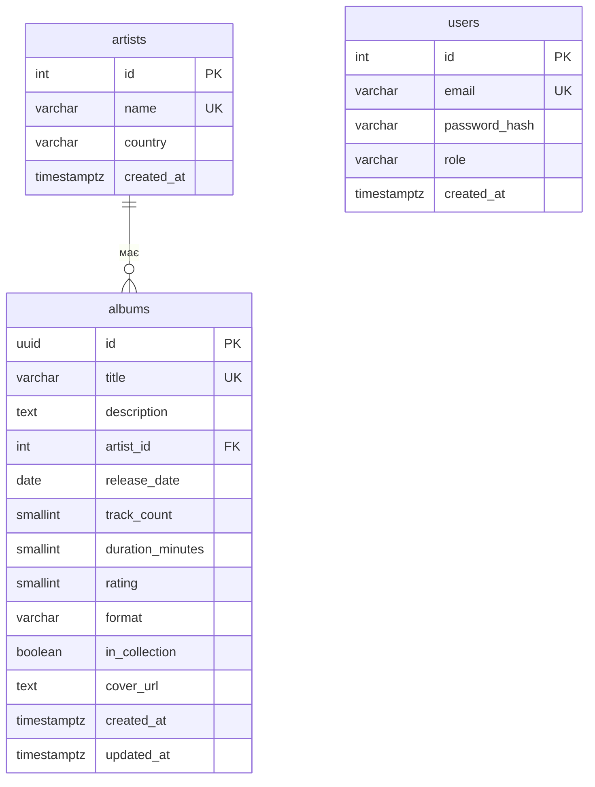

# Фонотека API — приклад Завдання №4

RESTful web service на **Node.js + Express 5 + PostgreSQL 18** для каталогу
музичних альбомів: шарова архітектура, валідація Zod, автентифікація JWT із
ролями USER/ADMIN, міграції, seed, документація OpenAPI.

> Навчальний приклад до курсу «Основи web програмування» (ЛНУ, ФПМІ).
> Покроковий опис створення — у файлі
> [`additiona-tutorials/02-assignment-4-5-step-by-step.md`](../../../additiona-tutorials/02-assignment-4-5-step-by-step.md).
> Тему «Музичні альбоми» для власного завдання брати не можна.

## Сутність «Альбом»

| Поле | Тип у БД | Обмеження | Тип за вимогами |
|---|---|---|---|
| `id` | `uuid` | PRIMARY KEY, `gen_random_uuid()` | ідентифікатор |
| `title` | `varchar(200)` | NOT NULL, UNIQUE (без урахування регістру) | унікальна назва |
| `description` | `text` | до 2000 символів | довгий текст |
| `artistId` → `artist_id` | `integer` | NOT NULL, FOREIGN KEY → `artists` (RESTRICT) | зв'язок із довідником |
| `releaseDate` → `release_date` | `date` | NOT NULL, ≥ 1900-01-01 | дата |
| `trackCount` → `track_count` | `smallint` | NOT NULL, CHECK 1–999 | число |
| `durationMinutes` → `duration_minutes` | `smallint` | CHECK 1–600 | число |
| `rating` | `smallint` | CHECK 1–5 | число |
| `format` | `varchar(10)` | CHECK IN (`vinyl`, `cd`, `cassette`, `digital`) | фіксований набір |
| `inCollection` → `in_collection` | `boolean` | NOT NULL, DEFAULT false | логічне |
| `coverUrl` → `cover_url` | `text` | формат URL (http/https) | посилання |
| `createdAt`, `updatedAt` | `timestamptz` | DEFAULT now(), тригер для `updated_at` | службові |

## Схема бази



Індекси: унікальні `lower(title)`, `lower(name)`, `lower(email)`; `albums(artist_id)`
(зовнішній ключ); `albums(release_date)`; GIN `pg_trgm` на `albums(title)` для пошуку `ILIKE '%…%'`.

## Ендпоїнти

Базова адреса — `http://localhost:3000/api/v1`. Документація: **`/api-docs`** (Swagger UI).

| Метод | Шлях | Доступ | Успіх | Помилки |
|---|---|---|---|---|
| GET | `/albums` | публічний | 200 (масив + `X-Total-Count`) | 400 |
| GET | `/albums/count` | публічний | 200 `{ total }` | 400 |
| GET | `/albums/:id` | публічний | 200 | 400, 404 |
| POST | `/albums` | токен | 201 + `Location` | 400, 401, 409 |
| PUT | `/albums/:id` | токен | 204 | 400, 401, 404, 409 |
| PATCH | `/albums/:id` | токен | 204 | 400, 401, 404, 409 |
| DELETE | `/albums/:id` | ADMIN | 204 | 401, 403, 404 |
| GET | `/artists` | публічний | 200 | — |
| POST | `/auth/sign-up` | публічний | 201 `{ user, token }` | 400, 409, 429 |
| POST | `/auth/sign-in` | публічний | 200 `{ user, token }` | 400, 401, 429 |
| POST | `/auth/refresh-token` | токен | 200 `{ user, token }` | 401 |
| GET | `/auth/me` | токен | 200 | 401 |
| GET | `/health` (без `/api/v1`) | публічний | 200 / 503 | — |

Відповіді `sign-up`, `sign-in` і `refresh-token` містять токен і в тілі, і в заголовку
`Authorization: Bearer <jwt>`.

**Query-параметри списку:** `search`, `artistId`, `format`, `inCollection`, `yearFrom`,
`yearTo`, `ratingMin` (фільтри); `sort` (`title`, `releaseDate`, `rating`, `trackCount`,
`createdAt`), `order` (`asc`, `desc`); `limit` (1–100, за замовчуванням 20), `offset` (≥ 0).

**Формат помилки:**

```json
{
  "status": 400,
  "message": "Помилка валідації",
  "errors": [{ "field": "title", "message": "Назва обов'язкова" }],
  "path": "/api/v1/albums",
  "timestamp": "2026-11-11T10:00:00.000Z"
}
```

## Запуск «з нуля»

Потрібні Node.js 22+ (рекомендовано 24 LTS) і Docker.

```bash
npm install
cp .env.example .env            # і впишіть JWT_SECRET (команда генерації — у файлі)
docker compose up -d --wait     # PostgreSQL 18 (--wait: дочекатися готовності)
npm run migrate:up              # схема бази
npm run seed                    # 60 альбомів, 12 виконавців, 2 користувачі
npm run dev                     # http://localhost:3000
```

**Тестові облікові записи** (лише для розробки):

| Роль | E-mail | Пароль |
|---|---|---|
| ADMIN | `admin@fonoteka.test` | `AdminPass123` |
| USER | `user@fonoteka.test` | `UserPass123` |

**Автоматичні тести.** Один раз створіть тестову базу, далі — `npm test`
(міграції тест застосовує сам, дані перед кожним тестом відновлює):

```bash
docker exec fonoteka-db createdb -U fonoteka fonoteka_test
npm test
```

Приклади всіх запитів, зокрема негативних (400, 401, 403, 404, 409), — у файлі
[`requests.http`](requests.http) (HTTP Client у WebStorm).

| Скрипт | Що робить |
|---|---|
| `npm run dev` | сервер з автоперезапуском |
| `npm start` | сервер для продакшену |
| `npm run migrate:up` / `migrate:down` | застосувати / відкотити міграцію |
| `npm run seed` | очистити таблиці й заповнити демо-даними (`SEED_ALBUMS=200 npm run seed` — більше) |
| `npm test` | інтеграційні тести (node:test + supertest) на окремій базі `fonoteka_test` |
| `npm run lint` | ESLint |
| `npm run format` / `format:check` | Prettier |

## Приклад запиту й відповіді

```http
GET /api/v1/albums?search=весна&limit=1
```

```json
[
  {
    "id": "1f9c5a1e-…",
    "title": "Гірська весна",
    "description": "Дебютний альбом гурту: трембіта, електрогітари й пісні, записані наживо в Яремчі.",
    "artist": { "id": 1, "name": "Карпатський вітер", "country": "Україна" },
    "releaseDate": "2014-04-18",
    "trackCount": 11,
    "durationMinutes": 47,
    "rating": 5,
    "format": "vinyl",
    "inCollection": true,
    "coverUrl": null,
    "createdAt": "2026-11-11T09:00:00.000Z",
    "updatedAt": "2026-11-11T09:00:00.000Z"
  }
]
```

## Чому лише параметризовані запити

Усі значення потрапляють у SQL лише як параметри `$1, $2, …`: драйвер надсилає текст
запиту й значення **окремо**, тому дані користувача фізично не можуть змінити структуру
запиту. Склеювання рядків (`` `WHERE title ILIKE '%${search}%'` ``) — це SQL-ін'єкція:
пошук `zzz' OR '%'='` повернув би всі записи, а звичайний апостроф у слові «пам'ять»
ламав би запит. Назви стовпців для сортування параметрами передати неможливо, тому вони
беруться з білого списку (`SORT_COLUMNS` у `albums.repository.js`).

## Використання ШІ

Приклад підготовлено викладачем за допомогою Claude (Anthropic): генерація коду, тексту
й тестових даних. Увесь код перевірено автоматичними сценаріями на PostgreSQL 18.